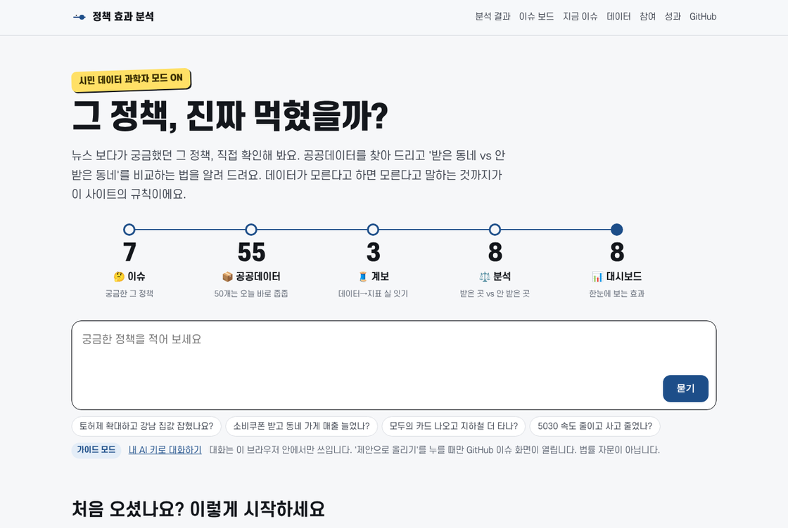
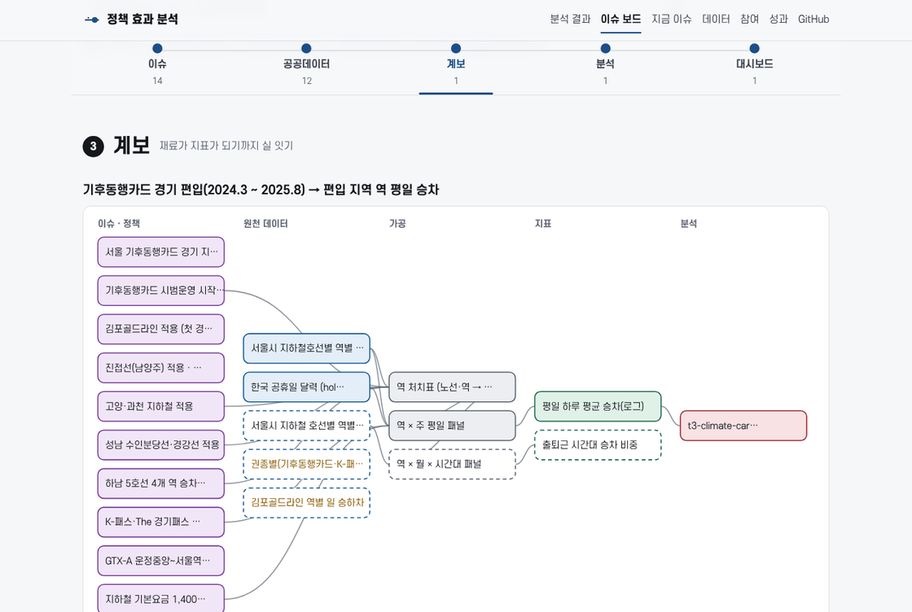

# 그 정책, 진짜 먹혔을까?

**뉴스 속 그 정책, 공공데이터로 직접 확인해 보는 시민 데이터 과학자 놀이터.**

정책을 받은 동네와 안 받은 동네를 공공데이터로 비교하고, 데이터가 모르면 "판단 불가"라고 정직하게 말합니다. 질문부터 데이터·계보·분석·대시보드까지 전부 오픈소스입니다.

[](https://causalinferencelab.github.io/policy-effect-analytics-agent/)
[](https://causalinferencelab.github.io/policy-effect-analytics-agent/results.html)
[](docs/ops/mentee-guide.md)
[](LICENSE)



> 가짜연구소 인과추론팀 × 오픈업 오픈소스 AI 특화형 트랙3 「에이전틱 AI × 데이터」(2026.9~11)에서 현업 개발자·분석가들이 함께 만들었습니다.
> **공식 평가가 아닙니다.** 학습·연구용 오픈소스 분석이며 정부·공공기관의 평가나 통계가 아닙니다.

---

## 30초 설명

| | |
|---|---|
| **무엇을** | "토허제 확대하고 집값 잡혔나?", "소비쿠폰 받고 동네 가게 매출 늘었나?" 같은 질문에 공공데이터로 답합니다 |
| **어떻게** | 이슈 → 공공데이터 → 계보 → 분석 → 대시보드. 정책을 받은 곳과 안 받은 '쌍둥이 동네'의 변화를 비교합니다 |
| **약속** | 데이터를 보기 전에 계획을 먼저 커밋하고(사전 등록), 판정은 세 가지(효과 근거 있음 · 크기를 판별하지 못함 · 판단 불가)로만 말합니다. 숫자가 어떻게 나왔는지 코드까지 공개합니다 |

## 이런 분께

| 나는 | 이렇게 시작하세요 |
|---|---|
| **궁금한 시민** | [사이트](https://causalinferencelab.github.io/policy-effect-analytics-agent/) 대화창에 정책 하나 물어보기. 주제·데이터·조심할 점을 같이 정리해 줍니다 |
| **기자 · 공무원 · 연구자** | [분석 결과](https://causalinferencelab.github.io/policy-effect-analytics-agent/results.html)에서 판정과 그대로 가져다 써도 되는 인용문, 쓴 데이터, CSV를 받기 |
| **분석가 · 개발자** | 아래 [5분 만에 돌려 보기](#5분-만에-돌려-보기) → [참여 가이드](docs/ops/mentee-guide.md). 공개 API(`api/*.json`)로 서비스를 만들어도 좋습니다 |

## 지금까지 만든 것

<!-- highlights:start -->
**주제 11개 · 지금 이슈 7개 · 공공데이터 55개 · 계보 4개 · 참여자 프로젝트 13개(결과 9개) · 함께 만든 사람 15명**

| 프로젝트 | 주제 | 누가 | 지금 | 보기 |
|---|---|---|---|---|
| 대형마트 의무휴업 평일 전환 전후 관측 매출의 탐색 비교 | 대형마트 의무휴업 | [@YoungjaeKang](https://github.com/YoungjaeKang) | 크기를 판별하지 못함 | [결과 보기](https://causalinferencelab.github.io/policy-effect-analytics-agent/answers/YoungjaeKang-retail-hours.html) |
| 마산·창원·진해 행정구역 통합(2010.7.1)이 통합 창원시의 인구·인구이동·재정자립도에 미친 효과 | 지방자치단체·공공기관 통폐합 | [@buildergarlic](https://github.com/buildergarlic) | 크기를 판별하지 못함 | [결과 보기](https://causalinferencelab.github.io/policy-effect-analytics-agent/answers/buildergarlic-changwon-integration.html) |
| 전남·광주 행정통합 영향분석(한국은행 2026.7)의 지표와 프레임으로 본 마산·창원·진해 통합(2010)의 성과 | 지방자치단체·공공기관 통폐합 | [@buildergarlic](https://github.com/buildergarlic) | 크기를 판별하지 못함 | [결과 보기](https://causalinferencelab.github.io/policy-effect-analytics-agent/answers/buildergarlic-changwon-jeonnam-frame.html) |
| 토지거래허가구역 지정(2020.6.23, 잠실·삼성·대치·청담) 뒤 옆 동네 아파트 ㎡당 가격(풍선효과) | 부동산 거래 규제 | [@Hyun2](https://github.com/Hyun2) | 크기를 판별하지 못함 | [결과 보기](https://causalinferencelab.github.io/policy-effect-analytics-agent/answers/hyun2-land-permit-spillover-2020.html) |
| 서울 25개 자치구 출산지원금 변경과 출생등록 변화 비교 | 출산·혼인 지원 | [@ingyeoking13](https://github.com/ingyeoking13) | 판단 불가 | [결과 보기](https://causalinferencelab.github.io/policy-effect-analytics-agent/answers/ingyeoking13-seoul-birth-support.html) |
| 고령운전자 면허 자진반납 인센티브와 초기 교통안전 성과 | 교통안전 | [@inshining](https://github.com/inshining) | 관측 통계 | [결과 보기](https://causalinferencelab.github.io/policy-effect-analytics-agent/answers/inshining-elderly-driver.html) |
| 대구시 대형마트 의무휴업일 평일 전환과 지역 소매업 판매 | 대형마트 의무휴업 | [@jgkim1008](https://github.com/jgkim1008) | 판단 불가 | [결과 보기](https://causalinferencelab.github.io/policy-effect-analytics-agent/answers/jgkim1008-daegu-mart-holiday.html) |
| 원주시 모바일 상품권 할인 상향 한 달(2024년 9월)의 결제 변화 | 지역화폐 (지역사랑상품권) | [@whatfontisthis](https://github.com/whatfontisthis) | 크기를 판별하지 못함 | [결과 보기](https://causalinferencelab.github.io/policy-effect-analytics-agent/answers/whatfontisthis-wonju-voucher-202409.html) |
| 녹색교통지역 5등급 운행제한이 서울 도심 대기질에 미친 효과 | 대기질 | [@yesolee](https://github.com/yesolee) | 크기를 판별하지 못함 | [결과 보기](https://causalinferencelab.github.io/policy-effect-analytics-agent/answers/yesolee-green-traffic.html) |
| 강남대로 광역버스 분산 전후 일반도로 속도 변화 | 도로교통 운영 | [@sgim49697-ops](https://github.com/sgim49697-ops) | 해석 단계 | [폴더](https://github.com/CausalInferenceLab/policy-effect-analytics-agent/tree/main/cases/sgim49697-ops-gangnam-bus-2024) |
| 서울 기후동행카드 시범사업 전후 지하철 승차 흐름 비교 | 대중교통 요금 지원 | [@jm-git-163](https://github.com/jm-git-163) | 수집 단계 | [폴더](https://github.com/CausalInferenceLab/policy-effect-analytics-agent/tree/main/cases/jm-git-163-climate-card) |
| 행정안전부 'AI 친화적 보고서' 도입(2026.3 시범)이 보도자료 형식·기계 판독·언론 확산에 미친 효과 | 디지털포용·무인정보단말기 접근성 | [@gyeom-yee](https://github.com/gyeom-yee) | 계획 단계 | [폴더](https://github.com/CausalInferenceLab/policy-effect-analytics-agent/tree/main/cases/gyeom-yee-public-markdown) |
| 지하철 승강장 발빠짐 안전 관리 및 Edge-AI 실시간 제어 효과 분석 (Aegis-Rail) | 교통안전 | [@heart5459oo-ctrl](https://github.com/heart5459oo-ctrl) | 계획 단계 | [폴더](https://github.com/CausalInferenceLab/policy-effect-analytics-agent/tree/main/cases/heart5459oo-subway-safety) |
| 기후동행카드 성남 편입(2025.5.3)이 성남 분당선·경강선 역 평일 승차에 미친 효과 | 대중교통 요금 지원 | 멘토 예시 | 판단 불가 | [결과 보기](https://causalinferencelab.github.io/policy-effect-analytics-agent/answers/t3-climate-card-seongnam.html) |
| 토지거래허가구역 확대 지정(2025.3.24)이 강남·서초·송파·용산 아파트 거래에 미친 효과 | 부동산 거래 규제 | 멘토 예시 | 크기를 판별하지 못함 | [결과 보기](https://causalinferencelab.github.io/policy-effect-analytics-agent/answers/t3-land-permit-2025.html) |
<!-- highlights:end -->

표는 `python scripts/readme_highlights.py`가 레포 파일에서 다시 만듭니다. 사이트에서는 [참여](https://causalinferencelab.github.io/policy-effect-analytics-agent/projects.html) 화면이 같은 목록을 그림과 함께 보여 줍니다.

## 어떻게 동작하나



```
🤔 이슈        📦 공공데이터        🧵 계보              ⚖️ 분석                 📊 대시보드
지금 논쟁 중인  오늘 바로 받을 수    데이터가 지표가       받은 동네 vs 안 받은    시점별 효과 그림과
정책과 시행일   있는 재료 (catalog/) 되는 길 (lineage/)   동네 (cases/, make flow) 판정 (사이트·API)
```

- **주제마다 이슈 보드**가 있고, 다섯 단계 중 어디까지 채워졌는지 [홈](https://causalinferencelab.github.io/policy-effect-analytics-agent/#topics)에서 한눈에 보입니다. 빈칸이 곧 기여할 곳입니다.
- **판정은 규칙이 정합니다.** 사전추세가 깨지면, 비교 단위가 너무 적으면, 범위가 0을 포함하면 판정을 낮춥니다. LLM은 질문을 정리하고 계획 초안을 돕지만 숫자를 만들지 않습니다.
- **'모르겠다'도 쓸모 있게.** 효과를 판별하지 못해도 "이보다 큰 효과는 데이터와 맞지 않는다"(배제 범위)는 말할 수 있어, 결과마다 붙여 둡니다.
- 사이트는 매일 레포에서 다시 만들어지고, 쓰임은 [성과](https://causalinferencelab.github.io/policy-effect-analytics-agent/impact.html) 화면이 셉니다(북극성: 주간 가져간 답).

## 5분 만에 돌려 보기

```bash
git clone https://github.com/CausalInferenceLab/policy-effect-analytics-agent.git
cd policy-effect-analytics-agent
python -m venv .venv && source .venv/bin/activate   # Windows: .venv\Scripts\activate
pip install -e ".[dev]"                               # Python 3.11 이상

make demo      # 예시 분석을 연습용 폴더(_demo/)에서 6단계로 실행 (레포 파일은 그대로)
make site      # 사이트를 http://localhost:8000 에서 보기
```

API 키 없이 돌아갑니다. 실제 데이터를 받을 때만 `.env.example`을 `.env`로 복사해 키를 넣으세요(커밋되지 않음).

## 참여하기

| 트랙 | 이런 분께 | 내 작업 공간 |
|---|---|---|
| **A. 데이터 계보** | 공공데이터를 찾아 이슈와 지표를 잇고 싶다 | `catalog/lineage/<내ID>-<주제>.yaml` |
| **B. 가설과 분석** | 실제 정책으로 효과 추정을 해 보고 싶다 | `cases/<내ID>-<주제>/` |
| **C. 서비스 개발** | 공개 API로 서비스를 만들고 싶다 | `apps/<내ID>-<서비스>/` |

시작은 [작업 제안 이슈](https://github.com/CausalInferenceLab/policy-effect-analytics-agent/issues/new?template=case-proposal.yml) 하나입니다. 규칙은 세 가지: 브랜치는 `<내ID>/<작업>`, 수정은 내 폴더만, 합치기는 리뷰 1명과 자동 검사 통과 뒤.
자세히: [참여 가이드](docs/ops/mentee-guide.md) · [GitHub가 처음이라면](docs/ops/github-onboarding.md) · [CONTRIBUTING](CONTRIBUTING.md) · [점검과 계획](docs/ops/roadmap.md) · [지표 정의](docs/ops/metrics.md)

<details>
<summary><b>폴더 안내</b></summary>

| 폴더 | 하는 일 | 누가 고치나 |
|---|---|---|
| [`cases/`](cases/) | 분석 폴더 (`<내ID>-<주제>`, `_template`에서 시작) | 폴더 주인 |
| [`catalog/`](catalog/) | 주제 · 이슈 · 데이터셋 · 계보(`lineage/`) · 참여자 명단 | 누구나 (PR) |
| [`apps/`](apps/) | 서비스. 합쳐지면 사이트 `/apps/<이름>/`에서 열림 | 폴더 주인 |
| [`site/`](site/) | 공개 사이트 · 대화창 · 공개 API | 메인테이너 |
| [`core/`](core/) | 주제 찾기 · 수집기 · 추정(이중차분, 무작위화 추론) · 6단계 실행 · 리포트 | 메인테이너 |
| [`scripts/`](scripts/) | 법령·순위·지표 갱신, README 표 갱신 | 메인테이너 |
| [`docs/`](docs/) | 참여 가이드, 계획 작성법, 운영 문서 | 운영진 |

</details>

<details>
<summary><b>데이터는 어디서 오나</b></summary>

| 무엇 | 어디서 |
|---|---|
| 정책이 언제, 누구에게 (법령·행정규칙·조례) | 법제처 국가법령정보 공동활용 API (메타데이터만 스냅샷) |
| 정책 발표 (지자체 공고, 행정지도) | 정부 보도자료 등, 출처와 함께 `catalog/topics.yaml`에 기록 |
| 무엇이 달라졌나 · 다른 요인 | 공공데이터포털, KOSIS, 서울 열린데이터광장 등 — [데이터 지도](https://causalinferencelab.github.io/policy-effect-analytics-agent/data.html) |

원자료는 레포에 올리지 않고 케이스마다 `fetch.py`로 각자 받습니다. 데이터마다 이용 조건이 다르며 데이터 지도와 각 케이스의 `plan.yaml`에 적습니다.

</details>

<details>
<summary><b>관련 프로젝트</b></summary>

| 프로젝트 | 관계 |
|---|---|
| [CAIS](https://github.com/causalNLP/causal-agent), [Causal-Copilot](https://github.com/Lancelot39/Causal-Copilot) | 범용 LLM 인과 분석 에이전트. 우리는 한국 공공데이터·정책 시작일·사전 등록에 집중 |
| [korean-law-mcp](https://github.com/chrisryugj/korean-law-mcp) | 법제처 API를 MCP로. 우리는 재현용 스냅샷·변경 감지에 집중 |
| [PublicDataReader](https://github.com/WooilJeong/PublicDataReader), [kpubdata](https://github.com/yeongseon/kpubdata) | 공공데이터 수집 라이브러리. 수집 층을 보완 |
| [PolicyEngine](https://github.com/PolicyEngine/policyengine-core), [OpenFisca](https://github.com/openfisca/openfisca-core) | 제도 사전 시뮬레이션(AGPL). 목적이 달라 코드를 가져오지 않음 |

</details>

## 라이선스

코드는 [MIT](LICENSE). GPL·AGPL 패키지는 필수 의존성으로 넣지 않고 CI가 확인합니다. 사이트 글꼴은 에스코어 드림(무료 글꼴)입니다. 법률 자문이 아닙니다.

---

**English.** *Did that policy actually work?* An open-source playground for citizen data scientists that checks Korean public policies in the news against public data. Each topic has an issue board — issue → public data → lineage → analysis → dashboard — and every result comes with a plain-language verdict (evidence of effect / size undetermined / cannot be judged), a quotable sentence, the data used, and code to reproduce it. Analysis plans are committed before estimation, verdicts are set by rules rather than by an LLM, and "cannot be judged" is a legitimate answer. Built by working developers and analysts in the Pseudo Lab causal inference team. Not an official government evaluation.
