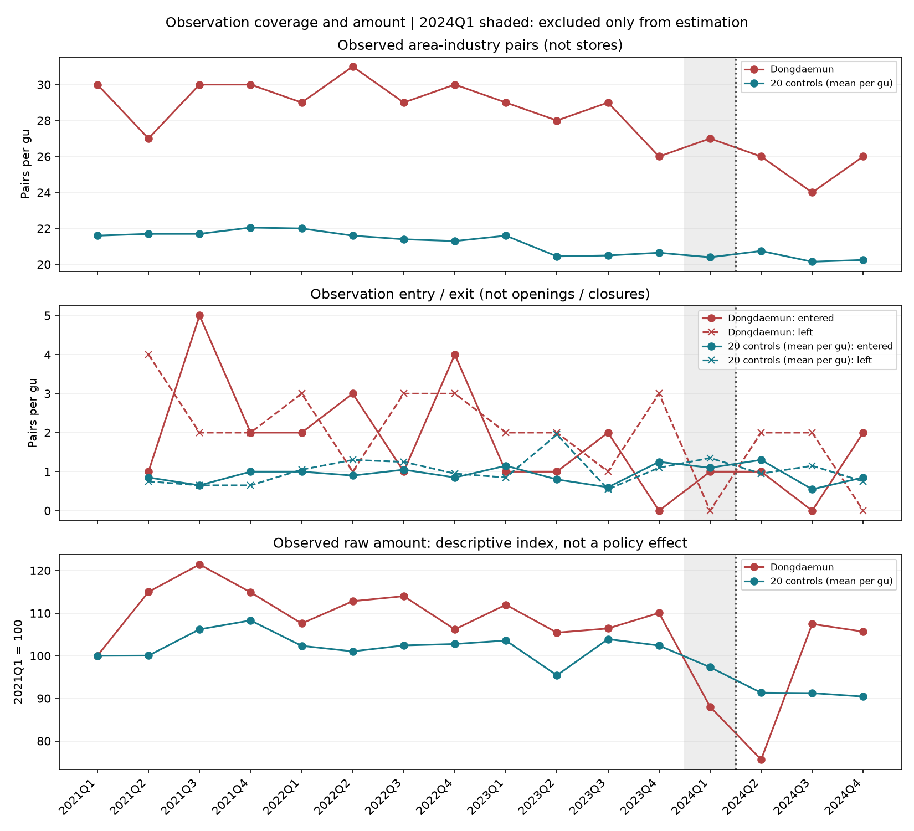
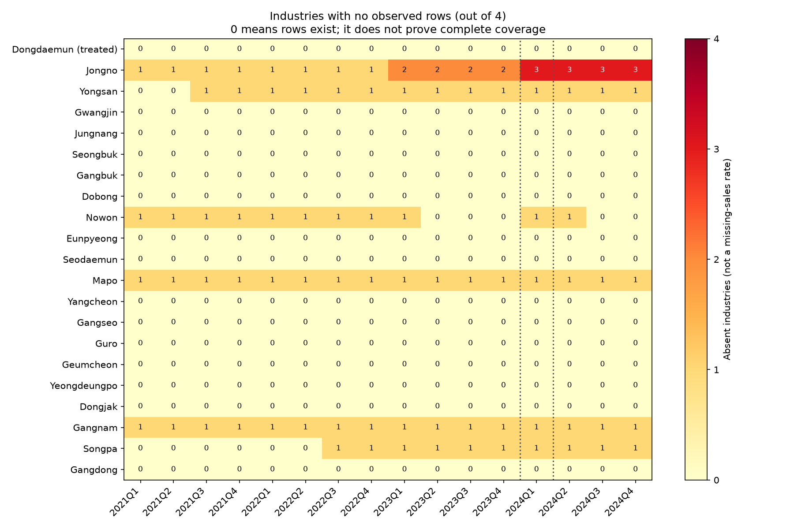

# 관측 매출 탐색 분석의 해석과 한계

## 결과를 한 문장으로

관측 매출의 사후 평균 비교계수는 0.012394 로그포인트(p=0.955)로 방향과 크기가 불확실하며, **전체 골목상권 매출에 대한 정책 인과효과는 판단 불가**다. 자동 판정 ‘크기를 판별하지 못함’(conditional)과 사전추세 ‘통과’는 계산 규칙의 결과이며, 측정의 완전성이나 평행추세 성립을 보증하지 않는다.

## 계획에서 바뀐 것

최초 계획과 비교군 명단은 매출 원자료 열람 전에 등록했다. 원자료 취득 후 고정21구×16분기×4업종 중95개 조합에서 매출 행이 없고, 공간 적용 버전과 행 생략 규칙을 확인하지 못했다. 전체 매출을 구성할 근거가 없어 원래 지표의 추정을 중단했다.

관측 공백 진단을 검토한 뒤 결과 지표를 공개 파일에 관측된 상권·업종 행의 원본 금액 합계 로그로 변경했다. 이는 원자료 열람 후 결정한 탐색 분석이며 최초 사전등록 지표의 검증 결과로 주장하지 않는다. 변경 계획은 이 지표의 모형 추정 전에 로컬 커밋 `05d64e1`로 기록했다. 특성자료 구현과 탐색 분석은 통합 PR #37로 2026-10-24 병합됐다. main의 squash 커밋에는 계획 변경과 결과가 함께 포함되므로 사이트의 자동 사전등록 표시는 이들을 같은 커밋으로 센다. 추정 전 변경 기록은 원래 브랜치의 `05d64e1`에 남아 있으며, 원자료 열람 후 지표를 바꾼 사실은 그대로 유지한다. 이번 보고서 보강은 추정 설정·지표·표본을 바꾸지 않는다.

처치 동대문구·비교20구, 4업종, 2021Q1~2024Q4, 2024Q1 추정 제외, 기준2023Q3, 이벤트스터디·가짜시행2023Q1 설정은 유지한다. 관측 여부나 효과 크기에 따라 구·업종을 제외하지 않는다. 전 기간 관측된 조합만 남기는 표본 선택도 하지 않는다.

## 측정과 해석 제한

- 관측 행만 합산하며 관측되지 않은 업종 금액은 미관측으로 보존한다. 이것은 미관측 금액이0이라는 가정이 아니라 결과 지표 자체를 관측 부분으로 한정한 것이다. 구×분기 전체가 미관측이거나 합계가0이하면 로그 추정을 중단한다.
- 매출 변화에 관측 집합의 진입·이탈, 비공개·누락, 공간 기준 변화가 섞일 수 있다. 동대문의 관측 상권·업종 조합은 분기마다24~31개로 바뀐다. 관측 진입·이탈은 개업·폐업과 같지 않다.
- 2023 영역 ZIP의 코드→자치구 연결은 가능하지만 모든 연도의 경계 호환성이 입증된 것은 아니다. 해당 연결을 탐색 집계에 사용한 가정으로 명시한다.
- 금액은 당월_매출_금액 원본을 그대로 사용한다. 월평균 해석의 공식 설명과2024년 한 관광특구 대조 근거가 있으나 전 기간을 분기총액으로 환산하지 않았다. 모든 관측에 같은 상수3을 곱해도 로그 모형 계수는 같지만, 이 성질은 시기별 정의 변경을 해결하지 않는다.
- 네 업종에 도매업이 혼재하고 슈퍼마켓은 제외돼 순수 소매업·마트 매출을 뜻하지 않는다.
- 비교구 정책 이력·점포 예외, 동시 지원사업, 지역 간 소비 이동과 단일 처치지역의 한계가 남는다. 무작위화 추론의 지역 교환가능성도 보장되지 않는다.

**계산 결과는 관측 지표의 비교 변화다. 전체 골목상권 매출에 대한 정책의 인과효과는 판단 불가로 유지한다.** 공통 자동 판정이 조건부이더라도 이 수동 해석 제한을 해소하지 않는다. 유의하지 않으면 효과가 없다는 뜻도 아니다. 프로젝트는 학습·연구용이며 정부의 공식 평가가 아니다.

## 실제 탐색 계산 결과

2021Q1~2024Q4 전체336행, 전환기2024Q1을 제외한315행(21구×15분기)으로 실행했다. 사전12분기·사후3분기, 기준2023Q3과 사전 고정 명단을 유지했다. 공통 품질검사11개를 통과했다.

| 항목 | 결과 |
|---|---:|
| 사후3분기 평균 비교계수 | 0.012394 로그포인트 |
| 무작위화 추론95% 구간 | [-1.338675, 1.235660] |
| 무작위화 추론 p값 | 0.955 |
| 무작위화 사전계수 제곱합 검정 p값 | 1.000 |
| 가짜 시행일2023Q1 비교계수 | 0.058691 로그포인트 |
| 가짜 시행일 p값 | 0.718 |

공통 구현은 처치지역1개 때문에999회 무작위 재배정(seed0)을 사용했다. 재배정 횟수가 늘어도 실제 처치 구를 제외한 서로 다른 재배정 후보는20개이며 관측 단위의 정보가 늘지는 않는다. 자동 판정은 소수 처치·0을 포함하는 구간 때문에 조건부다. 관측 지표에서도 증가나 감소를 뚜렷하게 판별할 근거를 얻지 못했으며, 전체 매출에 대한 인과효과는 앞서 적은 측정·정책 한계 때문에 판단 불가다.

사전추세의 일반 군집 Wald 검정(CRV1)은 p≈1.18×10⁻¹⁴로 기각하는 반면, 소수 처치용 무작위화 검정은 p=1.000이다. 공통 설정에 따라 후자를 주 검사로 사용했지만 두 결과가 다르다는 사실을 숨기지 않는다. 단일 처치에서 군집 근사가 불안정하고 재배정의 교환가능성도 입증되지 않았으므로, 어느 한 p값을 근거로 평행추세가 성립한다고 선언하지 않는다.

분기별 계수는2024Q2 -0.194275, Q3 0.122421, Q4 0.109037이다. 공통 그림의 분기별 구간은 군집 근사에 따른 참고 구간이며 주 결과의 무작위화 구간과 다르다. 특정 분기만 골라 유의한 정책 효과로 보고하지 않는다. 효과의 부호에 따라 지표·기간·비교군을 다시 고르지 않았다.

## 관측 범위와 매출 변화 함께 읽기

위 그림은 전체 16분기를 사용한 기술통계다. 회색 구간은 추정에서 제외한 2024Q1이며, 점선 뒤 2024Q2부터 사후 기간이다. 동대문과 비교 20개 구의 **구별 산술평균**을 각각 표시한다. 상단은 관측 상권×업종 조합 수, 중단은 직전 분기 대비 관측 진입·이탈이다. 첫 분기는 직전 관측이 없어 진입·이탈을 표시하지 않는다. 같은 상권의 여러 업종은 별도 조합으로 세며 고유 상권 수·점포 수와 다르다. 진입·이탈도 개업·폐업을 뜻하지 않는다.

하단은 각 집단의 관측 원본 금액 평균을 각자의 2021Q1=100으로 환산했다. 두 집단의 절대 매출 규모가 같다는 뜻이 아니며, 로그 매출의 평균이나 회귀 계수가 아니다. 원본 금액에 기간 환산을 적용하지 않았다. 그림의 선 간 차이를 정책효과로 해석하지 않는다.

동대문의 관측 조합은 분기별 24~31개이며, 2024Q1~Q4에는 27→26→24→26개다. 고정한 21개 구 전체에서도 2021Q1 462개에서 2024Q4 431개로 변했다. 매출 선과 관측 수를 함께 보여주는 이유는 동일 점포 모집단의 변화라고 단정하지 않기 위해서다. 이 그림으로 매출 변화 중 구성 변화의 기여분을 분해한 것은 아니다.

위 표형 그림은 네 업종 중 관측 행이 전혀 없는 업종 수다. 0은 네 업종 모두 적어도 하나의 관측 행이 있다는 뜻이며, 전체 상권·점포의 매출이 빠짐없이 관측됐다는 뜻이 아니다. 색은 미관측 매출의 비율이나 금액을 나타내지 않는다. 영문 구명 중 Dongdaemun이 처치지역이며 나머지는 고정 비교구다.

전체 21구×16분기×4업종 1,344개 조합 중 95개에 행이 없고, 추정 기간 1,260개 조합에서는 87개다. 이는 구×분기×업종 단위의 행 부재 수이며, 개별 상권의 모든 누락을 세거나 실제 영업 모집단의 결측률을 계산한 값은 아니다. 진단은 미관측 금액을 빈칸으로 보존한다.

두 그림은 `visualize.py`가 원본 해시 검사·관측 패널 재생성 후 만든다. `visualization_manifest.json`에 입력 진단·계획·패널·코드·그림 해시를 기록한다. 원자료와 진단 CSV는 저장소에 재배포하지 않는다.

## 한계에 따른 향후 방향과 제언

관측 매출의 변화에는 정책과 무관한 관측 집합의 진입·이탈이 섞일 수 있다. 이번 보고서에서는 매출 추세와 관측 조합 수·진입·이탈을 함께 시각화했다. 이 기술통계는 누락 원인을 확인하거나 편향을 교정한 결과가 아니다. 공간 버전과 행 생략 규칙은 공개 근거로 계속 확인하며, 관측이 없다는 이유만으로 0을 대입하거나 지역을 제외하지 않는다.

비교구 정책 이력, 동시 지원사업의 실제 집행 시점·대상, 인접 지역으로의 소비 이동은 미해결이다. 인접 구 제외나 추가 전환지역·사후 기간 확대는 별도 후속 계획과 변경 이력을 마련한 뒤 수행한다. 사전추세 검정의 불일치와 재배정 후보별 민감도도 후속 점검 대상으로 남긴다. 이 작업들은 현재 완료된 분석이 아니다.

이번 결과만으로 휴업일 전환의 확대·폐지나 효과 부재를 권고할 수 없다. 평가에 필요한 개선은 연도별 공간 코드 대응, 행 생략·비공개 기준, 점포별 휴업일 이력과 지원사업 집행 정보의 공개다. 이런 정보가 확보되면 동일한 관측 범위와 정책 노출을 검증하는 후속 평가가 가능해진다.

| 남은 한계 | 현재 결론에 미치는 영향 | 향후 확인·분석 |
|---|---|---|
| 행 생략 규칙·관측 구성 변화 | 전체매출·동일 점포의 변화로 일반화 불가 | 비공개·생략 기준과 관측 모집단 확인 |
| 연도별 공간 버전 미확인 | 경계 변화와 실제 매출 변화가 섞일 수 있음 | 코드·경계 대응 근거 확보 후 공통 범위 집계 검토 |
| 비교구 정책 예외·동시 지원사업 | 휴업 요일 변경만의 효과 분리 불가 | 점포별 휴업 이력 및 사업 집행 시점·대상 보강 |
| 소비 이동·처치지역 1개 | 지역 간 파급과 동대문 고유 충격 구분 어려움 | 별도 계획 후 인접 구 제외·추가 지역 분석 검토 |
| 사후 3분기·사전검정 불일치 | 장기 효과·평행추세 확보 주장 불가 | 자료 연속성 확인 후 기간 연장, 재배정 민감도 점검 |

위 후속 분석은 아직 실행하지 않았다. 유의한 결과를 찾기 위한 표본·방법 변경은 하지 않으며, 변경 시 결과 열람 후의 추가 분석임을 기록한다. 재현 확인은 현재 작성자 환경에서 수행했고 다른 참여자의 독립 재현은 남아 있다.
