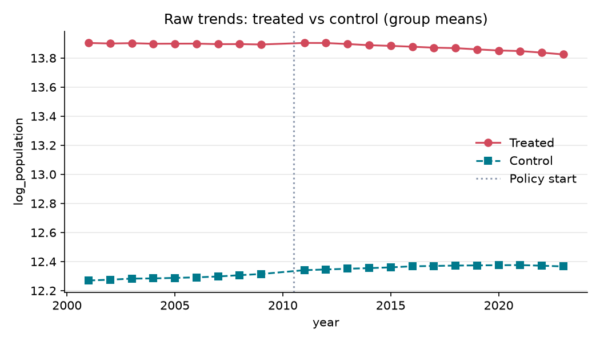
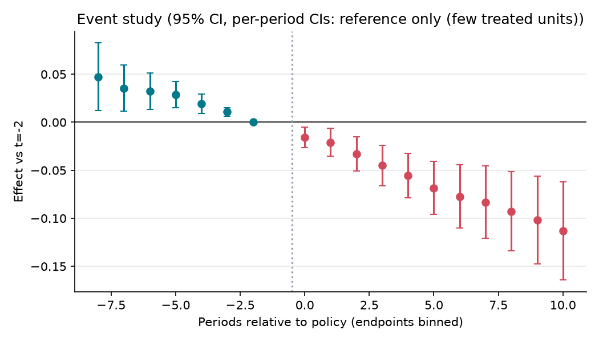

# 마산·창원·진해 행정구역 통합(2010.7.1)이 통합 창원시의 인구·인구이동·재정자립도에 미친 효과

**분석 질문**: 2010년 7월 1일 마산시·창원시·진해시가 통합 창원시로 합쳐진 뒤, 같은 기간 행정구역이 바뀌지 않은 전국의 다른 기초 시들과 비교해, (통합 전 3개 시를 합산해 같은 경계로 맞춘) 창원의 주민등록인구·순이동률· 재정자립도가 달라졌는가?

**종합 판정**: ⚠️ 조건부

**요약(조건부)**: 추정치는 -0.06 log 명 (95% CI -0.30 ~ 0.18) 이지만 다음 위험 신호가 있어 조건부로만 보고합니다: 처치 단위 수 부족(무작위화 추론 사용), 신뢰구간이 0을 포함. 신뢰구간이 0을 포함하므로 효과의 방향과 크기는 판별 불가입니다. 결론 전에 보완 분석이 필요합니다.

## 1. 설계

- 분석 단위: 기초 시(통합 경계 재구성) (`region_id`), 기간 2001–2023 (year)
- 처치: 「경상남도 창원시 설치 및 지원특례에 관한 법률」(법률 제10052호, 2010.3.12 공포)에 따라 2010.7.1 출범한 통합 창원시. 통합 전(≤2009)은 마산·창원·진해 3개 시 값을 합산해 같은 경계로 맞춤. 2010년은 반년만 통합된 전환연도라 제외하고 2011년을 첫 사후연도로 둠(주민여론조사 2009.11, 국회 통과 2010.3).

- 통제: 2001~2023년 사이 행정구역 통합·분리·승격이 없었던 전국 기초 시 62곳(fetch.py 의 DONOR_CITIES). 통합·경계변경이 있었던 청주·공주·논산·계룡·제주·서귀포·화성·광주·양주·포천·당진·여주·울산·세종과 창원에 접한 김해·밀양은 제외.
 — 같은 전국 경기·인구정책·지방재정제도 변화를 받는 기초 시 집단이라 '통합이 없었다면'의 추세를 대리한다. 처치 단위가 하나라 군집-강건 표준오차 대신 무작위화 추론(비교 시 하나를 차례로 가짜 창원으로 두는 placebo-in-space)으로 p값·신뢰구간을 내고, 합성통제(synth.py)로 같은 패널을 다시 본다.

- 주 결과변수: 주민등록인구(로그) — log(연말 주민등록 총인구수). 통합 전은 3개 시 인구 합계의 로그
- 추정 방법: `event_study` (cluster: `region_id`)

## 2. 결과

| 방법 | 결과변수 | 추정치 | 95% CI | p | N | 클러스터 | 판정 |
|---|---|---:|---|---:|---:|---:|---|
| event_study | log_population | -0.064 | [-0.301, 0.181] | 0.478 | 1386 | 63 | ⚠️ 조건부 |
| event_study | net_migration_rate | 2.099 | [-35.357, 38.408] | 0.827 | 1386 | 63 | ⚠️ 조건부 |
| event_study | fiscal_independence | -1.353 | [-12.960, 9.849] | 0.836 | 1386 | 63 | ⚠️ 조건부 |

## 3. 가정 점검 및 반박 검정

| 가정 | 점검 방법 | 결과 |
|---|---|---|
| 평행추세 | pretrend_test | randomization inference (사전 계수 제곱합) p=0.728 → 통과 |
| 선반영 없음 | placebo_time | 가짜 도입(2008) 추정 -0.032, p=0.724 → 통과 |
| 파급효과 없음(SUTVA) | manual | 수동 검토 필요 |
| 동시 정책 없음 | manual | 수동 검토 필요 |

## 4. 경고 및 보류 조건

- 신뢰구간이 0을 포함합니다. '효과 없음'이 아니라 '효과 크기를 판별할 수 없음'으로 해석하세요.
- 처치 단위가 1개뿐이라 군집-강건 표준오차를 믿을 수 없습니다. 무작위화 추론(처치 단위를 무작위로 바꿔 반복)으로 p값과 신뢰구간을 계산했습니다.

## 5. 데이터 출처

| 이름 | 제공 | 라이선스 | URL |
|---|---|---|---|
| 행정구역(시군구)별 성별 인구수 — 주민등록인구현황 (KOSIS DT_1B040A3) | 행정안전부 · KOSIS 국가통계포털 | KOGL-1 | https://kosis.kr/statHtml/statHtml.do?orgId=101&tblId=DT_1B040A3 |
| 시군구별 이동자수 — 국내인구이동통계 (KOSIS DT_1B26001_A01) | 통계청 · KOSIS 국가통계포털 | KOGL-1 | https://kosis.kr/statHtml/statHtml.do?orgId=101&tblId=DT_1B26001_A01 |
| 재정자립도(시도/시/군/구) — e-지방지표 (KOSIS DT_1YL20921) | 행정안전부 · KOSIS e-지방지표 | KOGL-1 | https://kosis.kr/statHtml/statHtml.do?orgId=101&tblId=DT_1YL20921 |

---

# 해석과 한계

> 이 파일은 **내가 쓰는 부분**입니다. `make flow` 가 `report.md` 를 새로 만들고 이 내용을 그 끝에 붙입니다.

## 결과를 한 문장으로

_(KOSIS 키로 실데이터를 실행한 뒤 기입)_ 판정은 자동 보류 규칙을 따릅니다. 처치 단위가 하나라 어떤 결과가 나와도
'효과 근거 있음'이 아닌 **조건부** 이상으로 올라가지 않으며, 사전추세 검정이 기각되면 **판단 불가**입니다.
"신뢰구간이 0을 포함"은 효과 없음이 아니라 판별 불가로 읽습니다. 합성통제(`synth_report.md`)의 RMSPE 비율 순위
p값이 작아도 비교 시 수(62)에 묶인 값이므로 같은 기준으로 읽습니다.

## 조심할 점

- **경계 재구성의 근사**: 인구·전입·전출은 합계라 정확하지만, 재정자립도는 비율이라 통합 전 3개 시의 값을
  인구로 가중 평균했습니다. 옛 창원시는 재정자립도가 높고 예산 규모도 커서 예산 가중 평균과 차이가 날 수 있습니다.
  일반회계 세입 규모를 같은 표에서 받을 수 있으면 예산 가중으로 바꿔야 합니다.
- **재정자립도의 두 계열**: KOSIS 는 2014년 세입과목 개편 전·후 정의를 따로 싣습니다(개편전 2001~2023, 개편후 2014~).
  이 분석은 한 정의로 이어지는 '개편전' 계열을 씁니다. 개편후 계열로 바꾸면 2014년 이전이 없어 사전 구간을 잃습니다.
- **통합 패키지**: 통합 창원시는 보통교부세 특례 등 통합 인센티브를 받았습니다. 이 분석의 '통합 효과'는 행정구역
  통합과 그에 딸린 지원을 합친 효과이며, 둘을 나누지 않습니다.
- **선반영**: 2009년 통합 논의와 주민여론조사 뒤 인구 이동이 미리 반응했다면 2009년 기준점이 오염됩니다.
  가짜 시점(2008) 검정과 사전 계수 그림으로 확인합니다.
- **파급(SUTVA)**: 창원과 접한 김해·밀양은 뺐지만, 더 먼 시로의 파급은 작다고 가정합니다. 부산·대구 같은
  광역시는 기초 시가 아니라 대조군에 넣지 않았습니다.
- **같은 시기의 다른 충격**: 2008~09 금융위기(전국 공통), 조선업 침체(2015~, 거제·통영·창원 진해구에 집중),
  2020~ 코로나는 연도 고정효과로 공통 부분만 지워집니다. 조선업 충격은 창원에만 있는 것이 아니라 대조군의
  거제·통영에도 있어 방향이 애매하므로, `synth.py` 의 leave-one-out 범위로 민감도를 봅니다.
- **2022년 특례시 출범**(창원 등 4곳)은 통합과 별개의 사건이라 2022~23 계수는 따로 읽습니다.
- **처치 단위 1개**: 무작위화 추론의 p값은 (1 + 더 극단적인 가짜 창원 수) ÷ (비교 시 수 + 1) 이라 아무리 작아도
  1/63 ≈ 0.016 아래로 내려가지 않습니다. 합성통제도 같은 한계를 가집니다.
- **지표가 '성과'의 전부가 아님**: 통합 목표였던 주민 서비스 접근성, 구 3개 시 사이의 지역 격차(마산·진해의
  상대적 박탈감)는 이 패널로 잴 수 없습니다. 구 단위 자료(행정동·구별 인구·사업체)로 별도 케이스가 필요합니다.

## 계획에서 바뀐 것

- 초안(PR #28, 자료가능성 검토)은 '주민 1인당 행정운영경비(지방재정365 결산)'를 주 지표로 잡았지만, 그 표는
  API 와 1998년 이전 시계열이 없어 `fetch.py → make flow` 로 재현할 수 없었습니다. 그래서 **결과를 보기 전에**
  KOSIS OpenAPI 로 받을 수 있는 세 지표(주민등록인구·순이동률·재정자립도)로 바꿨고, 초안이 요구한
  '3개 시 합산 → 동일 경계', '2010 전환연도 제외', '2011 첫 사후연도', '단일 처치 단위에는 SCM 류 보완'은
  그대로 지켰습니다. 행정운영경비는 결산 원표를 확보하면 같은 틀에 지표를 추가해 별도 PR 로 다룹니다.
- 실데이터 첫 수집(2026-10-22, 추정 산출 전)에서 재정자립도 표가 2001년부터인 것을 확인해 시작연도를 1998 → 2001 로
  당겼습니다. 세 지표의 공통 기간이 2001~2009(사전 9년)·2011~2023(사후 13년)이 됩니다. 같은 수집에서 KOSIS 가 폐지된
  시군구 코드의 폐지 후 연도를 0 으로 채우는 것과 광주·전남 시의 코드가 7자리인 것을 발견해 `fetch.py` 의 정리 규칙
  (0 은 결측, 5·7자리 코드 허용, 같은 시·연도 중복 시 중단)을 고쳤습니다. 지표·대조군·추정 방법은 그대로입니다.
- 실데이터를 본 뒤 계획을 바꾸면 여기와 커밋 메시지에 이유를 남깁니다.
