# 스코어카드 — 전남·광주 보고서의 기준으로 본 창원 통합(2010)

> 실행 2026-10-22T15:06:52+00:00 · 실데이터 · 판정 규칙은 `indicators.yaml`(결과 전 커밋) · 학습·연구용 분석이며 공식 평가가 아닙니다.

## 종합 판정: **판별 불가** — 목표 방향 0, 반대 0, 판별 불가 11 (전체 11)

판정 가능한 지표 가운데 목표 방향으로 0과 구별되는 것(✅)과 반대 방향(❌)을 세고, 1차 지표(사업체 종사자수)를 우선합니다. ⚪는 '효과 없음'이 아니라 '이 설계(처치 단위 1개, 무작위화 추론)로는 가를 수 없음'입니다.

## 1. 지표별 판정 (통합 후 평균효과, 2009년 기준, 무작위화 추론 95% 구간)

| 지표 | 영역 | 목표 방향 | 추정치 [95% CI] | RI p | 사전추세 p | 사전/사후 기간 | 핵심 판정 | 스코어 |
|---|---|---|---|---:|---:|---|---|---|
| 사업체 종사자수(로그) | 사업체·고용 (G5) | increase | -0.147 [-0.349, 0.059] | 0.181 | 0.251 | 9/13 | conditional | ⚪ 판별 불가 — 95% 구간이 0을 포함 |
| 사업체수(로그) | 사업체·고용 (G5) | increase | -0.097 [-0.325, 0.136] | 0.361 | 0.570 | 9/13 | conditional | ⚪ 판별 불가 — 95% 구간이 0을 포함 |
| 제조업 종사자 비중(%) | 산업구조 (G5) | unknown | -1.428 [-7.610, 4.937] | 0.640 | 0.635 | 9/13 | conditional | ⚪ 판별 불가 — 보고서가 방향을 정하지 않은 지표 |
| 재정자립도(%) | 지방재정·행정효율 (G3·G4) | increase | -1.353 [-12.960, 9.849] | 0.836 | 0.473 | 9/13 | conditional | ⚪ 판별 불가 — 95% 구간이 0을 포함 |
| 청년(20~34세) 인구 비율(%) | 인구 (G2) | increase | -0.128 [-3.323, 2.939] | 0.975 | 0.627 | 9/13 | conditional | ⚪ 판별 불가 — 95% 구간이 0을 포함 |
| 고령(65세 이상) 인구 비율(%) | 인구 (G2) | decrease | +0.321 [-1.697, 2.261] | 0.781 | 0.529 | 9/13 | conditional | ⚪ 판별 불가 — 95% 구간이 0을 포함 |
| 청년(20~34세) 순이동률(‰) | 인구 (G2) | increase | -0.734 [-57.611, 54.819] | 0.945 | 0.876 | 9/13 | conditional | ⚪ 판별 불가 — 95% 구간이 0을 포함 |
| 재정자주도(%) | 지방재정·행정효율 (G3·G4) | increase | -2.694 [-11.561, 6.279] | 0.500 | 0.971 | 9/13 | conditional | ⚪ 판별 불가 — 95% 구간이 0을 포함 |
| 고용률(%) | 노동시장 (G5·G6) | increase | +0.108 [-3.009, 3.356] | 0.959 | 0.205 | 2/13 | conditional | ⚪ 판별 불가 — 95% 구간이 0을 포함 |
| 실업률(%) | 노동시장 (G5·G6) | decrease | -0.798 [-2.476, 0.831] | 0.497 | 0.027 | 2/13 | not_identified | ⚪ 판별 불가 — 사전추세 기각 — 방향을 읽지 않음 |
| 고부가 서비스업(정보통신·금융보험·전문과학기술) 종사자 비중(%) | 산업구조 (G5) | increase | +0.348 [-3.527, 4.320] | 0.731 | 0.827 | 3/13 | conditional | ⚪ 판별 불가 — 95% 구간이 0을 포함 |
| 공무원 1인당 주민수(명) | 지방재정·행정효율 (G3) | increase | — | — | — | — | — | — 자료 없음 (civil_servants: 통계표 없음 — civil_servants: 시군구별 공무원 현원은 2015년부터 수록 — 통합 전(≤2009) 자료가 없어 사전추세·효과를 추정할 수 없으므로 수집하지 않음. e-지방지표에는 시도 단위 '공무원 1인당 주민수'(경찰·소방)만 있음) |

## 2. 보고서식 벤치마크 — 통합 전(2005~2009) → 후(2019~2023) 평균의 변화 (B1·B2)

창원의 변화에서 비교군의 변화를 뺀 값(변화 차이)이 양수면 비교군보다 더 올랐다는 뜻입니다. 판정에는 쓰지 않는 보조 정보입니다.

| 지표 | 창원 전→후 | 전국 시 62곳 전→후 (변화 차이) | 대도시 11곳 (변화 차이) | 경남 시 5곳 (변화 차이) |
|---|---|---|---|---|
| 사업체 종사자수(로그) | 12.64→12.77 (+0.13) | 10.76→11.21 (-0.31) | 11.96→12.41 (-0.32) | 10.80→11.08 (-0.15) |
| 사업체수(로그) | 10.37→10.52 (+0.15) | 8.69→9.08 (-0.24) | 9.84→10.26 (-0.26) | 8.58→8.90 (-0.17) |
| 제조업 종사자 비중(%) | 41.39→34.01 (-7.37) | 28.64→24.44 (-3.17) | 26.66→20.06 (-0.78) | 41.03→31.15 (+2.50) |
| 재정자립도(%) | 48.71→36.27 (-12.44) | 36.08→30.28 (-6.64) | 56.66→42.76 (+1.45) | 31.58→25.93 (-6.79) |
| 청년(20~34세) 인구 비율(%) | 23.56→18.13 (-5.43) | 22.03→17.34 (-0.74) | 23.61→20.14 (-1.97) | 22.64→15.46 (+1.74) |
| 고령(65세 이상) 인구 비율(%) | 7.03→15.05 (+8.02) | 11.04→18.32 (+0.74) | 7.22→13.84 (+1.41) | 10.09→17.23 (+0.88) |
| 청년(20~34세) 순이동률(‰) | -5.91→-25.41 (-19.49) | -1.86→-12.57 (-8.78) | 16.00→-2.45 (-1.05) | 13.21→-34.05 (+27.77) |
| 재정자주도(%) | 76.02→61.39 (-14.63) | 72.22→63.13 (-5.54) | 77.23→62.08 (+0.52) | 71.28→61.30 (-4.65) |
| 고용률(%) | 55.38→59.74 (+4.36) | 57.14→61.21 (+0.28) | 55.85→59.70 (+0.51) | 56.96→59.71 (+1.61) |
| 실업률(%) | 3.18→3.62 (+0.44) | 2.38→2.78 (+0.04) | 2.96→3.55 (-0.14) | 1.82→3.82 (-1.56) |
| 고부가 서비스업(정보통신·금융보험·전문과학기술) 종사자 비중(%) | 8.19→8.73 (+0.54) | 8.70→8.98 (+0.27) | 11.30→13.62 (-1.78) | 6.74→7.81 (-0.54) |

## 3. 산업연관분석 대응 (보고서 §Ⅲ-2 의 창원 버전)

> 사후 추정치가 아니라 **보고서 방식의 사전 기대치**입니다. 시군 단위 산업연관표가 없어 보고서 수치에서 역산한 승수를 차용했습니다.

| 항목 | 값 | 근거 |
|---|---:|---|
| 창원 통합 인센티브 (가정) | 1,460억 원 / 10년 (연 146억) | 「지방교부세법 시행령」의 통합 지방자치단체 보통교부세 추가 교부(통합 전 지자체 보통교부세 합산액의 6% 를 10년간)를 창원시에 적용한 금액으로 2010년 당시 언론·시 발표에 '10년간 약 1,460억 원'으로 보도됨. 결산서로 확인하지 못했으므로 가정이며 --support 로 바꿔 민감도를 본다. 통합 특별교부세·국고보조 등은 포함하지 않음 |
| 생산유발 승수 (전국 / 역내 / 경기형 역내) | 1.80 / 0.85 / 1.04 | 보고서 36.0조·17.0조·20.9조 ÷ 20조 |
| 고용유발 승수 (전국 / 역내, 명/10억원) | 8.8 / 4.6 | 보고서 4.4만·2.3만 ÷ 연 5조 |
| 기대 생산유발 (10년 누계, 억 원) | 전국 2,628 · 역내 1,241 · 경기형 1,526 | 인센티브 × 승수 |
| 기대 고용유발 (연간, 명) | 전국 128 · 역내 67 | 연간 인센티브 × 승수 |
| 역내 고용유발 ÷ 통합 직전 창원 종사자수 | 0.021% (로그 효과 ≈ 0.00021) | 패널의 2009년 값 |
| 보고서 패키지의 규모 | 1인당 연 1,562,500원, GRDP 대비 연 3.1% | 연 5조 ÷ 인구 약 320만·GRDP 158.8조 |
| 창원 인센티브의 규모 | 1인당 연 13,371원 (보고서의 0.9%) | 연 인센티브 ÷ 2011년 주민등록인구 |

**읽는 법.** 보고서의 정량 효과는 GRDP 의 10%를 넘는 재정 패키지에서 나옵니다. 창원 통합의 재정 인센티브는 보고서식으로 계산해도 역내 고용유발이 연 수십 명 수준이라, 통합 후 창원의 종사자·사업체 변화가 있었다면 그것은 '재정지원 경로'가 아니라 행정 효율화·산업 구조 경로에서 나온 것으로 읽어야 합니다. 같은 이유로 이 케이스의 사후 추정(신뢰구간 폭 수 %p)으로는 재정 경로의 효과(0.0x%)를 검출할 수 없습니다 — 검출 못 함이 곧 효과 없음은 아닙니다.

경남 지역산업연관표(한국은행 ECOS)의 투입계수 행렬과 취업계수를 CSV 로 넣으면 `--A/--emp-coef/--demand` 로 보고서와 같은 (I − A)⁻¹ 계산을 할 수 있습니다(`leontief_inverse`, `employment_effect`).

## 4. 그림

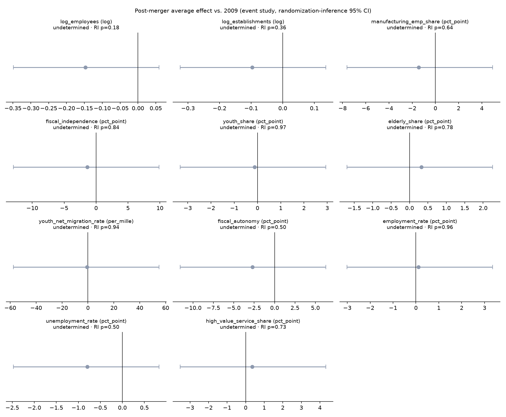

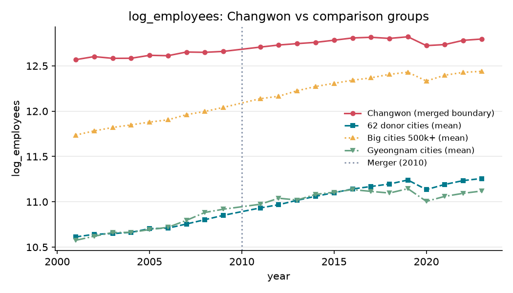
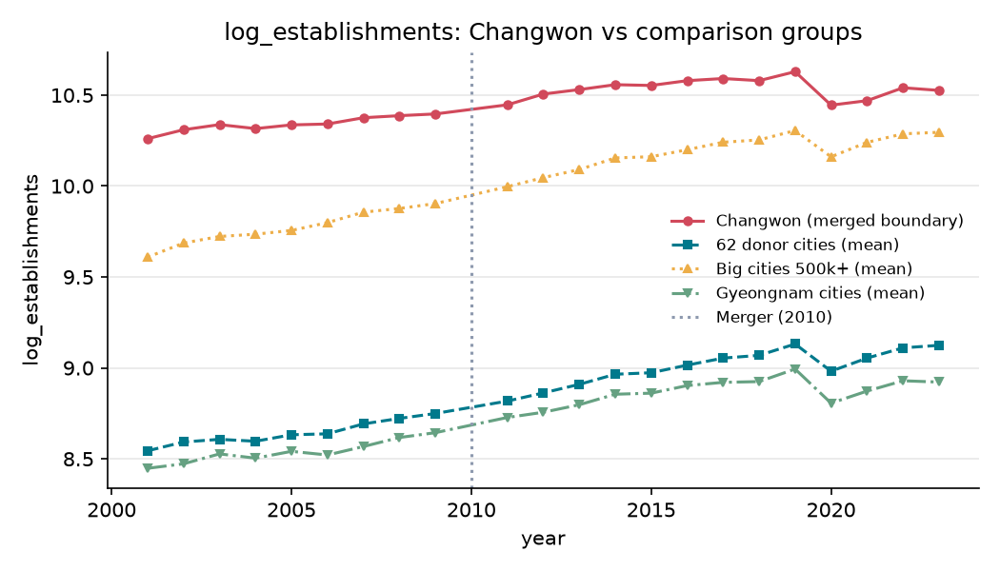
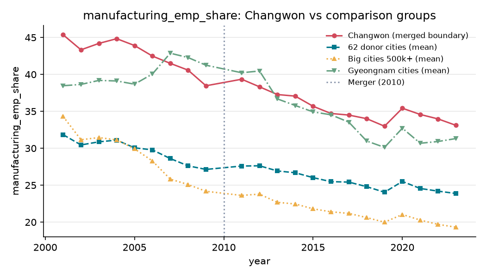
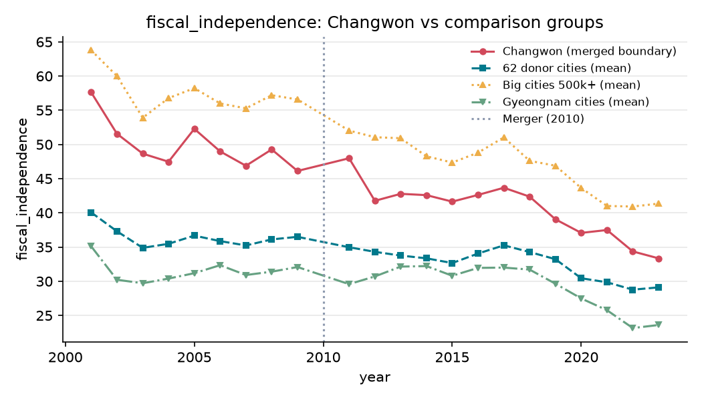
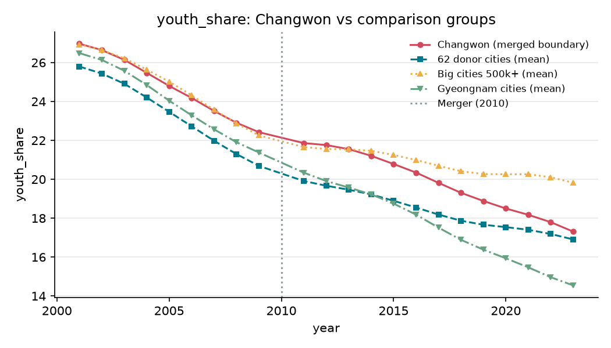
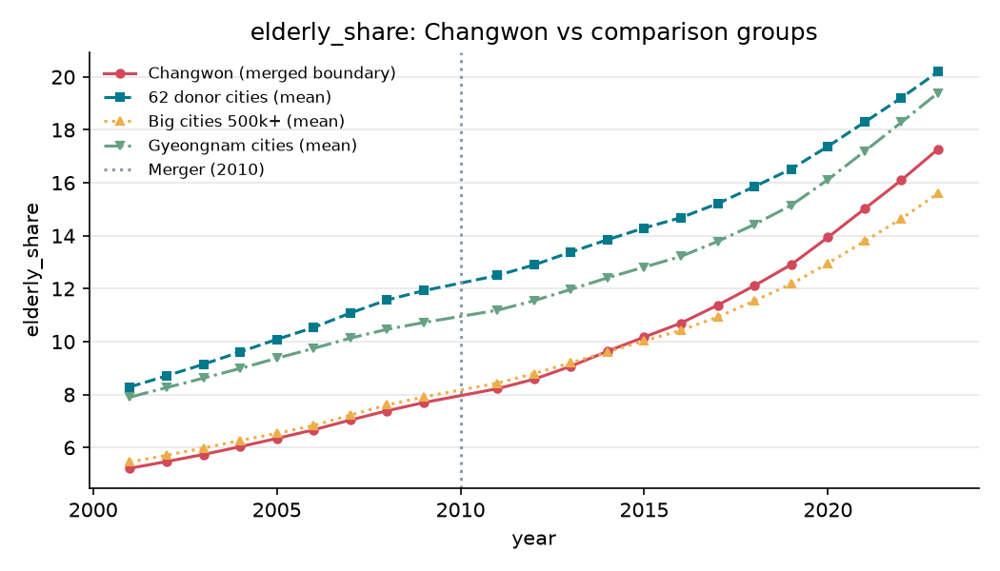
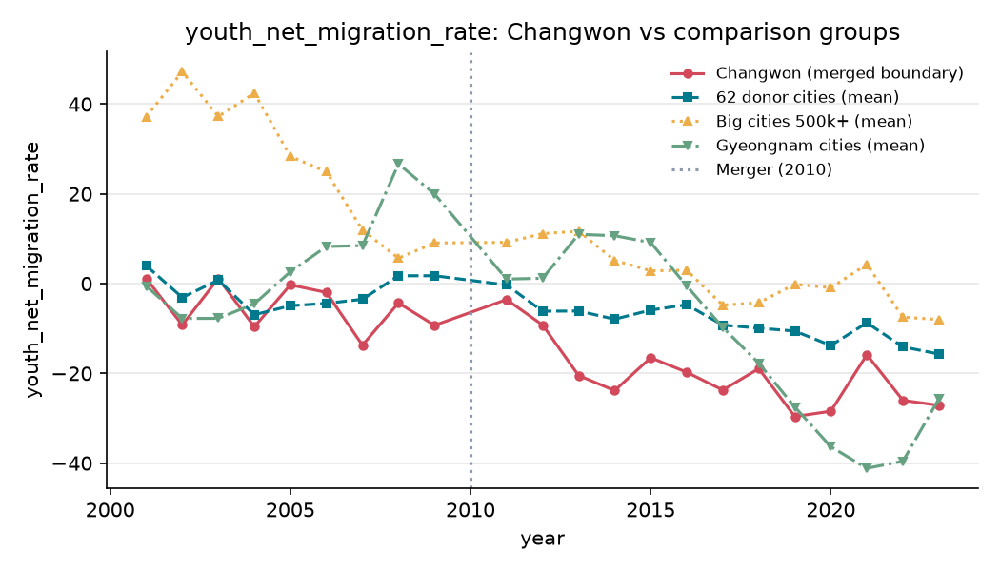
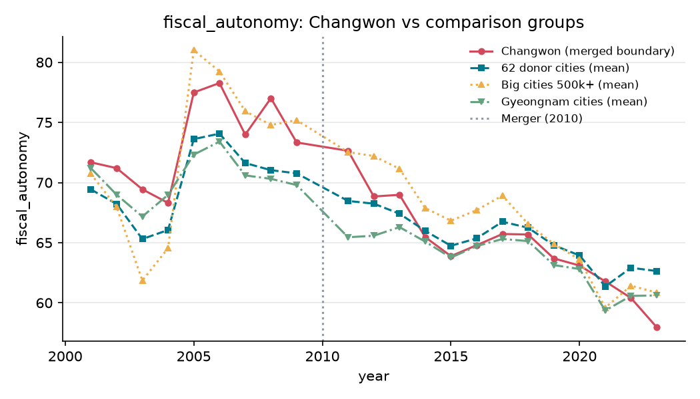
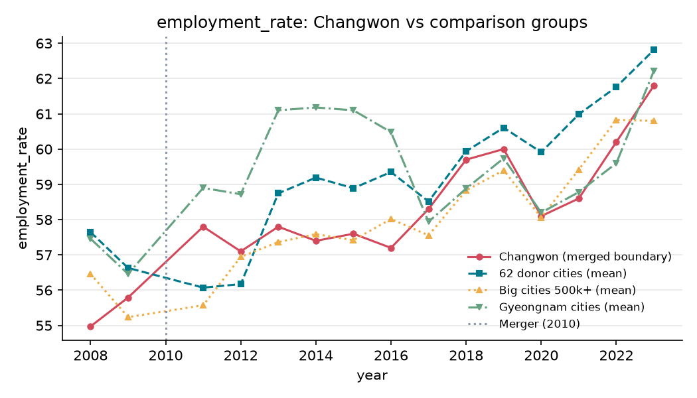
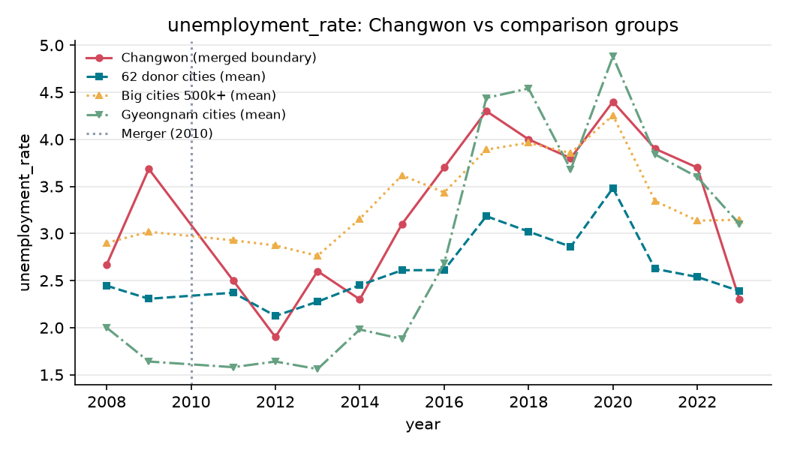
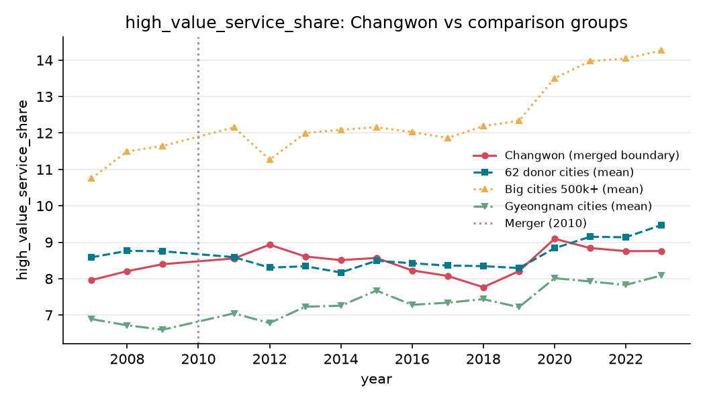

## 5. 지표를 뺀 이유 (자료 수집 실패만 해당)

- 공무원 1인당 주민수(명): civil_servants: 통계표 없음 — civil_servants: 시군구별 공무원 현원은 2015년부터 수록 — 통합 전(≤2009) 자료가 없어 사전추세·효과를 추정할 수 없으므로 수집하지 않음. e-지방지표에는 시도 단위 '공무원 1인당 주민수'(경찰·소방)만 있음
