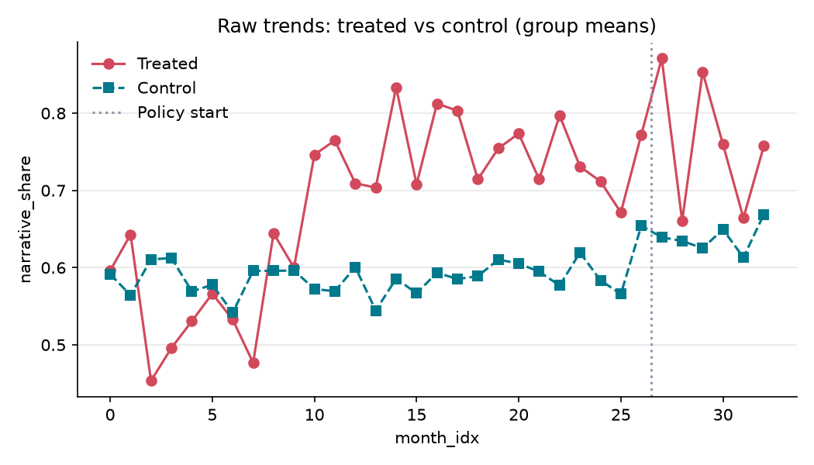
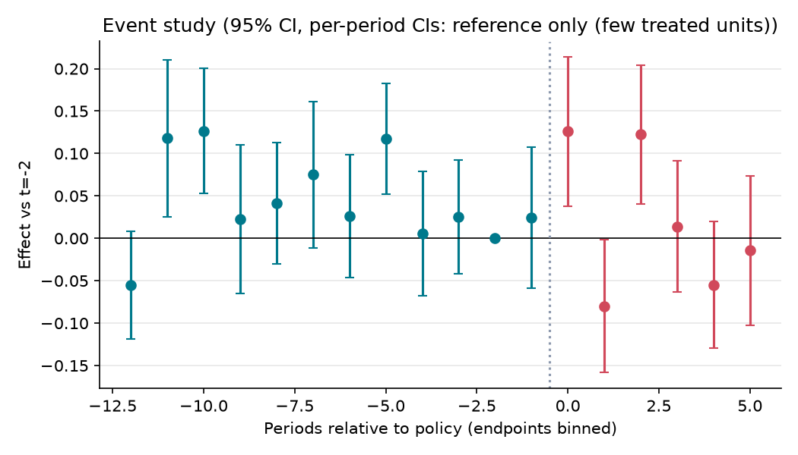

# 행정안전부 'AI 친화적 보고서' 도입(2026.3 시범)이 보도자료 형식과 기계 판독에 미친 효과

**분석 질문**: 행정안전부가 2026년 3월 'AI 친화적 보고서' 작성 방식(서술형 작성, 복잡한 표 지양, 마크다운 병행 제공)을 시범 도입한 뒤, 같은 방식을 도입하지 않은 다른 중앙행정기관과 비교해 행안부 보도자료의 서술형 문장 비율이 높아지고 표 사용이 줄었는가? 그리고 그 결과 공개 파서로 텍스트화할 때의 표 손상이 줄었는가?

**종합 판정**: ⛔ 판단 불가

**요약(판단 불가)**: 다음 사유로 이 설계에서는 정책 효과를 추정치로 보고하지 않습니다: 처치 단위 수 부족(무작위화 추론 사용), 사전추세 차이(평행추세 가정 기각), 신뢰구간이 0을 포함, 가짜 도입시점 검정 유의. 표의 수치(+0.02 비율(0~1))는 진단용이며 정책 효과로 해석하면 안 됩니다.

## 1. 설계

- 분석 단위: 중앙행정기관 (`org_id`), 기간 0–32 (month)
- 처치: 행정안전부. 시범운영 가이드라인 공개·부내 배포 2026-03-24, 첫 처치 월 = 2026-04 (month_idx 27, 첫 완전 처치 월). 2026-03(month_idx 26)은 일주일만 처치되어 rel -1 로 두고 선반영 점검에 쓴다. 2026-08-24 전면 실시(month_idx 31)는 처치 강도가 커진 시점으로 보고 이벤트 스터디의 사후 계수(+4, +5)로 따로 읽는다.

- 통제: 정책브리핑(korea.kr)에 보도자료를 올리는 다른 중앙행정기관(부·처·청) 중 2024-01~2026-09 모든 달에 보도자료가 1건 이상 있는 기관. 다음은 뺀다: (1) 국가인공지능전략위원회 — 같은 달 마크다운 전환을 발표해 처치 기관에 가깝다 (2) 행안부 소속 청(경찰청·소방청) — 행안부 가이드라인이 번질 수 있다 (3) 분석 기간 중 조직 개편으로 명칭·기능이 바뀌어 같은 단위로 이을 수 없는 기관 (4) 기간 중 'AI 친화 문서'·'마크다운' 작성 지침을 발표한 것이 확인된 기관
 — 중앙행정기관은 같은 정책브리핑 게시 체계와 한글(HWP) 기반 보도자료 양식, 같은 언론 환경을 공유한다. 정부 전체에 걸친 AI 활용 기조처럼 모든 기관이 함께 받는 충격은 대조군이 흡수한다. 행안부만 2026.3월에 문서 작성 지침을 바꿨으므로, 지침이 없었다면 행안부 보도자료 형식이 따랐을 추세를 다른 기관의 추세가 대신 보여 준다.

- 주 결과변수: 서술형 문장 비율 — 표본 보도자료 첨부 HWPX 본문(표 밖 최상위 문단)의 문장·항목 중 '~다.'로 끝나는 서술문의 비율(표본 합산). 분모 = 문단(항목 기호로 시작하는 줄은 HWPX 에서 각자 한 문단) 안을 '다.' 뒤에서 나눈 문장·항목 중 공백 빼고 5자 이상인 것. 표 안의 글자는 뺀다. HWPX 가 없는 보도자료는 뺀다.

- 추정 방법: `event_study` (cluster: `org_id`)

## 2. 결과

| 방법 | 결과변수 | 추정치 | 95% CI | p | N | 클러스터 | 판정 |
|---|---|---:|---|---:|---:|---:|---|
| event_study | narrative_share | 0.019 | [nan, nan] | 0.029 | 1069 | 35 | ⛔ 판단 불가 |
| event_study | tables_per_release | -0.144 | [nan, nan] | 0.029 | 1069 | 35 | ⛔ 판단 불가 |
| event_study | nested_table_share | 0.016 | [nan, nan] | 0.029 | 1069 | 35 | ⛔ 판단 불가 |
| event_study | parse_table_loss | -0.134 | [nan, nan] | 0.029 | 947 | 35 | ⛔ 판단 불가 |

## 3. 가정 점검 및 반박 검정

| 가정 | 점검 방법 | 결과 |
|---|---|---|
| 평행추세 | pretrend_test | randomization inference (사전 계수 제곱합) p=0.029 → 기각 |
| 미리 반응하지 않음 | placebo_time | 가짜 도입(21) 추정 0.054, p=0.029 → 실패 |
| 대조군 오염 없음 | manual | 수동 검토 필요 |
| 동시 정책 없음 | manual | 수동 검토 필요 |
| 측정 일관성 | manual | 수동 검토 필요 |

## 4. 경고 및 보류 조건

- 가짜 도입시점 검정이 유의(p=0.029): 도입 전부터 차이가 벌어졌을 가능성.
- 사전추세 검정 p=0.029 < 0.1: 평행추세 가정이 의심됩니다. 효과를 인과적으로 해석하지 마세요.
- 신뢰구간이 0을 포함합니다. '효과 없음'이 아니라 '효과 크기를 판별할 수 없음'으로 해석하세요.
- 처치 단위가 1개뿐이라 군집-강건 표준오차를 믿을 수 없습니다. 무작위화 추론(처치 단위를 무작위로 바꿔 반복)으로 p값과 신뢰구간을 계산했습니다.

## 5. 데이터 출처

| 이름 | 제공 | 라이선스 | URL |
|---|---|---|---|
| 대한민국 정책브리핑 보도자료 (목록·본문·첨부 HWPX·PDF) | 문화체육관광부 국정홍보 (korea.kr) | KOGL-1 | https://www.korea.kr/briefing/pressReleaseList.do |
| 행정안전부 보도자료 게시판 (첨부파일 형식 확인용) | 행정안전부 | KOGL-1 | https://www.mois.go.kr/frt/bbs/type010/commonSelectBoardList.do?bbsId=BBSMSTR_000000000008 |

---

# 해석과 한계

> 이 파일은 **내가 쓰는 부분**입니다. `make flow`는 `report.md`를 매번 새로 만들고, 이 파일의 내용을 그 끝에 붙입니다.

> **위 표의 p값·신뢰구간은 읽지 마세요.** 공통 무작위화 추론(`core/estimators/ri.py`)이 결과변수의 결측 칸을 걸러내지 않습니다. 결측이 있으면 모든 통계량이 NaN이 되고, p는 최솟값 1/35 = 0.029에 붙고, 신뢰구간은 `[nan, nan]`이 됩니다. 위 표의 '사전추세 기각'과 '가짜 도입시점 유의'도 이 계산 오류에서 나온 것입니다. 아래 수치는 `extra_checks.py`로 다시 낸 것입니다. 지표마다 33개월 모두 값이 있는 기관만 남겨 균형 패널을 만들었습니다(결과는 `extra_checks.json`).

## 결과를 한 문장으로

**조건부, 사실상 효과 근거 없음.** 시범 도입 뒤 6개월(2026-04~09) 동안 행정안전부 보도자료의 서술형 문장 비율, 표 수, 중첩 표 비율, PDF 표 손상률은 대조 기관보다 뚜렷하게 바뀌지 않았습니다. 네 지표 모두 95% 신뢰구간이 0을 크게 포함합니다. 처치 기관이 한 곳뿐이라 판정은 '조건부'보다 높아질 수 없습니다.

| 지표 | 기관 수 | 사후 평균 효과 | 95% CI (무작위화 추론) | p | 사전추세 p | 가짜 시점(2025-10) p |
|---|---:|---:|---|---:|---:|---:|
| 서술형 문장 비율 (1차) | 27 | +0.028 | [-0.301, +0.357] | 0.96 | 0.96 | 0.33 |
| 보도자료 1건당 표 수 | 27 | -0.39 | [-19.1, +16.9] | 0.85 | 0.78 | 0.52 |
| 중첩 표 포함 비율 | 27 | +0.014 | [-0.168, +0.182] | 0.96 | 0.59 | 0.41 |
| PDF 표 손상률 (2차) | 22 | -0.135 | [-0.642, +0.339] | 0.50 | 0.36 | 0.50 |

- 사전추세와 가짜 시점 검정은 모두 통과합니다. 다만 처치 기관이 한 곳이라 검정력이 낮습니다. 통과했다는 것은 반대 근거를 찾지 못했다는 뜻이지, 추세가 같았다는 증명은 아닙니다.
- 가짜 결과변수(월별 보도자료 건수, 로그): -0.007, CI [-0.92, +0.85], p 0.97. 형식 지침과 상관없는 지표에서 차이가 없어, 설계가 엉뚱한 차이를 만들어 내지는 않았습니다.
- 과학기술정보통신부를 빼도 결과가 거의 같습니다(서술형 +0.026, 표 수 -0.29, 중첩 +0.010, 손상률 -0.135).
- 전면 실시(2026-08-24) 뒤의 사후 계수도 일관된 방향이 없습니다. +4(8월)과 +5(9월)는 서술형 -0.05/-0.00, 표 수 -1.7/-0.2, 손상률 -0.34/+0.04입니다. 실시 후 한 달 남짓만 관측됐습니다.
- 원자료에서도 같은 그림입니다. 행안부의 서술형 비율은 도입 전 11개월(2025-04~2026-02) 0.745에서 도입 뒤 0.761이 됐고, 대조 기관은 0.590에서 0.639가 됐습니다. 행안부는 이미 2024년 하반기부터 다른 기관보다 서술형 비율이 높았습니다(도입 전 수준 차이는 기관 고정효과가 흡수합니다).
- **마크다운 병행 제공은 관측되지 않았습니다.** 표본 5,756건(행안부 165건 포함) 어디에도 `.md` 첨부가 없었습니다. 그래서 이 지표는 추정하지 않았습니다(아래 '계획에서 바뀐 것'). 행안부 누리집 보도자료 게시판의 첨부도 HWPX·PDF뿐이었습니다. 적어도 일반에 공개된 보도자료 첨부에서는 이 정책 요소가 실행된 흔적을 찾지 못했습니다.

해석: 가이드라인이 행안부 **내부 보고서**를 바꿨을 수는 있습니다. 하지만 이 분석이 볼 수 있는 **공개 보도자료** 형식에는 6개월 안에 확인할 만한 변화가 드러나지 않았습니다. 처치 단위가 하나라 신뢰구간이 넓습니다. 서술형 비율이 ±0.3, 표 손상률이 ±0.5 범위에서 바뀌었어도 이 설계로는 가려내지 못합니다. 그러니 '효과가 없다'가 아니라 '이 자료로는 효과를 확인할 수 없다'로 읽어야 합니다.

## 조심할 점

- **처치 단위 1개.** 신뢰구간은 '행안부 자리에 다른 기관 하나를 넣었을 때 나오는 효과의 분포'에서 나옵니다. 가능한 배정이 26가지(손상률은 21가지)뿐이라 가장 작은 p가 0.037(0.045)입니다. 웬만큼 큰 효과가 아니면 유의하게 나올 수 없습니다.
- **표본 추출.** 형식 지표는 기관·월마다 고정 시드로 5건을 뽑아 계산했습니다(월별 건수만 전수). 월 단위 지표의 잡음이 커서 신뢰구간이 넓어진 이유 중 하나입니다. 행안부만 전수로 받거나 기관당 표본을 늘리면 검정력이 오릅니다.
- **측정의 한계.**
  - '서술형'은 '~다.'로 끝나는 문장·항목의 비율로 근사했습니다. '~함', '~임' 같은 개조식 어미를 서술문으로 바꾸는 변화는 잡지만, 문단 구성이나 글의 길이는 보지 않습니다.
  - 표 수에는 보도자료 머리 상자와 담당자 표도 들어갑니다. 양식 표가 바뀌지 않으면 본문 표의 변화가 묻힐 수 있습니다.
  - PDF 표 손상률은 pdfplumber 하나로만 쟀습니다. 상용 AI 서비스가 문서를 읽는 정확도와 같지 않습니다.
  - PDF 7건은 파서 오류(PDFSyntaxError 6, KeyError 1)로 손상률에서 빠졌습니다.
- **결측과 표본 제한.** 일부 기관·월은 첨부에 HWPX가 없거나 HWPX·PDF가 함께 있지 않아 지표가 비었습니다. 균형 패널을 맞추느라 형식 지표에서 8곳, 손상률에서 13곳을 뺐습니다. 손상률에서 빠진 기관에는 교육부, 국방부, 과학기술정보통신부, 조달청 등이 있습니다. 빠진 기관이 무작위가 아니므로 대조군의 성격이 계획과 조금 다릅니다.
- **같은 시기의 다른 제도.**
  - 「행정업무의 운영 및 혁신에 관한 규정」이 기간 중 개정됐습니다: 2025.12.23(2026.1.1 시행), 2025.12.30(부처 명칭), 2026.5.19. 모두 중앙행정기관 전체에 적용되어 대조군이 흡수합니다.
  - 2026.9.29 개정(2026.10.2 시행)은 분석 기간 밖입니다. 시행규칙은 2023년 뒤로 바뀌지 않았습니다.
  - 다른 중앙행정기관이 비슷한 문서 작성 지침을 발표한 사례는 찾지 못했습니다. 뉴시스(2026.5.17) 인터뷰에 나온 '4개 부처'는 보고서 형식이 아니라 '온AI' 모바일 서비스 이야기입니다.
- **번짐.** 행안부 소속 청(경찰청·소방청)은 미리 뺐습니다. 행안부 가이드라인이 다른 부처에 비공식으로 퍼졌다면 효과가 작게 추정됩니다. 다만 대조 기관의 서술형 비율 상승폭(+0.05)이 행안부(+0.02)보다 커서, 이것만으로 이 결과를 설명하기는 어렵습니다.
- **정책 브리핑 자료의 빈틈.** 해양수산부는 2025-09 목록이 정책브리핑에 비어 있어('등록된 정보가 없습니다') 빠졌습니다. 정책브리핑 목록 옆 '최신 보도자료' 위젯을 목록으로 잘못 읽는 수집 오류가 있었으나, 추정 전에 고쳤습니다(`tests/test_public_markdown.py`).
- **추정하지 않은 기대 효과.** 보도자료가 밝힌 직원 작성 시간 단축과 AI 요약 정확도 향상은 기관 간에 비교할 공개 자료가 없어 다루지 않았습니다. 행안부 내부 보고서 표본이나 작성 시간 기록이 공개되면 이어서 볼 수 있습니다.
- 이 분석은 공개 보도자료로 한 독립 분석이며, 행정안전부의 평가가 아닙니다.

## 계획에서 바뀐 것

사전 등록(0d173a9)은 데이터를 열기 전에 했습니다. 그 뒤에 바꾼 것은 다음과 같습니다. 데이터를 보기 전에 바꾼 것(1aeda4c, dd002df)은 plan.yaml 머리 주석에도 적었습니다.

1. **언론 확산 지표 2개와 '언론 관심 변화 없음' 가정을 뺐습니다** (데이터 보기 전). 빅카인즈 OPEN API는 신청·승인이 필요한데 승인을 받지 못했습니다. 계획에 미리 적은 규칙대로 뺐습니다.
2. **데이터 출처를 바꿨습니다** (데이터 보기 전). 공공데이터포털 정책브리핑 보도자료 API가 폐기되어, 정책브리핑 누리집의 목록·본문·첨부(HWPX·PDF)에서 직접 받았습니다. robots.txt가 허용하는 경로만 썼고, API 키는 쓰지 않았습니다.
3. **표·문장을 본문 HTML 대신 첨부 HWPX에서 셉니다** (데이터 보기 전). 본문이 문서 뷰어로만 나와 HTML에 표가 없습니다.
4. **형식 지표를 표본으로 계산합니다** (데이터 보기 전). 기관·월마다 고정 시드로 5건을 뽑습니다(전수는 약 7만 건).
5. **첫 처치 월을 2026-03에서 2026-04로 옮겼습니다** (데이터 보기 전). 시범 가이드라인이 2026.3.24 공개·배포되어 3월은 마지막 일주일만 처치됩니다. 기준 시점도 rel -2(2026-02)로 바꿨습니다.
6. **마크다운 첨부 제공 비율을 결과 지표에서 뺐습니다** (데이터를 받은 뒤, 7720106). 1,155칸이 모두 0이라 표준오차가 0이 되어 `make flow`가 멈췄습니다. 효과 크기가 아니라 변동이 없다는 이유로 뺐습니다. 원인을 찾느라 지표별로 돌리면서 다른 네 지표의 추정치를 보았지만, 그 지표들의 정의·창·기준 시점·반박 검정은 바꾸지 않았습니다.
7. **결측 기관을 빼고 다시 추정했습니다** (결과를 본 뒤). `make flow`의 p값이 모두 0.029로 같아 원인을 찾았고, 공통 무작위화 추론이 결측을 처리하지 않는 문제를 확인했습니다. `core/`는 이 케이스에서 고치지 않았습니다. 대신 `extra_checks.py`에서 지표마다 결측 없는 기관만으로 같은 설계(창, 기준 시점, 반박 검정)를 돌렸습니다. 위 '결과를 한 문장으로'의 수치는 모두 이 재추정에서 나왔습니다.
8. **반박 검정 실행 방식.** 계획의 `placebo_outcome`(월별 보도자료 건수)은 로그(log(1+건수))로 바꿔 넣었습니다. 기관마다 건수 규모가 달라서입니다. `placebo_outcome`과 `drop_unit`(과학기술정보통신부)은 공통 실행기가 돌리지 않아 `extra_checks.py`에서 돌렸습니다.
