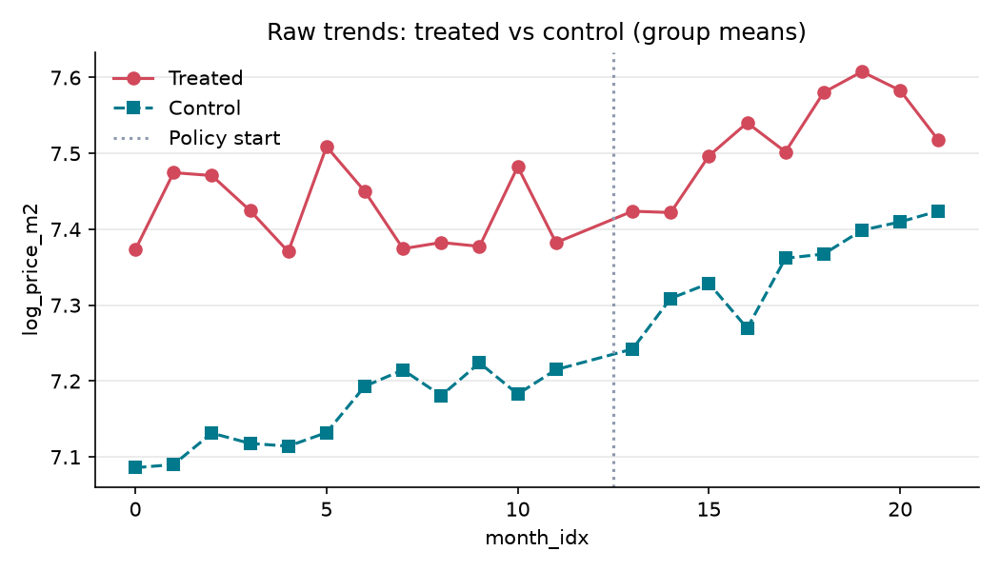
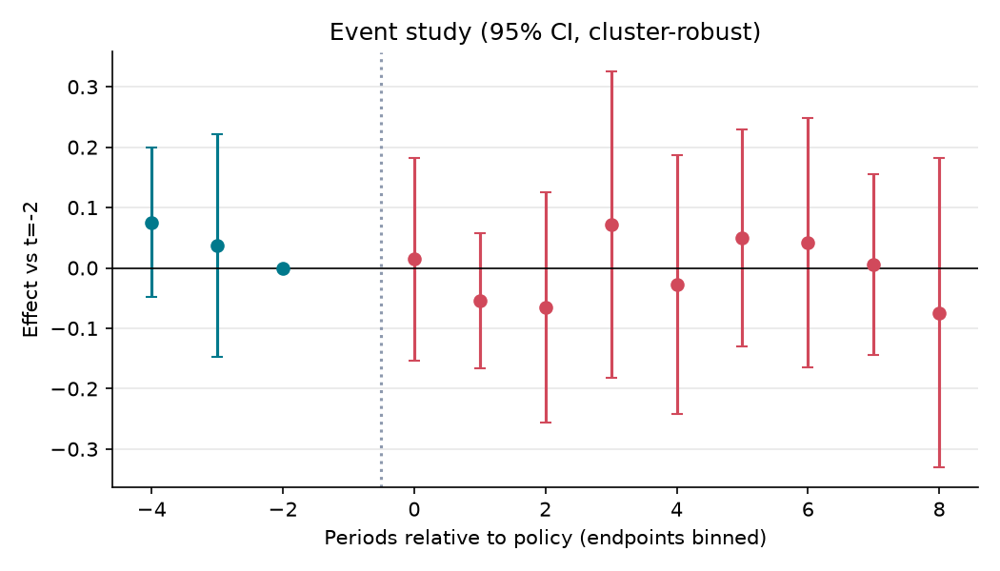

# 토지거래허가구역 지정(2020.6.23, 잠실·삼성·대치·청담) 뒤 옆 동네 아파트 ㎡당 가격(풍선효과)

**분석 질문**: 2020년 6월 23일 송파구 잠실동과 강남구 삼성·대치·청담동을 토지거래허가구역으로 지정한 뒤, 이 4개 동과 경계를 맞댄 법정동 10곳의 아파트 ㎡당 거래가격 중위값이 강남·서초·송파구의 떨어진 법정동 10곳과 비교해 달라졌는가?

**종합 판정**: ⚠️ 조건부

**요약(조건부)**: 추정치는 -0.00 log 만원/㎡ (95% CI -0.15 ~ 0.14) 이지만 다음 위험 신호가 있어 조건부로만 보고합니다: 신뢰구간이 0을 포함, 가짜 도입시점 검정 유의. 신뢰구간이 0을 포함하므로 효과의 방향과 크기는 판별 불가입니다. 결론 전에 보완 분석이 필요합니다.

## 1. 설계

- 분석 단위: 법정동 (`dong_id`), 기간 0–21 (month)
- 처치: 지정 4개 동(강남 삼성·대치·청담, 송파 잠실)과 법정동 경계를 맞댄 동 10곳 (강남 개포·논현·도곡·신사·압구정·역삼·일원, 송파 삼전·석촌·신천). 한강 건너 경계는 세지 않는다. 발표 2020-06-17, 시행 2020-06-23(서울특별시 공고 제2020-1832호). 2020-06(month_idx 12)은 발표와 시행이 겹쳐 모든 분석에서 뺀다. 첫 처치 월 = 2020-07(month_idx 13). 같은 발표에서 국세청 등의 실거래 기획조사가 잠실·삼성에서 대치·청담으로 넓어졌으므로, 추정 대상은 «허가구역 + 같은 날 넓어진 기획조사»다.

- 통제: 강남·서초·송파구에서 지정 동도 아니고 지정 동의 1·2차 인접 동도 아닌 법정동 10곳 (강남 세곡·율현, 서초 방배·신원·우면, 송파 거여·마천·문정·오금·장지). 지정 4개 동과 2차 인접 동 11곳은 이 대비에서 뺀다.
 — 같은 구에서 같은 대출·세제 규제와 서울 전체 수요 충격을 받으면서, 허가구역과 경계를 맞대지 않아 수요가 직접 옮겨 오기 어려운 동이다. 다만 두 가지로 대리가 흐려질 수 있다. 첫째, 지정 전 15억 원 넘는 거래 비율이 옆 동 64%, 먼 동 13%(2019-06~11)로 달라 가격대별 정책(2019-12-16 대책 등)이 두 집단에 다르게 걸린다. 둘째, 수요가 먼 동까지 번지면 차이가 작게 나온다.

- 주 결과변수: 아파트 ㎡당 거래가격 중위값(로그) — 법정동·계약월별로 해제 신고(cdealType 비어 있지 않음)를 뺀 거래의 거래금액(만원) ÷ 전용면적(㎡) 중위값의 자연로그. 거래가 없는 칸은 결측으로 두고 채우지 않는다.

- 추정 방법: `event_study` (cluster: `dong_id`)

## 2. 결과

| 방법 | 결과변수 | 추정치 | 95% CI | p | N | 클러스터 | 판정 |
|---|---|---:|---|---:|---:|---:|---|
| event_study | log_price_m2 | -0.004 | [-0.152, 0.143] | 0.956 | 397 | 20 | ⚠️ 조건부 |

## 3. 가정 점검 및 반박 검정

| 가정 | 점검 방법 | 결과 |
|---|---|---|
| 평행추세 | pretrend_test | joint Wald (chi2, CRV1) p=0.362 → 통과 |
| 2019-12 무렵의 사전 차이 | placebo_time | 가짜 도입(6) 추정 -0.125, p=0.005 → 실패 |
| 파급효과가 먼 동에 닿지 않음(SUTVA) | manual | 수동 검토 필요 |
| 같은 시기 다른 정책 | manual | 수동 검토 필요 |
| 거래되는 집의 구성 | manual | 수동 검토 필요 |

## 4. 경고 및 보류 조건

- 가짜 도입시점 검정이 유의(p=0.005): 도입 전부터 차이가 벌어졌을 가능성.
- 신뢰구간이 0을 포함합니다. '효과 없음'이 아니라 '효과 크기를 판별할 수 없음'으로 해석하세요.

## 5. 데이터 출처

| 이름 | 제공 | 라이선스 | URL |
|---|---|---|---|
| 국토교통부_아파트 매매 실거래가 자료 | 국토교통부 (공공데이터포털 15126469) | other | https://www.data.go.kr/data/15126469/openapi.do |

---

# 해석과 한계

> 이 절은 작성자가 쓴 해석이다. 위의 판정은 `make flow`가 `plan.yaml`의 비교 하나(옆 동 vs 먼 동)에 대해 낸 것이고, 아래의 결론은 `analysis-plan.yaml`의 주 분석에 대한 것이다. 숫자는 `estimate.py`가 만든 `results/post-period.json`과 `results/pre-period.json`에서 옮겼다. 학습·연구용 분석이며 공식 평가가 아니다.

## 결과를 한 문장으로

**주 분석: 세 비교 모두 «판별 불가».** 지정 이후 지정 동과 옆 동의 ㎡당 가격은 먼 동보다 덜 올랐다. 하지만 같은 크기의 차이가 지정 전(2019-12 무렵)부터 있었고, 세 비교를 함께 보정하면 유의하지 않다. 그래서 이 자료와 설계로는 허가구역의 효과를 판별할 수 없다. 풍선효과(옆 동이 더 올랐다)를 지지하는 근거는 없었다.

`make flow`의 판정은 «조건부»다. 추정치 −0.004 [−0.152, +0.143]이 0을 포함하고, 가짜 지정일(2019-12) 검정이 유의했다(−0.125, p 0.005).

## 주 분석 결과

단위는 log point다(−0.10 ≈ −10%). 95% 범위는 동 단위 군집 표준오차(CR1)와 t 분포로 계산했다. p는 무작위화 추론(35개 동의 집단 이름표를 5,000번 섞음) 값이고, Holm p는 세 비교를 함께 본 보정값이다.

| 비교 | 추정 | 95% 범위 | p | Holm p | MDE | 판정 |
|---|---|---|---|---|---|---|
| 지정 동 − 먼 동 (직접 효과) | −0.129 | −0.233 ~ −0.024 | 0.029 | 0.086 | 0.099 | 판별 불가 |
| 옆 동 − 먼 동 (풍선효과) | −0.070 | −0.147 ~ +0.007 | 0.121 | 0.121 | 0.076 | 판별 불가 |
| 옆 동 − 그다음 동 (거리 차이) | −0.081 | −0.168 ~ +0.005 | 0.057 | 0.113 | 0.073 | 판별 불가 |

판정 규칙(`analysis-plan.yaml`의 결론 규칙): Holm p < 0.05이면 방향을 적는다. 그렇지 않으면 95% 범위가 (−MDE, +MDE) 안에 다 들어올 때만 «MDE 이상 효과 배제», 아니면 «판별 불가»다. 세 비교 모두 Holm p가 0.05보다 크고, 범위가 −MDE 아래로 내려가므로 «판별 불가»다.

## 숫자를 어떻게 읽나

- **지정 전에도 같은 크기의 차이가 있었다.** 2019-12를 가짜 지정일로 두면 지정 동 −0.124, 옆 동 −0.125였다. 지정 이후 추정치(−0.129, −0.070)는 이보다 크지 않다. 계획은 지정 전 검정에 걸린 직접 효과와 풍선효과 비교에 «원래 흐름 차이 의심» 표지를 붙이게 했다. 두 비교 모두 이 표지가 붙어 있다.
- **흐름 차이 표지가 없는 비교도 판별 불가다.** 옆 동 − 그다음 동은 지정 전 검정을 통과한 유일한 비교다. 추정은 −0.081로, 풍선효과가 있다면 나와야 할 방향(+)과 반대다. 범위는 0을 조금 넘는다.
- **원인 후보를 빼면 차이가 준다.**
  - 2019-12-16 대책(15억 원 넘는 아파트 담보대출 금지)에 노출된 정도를 보정하면 직접 −0.089 [−0.195, +0.017], 풍선 −0.047 [−0.120, +0.026]이다.
  - 같은 단지 안에서 비교하면 직접 −0.084 [−0.129, −0.040], 풍선 −0.054 [−0.094, −0.014]다. 범위가 0을 넘지 않지만, 지정 전 가짜 지정일에서도 같은 방식으로 −0.040, −0.033이 나왔다.
  - 지정 전 집단별 선형 추세를 빼면 직접 −0.122 [−0.227, −0.018], 풍선 −0.042 [−0.119, +0.036]이다. 선형 추세는 2019-12 같은 계단식 변화를 흡수하지 못한다.
- **정책이 없던 해와 비교.** 2015~2019년 같은 시기의 가짜 지정일 5개 해 가운데 직접 효과만큼 큰 차이가 난 해는 0개, 풍선효과만큼 큰 차이가 난 해는 1개다. 5개 해로는 p값을 1/6 아래로 낼 수 없으므로 참고 비교로만 쓴다.
- **추세 위반 한계.** 지정 전 월별 변화의 최대치를 기준으로 추세 위반을 허용하는 범위(계획의 trend_violation_bound)는 허용 폭 0에서 이미 세 비교 모두 0을 포함했다.
- **민감도 분석에서도 방향은 같다.** 오래된 단지 제외(S1), 비교 기준을 서울 전체로 넓힘(S2), 거래가 드문 동 제외(S3) 모두 세 비교의 추정이 음수였다.

## 조심할 점

- **같은 시기의 다른 정책.** 2019-12-16 대책, 2019-11-06 분양가상한제, 2020-07-10 세제, 2020-07-31 임대차법, 2020-08-04 공급대책(삼성동 서울의료원 부지), GBC·영동대로 개발이 동마다 다르게 걸렸다. 이 분석은 이것들을 분리하지 못한다.
- **함께 시작된 기획조사.** 같은 발표에서 실거래 기획조사가 대치·청담으로 넓어졌다. 추정 대상은 «허가구역 + 기획조사»다.
- **거래되는 집의 구성.** 허가 대상이 줄면 거래되는 단지·면적이 바뀐다. 동별 중위값은 이 변화에 흔들린다. 같은 단지 안 비교가 이를 일부 보완한다.
- **지정 동이 4곳뿐.** 직접 효과의 95% 범위는 낙관적일 수 있다. 무작위화 추론은 35개 동이 서로 바꿔 놓아도 되는 단위라는 가정에 기대는데, 동마다 크기와 가격대가 달라 이 가정이 강하다.
- **대조군 오염.** 수요가 먼 동까지 옮겨 갔다면 차이가 작게 나온다. 서울 전체를 비교 기준으로 쓴 S2에서도 방향은 같았다.

## 계획에서 바뀐 것

- 계획은 2026-10-18 고정했다. 지정 전 결과를 본 뒤, 지정 이후 가격을 보기 전에 계획 보완(`analysis-plan.yaml`의 `amendments`)을 더했다. 결론 규칙, 보조 분석, S2 정정이 여기에 있다.
- `plan.yaml`(`make flow`용)은 지정 전 결과를 본 뒤 썼다. 사전추세 검정 범위를 [-4, 8]로 묶은 이유는 그 파일 주석에 있다.
- 지정 이후 비교를 계산한 뒤 바꾼 것은 없다. 지금까지 본 숫자는 `analysis-plan.yaml`의 `disclosures`에 적었다.
