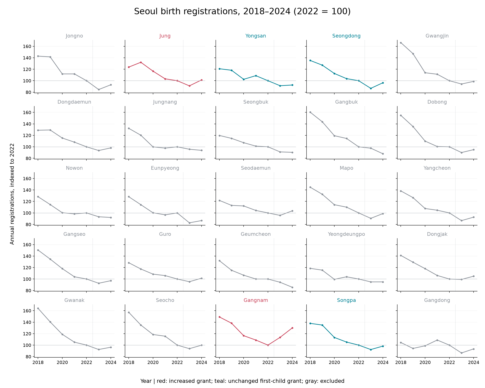

# 서울 25개 구 출생등록 기술통계

`fetch.py`가 공식 월별 CSV에서 생성한 연구용 요약이다. 정책 효과 추정표가 아니다.
출생등록은 주민등록 신고기준이며 발생기준 출생아 수·출산율과 다르다.

| 자치구 | 비교 분류 | 2022 | 2023 | 2024 | 2022→2024 변화 |
|---|---|---:|---:|---:|---:|
| 종로구 | 제외 | 481 | 407 | 447 | -7.1% |
| 중구 | 증액 | 604 | 550 | 612 | +1.3% |
| 용산구 | 유지 | 1,147 | 1,047 | 1,061 | -7.5% |
| 성동구 | 유지 | 1,754 | 1,521 | 1,692 | -3.5% |
| 광진구 | 제외 | 1,357 | 1,279 | 1,341 | -1.2% |
| 동대문구 | 제외 | 1,489 | 1,393 | 1,461 | -1.9% |
| 중랑구 | 제외 | 1,891 | 1,811 | 1,775 | -6.1% |
| 성북구 | 제외 | 1,929 | 1,758 | 1,744 | -9.6% |
| 강북구 | 제외 | 884 | 863 | 777 | -12.1% |
| 도봉구 | 제외 | 1,135 | 1,022 | 1,079 | -4.9% |
| 노원구 | 제외 | 2,269 | 2,117 | 2,089 | -7.9% |
| 은평구 | 제외 | 2,147 | 1,777 | 1,860 | -13.4% |
| 서대문구 | 제외 | 1,392 | 1,332 | 1,442 | +3.6% |
| 마포구 | 제외 | 1,798 | 1,628 | 1,778 | -1.1% |
| 양천구 | 제외 | 1,771 | 1,534 | 1,640 | -7.4% |
| 강서구 | 제외 | 2,898 | 2,684 | 2,814 | -2.9% |
| 구로구 | 제외 | 2,113 | 2,014 | 2,143 | +1.4% |
| 금천구 | 제외 | 1,024 | 966 | 877 | -14.4% |
| 영등포구 | 제외 | 2,333 | 2,216 | 2,217 | -5.0% |
| 동작구 | 제외 | 1,749 | 1,736 | 1,835 | +4.9% |
| 관악구 | 제외 | 1,612 | 1,489 | 1,553 | -3.7% |
| 서초구 | 제외 | 1,915 | 1,797 | 1,912 | -0.2% |
| 강남구 | 증액 | 2,070 | 2,350 | 2,689 | +29.9% |
| 송파구 | 유지 | 3,374 | 3,114 | 3,316 | -1.7% |
| 강동구 | 제외 | 2,605 | 2,249 | 2,434 | -6.6% |

서울 합계: 2022년 43,741건, 2023년 40,654건, 2024년 42,588건.
원본의 서울시 총계와 25개 구 합이 84개월 모두 일치했다.

## 작은 표본의 추론 진단

5개 구의 2022년 대비 2023~2024년 평균 로그 변화 차이는 +0.151199이다. 균형 패널 이벤트 스터디의 사후 평균과 같다.
5개 구 중 2개를 선택하는 10개 배정에 관측 배정도 포함해 전수 비교하면 양측 꼬리 비율은 0.100이다.
이는 결과를 본 후 추가한 구현 점검용 진단이며 사전 등록된 주 분석을 대체하지 않는다.
실제 정책 배정은 무작위가 아니므로 이 비율도 인과적 p값으로 사용할 수 없다.

현재 공통 엔진은 실제 처치 구를 제외한 대조 구 3개 중 2개를 뽑는 방식을 999회 반복한다. 서로 다른 가짜 배정은 3개뿐이다. 자동 리포트의 p=0.001과 좁은 구간을 유효한 무작위배정 검정이나 정책 효과의 신뢰구간으로 해석하지 않는다. 공통 엔진은 변경하지 않았으며, 사전 계획에 따라 종합 판정은 식별 불가다.

자료: [행정안전부 주민등록 인구통계](https://jumin.mois.go.kr/etcStatBirth.do), [공공데이터포털 3033249](https://www.data.go.kr/data/3033249/fileData.do) (이용허락범위 제한 없음). 정책 분류·근거 부족은 [policy-review.md](policy-review.md) 참조.
