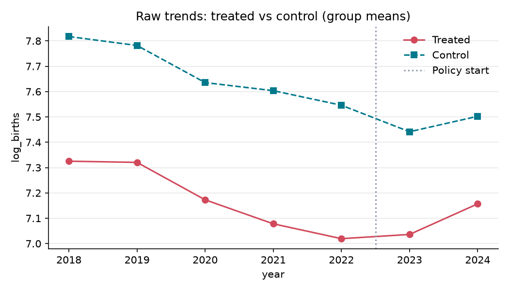
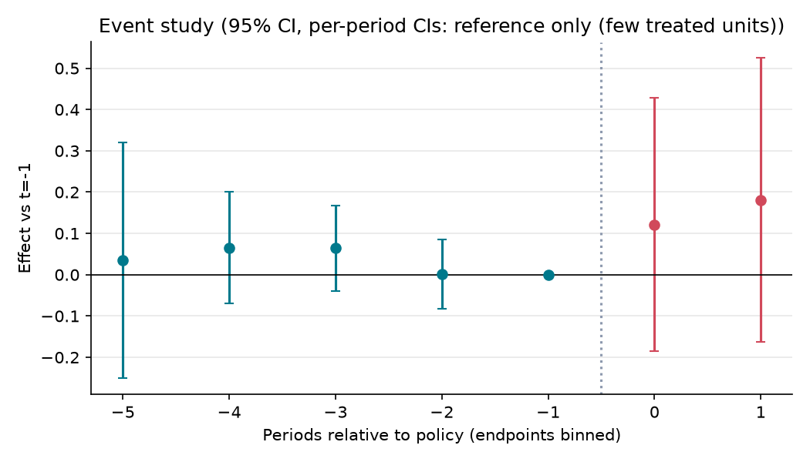

# 서울 25개 자치구 출산지원금 변경과 출생등록 변화 비교

**분석 질문**: 서울 25개 자치구를 조사 모집단으로 하여, 2023년 1월 1일 첫째아 자체 출산지원금을 증액한 구와 2022~2024년 해당 지원금의 금액·수급 조건을 유지한 구 사이에서 연간 출생등록 건수의 변화가 달랐는가?

**종합 판정**: ⛔ 식별 불가

**요약(식별 불가)**: 다음 사유로 이 설계에서는 정책 효과를 추정치로 보고하지 않습니다: 처치 단위 수 부족(무작위화 추론 사용), 클러스터 수 부족(표준오차 과소추정 위험). 표의 수치(+0.15 log 건/년)는 진단용이며 정책 효과로 해석하면 안 됩니다.

## 1. 설계

- 분석 단위: 서울 자치구 (`district`), 기간 2018–2024 (year)
- 처치: 공식 근거에서 2023-01-01을 적용일로 확인하고, 2022년 말 대비 첫째아에게 지급하는 자치구 자체 일시금이 증가한 구. 국가 첫만남이용권·부모급여, 서울시 공통 지원, 산후조리 실비·다자녀 전용 지원은 금액에 합산하지 않는다. 2022~2024년 정책 이력이 확인된 구만 분류한다. 2026-10-19 결과 패널 수집 전 확정한 증액 구는 중구·강남구이다. 다른 시점의 변경·감액·폐지, 지급조건 변경, 이력 미확인은 처치나 대조에 억지로 넣지 않고 제외 이유를 남긴다. 전수 조사 대상이 25개라는 뜻이며 최종 추정 표본이 25개라는 뜻은 아니다.

- 통제: 공식 근거로 2022-01-01~2024-12-31 동안 첫째아 자체 일시금과 지급조건이 유지되었음을 확인한 서울 자치구. 미지원도 공식 근거로 확인된 경우만 0원으로 기록한다. 검색 결과 없음·현행 안내만 존재하는 경우는 대조군으로 분류하지 않는다. 2026-10-19 결과 패널 수집 전 확정한 유지 구는 용산구·성동구·송파구이다. 미지원 구의 조건 유지는 첫째아의 자격 없음이 유지된다는 뜻이다. 성동구의 다자녀 지원 확대는 별도의 동시 정책으로 기록한다. 나머지 20개 구는 policy-review.md의 사유에 따라 제외한다.
 — 같은 서울시의 자치구로서 국가·서울시 공통 정책과 경기 충격을 공유한다. 자치구 및 연도 고정효과로 고정적인 지역 차이와 공통 연도 충격을 조정한다. 이 조건만으로 비교 가능성이 보장되지는 않으며, 사전 추세와 동시 정책을 별도 점검한다.

- 주 결과변수: 연간 출생등록 건수의 로그 — 서울 열린데이터광장 OA-12408의 원천인 행정안전부 주민등록 출생등록 통계의 자치구별 남녀 합계. 월별 12개 값의 합계에 자연로그를 취한다. 자치구 합계 행과 동별 행을 중복 합산하지 않는다. 12개월 중 하나라도 누락·비공개·비수치이면 해당 연도를 완성하지 않는다. 주민등록 신고기준 지표이므로 발생기준 출생아 수·출산율·지원금 수급자 수로 해석하지 않는다.

- 추정 방법: `event_study` (cluster: `district`)

## 2. 결과

| 방법 | 결과변수 | 추정치 | 95% CI | p | N | 클러스터 | 판정 |
|---|---|---:|---|---:|---:|---:|---|
| event_study | log_births | 0.151 | [0.091, 0.185] | 0.001 | 35 | 5 | ⛔ 식별 불가 |

## 3. 가정 점검 및 반박 검정

| 가정 | 점검 방법 | 결과 |
|---|---|---|
| 평행추세 | pretrend_test | randomization inference (사전 계수 제곱합) p=0.312 → 통과 |
| 선반영과 임신부터 출생까지의 시차 | manual | 수동 검토 필요 |
| 동시 정책과 인구 이동 | manual | 수동 검토 필요 |
| 결과를 보지 않고 정책 집단 확정 | manual | 수동 검토 필요 |

## 4. 경고 및 보류 조건

- 처치 단위가 2개뿐이라 군집-강건 표준오차를 믿을 수 없습니다. 무작위화 추론(처치 단위를 무작위로 바꿔 반복)으로 p값과 신뢰구간을 계산했습니다.
- 클러스터 수 5개 < 20: 군집-강건 표준오차가 과소추정될 수 있습니다. wild cluster bootstrap(pyfixest `wildboottest`) 또는 randomization inference 를 병행하세요.

## 5. 데이터 출처

| 이름 | 제공 | 라이선스 | URL |
|---|---|---|---|
| 행정안전부 주민등록기준 지역별 출생등록자수 (3033249) | 행정안전부 | other | https://jumin.mois.go.kr/etcStatBirth.do |
| 서울시 출생·사망(신고기준)(동별) 통계 (OA-12408) | 서울특별시 / 원천 행정안전부 | KOGL-1 | https://data.seoul.go.kr/dataList/OA-12408/S/1/datasetView.do |
| 한국사회보장정보원 지자체복지서비스 (15108347) | 한국사회보장정보원 | other | https://www.data.go.kr/data/15108347/openapi.do |
| 강남구 2023년 출산양육지원금·산후건강관리 확대 발표 | 서울특별시 강남구 | KOGL-2 | https://gangnam.go.kr/board/B_000031/1072842/view.do?mid=ID01_0313 |
| 보건복지부 2022 지방자치단체 출산지원정책 사례집 | 보건복지부 | KOGL-4 | https://www.mohw.go.kr/board.es?mid=a10411010100&bid=0019&act=view&list_no=375311 |
| 보건복지부 2023 지방자치단체 출산지원정책 사례집 | 보건복지부 | KOGL-4 | https://www.mohw.go.kr/board.es?mid=a10411010100&bid=0019&act=view&list_no=1480319 |
| 보건복지부 2024 지방자치단체 출산지원정책 사례집 | 보건복지부 | KOGL-4 | https://www.mohw.go.kr/board.es?mid=a10411010100&bid=0019&act=view&list_no=1484766 |
| 정책 검증 근거 gangnam-old | 법제처 국가법령정보센터 / 행정안전부 | other | https://www.law.go.kr/ordinInfoP.do?ordinSeq=1549839 |
| 정책 검증 근거 gangnam-2022 | 법제처 국가법령정보센터 / 행정안전부 | other | https://www.law.go.kr/ordinInfoP.do?ordinSeq=1707031 |
| 정책 검증 근거 gangnam-2023 | 법제처 국가법령정보센터 / 행정안전부 | other | https://www.law.go.kr/ordinInfoP.do?ordinSeq=1743435 |
| 정책 검증 근거 gangnam | 법제처 국가법령정보센터 / 행정안전부 | other | https://www.law.go.kr/ordinInfoP.do?ordinSeq=1856235 |
| 정책 검증 근거 junggu-old | 법제처 국가법령정보센터 / 행정안전부 | other | https://www.law.go.kr/ordinInfoP.do?ordinSeq=1586309 |
| 정책 검증 근거 junggu | 법제처 국가법령정보센터 / 행정안전부 | other | https://www.law.go.kr/ordinInfoP.do?ordinSeq=1793155 |
| 정책 검증 근거 yongsan-2022 | 법제처 국가법령정보센터 / 행정안전부 | other | https://www.law.go.kr/ordinInfoP.do?ordinSeq=1715313 |
| 정책 검증 근거 yongsan | 법제처 국가법령정보센터 / 행정안전부 | other | https://www.law.go.kr/ordinInfoP.do?ordinSeq=1985773 |
| 정책 검증 근거 seongdong | 법제처 국가법령정보센터 / 행정안전부 | other | https://www.law.go.kr/ordinInfoP.do?ordinSeq=1852983 |
| 정책 검증 근거 geumcheon | 법제처 국가법령정보센터 / 행정안전부 | other | https://www.law.go.kr/ordinInfoP.do?ordinSeq=2018091 |
| 정책 검증 근거 gwangjin | 법제처 국가법령정보센터 / 행정안전부 | other | https://www.law.go.kr/ordinInfoP.do?ordinSeq=2001319 |
| 정책 검증 근거 dongjak | 법제처 국가법령정보센터 / 행정안전부 | other | https://www.law.go.kr/ordinInfoP.do?ordinSeq=1746909 |
| 정책 검증 근거 gangnam-history | 법제처 국가법령정보센터 / 행정안전부 | other | https://www.law.go.kr/LSW/ordinHstListR.do?ordinSeq=1856235&ordinId=2072574&gubun=ELIS |
| 정책 검증 근거 junggu-history | 법제처 국가법령정보센터 / 행정안전부 | other | https://www.law.go.kr/LSW/ordinHstListR.do?ordinSeq=1793155&ordinId=2080553&gubun=ELIS |
| 정책 검증 근거 yongsan-history | 법제처 국가법령정보센터 / 행정안전부 | other | https://www.law.go.kr/LSW/ordinHstListR.do?ordinSeq=1985773&ordinId=2079260&gubun=ELIS |
| 정책 검증 근거 songpa | 서울특별시 송파구 | other | https://www.songpa.go.kr/www/contents.do?key=2953 |
| 마포구의회 2022-09-20 복지도시위원회 회의록 | 서울특별시 마포구의회 | other | https://council.mapo.go.kr/record/recordView.do?key=09db8112ba2c9adc5ec2e4134aad750c5b0746c1686c2abcf5904685d2d68b443e66f1805ca5b93a |

---

# 해석과 한계

실자료 수집과 사전 계획에 따른 분석을 완료했다. **지원금 증액이 출생을 늘렸다고 결론 내릴 수 없다.**
조사 모집단은 25개 구지만, 비교에는 증액 2개 구(중구·강남구)와 유지 3개 구(용산구·성동구·송파구)만
포함했다. 다른 적용일 2개 구와 전체 이력의 검증이 부족한 18개 구는 제외했다.
[정책 검증 기록](policy-review.md)에 구별 근거·제외 사유를 남겼다.

## 자동 결과표의 p값·구간을 해석할 때

공통 엔진의 작은 처치 표본용 계산은 실제 처치 구를 제외한 대조 구 3개 중 2개를 뽑는
가짜 배정을 999회 반복한다. 서로 다른 배정은 3개뿐이며 정책 배정도 무작위가 아니다.
따라서 위 결과표의 **p=0.001과 [0.091, 0.185] 구간은 유효한 인과 검정·신뢰구간으로 사용하지 않는다.**
[기술통계·추론 진단](descriptive-report.md)은 전체 5개 구 중 2개를 선택하는 10개 배정에 관측 배정도
포함해 전수 비교한다. 양측 꼬리 비율은 0.100이며, 이것도 무작위 정책 배정이 성립하지 않으므로
인과적 p값이 아니다. 이 점검은 결과 확인 후 추가한 구현 진단으로 사전 주 분석을 대체하지 않는다.
공통 엔진은 이번 PR에서 변경하지 않았다.

사후 평균 비교값은 +0.151 로그 포인트이며, 2023년은 +0.121, 2024년은 +0.181이다.
이는 지역·연도 고정효과를 조정한 비교값이다. 출생등록 증가율 그 자체나 지원금 단독 효과가 아니다.
처치 구가 2개, 클러스터가 5개여서 사전 기준 20개에 못 미친다.
자동 사전 추세·위약 시점 검정의 비기각은 적은 표본에서 평행추세를 입증하지 못한다.

## 관측 자료와 정책 정의의 한계

- 2018~2024년 25개 구×84개월의 출생등록 2,100행을 수집했다. 원본 성별 합계·서울 총계·지역 코드·월 누락·중복 검사를 통과했다. 비교 패널은 5개 구×7년=35행이다.
- 출생등록은 주민등록 신고기준이다. 발생기준 출생아 수·출산율·지원금 수급자 수와 다르며 신고 지연·주소 이전·신규 주택 입주에도 영향을 받는다.
- 첫째아 자체 일시금으로 집단을 정의했지만 결과는 모든 출생순위를 합한 건수다. 첫째아만의 반응을 측정한 분석이 아니다.
- 중구는 2023-03-27 공포된 조례를 2023-01-01 출생아부터 적용했다. 출생 코호트 적용일과 주민이 정책을 알 수 있었던 시점은 다르며, 2023년 출생에는 발표 전 임신이 포함된다.
- 강남구는 2023년 산후건강관리도 확대했다. 성동구는 셋째 이상 지원액·조건이 바뀌었다. 첫째아 미지원이 유지되어 대조군에 포함했지만 다른 출산정책까지 고정된 대조군은 아니다.
- 용산구·송파구를 포함한 여러 구의 2022년 첫만남이용권 전환은 기준 연도에도 정책 변화가 있었음을 뜻한다. 2018~2021년 추세만으로 그 영향을 분리하지 못한다.
- 국가 부모급여·서울시 정책의 평균적 공통 충격은 연도 고정효과로 조정하더라도, 연령 구성·주택 입주·전출입 같은 지역별 동시 변화를 제거하지 못한다. 별도 인구·주택 자료는 수집하지 않았다.
- 공식 조례는 정책 규정이며 실제 집행·수급 이력이 아니다. 18개 구는 전체 이력 검증이 남아 있어 서울 전체에 일반화할 수 없다. 결과를 본 뒤 이 구들을 유리한 방향으로 추가하지 않는다.

## 재현 기록

최초 계획 `6e43102` → 정책 집단·다운로드 경로 확정 `f8af67d` → 공식 CSV 수집기 `e19ec14` 순서다.
정책 조사 중 검색 결과·사례집에 노출된 참고 출생 수는 [policy-review.md](policy-review.md)에 공개했다.
원천 PDF 3개와 조례·안내문을 빈 임시 폴더에 다시 받고 출생 CSV 7개도 재수집한 결과,
2,100행 원자료 변환본과 35행 패널이 첫 실행과 일치했다. 원본과 가공 데이터는 Git에서 제외한다.
월별 변환본 SHA-256: `82a29b10fcc01d48fd79207caf22c064367baac1f637fb20a3abd1595198e16a`.
이는 학습·연구용 분석이며 정부·공공기관의 공식 정책 평가가 아니다.
