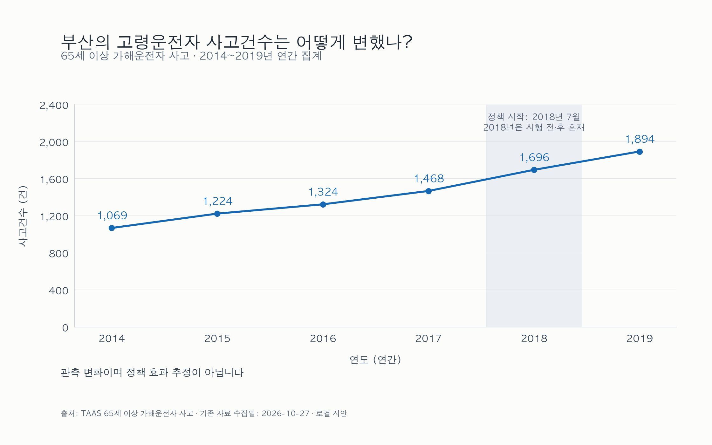
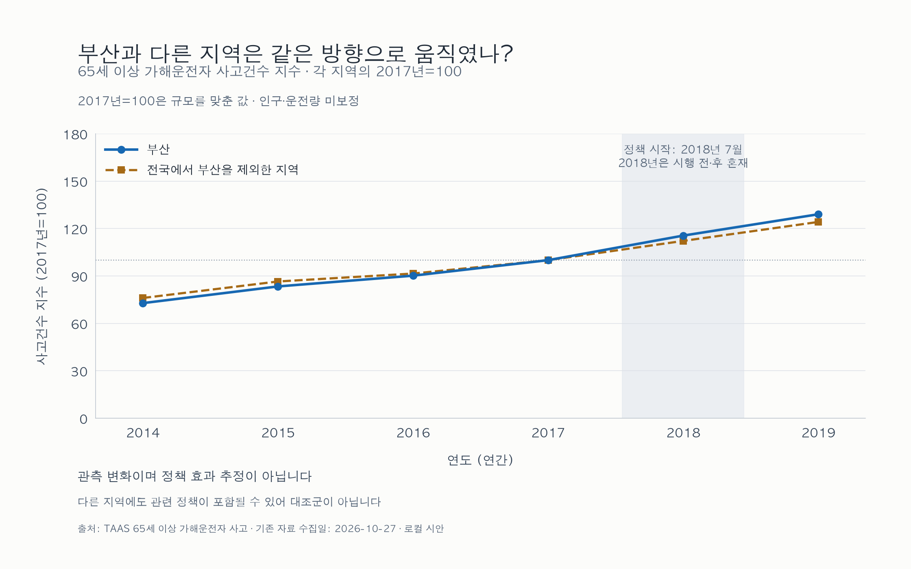
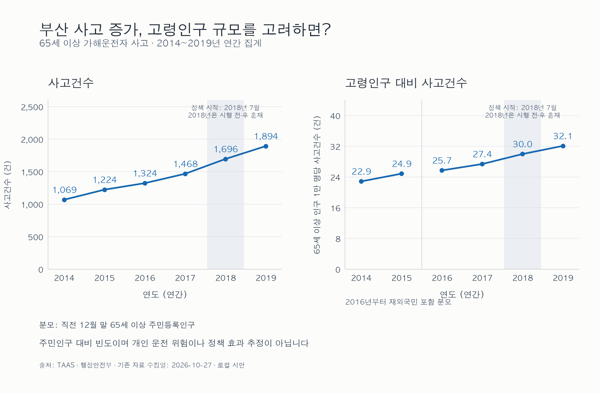
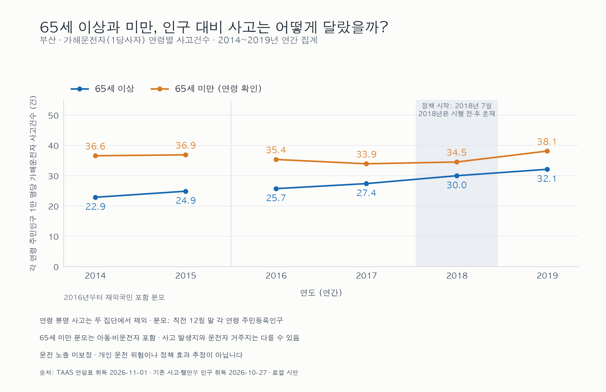

# 면허 반납 지원은 고령운전자 사고를 줄였는가?

**짧은 답:** 부산의 관측 사고건수와 고령인구 대비 사고 빈도는 증가했다. 현재 비교자료로 면허반납 지원의 예방효과 방향·크기는 식별하지 못했다. 관측 연구는 완료했으며 인과 추정은 실행하지 않았다(`not_identified`).

부산은 2018년 7월 지원을 시작했다. [부산시 2019-02-18 공식 보도자료](https://www.busan.go.kr/nbtnews/1361473)는 시행 시점을 설명한다. 도입 직전인 2017년과 2019년을 비교하면 65세 이상 가해운전자 사고가 1,468→1,894건으로 **29.0% 증가**했다. 같은 연결 기준의 65세 이상 주민은 536,064→589,961명(10.1%) 증가했고, 주민 1만 명당 사고 빈도는 27.38→32.10건(**17.2% 증가**)이다. 주민인구 분모만으로 증가가 사라지지는 않는다. 이는 면허 보유·실제 운전 노출을 보정한 개인 위험이나 정책 실패의 증거가 아니다.

> 안전하게 인용할 문장: “2014~2019년 공개자료를 대사한 결과, 부산의 65세 이상 가해운전자 사고는 2017~2019년 건수와 주민인구 대비 빈도 모두 증가했다. 면허반납 지원이 없었을 경우와의 차이는 추정하지 못했다.”

부산 보도의 사망자 35→18명은 이 표의 **사고건수와 다른 결과**다. 여기서는 그 사망자 감소를 재현·반증하거나 사고와 같은 지표로 비교하지 않았다.

## 관측값: 부산 변화에서 비교의 한계까지

분자는 해당 연도 부산에서 발생한 가해운전자(1당사자) 사고, 분모는 직전 12월 말 부산 주민등록인구다. 표의 65세 미만은 확인된 여섯 연령구간을 직접 합산했으며, 연령 불명은 어느 집단에도 배분하지 않았다.

| 연도 | 65+ 사고(건) | 65+ 주민(명) | 65+ 주민 1만 명당(건) | 65세 미만 사고(건) | 연령 불명(건) | 65세 미만 주민 1만 명당(건) |
| --- | ---: | ---: | ---: | ---: | ---: | ---: |
| 2014 | 1,069 | 467,416 | 22.87 | 11,194 | 430 | 36.58 |
| 2015 | 1,224 | 492,116 | 24.87 | 11,164 | 369 | 36.88 |
| 2016 | 1,324 | 514,630 | 25.73 | 10,604 | 264 | 35.36 |
| 2017 | 1,468 | 536,064 | 27.38 | 10,052 | 233 | 33.93 |
| 2018 | 1,696 | 565,527 | 29.99 | 10,028 | 213 | 34.52 |
| 2019 | 1,894 | 589,961 | 32.10 | 10,871 | 227 | 38.12 |

전국에서 부산을 뺀 계열은 규모와 전국적 추세를 읽는 **참고선**이다. 서울·경기 등 2019년 지원 지역을 포함하므로 미처치 대조군이 아니다. 2017년=100은 각 계열의 크기를 맞춘 지수이며 정책효과가 아니다. 전주·군산도 2019년 입법 신호와 2020년 제공 기록이 공존한다. 선행 지원·예고 반응·경계·분모·사전 추세 검증을 마치지 않아 후보의 분석 적격성은 보류한다. 두 도시의 새로운 숫자는 집계하지 않았다. [비교 적격성 근거](comparison-feasibility.md).

2017~2019년 65세 미만 주민인구 대비 빈도도 12.4% 증가했다. 두 집단의 변화율 차이는 정책효과가 아니다. 도입 전인 2016→2017년에도 고령선은 상승하고 비고령선은 하락한다. 이 구간은 2015→2016 분모 정의 경계를 넘지 않는다. 이는 비고령선을 그대로 고령집단의 반사실로 볼 수 없는 관측상 주의점이며, 사전추세의 통계적 검정을 실행하거나 기각했다는 뜻이 아니다.

연령 비교는 다른 분모의 두 관측 계열이다. 65세 미만 주민에는 아동·비운전자도 포함되며 두 연령집단의 운전 노출과 면허 보유가 다르다. 고령선의 수준이 낮다는 이유로 고령 개인의 운전 위험이 더 낮다고 해석할 수도 없다. 65세 미만을 확정 미처치·위약 대조군으로 사용하지 않았다. 2016년 사고연도부터 연결된 인구에 재외국민 포함 정의 경계가 있어 두 선을 2015→2016에서 끊었다. 그 정의 변화의 크기나 연령별 기여분은 분리하지 않았다.

## 인과판단을 막는 근거

- 부산 한 광역 정책군집과 2014~2017년 사전 네 해, 2018년 부분 노출, 2019년 한 온전한 사후 연도다. 구군 수가 독립 정책군집 수를 늘리지 않는다.
- [부산 안전속도 5030](https://www.busan.go.kr/depart/5030safe01)은 2019-11-11 도심 전역 시행, 본격 단속은 2020-05-12다. 2019년 늦은 시점의 혼입 가능성을 분리하지 않았다. 부산 고유 정책은 연도 효과만으로 제거되지 않는다.
- [국민권익위원회2019-420호(2019-09-23 의결),6~7쪽](https://m.acrc.go.kr/boardDownload.es?bid=1013&list_no=30601&seq=1)은 2019년1월부터75세 이상 면허 발급·갱신 대상자의 의무교육과3년 갱신주기를 설명한다. 모든75세 이상 주민이 동시에 교육받는 제도가 아니다. 갱신 대상 비중·연령 구성에 따른 차등 노출과 운전 노출·면허 보유·교통수단·지역 추세를 조정하지 않았다.
- 사고 발생지와 운전자 거주지는 다를 수 있다. 주민인구 분모는 실제 운전자·주행거리 분모가 아니다. 정책 대상 연령과 65+ 결과의 연령 경계도 완전히 같지 않다.
- 전주·군산의 후보 지위는 확정 미처치가 아니며 hold/unknown을 0으로 바꾸지 않았다. 검증된 비교군·반사실이 없다.

따라서 관측 증가가 정책의 실패·효과 없음·개인 위험 증가를 뜻하지 않는다. 효과가 감소 방향이었어도 다른 요인의 증가를 상쇄했을 가능성과 반대 가능성을 구별할 수 없다. **효과값·신뢰구간·p값을 계산하지 않았고 estimator/estimate/refute 단계도 실행하지 않았다.** 한계의 열거는 교란 제거·평행추세 입증·인과 식별이 아니다.

## 자료·공개 범위와 재현

출처: 한국도로교통공단 [TAAS](https://taas.koroad.or.kr/OBIP25/analysis/TypicalAnalysis.jsp), 2014~2019년 가해운전자 사고건수(기존65+ 취득2026-10-27, 연령표 취득2026-11-01); 행정안전부 [주민등록 인구통계](https://jumin.mois.go.kr/ageStatMonth.do), 2013~2018년12월(취득2026-10-27). 자체 집계·시각화다. 사실 집계/새 차트와 원표·화면·DB 재배포, 자동 접근을 구별한다. 보유 인구 CSV의 파일·버전 이용조건 연결 등은 [출처·이용조건](source-use-notes.md)에 남겼다. 불확실성은 전면 공개 금지나 전면 허가를 뜻하지 않는다. 원자료·가공 CSV/XML은 기존 data ignore에 따라 배포물에서 제외한다.

프로젝트 루트에서 `python3 cases/inshining-elderly-driver/run_descriptive.py`를 실행한다. 기본 네트워크 요청은 0이며 세 집계 순수 함수, 원자료·코드·네 그림·세 CSV의 해시·숫자를 검증하고 `report.md`, `flow_log.json`, `run_manifest.json`만 갱신한다. 그림 재생성은 각 describe 모듈의 별도 명령이다. 누락·변조는 실패하고 보고서를 완료로 쓰지 않는다. 원자료 없는 새 clone의 획득·동일 바이트와 새 다운로드 구별은 [데이터 안내](data/README.md)를 따른다. 실행 시각 파일은 바뀔 수 있고 수치·그림은 대사 대상이다.

계획 작성 전 보도와 선행연구 결과를 알고 있었고 이후 원자료·결과를 열람했다. 이번 사례는 탐색적 관측 분석이며 사전등록 완료라고 주장하지 않는다. 계획의 인과 추정 설계는 미실행 초안으로 보존했다. [토론](discussion.md), [실행 로그](flow_log.json), [실행 manifest](run_manifest.json).
