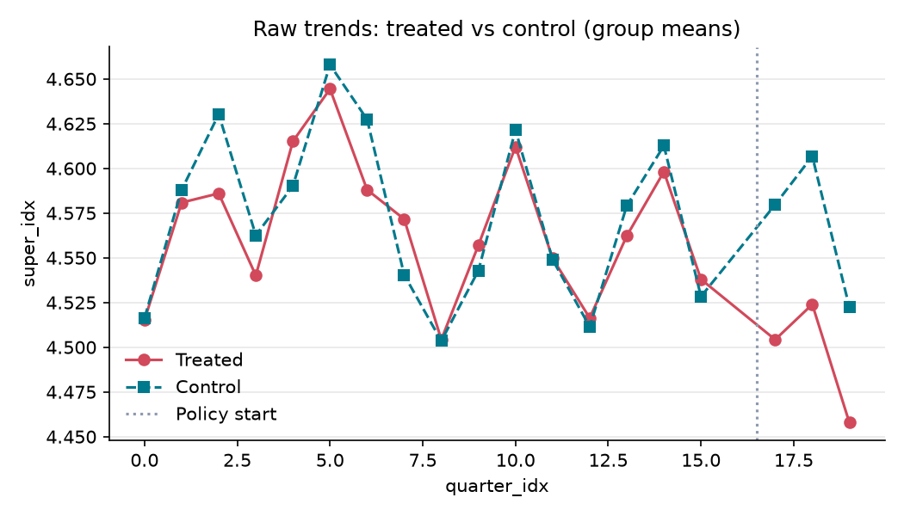
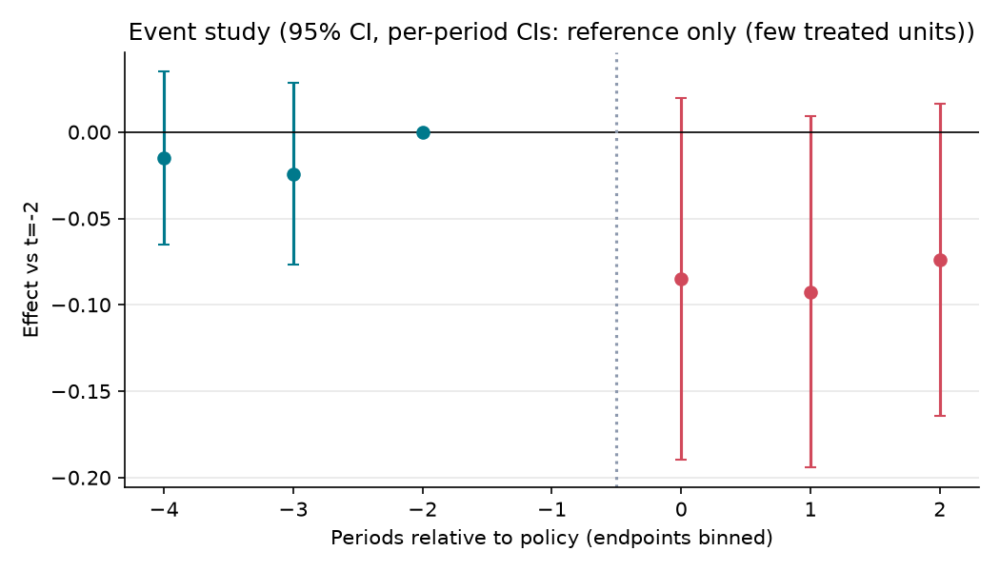

# 대구시 대형마트 의무휴업일 평일 전환과 지역 소매업 판매

**분석 질문**: 2023년 2월 대구시가 대형마트 의무휴업일을 일요일에서 월요일로 바꿔 일요일 영업을 허용한 이후, 대구의 슈퍼마켓·잡화점 판매액지수는 같은 기간 일요일 의무휴업을 유지한 다른 광역시와 비교해 어떻게 달라졌는가?

**종합 판정**: ⛔ 판단 불가

**요약(크기를 판별하지 못함)**: 추정치는 -0.08 지수(2020=100, 로그) (95% CI -0.20 ~ 0.05) 이지만 다음 위험 신호가 있어 단정하지 않고 범위로만 보고합니다: 처치 단위 수 부족(무작위화 추론 사용), 클러스터 수 부족(표준오차 과소추정 위험), 신뢰구간이 0을 포함. 신뢰구간이 0을 포함하므로 효과의 방향과 크기는 판별 불가입니다. 결론 전에 보완 분석이 필요합니다.

## 1. 설계

- 분석 단위: 광역시 (`region_id`), 기간 0–19 (quarter)
- 처치: 대구광역시 8개 구·군이 '대형마트 및 준대규모점포 의무휴업일 변경 지정' 고시로 의무휴업일을 매월 둘째·넷째 일요일에서 둘째·넷째 월요일로 동시에 변경했다. 2022-12-19 평일 전환 협약, 2023-01 행정예고, 2023-02-12(일) 첫 일요일 영업, 2023-02-13(월) 첫 평일 휴무. 대상은 대형마트 17곳·SSM 43곳이다. 전환이 분기 중간(2023Q1)에 일어나 2023Q1(16)은 추정에서 제외하고, 전환 후 첫 온전한 분기인 2023Q2(17)부터를 처치 이후로 본다. 근거 법령: 유통산업발전법 제12조의2(이해당사자 합의 시 공휴일 외 지정).
- 통제: 분석 기간(2019Q1~2023Q4) 동안 의무휴업일을 바꾸지 않은 광역시: 부산, 인천, 광주, 대전, 울산. 전체 기간 treated=0. 부산·인천·광주·대전은 둘째·넷째 일요일 휴무다. 울산은 남·북·중구가 둘째 수요일 + 넷째 일요일, 동구가 둘째·넷째 일요일로, 기간 내내 같은 상태다(근거는 README). 부산은 2024-05~07 순차 전환이므로 분석 기간 밖이다. 서울(2024~ 일부 자치구 전환)·경기(2023년 이전부터 31개 시군 중 14곳 평일 휴무)· 충북(청주 2023-05 전환)은 광역시와 구조가 다르거나 기간 내 전환이 있어 쓰지 않는다. — 광역시는 인구 규모·도시 구조·유통 구성이 대구와 비슷하고, 같은 분기의 전국 경기· 물가·이커머스 확산 충격을 함께 받는다. 광주는 2024-01 공휴일 의무휴업 유지를 공식 발표해 이력이 가장 분명하다. 인천·대전·울산의 휴무일 이력은 README에 기록했다. 울산은 처음부터 한 달 한 번 일요일 영업을 해 기준 조건이 다르지만, 기간 중 바뀌지 않아 지역 고정효과에 흡수된다고 보고 유지한다. 대신 울산을 뺀 추정을 반박 검정으로 둔다. 검색 결과 없음을 미전환의 증거로 쓰지 않는다. 대구 인접 지역(경북 경산 등)으로의 소비 이동은 광역시 단위 지표에 섞일 수 있어 한계로 둔다.
- 주 결과변수: 슈퍼마켓·잡화점 및 편의점 판매액지수 — KOSIS DT_1K41018 '시도별 소매판매액지수' 중 업종 A4 '슈퍼마켓· 잡화점 및 편의점' 불변지수(T2, 2020=100), 분기. 지역별 자연로그를 취해 비율 변화로 해석한다. 시도 단위에서는 편의점이 분리되지 않아 함께 포함된다. 편의점은 의무휴업 대상이 아니고 일요일에도 영업하므로 효과가 희석될 수 있다(한계로 기록).
- 추정 방법: `event_study` (cluster: `region_id`)

## 2. 결과

| 방법 | 결과변수 | 추정치 | 95% CI | p | N | 클러스터 | 판정 |
|---|---|---:|---|---:|---:|---:|---|
| event_study | super_idx | -0.084 | [-0.195, 0.052] | 0.420 | 114 | 6 | ⚠️ 크기를 판별하지 못함 |
| event_study | mart_idx | -0.010 | [-0.106, 0.087] | 1.000 | 114 | 6 | ⛔ 판단 불가 |
| event_study | auto_fuel_idx | -0.020 | [-0.147, 0.064] | 0.596 | 114 | 6 | ⚠️ 크기를 판별하지 못함 |

### 그래도 말할 수 있는 것

- 슈퍼마켓·잡화점 및 편의점 판매액지수: +0.0524 지수(2020=100, 로그)보다 큰 증가나 -0.195 지수(2020=100, 로그)보다 큰 감소는 이 자료와 맞지 않습니다(설계 가정이 맞다는 전제).
- 승용차·연료소매점 판매액지수 (가짜 지표): +0.0639 지수(2020=100, 로그)보다 큰 증가나 -0.147 지수(2020=100, 로그)보다 큰 감소는 이 자료와 맞지 않습니다(설계 가정이 맞다는 전제).

> 배제 범위: 효과가 있었는지는 판별하지 못했지만, 95% 범위 밖의 큰 효과는 이 자료와 맞지 않습니다. '효과가 없다'는 뜻이 아닙니다. 판단 불가 결과에는 쓰지 않습니다.

## 3. 가정 점검 및 반박 검정

| 가정 | 점검 방법 | 결과 |
|---|---|---|
| 평행추세 | pretrend_test | randomization inference (사전 계수 제곱합) p=1.000 → 통과 |
| 동시 정책 없음 | manual | 수동 검토 필요 |
| 대조군 오염 없음 | manual | 수동 검토 필요 |
| 선반영 없음 | manual | 수동 검토 필요 |
| 행정구역 불변 | manual | 수동 검토 필요 |

## 4. 경고 및 보류 조건

- 가짜 도입시점 검정이 유의(p=0.001): 도입 전부터 차이가 벌어졌을 가능성.
- 신뢰구간이 0을 포함합니다. '효과 없음'이 아니라 '효과 크기를 판별할 수 없음'으로 해석하세요.
- 처치 단위가 1개뿐이라 군집-강건 표준오차를 믿을 수 없습니다. 무작위화 추론(처치 단위를 무작위로 바꿔 반복)으로 p값과 신뢰구간을 계산했습니다.
- 클러스터 수 6개 < 20: 군집-강건 표준오차가 과소추정될 수 있습니다. wild cluster bootstrap(pyfixest `wildboottest`) 또는 randomization inference 를 병행하세요.

## 5. 데이터 출처

| 이름 | 제공 | 라이선스 | URL |
|---|---|---|---|
| 서비스업동향조사 시도별 소매판매액지수(2020=100) | 국가데이터처(구 통계청) KOSIS | KOGL-1 | https://kosis.kr/statHtml/statHtml.do?orgId=101&tblId=DT_1K41018 |

---

# 해석과 한계

> 이 파일은 **내가 쓰는 부분**입니다. `make flow`는 `report.md`를 매번 새로 만들고, 이 파일의 내용을 그 끝에 붙입니다.

## 결과를 한 문장으로
이 설계로는 2023년 2월 대구의 대형마트 의무휴업일 평일 전환이 대구 슈퍼마켓·잡화점 및 편의점 판매에 효과가 있었는지 판단할 수 없다(판정: 판단 불가). 주 지표만 보면 대구가 일요일 휴무를 유지한 5개 광역시보다 약 8% 낮은 쪽으로 추정됐고 이 크기는 실질적으로 작지 않지만, 처치 지역이 대구 1곳뿐이라 95% 범위(약 −18% ~ +5%)가 0을 포함해 우연과 구분되지 않았다. "효과가 있었다"도 "없었다"도 아니다.

## 조심할 점
- 판정 근거: 주 지표는 조건부(범위가 0을 포함)이고, 보조 지표인 대형마트의 가짜 시작일 검정이 p=0.001로 걸려 전체 판정이 판단 불가가 됐다. 실행기의 무작위화 추론은 대조 5곳 안에서만 처치를 바꿔 넣기 때문에, 대구가 5곳보다 극단이기만 하면 p가 바닥값 1/1000에 붙는다. 진짜 사전 추세 문제라기보다 이 한계일 가능성이 크지만, 사전에 정한 규칙대로 판정을 낮췄다.
- 일반 군집 표준오차(CRV1)로는 주 지표 p≈0.03이다. 처치 지역이 1곳이면 이 방식은 과소추정되므로 쓰지 않는다고 계획서에 미리 정했다. 이 숫자를 근거로 "유의하다"고 인용하면 안 된다.
- 광역시 단위 분기 지수라 마트 주변 상권의 변화나 요일별 변화는 보이지 않는다. 대구시가 발표한 전통시장 매출(+32.3%)은 이 자료에 없어 검증하지 않았다.
- 주 지표에 편의점이 섞여 있다. 편의점은 의무휴업 대상이 아니고 일요일에도 영업하므로 슈퍼마켓만의 변화는 희석됐을 수 있다.
- 울산 제외 점검: 울산(남·북·중구가 처음부터 일요일 1회 휴무)을 빼고 다시 추정해도 약 6% 감소(95% 범위 약 −14% ~ +10%), 조건부로 방향이 같았다.
- 가짜 지표인 승용차·연료소매점은 약 −2%로 거의 변화가 없었다. 대구 전체 소비가 함께 줄어서 생긴 차이는 아닐 수 있다는 정도의 참고 신호다.
- 원자료 추세(대구 − 대조 5곳 평균, 로그)는 2019~2022년에 분기마다 −0.044 ~ +0.031 사이에서 오르내렸고, 2022년 네 분기(기준 분기 2022Q4 포함)는 ±0.02 안이었다. 2023Q2~Q4에는 −0.065 ~ −0.083으로 벌어졌다. 2022-12 협약 발표만으로 미리 움직인 흔적은 보이지 않는다.
- 2023-07-01 경북 군위군이 대구에 편입됐다. 2023Q3부터 대구 통계 범위가 바뀌었을 수 있는데, 통계표 주석에서 반영 시점을 확인하지 못했다.
- 대구 인접 경북(경산 등)으로의 소비 이동이 섞일 수 있다.
- 같은 시기 대구에만 적용된 다른 소비·유통 정책(계획서의 "동시 정책 없음")은 아직 수동으로 확인하지 못했다.

## 계획에서 바뀐 것
PR #34 이후 두 번 바꿨다. 둘 다 판매액지수 값을 받기 전에 로컬에 커밋했다.

1. **대조군 정의** (`73042ae`): "일요일 의무휴업을 유지한 광역시" → "분석 기간 중 의무휴업일을 바꾸지 않은 광역시".
   대조 광역시 휴무일 이력을 확인해 보니 울산 남·북·중구는 기간 내내 둘째 수요일 + 넷째 일요일이었다(근거는 README).
   기간 중 바뀌지 않아 울산을 유지하고, 울산을 뺀 추정을 반박 검정(`drop_unit`)으로 추가했다.
2. **주 지표와 데이터 출처** (`f0de252`): KOSIS 메타데이터만 조회해 통계표를 DT_1K41018로 확정했다.
   시도 단위에는 '슈퍼마켓 및 잡화점'이 따로 없고 '슈퍼마켓· 잡화점 및 편의점'(A4)만 있어 주 지표 정의를 이에 맞췄다.
   편의점 포함으로 효과가 희석될 수 있음을 한계에 추가했다.

공개 순서 기록: 위 두 수정은 로컬에 커밋한 뒤, #45를 올리기 전에 `fetch.py`로 데이터를 받았다(`fetch.py`는 #46).
수집할 때 표 크기와 부산 첫 3행만 출력해 형식을 확인했고, 대구와 비교하는 계산은 하지 않았다.
