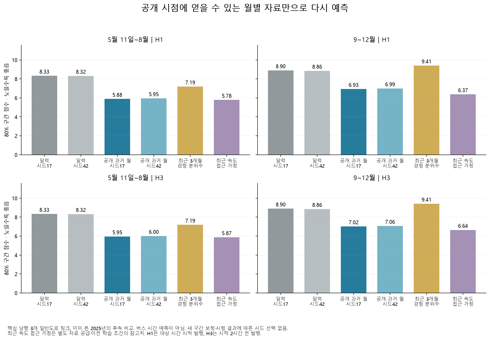

# 월별 공개 자료로 가능한 일반도로 예측

**최근 2시간 속도를 구할 수 없더라도, 공개된 과거 월의 요일·시간별 모양을 쓰면 달력만 쓰는 모델보다 잘 예측했다.** 미리 지정한 시드 17의 H1 평균 절대오차는 2025년 5월 11일~8월 1.26km/h, 9~12월 1.50km/h였다. 같은 학습 조건의 달력 모델보다 각각 29.29%·21.26% 낮았다. 두 시드·두 예측 시계·전체/저녁의 비교에서 같은 방향이었다.

이는 강남역 **남행 일반도로 3개 링크**의 이미 관찰한 2025년 자료에 대한 후속 탐색이다. 버스 이동시간이나 정책 효과 예측이 아니다. [공개 지연 감사](deepening-availability-report.md)에서 정한 보수적 공개 시각을 적용했지만, 현재 카탈로그의 등록·수정일이 과거 파일 버전을 완벽하게 복원한다는 뜻은 아니다. 실제 현장 운영·신규 독립 시험 결과로 부르지 않는다.

## 어떤 조건으로 다시 학습했나

[규칙](deepening_archive_config.yaml)과 [입력 명세](results/deepening/archive_forecast/input_manifest.json)는 결과 계산 전에 고정했다. 기존 사전 선택 62개 링크·36개월 가공 자료·월별 속성 제외 규칙을 유지했다. 최종 평가는 기존 핵심 3개 링크 `1220025000`, `1220021000`, `1220016200`이다.

| 항목 | 고정한 내용 |
|---|---|
| 훈련 | 2023~2024년, 링크별 최대 4,000행 균일 표본, 모형당 248,000행 |
| 튜닝 | 2025년 1~2월 핵심 3개 링크 4,248행, 조기 종료만 사용 |
| 평가 | 2025-05-11~08-31, 09-01~12-31; 발행 시각도 5월 11일 00시 이후 |
| 시계 | H1은 대상 시간 시작 시점 발행, H3는 시작 2시간 전 발행 |
| 모형 | CatBoost 1.2.10, 깊이 6, 최대 1,000트리, 학습률 0.05, MultiQuantile 0.1/0.5/0.9 |
| 비교 | 달력 전용 / 공개 과거 월 추가, H1/H3, 시드 17/42: 총 8회 |
| 후처리 | 예측 분위수 3개를 정렬하고 원래 교차율도 기록; 새 보정·경보 임계값 선택 없음 |
| 자원 | CPU 2스레드, 순차 학습, 8회 합계 807.18초; 새 GPU 설치 없음 |

3·4월은 새 학습·보정·선택에 쓰지 않았다. 5월 11일 경계는 이전 모형의 4월 최종 상태와 같은 준비 시계를 적용하기 위한 보수적 공통 조건이다. 새 모형 자체가 4월 결과로 선택됐다는 뜻은 아니다. 훈련·튜닝을 합쳐 재학습하지 않았다. 같은 시드의 두 입력군은 훈련 표본 해시가 같고, 8회 모두 전체 결측 훈련 열이 없었다. 튜닝으로 정해진 트리 수는 377~777개다.

[학습 완료 명세](results/deepening/archive_forecast/training_manifest.json)는 `3b8461d`에서 평가 전에 커밋했다. 모형·대체값·시드·튜닝 결과·버전·입력 해시를 보존하고 평가 결과로 다시 선택하지 않았다. 기존 동결 모형과 2026년 잠금 결과는 바꾸거나 열지 않았다.

## 어떤 입력을 실제로 얻을 수 있다고 보았나

- **달력 6개:** 링크, 시각, 요일, 월, 주말, 한국 공휴일.
- **과거 월 26개:** 대상 시간 기준 8·9·10·11주 전 속도와 가용 표시, 이미 공개된 가장 최근 1·3개월의 링크·요일·시간별 평균/표준편차/10·50·90분위수/관측 수/예정 수, 사용 월수와 가장 최근 월말의 경과일.
- 공개 가능 시각은 **익월 11일 00시와 현재 카탈로그 등록·수정 시각 중 늦은 시각**이다. 실제 공개 순서가 바뀌어도 공개된 월 중 시간상 최신 월을 선택한다. 미공개 값·관측 공백은 결측으로 남긴다. 월 프로필에는 해당 월의 공휴일도 포함하고 목표 공휴일 표시는 별도로 입력한다.
- 최근 도로 속도, 버스 시간, 실제 당일 날씨는 새 모델에 입력하지 않았다. 8주 지연이 공개되었다고 해도 해당 관측값이 존재하는 것은 아니다.

기존 공휴일 공식 대조 범위를 임의 확장하지 않았다. 그 범위를 확인한 뒤 기존 예측 파일의 달력 열과 `holidays` 0.107의 **1,096일 표시가 전부 일치**하는 것을 별도로 확인했다. 이것은 모든 날짜의 공식 원문을 새로 검증했다는 주장은 아니다.

[특징 감사](results/deepening/archive_forecast/feature_audit.json)는 H1/H3 각각 1,630,848행을 기록한다. [별도 특징 대조](results/deepening/archive_forecast/feature_validation.json)는 지연값 13,046,784칸과 같은 수의 가용 표시, 공개 직전·직후 프로필 840개·통계 5,880개를 확인했다. 원래 월별 속성 제외 144건을 유지했으며 핵심 3개 링크에는 해당 제외가 없다.

## 평가 결과

다음은 규칙에서 지정한 대표 시드 **17**이다. 낮은 절대오차·구간 점수가 좋다. 80% 구간 점수는 폭과 구간 밖 오차를 함께 벌점화한다. 포괄률만 높이려고 구간을 넓힌 결과와 구별하기 위해 함께 본다.

| 기간·시계 | 달력 MAE | 과거 월 MAE | MAE 감소 | 과거 월 포괄률 | 과거 월 폭 | 달력 → 과거 월 구간 점수 |
|---|---:|---:|---:|---:|---:|---:|
| 5월 11일~8월 H1 | 1.7783 | 1.2575 | 29.29% | 84.80% | 4.5384 | 8.3290 → 5.8842 |
| 5월 11일~8월 H3 | 1.7786 | 1.2653 | 28.86% | 84.90% | 4.6460 | 8.3308 → 5.9534 |
| 9~12월 H1 | 1.9075 | 1.5019 | 21.26% | 78.77% | 4.6158 | 8.8953 → 6.9322 |
| 9~12월 H3 | 1.9075 | 1.5170 | 20.47% | 79.51% | 4.7258 | 8.8953 → 7.0170 |

MAE·폭의 단위는 km/h다. H1은 여름 예정 8,136개 링크·시간 중 실제값 8,100개, H3는 발행 경계 때문에 첫 2시간을 제외한 8,130개 중 8,094개를 채점했다. 가을은 각각 8,784개 전부 관측됐다. 새 모델은 실제값이 빠진 36개 링크·시간에도 예측을 저장했고, 이를 성능 분모에 넣지는 않았다. 기존 최근 속도 참고 파일은 이 36개에서 예측도 없으며 복원하지 않았다.



같은 달력 주를 2,000회 재표집한 짝 비교에서, 과거 월 입력의 **MAE·구간 점수 차이 구간은 두 시드 × 두 시계 × 두 기간 × 전체/저녁의 16개 조합 모두 0 아래**였다. 예를 들어 가을 H1 시드 17의 MAE 차이는 −0.4055 [−0.4714, −0.3329]km/h, 구간 점수 차이는 −1.9631 [−2.3415, −1.5442]였다. 여름은 17개 주, 가을은 18개 주다. 개별 기술 구간이며 다중비교 보정·인과효과의 신뢰구간이 아니다.

시드 42의 과거 월 MAE는 여름 H1/H3 1.2618/1.2689, 가을 1.5144/1.5251이었다. 시드 17만 좋은 결과를 골라 제시한 것이 아니다. 전체 수치와 링크·월별 결과는 [216행 성능 표](results/deepening/archive_forecast/metrics.csv), 비교 전체는 [240행 짝 비교](results/deepening/archive_forecast/paired_comparisons.csv)에 있다.


## 단순 기준과 최근 속도 참고치는 어떤가

**공개 3개월의 경험 분위수**는 같은 요일·시간에 관측이 3개 이상이면 그 분위수를 사용한다. 부족하면 훈련 자료만으로 만든 경험 기준선으로 돌아가지만 이번 평가에서 대체는 0건이었다. H1 MAE는 여름 1.3733, 가을 1.6975로 달력보다 낮았으나, 80% 구간 포괄률이 68.02%·62.49%로 부족했다. 과거 월 학습 모형은 두 시계·시드·기간의 전체 시간 비교에서 이 기준선보다 MAE와 구간 점수가 낮았다. 적은 표본의 경험 분위수를 그대로 확률 보장처럼 쓰기 어렵다는 결과다.

**기존 최근 속도 모형은 접근 조건이 다른 참고치**다. 동일 표본 H1 MAE는 여름 1.2533, 가을 1.3927이고 구간 점수는 5.7802·6.3700이었다. 과거 월 모형과 여름에는 가깝고 가을에는 차이가 커졌다. 다만 이전 학습 설정도 다르므로 이 차이를 최근 2시간 입력의 순수한 추가 가치로 해석하지 않는다. 공정한 입력 비교는 이번에 같은 조건으로 학습한 달력/과거 월 두 모형이다.

## 아직 남은 실패 조건

1. **가을 구간이 좁다.** 시드 17 H1의 10월·12월 포괄률은 76.52%·74.10%다. H3도 77.28%·75.49%다. 전체 평균이 80%에 가깝더라도 월별 보장이 성립하지 않는다. 이 결과를 보고 시험 기간으로 보정량을 다시 선택하지 않았다.
2. **저녁 오차는 더 크다.** 과거 월 H1 MAE는 여름 1.5941, 가을 1.8090km/h이고 가을 저녁 포괄률은 78.05%다. 같은 조건의 달력 MAE 2.1911·2.3501보다 낮지만 실제 경보 기준·행동 비용은 별도 문제다.
3. **프로필은 과거의 반복 패턴이다.** 모형 중요도에서 최근 3개월 중앙값이 크게 쓰였지만 이것은 인과 기여도나 입력 제거 실험이 아니다. 급작스러운 사고·공사·차로 통제의 시작을 이 자료만으로 확인할 수 없다.
4. **현재 카탈로그는 완전한 과거 버전 기록이 아니다.** 보수적 공개 시계를 사용했어도 실제 배포 당시의 내용·수정 이력까지 증명하지 못한다. 2024년 3월 파일의 수정일 차이는 별도 공개 시각 표에 유지했다.
5. **다음 시험을 새로 설계해야 한다.** 2025년 결과는 이미 본 자료다. 새 독립 시험은 실제 배포 버전·수신 시각·예측 발행 기록을 보존하는 운영 수집 뒤에 가능하다. 2026년 잠금값은 이 탐색에서 열지 않았다.

## 검증과 재현

[평가 감사](results/deepening/archive_forecast/evaluation_audit.json)는 예측 24개 파일 203,004행의 해시와 공개 표를 연결한다. 기존 점수 함수를 호출하지 않는 [별도 대조](results/deepening/archive_forecast/result_validation.json)에서 성능 216행·3,240수치, 주별 짝 비교 240행·1,680수치가 `rtol=atol=1e-10`에서 일치했다. 전체 발행 격자, 모형별 실제값·결측, 분위수 순서도 확인했다. 원본 XLSX 전체 재추출이나 학습의 독립 구현 검증까지 했다는 뜻은 아니다.

기존 로컬 가공 자료·모형을 보유한 사례 환경에서:

```bash
OPENBLAS_NUM_THREADS=2 OMP_NUM_THREADS=2 MKL_NUM_THREADS=2 .venv/bin/python deepening.py archive-train
OPENBLAS_NUM_THREADS=2 OMP_NUM_THREADS=2 MKL_NUM_THREADS=2 .venv/bin/python deepening.py archive-evaluate
OPENBLAS_NUM_THREADS=2 OMP_NUM_THREADS=2 MKL_NUM_THREADS=2 .venv/bin/python deepening.py archive-result-check
OPENBLAS_NUM_THREADS=2 OMP_NUM_THREADS=2 .venv/bin/python deepening.py archive-plots
```

완료된 `archive-train`은 파일 해시만 확인하고 모델을 덮어쓰지 않는다. 학습 후 특징 생성은 거절한다. 새 환경은 [입력 명세](results/deepening/archive_forecast/input_manifest.json)의 기존 원본·가공 자료부터 복원해야 하며 공개 CSV만으로 새 학습이 가능하다고 안내하지 않는다.

[CatBoost 공식 문서](https://catboost.ai/docs/en/concepts/loss-functions-regression)의 MultiQuantile 목적함수·CPU 지원과 [예측 스레드 명세](https://catboost.ai/docs/en/concepts/python-reference_catboostregressor_predict)를 확인했다. [Forecasting: Principles and Practice §5.10](https://otexts.com/fpp3/toolbox.html#time-series-cross-validation)의 시간 순서 검증 취지는 따르되, 이 실행은 반복 원점 재학습이 아닌 고정 훈련/튜닝/평가다. 구간 점수는 앞서 읽은 [Gneiting·Raftery(2007) §6.2](https://sites.stat.washington.edu/raftery/Research/PDF/Gneiting2007jasa.pdf)의 방식으로 폭과 이탈을 함께 평가하며, 보정된 포괄 확률을 보장하는 절차를 새로 적용하지 않았다.
