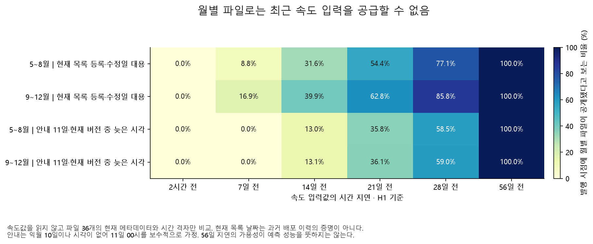

# 월별 파일의 공개 시점과 예측 입력의 가용성

**수집한 월별 속도 파일만으로는 기존 최근 2시간 입력을 공급할 수 없다.** 2025년 5~12월의 모든 평가 발행 시점에서 그 값의 월 파일은 아직 공개되지 않은 것으로 계산됐다. 7일 전 값도 현재 목록 날짜를 대용한 H1 기준으로 여름 8.84%·가을 16.91%의 시점에만 이용 가능했다.

기존 모형은 처음부터 최근 속도의 이용 가능성을 가정한 회고 모의였다. 이번 결과는 그 가정의 필요성을 수치화한 것이며, 모형의 수학적 예측 결과를 지우거나 실제 과거 정보 누출을 입증한 것으로 바꾸지 않는다. 현재 메타데이터에는 과거 전체 배포·수정 이력이 없다.

## 확인한 출처와 확인하지 못한 부분

[TOPIS 속도 안내](https://topis.seoul.go.kr/refRoom/openRefRoom_1.do)는 일반도로에 카드택시 GPS를 활용하고 여러 시간 단위의 통계속도를 생성하며, 도로별 일자별 파일을 다음 달 10일에 제공한다고 안내한다. 현재 안내를 모든 과거 월의 정확한 배포 시각으로 취급하지 않았다.

공식 자료실의 2023·2024·2025년 현재 목록 JSON 36개 월을 보존했다. 기존에 실제 수집한 파일의 게시물 번호·첨부 이름·첨부 식별자·분류 4개 항목이 36개 모두 대응했다. 작성자 ID는 공개 산출물에 내보내지 않았다. 날짜·식별자·기존 원본 해시는 [월별 표](results/deepening/availability/monthly_catalog.csv), 참고 문서의 URL·요청·해시는 [별도 출처 명세](results/deepening/availability/reference_sources.json)에 있다.

- `createDate`·`updateDate`에는 시간대가 명시되지 않아 **Asia/Seoul 가정**으로 계산했다. 등록일은 최초 실제 다운로드 가능 시각의 증명도, 이용자가 수신한 시각의 증명도 아니다.
- 36개월 중 등록·수정일이 다른 것은 2024년 3월 자료 1개였다. 등록은 4월 1일 09:25:34, 수정은 4월 3일 03:10:38이다. 무엇이 수정됐는지 또는 중간 버전이 있었는지는 알 수 없다.
- 목록에는 2024년 6월 자료의 7월 12일 등록, 2024년 12월 자료의 2025년 1월 21일 등록처럼 현재 안내보다 늦은 사례도 있다. 안내와 목록을 같은 사실로 합치지 않았다.
- 2025년 12월 자료의 2026년 1월 등록일은 **메타데이터**로만 사용했다. 잠금 대상인 2026년 속도 결과값은 열지 않았다.

[서울시 실시간 도로 소통 정보 OA-13291](https://data.seoul.go.kr/dataList/OA-13291/A/1/datasetView.do)는 별도 실시간 API다. 공개 명세 표의 요청은 `KEY`, `TYPE`, `SERVICE`, `START_INDEX`, `END_INDEX`, `LINK_ID`이고 관측 출력은 `LINK_ID`, `PRCS_SPD`, `PRCS_TRV_TIME`이다. 이 표에는 관측 시각·버전 필드와 과거 날짜 요청 인자가 없다. 실제 API를 호출하거나 인증을 신청하지 않았다. 같은 TOPIS 계통이라는 사실만으로 실시간 샘플과 월별 시간 집계의 동등성·지연 상한을 보장할 수 없다.

## 시나리오와 계산 범위

[설정](deepening_availability_config.yaml)에 따라 속도값을 읽지 않고 발행 시계만 만들었다. H1 발행은 대상 시간 시작과 같고 H3는 2시간 앞선다. 원점 기준 지연 2·3·4·24·48·168시간과 대상 기준 1·2·3·4·8·9·10·11주를 평가했다. 원본 시간대가 끝났는지도 확인하고, 그 자료 월의 공개 시각이 발행 시각 이하일 때만 이용 가능으로 판정했다.

| 시나리오 | 자료 월의 이용 가능 시각 | 해석 |
|---|---|---|
| 안내 10일 시작 | 다음 달 10일 00시 | 안내에 시각이 없어 낙관적 시간 경계 |
| 안내 11일 시작 | 다음 달 11일 00시 | 10일 하루가 끝난 보수적 시간 경계 |
| 현재 등록일 대용 | `createDate` | 당시 배포 이력을 확인한 값은 아님 |
| 현재 버전 대용 | `max(createDate, updateDate)` | 현재 목록이 가리키는 버전의 시각 대용 |
| 안내·현재 버전 중 늦은 시각 | `max(11일 00시, createDate, updateDate)` | 후속 월별 파일 모의에 사용할 보수적 규칙 |

결과는 특징 가용성 280행, 모형 상태 20행이다. 분모는 링크를 중복 계산하지 않은 여름 2,952개·가을 2,928개 시간 원점이다. 실제값 결측 여부와도 독립적이다. 상세는 [입력별 가용성](results/deepening/availability/feature_availability.csv)에 있다.

## 최근·주간 입력에 미치는 영향

| H1 입력 | 현재 버전 대용: 5~8월 | 현재 버전 대용: 9~12월 | 보수적 규칙: 5~8월 | 보수적 규칙: 9~12월 |
|---|---:|---:|---:|---:|
| 2시간 전 | 0% | 0% | 0% | 0% |
| 7일 전 | 8.84% | 16.91% | 0% | 0% |
| 14일 전 | 31.61% | 39.86% | 13.01% | 13.11% |
| 21일 전 | 54.37% | 62.81% | 35.77% | 36.07% |
| 28일 전 | 77.13% | 85.76% | 58.54% | 59.02% |
| 56일 전 | 100% | 100% | 100% | 100% |

8~11주 전의 값은 두 평가 기간·두 H·다섯 시나리오에서 모두 자료 월이 공개된 것으로 계산됐다. 그렇다고 값이 모두 관측됐거나 예측력이 높다는 뜻은 아니다. 값의 누락과 공개 여부는 후속 모형에서 따로 처리해야 한다.

보수적 규칙에서 가장 최근 공개 월의 끝은 발행 시점보다 약 10~40.96일 전이었다. 같은 요일·시간 프로필을 쓰더라도 실시간 상태가 아니라 이 정도 오래된 월의 패턴이다. [최신 파일의 나이](results/deepening/availability/newest_archive_age.csv)를 별도로 기록했다.

## 입력 외에 모형 자체도 준비돼 있어야 한다

기존 분할은 훈련 2023~2024년, 선택 2025년 1~2월, 보정 3월, 임계값 결정 4월이다. 4월의 결과를 사용한 최종 상태는 그 파일이 공개된 뒤에만 만들 수 있다고 보는 것이 월별 파일 시나리오의 일관된 조건이다.

현재 목록의 2025년 4월 자료 등록 시각은 **5월 7일 03:17:57**이다. 정시 발행으로는 5월 7일 04시부터, 안내·현재 버전 중 늦은 규칙으로는 **5월 11일 00시부터** 최종 상태가 준비될 수 있다고 계산된다. 학습·수신 처리 시간은 추가로 들 수 있으므로 이것도 실제 배포 완료 시각의 보장은 아니다.

| 여름 평가의 모형 상태 | H1 이용 불가 원점 | H3 이용 불가 원점 |
|---|---:|---:|
| 현재 버전 대용 | 148 / 2,952 | 150 / 2,952 |
| 보수적 규칙 | 240 / 2,952 | 242 / 2,952 |

단순히 달력 입력만 쓴 모형도 4월로 정한 임계값까지 포함하면 이 조건을 받는다. [개발 단계별 시각](results/deepening/availability/model_stage_availability.csv)과 [최종 상태](results/deepening/availability/model_state_availability.csv)를 공개했다. 가을 평가에는 이 초기 상태 제약이 없지만 최근 속도 입력의 제약은 계속 남는다.

## 후속 분석의 선택

월별 파일만으로 가능한 비교는 **달력만 사용하는 모형 대 이미 공개된 과거 월·8~11주 지연값을 추가한 모형**이다. 모든 특징을 발행 시점에 공개된 자료로 제한하고, 최종 개발 상태가 준비되는 시점부터 평가해야 한다. 두 모형의 학습 방식·표본·평가 기간을 맞추며 이미 본 2025년의 후속 탐색임을 유지한다.

실시간 경보를 하려면 별도로 허용된 수집 경로에서 관측 시각·수신 시각·정정·누락·집계법과 과거 ID 적용을 검증해야 한다. 이번에는 가입·API 호출·외부 자료 신청으로 넘어가지 않았다.

재현 명령은 사례 폴더에서 `python deepening.py availability-audit`, 그림은 `python deepening.py forecast-plots`다. 원점과 대상 시각 구별·월 공개 전 차단·늦은 수정과 파일 식별자 불일치 검증 3건을 통과했다. 처음에는 없는 선택 패키지 때문에 테스트가 건너뛰어졌으므로 저장소의 표준 HTML 판독기를 재사용해 추가 설치 없이 실제 실행하도록 고쳤다.
