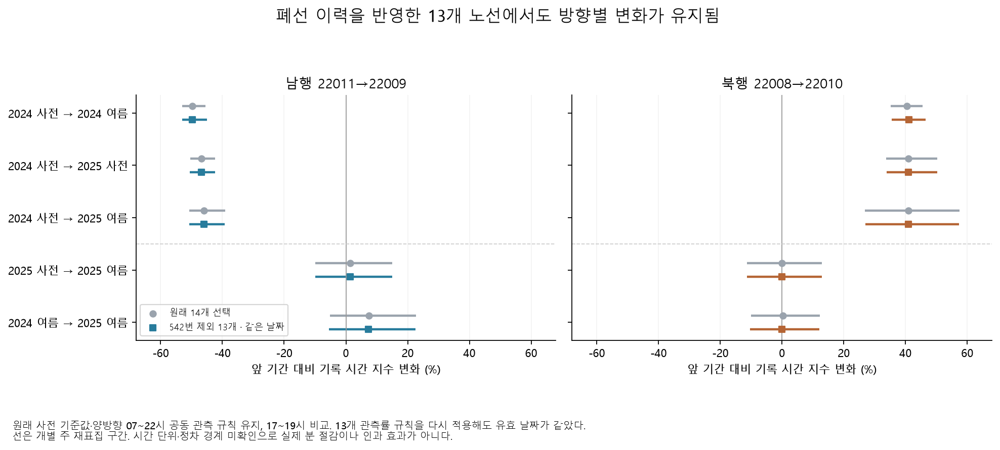
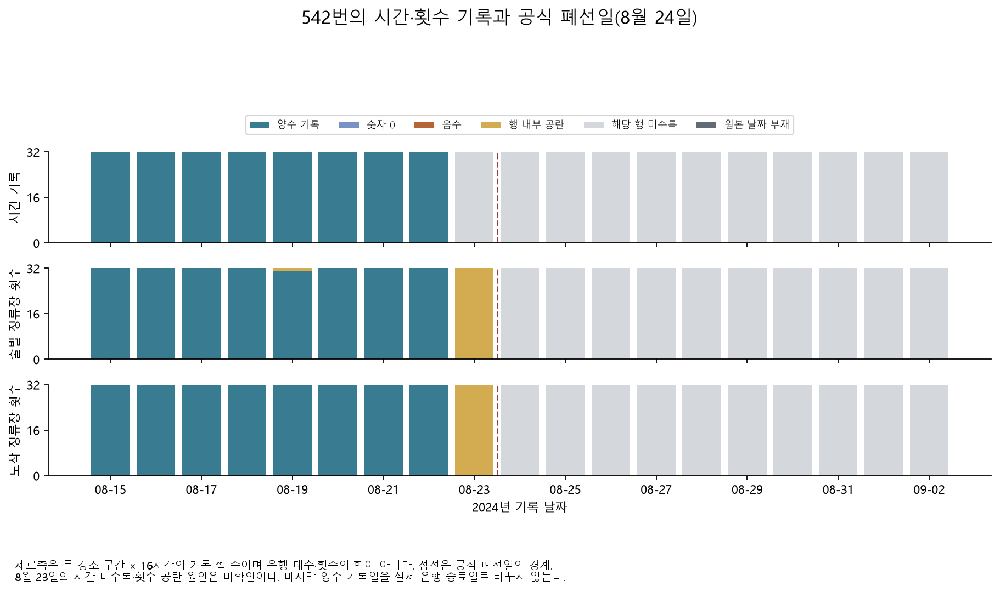

# 542번 폐선을 반영해도 남행 감소·북행 증가가 유지되는가

**유지된다.** 공식 폐선 이력에 따라 542번을 전 기간에서 제외한 고정 13개 노선에서 2024년 여름 시간 지수 변화는 **남행 −49.71%, 북행 +41.03%**였다. 원래 14개와 같은 날짜를 쓴 결과와 13개 분모로 날짜 관측률을 다시 판정한 결과가 일별 값까지 일치했다. 폐선일 이후 542번의 시간·운행횟수 기록은 없었으며, 사전 선택 목록에 남아 있던 것을 실제 사후 운행으로 해석하지 않는다.

이 결과는 같은 노선·날짜·시간대의 평균 기록을 비교한 구성 민감도다. 버스 시간값의 단위·정차 경계가 미확인이므로 실제 소요시간 절감률이나 정책의 인과 효과로 확정하지 않는다. [과거 정류장·노선 감사](deepening-history-report.md)와 함께 읽는다.

## 비교 규칙

원래 두 강조 구간은 남행 `22011→22009`, 북행 `22008→22010`이다. 서로 정확히 반대인 동일 물리 구간은 아니다. 같은 노선·날짜에서 양방향 7~22시의 **32개 시간값이 모두 양수**인 경우를 공동 관측으로 삼고, 기존의 노선·방향·시간별 2024년 사전 평균을 그대로 사용한다. 기존 일별 지수를 먼저 `rtol=atol=1e-10`으로 재현한 뒤 아래 세 결과를 모두 계산했다.

1. 원래 14개 노선 결과 재현.
2. 542번을 제외한 13개에서 원래 통과 날짜만 사용.
3. 같은 13개에서 기존 80% 관측률 규칙으로 날짜를 다시 판정.

제외 사유는 [과천시가 명시한 2024-08-24 폐선](https://www.gccity.go.kr/portal/newsList/view.do?idx=733&mId=0301140000)이며 변화 크기나 유의성으로 고른 것이 아니다. [서울시의 폐선 확인](https://mediahub.seoul.go.kr/archives/2012820)도 별도로 보존했다. 기존 2024년 사후 창은 8월 16일에 끝나므로 폐선 이전이다. 13개는 역사 노선 목록 29개 기준일 모두에서 같은 ID·이름으로 확인됐다.

2024년 사전·사후 통과 날짜는 각각 **27/29일·29/29일**, 2025년은 **27/27일·28/28일**로 세 방식 모두 같다. 두 13개 방식의 일별 자료 270행도 일치한다. 2025년 평균 노선 관측률은 14개 분모에서 사전 92.06%·사후 92.86%, 13개에서 99.15%·100%다. 이는 분모 변경이며 기록을 새로 채운 결과가 아니다.

## 고정 13개 결과

표의 범위는 원래와 같은 주 단위 재표집 95% 범위다. 여러 비교 전체에 대한 동시 신뢰구간이나 인과 효과의 범위는 아니다. 모든 30개 방향별 비교는 기존 관측률·최소 날짜 기준을 통과했다.

| 비교 | 남행 변화 | 주별 재표집 범위 | 북행 변화 | 주별 재표집 범위 |
|---|---:|---:|---:|---:|
| 2024 사전 → 2024 여름 | −49.71% | −53.05 ~ −45.06 | +41.03% | +35.44 ~ +46.42 |
| 2024 사전 → 2025 사전 | −46.76% | −50.51 ~ −42.39 | +40.92% | +33.81 ~ +50.32 |
| 2024 사전 → 2025 여름 | −46.02% | −50.78 ~ −39.26 | +40.95% | +26.96 ~ +57.39 |
| 2025 사전 → 2025 여름 | +1.39% | −9.88 ~ +14.98 | +0.03% | −11.41 ~ +12.87 |
| 2024 여름 → 2025 여름 | +7.34% | −5.47 ~ +22.59 | −0.06% | −10.33 ~ +12.01 |



원래 14개의 2024년 변화는 남행 −49.80%, 북행 +40.52%였다. 제외 후 차이는 각각 0.09·0.52%p 미만이다. 2025년 사전과 여름의 차이는 양방향 모두 범위가 0을 포함하지만, 2024년 사전 대비 2025년 수준 차이는 남는다. 따라서 이번 표본에서 **542번의 폐선만으로 장기 방향 차이가 생겼다는 설명은 뒷받침되지 않는다.** 다른 운영·측정·수요 변화는 여전히 별도 확인이 필요하다.

## 폐선 전후에 실제로 어떤 기록이 있었나

2023-01-01~2025-08-31의 14개 노선·2구간·16시간·974일을 **436,352개 고정 칸**으로 만들었다. 시간, 출발 정류장 횟수, 도착 정류장 횟수를 각각 양수·0·음수·공란·행 부재·원본 날짜 부재로 구분했다. 같은 시간 칸의 일치는 같은 차량이나 회차의 일치를 뜻하지 않는다.

542번의 마지막 양수 관측일은 세 자료 모두 **2024-08-22**였다. 8월 23일은 시간 행이 없고 정류장 횟수 행은 있으나 시간값이 공란이다. 공식 폐선일 8월 24일부터 분석 끝까지는 해당 노선의 양수·0·음수·공란 행이 모두 없다. 원본에 날짜 자체가 없는 경우도 별도 상태로 보존했다. **실제 마지막 운행일을 8월 22일로 추정하거나, 23일의 공란 원인을 폐선으로 확정하지 않는다.**



그림의 세로축은 2구간×16시간의 **기록 칸 수**이며 운행 차량 수가 아니다. 14개 전체에서 양수 시간 405,799칸 중 401,108칸(98.84%)은 양 끝 정류장 횟수도 양수였다. 나머지 4,691칸은 한쪽 이상 횟수가 미확인·유효하지 않은 상태였다. 두 횟수가 모두 확인되면서 한쪽이 0인 양수 시간 칸은 없었다. 이는 기록 정합성 진단이며 운행횟수 가중 시간, 정차 시간 또는 배차간격 분산을 계산할 근거는 아니다.

## 원본을 다시 읽어 확인한 범위

기존 Parquet 변환기를 재사용하지 않는 별도 CSV 판독기로 2024년 8월 두 ZIP의 **4,659,851행**을 끝까지 검사했다. 시간 2,256,663행과 횟수 2,403,188행의 헤더·열 수를 확인하고, 폐선 경계의 **8월 22·23·24·26일**에 대해 14개 노선·2구간·16시간·3자료의 **5,376개 값/상태를 대조해 불일치 0건**이었다. 0·공란·행 부재 및 반복 정류장 방문을 구별한다.

이 검사는 폐선 전후 네 날짜의 좁은 독립 대조다. 32개월 모든 값이 별도 판독기로 재생성됐다는 뜻은 아니다. 출처와 원본 해시는 [원본 대조 감사](results/deepening/cohort/raw_retirement_audit.json), 날짜·노선·자료별 결과는 [대조표](archive.md#results) (`results/deepening/cohort/raw_retirement_spotcheck.csv`, 로컬 보관)에 있다.

## 재현과 남은 질문

사례 폴더의 기존 자료·환경에서 실행한다. 기존 분석 파일과 모델을 덮어쓰지 않는다.

```bash
.venv/bin/python deepening.py cohort-audit
.venv/bin/python deepening.py cohort-raw-check
.venv/bin/python deepening.py cohort-plots
```

[구성 규칙](deepening_cohort_config.yaml), [독립 대조 규칙](deepening_raw_check_config.yaml), [입출력 해시·원래 결과 재현](results/deepening/cohort/audit.json), [방향별 비교](results/deepening/cohort/comparisons.csv), [같은 날짜의 방향 격차](results/deepening/cohort/paired_gaps.csv), [일별 지수](archive.md#results) (`results/deepening/cohort/daily.csv`, 로컬 보관), [날짜 유지](results/deepening/cohort/date_retention.csv), [월별 기록 상태](archive.md#results) (`results/deepening/cohort/monthly_record_states.csv`, 로컬 보관), [시간·횟수 지원](archive.md#results) (`results/deepening/cohort/positive_time_count_support.csv`, 로컬 보관), [542번 일별 상태](archive.md#results) (`results/deepening/cohort/retired_route_daily.csv`, 로컬 보관), [그림 해시](results/deepening/cohort/figures.json)를 공개한다. 세밀한 격자와 원본은 Git 제외 경로에 보존한다.

남은 핵심은 시간 필드의 정확한 단위·정차 경계, 경기·인천 노선의 당시 ID/경로, 승강장·신호·검지 및 동시 도로 변화다. 이번 결과로 노선 구성의 한 가지 대안 설명은 좁혔지만 정책 원인을 식별한 것은 아니다.
