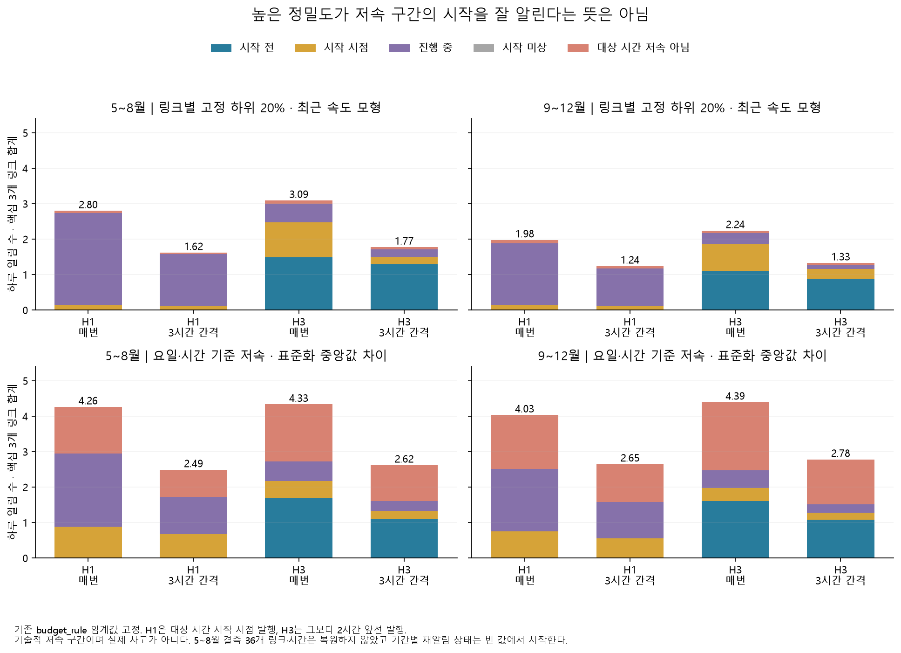

# 경보가 맞은 시각과 저속 구간을 시작 전에 알린 비율

기존 확률·임계값을 그대로 사용해도 **시간별 정밀도와 구간 시작 감지는 다른 결론**을 준다. 2025년 9~12월 링크별 하위 20% 모형의 H1 제한 알림은 정밀도 95.44%였지만, 시작을 아는 727개 저속 구간 중 시작 시점까지 알린 것은 17개(2.34%)였다. 맞힌 230개 알림 중 213개는 이미 진행 중인 구간을 가리켰다.

이것은 이미 열람한 2025년 예측의 후속 기술 평가다. 새 독립 시험·사고 탐지 성능·버스 도착시간 예측으로 부르지 않는다. 실제 입력의 공개 지연은 [별도 감사](deepening-availability-report.md)에서 다룬다.

## 고정한 평가 방법

[설정](deepening_episode_config.yaml)과 [입력 명세](results/deepening/episodes/input_manifest.json)를 `a5f40d9`에서 고정했다. 기존 추가 검증에 들어간 확률 후보 12개(모형 6개 × H1/H3), 두 기간의 예측 파일 24개, `original_rule`·`budget_rule` 임계값을 복사했다. `raw_probability` 보조 열은 사용하지 않았으며 재학습·재보정·임계값 재선택은 없었다.

- 대상은 일반도로 핵심 남행 3개 링크다. 5~8월은 기대 8,856개 링크·시간 중 8,820개, 9~12월은 8,784개 전부에 저장 예측·실제값이 있다. 7월 4일 20시~5일 07시의 12시간 × 3개 링크는 알 수 없는 값으로 남겼다.
- 같은 링크에서 정답 1이 연속되면 한 저속 구간이다. 자정은 이어지고 정답 0 또는 결측에서 끊는다. 결측 직후/평가 시작의 양수는 시작을 모르는 구간으로 표시한다. 평가 끝/결측 앞에 끝나는 구간은 길이가 하한임을 표시한다.
- 상대 기준은 **훈련기 링크별 q20**, 조건부 기준은 **훈련기 링크·요일·시간별 q20**다. 이는 분석용 라벨이며 확인된 사고나 운영 장애가 아니다.
- H1은 대상 시간대 시작 시각에 발행한다. H3는 그보다 2시간 앞서 발행한다. 실제 발행 `origin`이 구간 시작보다 빠른 경우만 시작 전 감지로 인정했다. H1의 시작 전 감지율은 정의상 0이다.
- 구간 중 어느 시간이라도 맞힘, 시작 시점까지 맞힘(`origin ≤ start`), 시작 전에 맞힘(`origin < start`)을 따로 계산했다. 시작을 모르는 구간은 뒤 두 지표의 분모에서 제외했다.
- 같은 링크에서 마지막 발행 뒤 3시간이 지나야 재알림을 내는 규칙을 함께 적용했다. 확률·발행 시각·과거 발행만 보고 정답을 보지 않는다. 자정에 상태를 초기화하지 않으며, 두 평가 기간 시작에는 빈 상태를 둔다.
- 최소 관측 길이 1시간·2시간을 모두 보고했다. 길이 조건은 구간 지표에만 적용하므로 시간별 정밀도·재현율은 바뀌지 않는다. 일당 알림은 3개 링크의 합계를 123일·122일로 나눴다. 하루 2회 하드캡을 새로 적용한 결과가 아니다.

[Tatbul 등(NeurIPS 2018)](https://proceedings.neurips.cc/paper_files/paper/2018/file/8f468c873a32bb0619eaeb2050ba45d1-Paper.pdf)의 서론·§4.1~4.3에서 구간의 존재·겹침 크기·위치·분할을 나누는 근거를 확인했다. 여기서는 그 논문의 `PrecisionT`·`RecallT`나 NAB 점수를 구현했다고 주장하지 않는다. 실제 발행 시계에 맞춘 단순 감지 개수와 기존 시간별 지표를 병기했다.

## 구간 수와 미확인 경계

| 기간·라벨 | 구간 수 | 양수 링크·시간 | 관측 길이 중앙값/최대 | 시작 미상 | 끝 미상 |
|---|---:|---:|---:|---:|---:|
| 5~8월 상대 | 726 | 2,075 | 2 / 14시간 | 1 | 4 |
| 9~12월 상대 | 727 | 1,990 | 2 / 13시간 | 0 | 0 |
| 5~8월 조건부 | 1,225 | 2,569 | 2 / 13시간 | 4 | 2 |
| 9~12월 조건부 | 1,171 | 2,479 | 2 / 12시간 | 0 | 0 |

시작 시각을 아는 구간의 분모는 각각 725·727·1,221·1,171개다. 전체 [구간 목록](results/deepening/episodes/episodes.csv)과 [관측률](results/deepening/episodes/coverage.csv)을 공개했다. 두 라벨의 구간이 일부 겹칠 수 있으므로 3,849개를 독립적인 실제 정체 사건 수로 해석하지 않는다.

## 알림 수를 줄일 때 유지되는 것과 놓치는 것

아래는 기존 `budget_rule`, 최소 길이 1시간의 결과다. 전체 192개 조합은 [지표 표](results/deepening/episodes/metrics.csv)에 있다. 여기의 모형은 첫 탐색에서 이미 주요 비교 대상으로 삼았던 최근 속도 기반 상대 모형과 표준화 중앙값 차이 조건부 모형이다.

| 기간·모형 | H | 재알림 | 알림/일 | 시간별 정밀도 | 구간 내 한 번 감지¹ | 시작 시점까지 감지¹ | 시작 전 감지¹ |
|---|---:|---|---:|---:|---:|---:|---:|
| 5~8월 상대 | 1 | 매번 | 2.80 | 97.97% | 26.34% | 2.34% | 0% |
| 9~12월 상대 | 1 | 매번 | 1.98 | 95.44% | 19.53% | 2.34% | 0% |
| 9~12월 상대 | 1 | 3시간 | 1.24 | 94.70% | 19.26% | 2.06% | 0% |
| 5~8월 상대 | 3 | 매번 | 3.09 | 97.11% | 27.86% | 26.21% | 22.62% |
| 9~12월 상대 | 3 | 매번 | 2.24 | 96.70% | 21.18% | 19.94% | 15.27% |
| 9~12월 상대 | 3 | 3시간 | 1.33 | 96.30% | 20.63% | 19.39% | 14.72% |
| 5~8월 조건부 | 1 | 매번 | 4.26 | 69.08% | 16.38% | 8.85% | 0% |
| 9~12월 조건부 | 1 | 매번 | 4.03 | 62.20% | 16.57% | 7.86% | 0% |
| 9~12월 조건부 | 1 | 3시간 | 2.65 | 59.44% | 14.69% | 5.72% | 0% |
| 5~8월 조건부 | 3 | 매번 | 4.33 | 62.85% | 16.30% | 15.40% | 13.60% |
| 9~12월 조건부 | 3 | 매번 | 4.39 | 56.34% | 16.91% | 15.54% | 13.75% |
| 9~12월 조건부 | 3 | 3시간 | 2.78 | 54.57% | 14.86% | 13.24% | 11.19% |

¹ 이 표의 세 구간 지표는 비교를 위해 모두 **시작을 아는 구간**을 분모로 사용했다. CSV에는 시작 미상까지 포함한 `episode_recall_any`도 별도로 있다.

가을 상대 H3에서 3시간 간격은 알림을 273→162개로 줄였고 시작 전 감지는 111→107개가 됐다. 중복 억제에 비교적 유리했다. 조건부 H3에서는 알림 536→339개와 함께 시작 전 감지도 161→131개로 줄었다. 동일한 억제 규칙도 라벨·모형에 따라 손실이 다르다.

길이 2시간 이상인 조건부 구간은 여름 622개·가을 598개였다. H3 표준화 중앙값 차이의 시작 전 감지율은 재알림 제한 없이 20.10%·19.23%, 3시간 간격에서 17.04%·16.72%였다. 긴 구간만 남겨 지표가 높아진 값을 전체 사건 성능으로 바꾸지 않는다.

알림 제한이 느슨한 `original_rule`에서는 상대 H3의 여름/가을 시작 전 감지가 76.41%·75.65%지만 알림은 하루 19.36·18.88회다. 같은 시점의 달력 전용 모형도 74.62%·72.63%를 감지했다. 반복되는 혼잡 시간대를 예측한 성분과 뜻밖의 악화를 감지한 성분을 구별해야 한다.

`budget_rule`도 운영 중 하루 2회를 보장하는 장치가 아니다. 예를 들어 조건부 확률 분류기의 4월 결정기 알림은 H1/H3 하루 1.93·1.83회였지만, 가을에는 같은 임계값으로 32.08·53.68회가 됐다. 확률 분포 변화 때문에 임계값만으로 알림 예산을 유지할 수 없음을 보여준다. 표준화 중앙값 차이의 결과와 이 분류기의 결과를 섞지 않는다.

## 검증과 실제 사용의 조건

[독립 대조](results/deepening/episodes/validation.json)는 제한 없는 시간별 지표 48행·480개 수치를 기존 결과와 `rtol=atol=1e-12`로 맞췄다. 별도 벡터 연산으로 3,849개 구간의 시작·끝·길이·검열을 재구성했고 전부 일치했다. 저장 알림/감지 상세 192개 파일의 해시·행 수와 96개 알림 파일의 발행 시계·재알림 간격·집계도 대조했다. 상세 Parquet는 로컬 `data/deepening/episodes/`에 유지하고 공개 감사에 경로·해시를 남겼다.

결측 실제값 때문에 저장되지 않은 예측이 있다. 그 시점에 실제 서비스가 냈을 알림과 이후 대기 상태를 복원할 수 없으므로, 여름의 재알림 결과는 **저장된 행만 대상으로 한 오프라인 규칙**이다. 모든 시간이 있는 가을도 실제로 운영한 기록은 아니다. 이 결과로 실시간 자료 접근, 경보 비용, 신호 변경 효과를 입증하지 않는다.

다음 단계에서는 전체 시간별 저속 분류와 별도로, 사용자가 대응할 수 있는 선행시간·알림 비용·구간 시작 정답을 정해야 한다. 현재 자료만으로는 실시간 운행 지시보다 **공개된 과거 파일로 만들 수 있는 예측의 범위를 확인하는 후속 모형**이 먼저다.

재현은 사례 폴더의 기존 `uv` 환경에서 `python deepening.py episode-prepare`, 입력 커밋, `python deepening.py episode-audit`, `python deepening.py episode-check`, `python deepening.py forecast-plots` 순서다. 경계·결측·보조 확률·발행 시계·재알림·빈 구간 회귀검증 6건을 통과했다.
