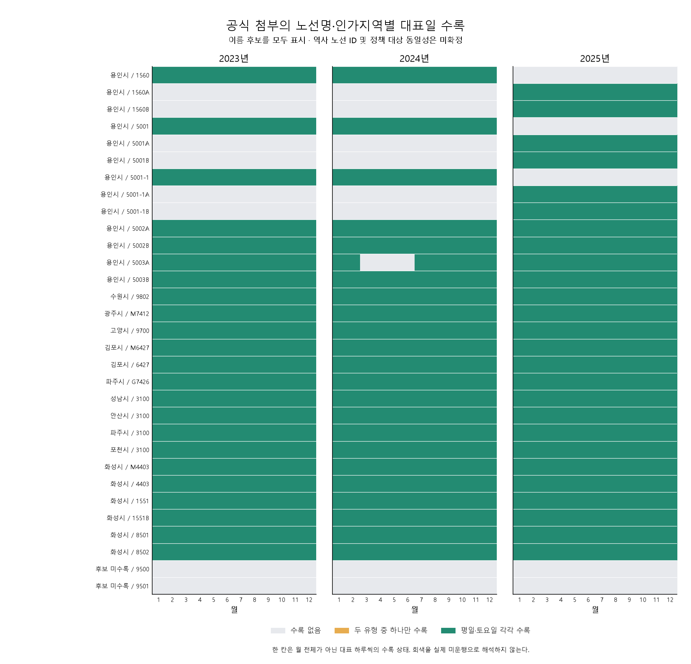

# 경기 노선 이용객 자료: 대표일·이름 후보·중복을 구분한 감사

2026-10-29 두 번째 탐색에서 경기교통정보센터의 2023~2025년 공개 첨부 9개, 129,134,312바이트를 수집했다. 압축 내부를 포함한 XLSX 12개의 **자료 3,303,980행**을 읽었다. 이 자료는 정책 노선의 장기 수요를 더 조사할 단서가 되지만, 현재 상태로 기존 일별 버스 시간 분석에 결합하지 않는다. 월 전체 합계가 아니며, 실제 대표 날짜와 역사 노선 ID가 없기 때문이다.

## 무엇을 측정하는가

[공식 노선별 이용객 설명](https://gits.gg.go.kr/gtdb/web/trafficDb/publicTransport/passengersByRoute.do)과 [공식 3쪽 PDF](https://gits.gg.go.kr/gtdb/pdfDownload/publicTransport_passengersByRoute.pdf)를 전부 확인했다.

| 항목 | 확인한 정의와 사용 범위 |
|---|---|
| 관측일 | 매월 평일 수요일·주말 토요일에서 대표 하루씩, 총 2일. 실제 선정 날짜는 첨부에 없음 |
| 지역 | 승하차 장소가 아닌 노선 인허가 지역 |
| 원천 | 교통카드와 버스 기반정보 |
| 전체통행 | 전체승차 + 전체하차. 고유 이용자 수가 아님 |
| 전체승차·하차 | 각각 단일통행과 환승통행의 합 |
| 주간 | 07시 이상 19시 미만, 12개 시간 |
| 전일 | 24개 시간 |
| 연결 키 | 설명 문서의 원천 DB에는 카드노선 ID가 나오지만 실제 XLSX에는 ID 열이 없음 |

따라서 이 수치를 월 승객 총량·일평균으로 바꾸지 않는다. 대표 날짜를 모르는 상태에서 2024년 5월 20일~6월 28일 / 7월 8일~8월 16일 비교 창, 날씨, 휴일 자료와 결합하지 않는다. `주말`이라는 원본 열 값은 이 자료에서는 토요일 대표일을 뜻한다.

## 출처와 원본 구조

[공식 자료실](https://gits.gg.go.kr/gtdb/web/trafficDb/visualization/data/list.do)의 2023·2024·2025년 게시물을 사용했다. [2024년 게시물](https://gits.gg.go.kr/gtdb/web/trafficDb/visualization/data/view.do?boardNo=1956&boardOrder=1695&schGubunCode=02&schCon=0&schStr=&pageIndex=1)과 각 연도 첨부의 정확한 요청·해시는 [수집 명세](results/deepening/gyeonggi/collection_requests.json), [원본 목록](deepening-gyeonggi-sources.json)에 있다. 공개 다운로드 URL의 파일 인자는 게시물에서 받은 값을 보존했다.

| 연도 | 시간대별 자료 행 | 전일·주간 자료 행 | 단일·환승·전체 자료 행 | 값 없이 서식만 남은 XML 행 |
|---|---:|---:|---:|---:|
| 2023 | 896,028 | 132,903 | 67,764 | 448,010 |
| 2024 | 861,240 | 126,502 | 64,482 | 400,000 |
| 2025 | 951,354 | 135,069 | 68,638 | 0 |
| 합계 | 2,708,622 | 394,474 | 200,884 | 848,010 |

일부 시트는 선언 범위가 `A1`인데 실제 XML에는 전체 자료가 있다. 반대로 일부 파일에는 빈 서식 행이 대량으로 남아 있다. 선언 범위를 초기화하고 모든 XML 행을 읽되, **모든 셀이 비어 있는 행만** 별도 집계해 제외했다. 숫자 0과 일부 값이 있는 잘못된 행은 빈 행으로 처리하지 않는다. 자료 행의 수치 공란·음수는 없었다. 첫 실행 중 빈 서식 행에서 중단한 부분 변환은 로컬 격리 경로에 보존했으며, 수정된 규칙으로 전체 파일을 다시 검사했다.

첨부의 SQL에는 통계 연도와 시종점 설명의 기준 연도가 따로 적혀 있다. 2023년과 2024년 통계 모두 **2023년 1월** 노선 설명을 연결하고, 2025년 통계는 **2025년 1월** 설명을 연결한다. 행정지역과 노선명으로 연결하는 예시이며, 역사 노선 ID나 매월 실제 경로를 제공하는 자료가 아니다.

## 노선명만으로 합치면 생기는 문제

연도·지역·월·노선명·대표일 유형에 시간/집계 종류를 더한 키와, 여기에 시종점 설명까지 더한 키를 각각 검사했다. 같은 키에 값이 다른 경우를 임의 합산·평균·첫 행 선택으로 해결하지 않는다.

| 연도 | 시간 자료의 값 충돌 키 | 전일·주간 자료의 값 충돌 키 | 통행 종류 자료의 값 충돌 키 |
|---|---:|---:|---:|
| 2023 | 16,894 | 2,677 | 1,341 |
| 2024 | 16,075 | 2,684 | 1,345 |
| 2025 | 16,388 | 2,805 | 1,408 |

이 표는 **시종점 설명을 제외한 키의 값 충돌**이다. 같은 설명까지 가진 행에서도 값 충돌이 있으므로 설명 중복만 제거하면 해결되는 문제가 아니다. 숨겨진 식별자 등 원인을 이 파일만으로 확정하지 않는다. 자세한 분모·설명별 충돌과 예시는 [키 감사](results/deepening/gyeonggi/key_audit.csv), [예시](archive.md#results) (`results/deepening/gyeonggi/description_ambiguity_examples.csv`, 로컬 보관)에 있다.

2024년 시간 파일 두 개의 경계에는 내용이 완전히 같은 행 1개도 있었다. 안양시 8번, 12월 주말 13~14시의 921이라는 값이다. 이 단일 중복과 서로 다른 값의 충돌은 별개로 기록했다.

값이 한 가지인 키만 내부 산술 대조용 한 표현으로 만들었다. 이것은 노선 ID를 복원하거나 수요를 합친 결과가 아니다. 단일·환승·전체의 승하차 관계 **1,107,318개 등식**은 모두 일치했다. 전일 값과 통행 합계는 비교 가능한 184,553건이 일치했고, 다른 한쪽이 없는 8건은 판정하지 않았다. 24시간이 모두 있는 523건, 주간 12시간이 모두 있는 99,388건의 시간 합계도 일치했다. 나머지 불완전 시간 표를 0으로 채우거나 합계 불일치로 판정하지 않았다. [전체 산술 집계](results/deepening/gyeonggi/arithmetic_summary.csv)에 누락·불완전·일치가 함께 있다.

## 정책 대상 이름의 수록 상태

공식 정책의 20개 노선명을 사전에 지정하고, 용인 5개 이름에만 명시적인 A/B 접미사 후보를 허용했다. `M`, `G`, `1551B`는 제거하거나 다른 이름과 합치지 않았다. **매년 18개 이름에서 후보를 찾았고 9500·9501은 없었다. 이는 정책 대상 18개 노선의 동일성을 확인했다는 뜻이 아니다.**

- 9802는 **수원시** 이름으로 수록되어 원래 정책의 **인천 9802**와 그대로 연결할 수 없다.
- 3100은 성남·안산·파주·포천 네 지역에 각각 있다. 모든 후보를 보존했다.
- 1560·5001·5001-1은 2023~2024년 이름과 2025년 A/B 이름이 다르다. 설명 기준 연도도 다르므로 실제 분할·개통 시점을 추정하지 않는다.
- 용인 5003A의 2024년은 1·2·7~12월만 수록된다. 3~6월의 부재는 원본 부재이며 값 충돌로 제외된 것이 아니다. 미운행으로 바꾸지 않는다.
- 후보에 해당하는 통행 종류 자료는 1,720행이다. 이 후보들의 자연 키에는 값 충돌·복수 시종점 설명이 없었다. 그렇더라도 외부 역사 ID 확인과 대표 날짜의 부재는 해결되지 않는다.



그림은 실제로 발견된 지역·이름 29개와 미수록 이름 2개를 모두 보여 준다. 녹색은 그 달의 평일·토요일 대표일이 모두 수록됐다는 뜻이다. 회색은 이 파일의 미수록이며 실제 운행 중단을 뜻하지 않는다. [전체 이름 수록](results/deepening/gyeonggi/policy_name_presence.csv), [품질과 월 목록](results/deepening/gyeonggi/candidate_coverage.csv), [후보의 원래 대표일 집계](archive.md#results) (`results/deepening/gyeonggi/candidate_representative_day_trips.csv`, 로컬 보관)를 함께 공개한다.

## 이번 판단과 다음 자료

**채택:** 공개 자료의 실제 범위와 한계를 확인하고, 향후 연결을 검토할 지역·이름·시종점 후보 목록으로 사용한다. 지역 전체 수요 합계나 정책 노선 효과에는 사용하지 않는다.

**보류:** 경기 노선 수요가 강남대로 시간 기록 변화를 설명한다는 분석. 다음 세 가지가 확보되어야 한다.

1. 해당 통계의 실제 대표 날짜와 선정·대체 규칙.
2. 해당 시점의 카드노선 ID ↔ 경기/인천 기반정보 ID ↔ 서울 관측 노선 ID 대응.
3. 같은 지역·이름·시종점에서 다른 값이 나오는 키의 정의와 중복 처리 규칙.

[GBIS 기반정보 공식 안내](https://www.gbis.go.kr/gbis2014/publicService.action?cmd=mBaseInfo)는 인증키와 현재 기반정보 버전/다운로드 경로를 설명한다. 확인한 명세에는 원하는 과거 날짜를 지정하는 인자가 없다. 현재 노선 파일을 받아 과거 ID로 대신 쓰지 않았고, 인증 신청이나 기관 연락도 하지 않았다. 옛 경기데이터드림 링크의 HTTP 200 오류 페이지는 자료로 채택하지 않았다.

## 재현과 검증

사례 디렉터리의 `uv` 환경에서 순서대로 실행한다. 원본·변환 Parquet·SQL은 Git 제외 경로, 감사 표와 그림은 `results/deepening/gyeonggi/`에 있다.

```bash
.venv/bin/python deepening.py gyeonggi-prepare
.venv/bin/python deepening.py gyeonggi-collect
.venv/bin/python deepening.py gyeonggi-parse
.venv/bin/python deepening.py gyeonggi-audit
.venv/bin/python deepening.py gyeonggi-plots
```

[파싱 명세](results/deepening/gyeonggi/extraction.json)는 파일별 실제 행·빈 행·SQL 연도·변환 해시를 기록한다. [감사 명세](results/deepening/gyeonggi/audit.json)와 [그림 명세](results/deepening/gyeonggi/figures.json)는 설정·코드·산출물 해시를 기록한다. 2026년 값은 수집·분석하지 않았다. 관련 테스트는 잘못된 XLSX 범위, 0과 빈 서식 행, 잠금 연도 선검사, 이름 접두사/접미사, 충돌 키, 불완전 시간 합계의 오판 방지를 검사한다.
