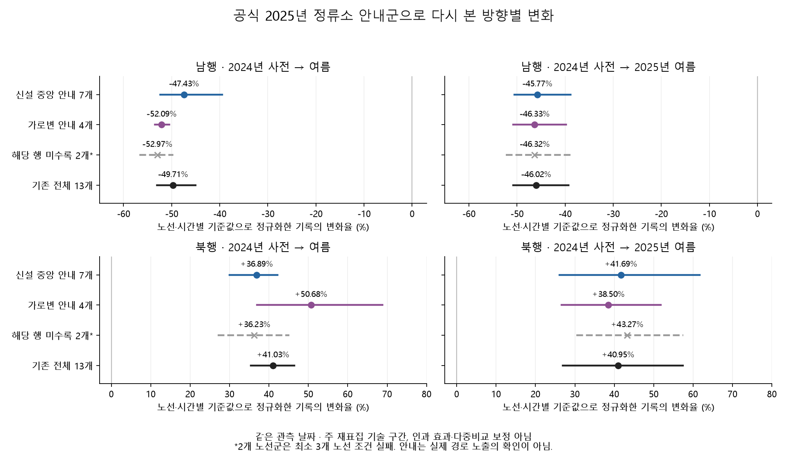

# 도로 속성 기록과 실제 운영 변경을 구별하기

2026-10-29 작성. 영동1교~시민의숲 주변을 조사하면서 **2025년 1월 중앙차로 연장과 정류소 변경**을 확인했다. 기존 도로 메타데이터는 이 기간 그대로였지만, 새 정류소의 운행횟수 기록은 개통 안내일인 1월 11일부터 나타났다. 기존 버스 방향별 변화는 중앙 안내군과 가로변 안내군 모두에 남았다.

## 공식 기록이 알려 주는 사건

| 날짜 | 확인한 근거 | 해석 범위 |
|---|---|---|
| 2023-06-21 | [서울시의회 청원 검토](https://ms.smc.seoul.kr/record/recordView.do?key=279e8a70cc0c39a40f9ac388dfe0ce45f5b310361158db5b6560b68b0a20308b3725cd47d6ab8d6b): 강남대로 연결 구간의 7월 착공 예정, 가로변 정류소·유턴 존치 논의 | 예정·청원 내용이며 일별 공정표가 아님 |
| 2023-07-08 | [서울시 발행 시민기자의 현장 기록](https://mediahub.seoul.go.kr/archives/2008470): 청계산입구~내곡IC 1구간 개통 | 직접 방문 기사와 사진을 확인했으며 행정 준공 서류와 구별 |
| 2023-11-02 | [서울시의회 업무보고](https://ms.smc.seoul.kr/record/recordView.do?key=4833d0888ff75d435db3fd39dd276a674565cde2a50768454885758e3f741b6adf7c5572346477c5): 1구간 개통, 2구간 공사 진행 | 공사 진행의 근거이며 2024년 6월 세부 통제일은 미확인 |
| 2024-06-29 | [서초구의회 사후 보고](https://sdc.seoul.kr/main/minutes/html/MinutesView.do?MINTS_SN=5089): 양재천 우안도로 공사 완료 | 버스 분산 정책일과 겹침. 구체적 개방 시각·신호 현시는 미확인 |
| 2025-01-11 | [서울시 1월 6일 안내](https://mediahub.seoul.go.kr/archives/2013139): 영동1교~청계산입구 약 1.5km 연결, 중앙 정류소 4개와 횡단보도 정비 | 안내문만으로 실제 첫 차량 운행을 확정하지 않고 아래 원본 기록과 연결 |

2025년 안내의 위치도와 영동1교 전후·시민의숲 조감도를 직접 확인했다. 조감도는 중앙차로·횡단보도·양재천 우안도로의 배치를 보여 준다. 실제 촬영일, 일별 차로 운영, 신호 주기, 교차로 회전량을 제공하지는 않는다. 원문·이미지·해시는 [출처 명세](deepening-sources.json)에, 원본은 Git 제외 경로에 보존했다.

이 사건들 때문에 2023년을 사건이 없는 대조 연도로, 2025년을 2024년 정책만 남은 상태로 가정할 수 없다. 해당 사건이 우리 구간의 관측 변화에 얼마나 기여했는지도 현재 자료로 분리하지 못한다.

## 메타데이터가 같아도 현장 조건은 바뀔 수 있다

기존 14개 일반도로 링크의 2023-01~2025-12 추출 명세에서 도로명·시종점명·방향·거리·차선수·기능유형·도심/외곽·권역의 9개 속성을 대조했다. **504개 링크·월 모두 단일 속성으로 월 전체가 기록**됐고 링크 누락은 없었다. 인접 완전 월의 필드 변경 11건은 모두 2023년 3→4월 경계였다. 이름 변경 2건, 차선수 변경 9건이다.

2023년 4월 이후에는 이 필드들에 추가 변경이 없다. 그러나 공식 2025년 공지에는 중앙차로·정류소·횡단보도 변경이 기록돼 있다. 따라서 “ID·이름·거리·차선수가 같다”는 것은 **공개 속성 기록의 안정성**이다. 물리적 도로·검지 표본·신호 운영이 불변이었다는 증거가 아니다. 속성 기록의 갱신 시점과 행정상 차선수의 정의도 미확인이다.

[전체 월별 상태](results/deepening/metadata/monthly_status.csv), [속성 원문 값](results/deepening/metadata/variants.csv), [11개 변경 필드](results/deepening/metadata/adjacent_changes.csv), [감사 명세](results/deepening/metadata/audit.json). 이 감사는 기존 추출 명세를 읽었으며 속도 관측값을 다시 열지 않았다.

## 새 정류소의 ID와 실제 집계 기록

기존에 수집한 정류소 전체 위치 목록과 중앙차로 목록을 다시 사용했다. 새 중앙 정류소 4개와 가로변 6개를 총 43개 목록 기준일에서 확인했다. 352개 목표 기록 중 242건이 대응했고 ARS 중복 충돌은 없었다.

| 새 중앙 ARS | 표준 ID | 목록의 이름 |
|---|---|---|
| 22043 | 121001341 | 영동1교교차로 |
| 22044 | 121001342 | 영동1교교차로 |
| 22045 | 121001343 | 매헌시민의숲 |
| 22046 | 121001344 | 매헌시민의숲 |

두 종류 목록에서 네 정류소는 2024-12-09 미수록, 2025-02-04 첫 수록이다. 57일 사이의 정확한 변경일은 목록만으로 추정하지 않는다. 가로변 6개는 각각 30개 위치 기준일 중 29개에 존재한다. 빠진 2024-08-12 파일은 전체가 100행인 부분 목록이므로 폐지 근거로 쓰지 않는다. 두 목록이 같은 원천에서 만들어졌을 가능성도 있어 독립적인 현장 확인 두 번으로 세지 않는다.

이 공백을 좁히기 위해 기존 [OA-21220 운행횟수](https://data.seoul.go.kr/dataList/OA-21220/S/1/datasetView.do)의 2025년 1·2월 ZIP 두 개를 별도 CSV 판독기로 순회했다. 전체 4,416,971행에서 1월 1일~2월 7일·기존 13개 노선·10개 정류소의 기록을 확인했다.

- 새 중앙 4개×중앙 안내 7개 = **28개 조합 모두 첫 양수 기록이 2025-01-11**이었다. 같은 범위에서 가로변 안내 4개 노선은 새 중앙 정류소에 양수 기록이 없었다.
- 1월 9일에는 중앙 안내군의 기존 가로변 22개 조합과 가로변 안내군의 16개 조합에 양수 기록이 있었다. 1월 10일 중앙 안내군의 기존 가로변 22개 조합은 복수 기록으로 격리했다. 이를 하루 운휴로 해석하지 않는다.
- 원본의 날짜 자체는 1월 9일부터 시작한다. 1~8일은 날짜 부재다. 1월 25일 새 중앙 28개 조합은 행이 있지만 24시간 모두 공란이며, 26일은 27개가 공란·1개가 행 부재였다. 실제 버스가 운행하지 않았다는 뜻이 아니다.
- 4,940개 노선·정류소·날짜 중 고유 행 1,283개, 행 부재 2,593개, 날짜 부재 1,040개, 복수 기록 격리 24개다. 일 합계와 24시간이 모두 유효한 행은 **0개**여서 합계 일치 검증을 통과했다고 주장하지 않는다.

공식 안내일과 **양수 집계 기록의 첫 출현**이 맞는다는 근거를 얻었다. 개별 차량의 첫 통과 시각이나 모든 차량의 실제 경로를 관측한 것은 아니다. [전체 상태](results/deepening/infrastructure/trip_support_daily.csv), [노선·정류소별 요약](results/deepening/infrastructure/trip_support_summary.csv), [원본 감사](results/deepening/infrastructure/trip_support_audit.json).

개통 전후·공란·복수 기록의 6개 날짜는 Pandas CSV 판독으로 다시 확인했다. 기존 스트리밍 집계 함수를 호출하지 않고 3개 주간 파일을 읽어 **780개 상태·3,900개 수치가 일치**했다. [대조 명세](results/deepening/infrastructure/trip_support_validation.json).

## 기존 방향별 변화가 중앙 안내군에만 남는가

공식 정류소별 노선 표와 기존 역사적 노선 ID를 연결해 고정 13개를 나눴다. 각 이름은 역사 목록 29개 기록에서 같은 ID에 대응한다. 새 중앙 정류소 기록이 있는 7개와 가로변 안내 4개가 모두 분석에 포함된다. 나머지 2개를 무영향 대조군으로 간주하지 않는다.

| 그룹 | 노선 이름 |
|---|---|
| 신설 중앙 안내 7개 | 440, 452, 470, 741, 9404, 9408, 9409 |
| 가로변 안내 4개 | 140, 400, 421, 441 |
| 해당 안내 행 미수록 2개 | 402, 420 |

2024년 사전의 노선·방향·시간별 평균, 양방향 7~22시 32개 양수 기록의 공동 관측 조건을 유지했다. 두 강조 구간은 남행 `22011→22009`, 북행 `22008→22010`으로 정확히 반대편의 같은 물리 구간이 아니다. 시간 단위·정차 포함 경계도 여전히 미확인이다.

아래는 모든 분할 그룹에서 관측률을 통과한 **같은 날짜**의 저녁 17~19시 변화다. 2024년 사전 27일·여름 29일, 2025년 사전 26일·여름 28일이다. 그룹별 자체 관측 날짜 결과도 모두 공개했다.

| 그룹 | 2024년 여름/사전 남행 | 북행 | 2025년 여름/2024년 사전 남행 | 북행 |
|---|---:|---:|---:|---:|
| 신설 중앙 안내 7개 | −47.43% | +36.89% | −45.77% | +41.69% |
| 가로변 안내 4개 | −52.09% | +50.68% | −46.33% | +38.50% |
| 전체 13개 | −49.71% | +41.03% | −46.02% | +40.95% |



남행 감소·북행 증가의 기록은 두 안내군에 모두 남았다. 2025년 여름/2024년 사전 변화율의 중앙−가로변 차이는 남행 +0.57%p, 북행 +3.18%p이며 주 재표집 구간이 각각 0을 포함했다. 작은 표본과 다른 운영 이력 때문에 두 그룹이 동등하다거나 중앙차로 연장의 영향이 없다고 결론내릴 수 없다. 2025년 배치 차이 하나만으로 기존 패턴을 설명하지 못했다는 구성 점검이다.

80개 비교 중 60개가 품질 조건을 통과했다. 미수록 2개 그룹의 20개 비교는 원래 최소 3개 노선 조건을 실패했으며 표·그림에 그대로 남겼다. 10개 같은 날짜 그룹 대비는 기술 비교이고 인과 이중차분·다중비교 보정 구간이 아니다. 기존 13개 노선 일별 270행을 재현했고, 별도 긴 표 계산으로 4,590수치를 대조해 최대 차이는 `1.14e-13` 이하였다.

[노선 선택표](results/deepening/infrastructure/route_groups.csv), [80개 전체 비교](results/deepening/infrastructure/group_comparisons.csv), [그룹 대비](results/deepening/infrastructure/group_contrasts.csv), [관측 날짜](results/deepening/infrastructure/group_date_retention.csv), [독립 검증](results/deepening/infrastructure/group_validation.json).

## 관련 연구와 남은 자료

서울연구원의 [전범준 외, 2024-PR-10](https://www.si.re.kr/bbs/view.do?key=2024100039&pstSn=2502190011)은 인쇄 26~28쪽에서 첫차·막차·배차간격으로 버스 교통량을 산정한다. 86~89쪽의 도로점용 분석은 VISSIM 가상 도로망이다. 표와 도면도 확인했다. 이 수치를 우리 구간의 실제 일별 운행 대수나 공사 효과로 붙이지 않았다. 연구가 사용하는 회전비율·차로 구성·신호 주기는 앞으로 실제 현장에서 확보해야 할 변수다.

가장 가치 있는 다음 자료는 2024년 6~7월의 차로 통제·신호 현시 적용 이력과, 시간 필드의 정확한 정의다. 2025년 1월은 개통일과 집계 기록을 연결했지만 2024년 변화의 원인을 대신 밝혀 주지는 않는다.

```bash
# 사례 폴더, 기존 원본과 동결된 입력 명세가 있는 환경
.venv/bin/python deepening.py metadata-audit
.venv/bin/python deepening.py infrastructure-history
.venv/bin/python deepening.py infrastructure-groups
.venv/bin/python deepening.py infrastructure-check
.venv/bin/python deepening.py infrastructure-raw
.venv/bin/python deepening.py infrastructure-raw-check
.venv/bin/python deepening.py infrastructure-plots
```

앞 단계 결과를 다시 쓰면 뒤 단계의 해시가 달라질 수 있다. 단순 공개 검토는 [공개 검증기](review_deepening.py)의 `--check`를 사용한다.
