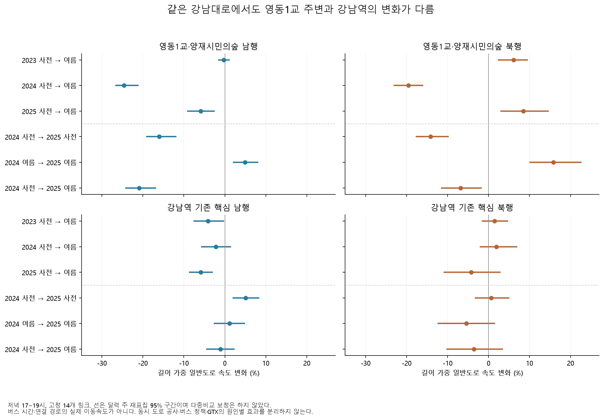
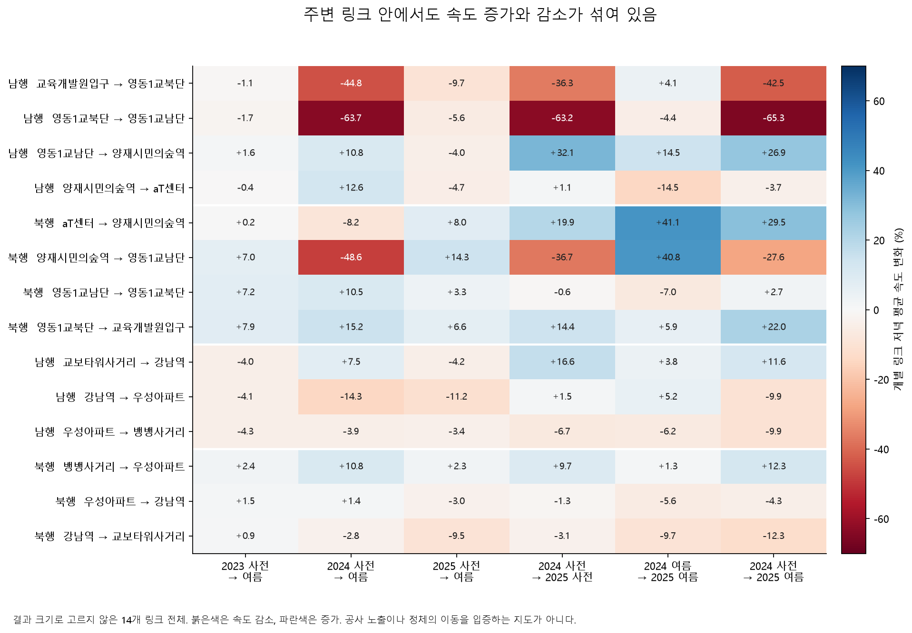

# 양재천 동시 도로 변화와 강남대로 내부의 다른 속도 양상

2026-10-29 추가 탐색에서 영동1교·양재시민의숲 주변의 일반도로 링크 8개와 기존 강남역 핵심 링크 6개를 비교했다. **2024년 여름 저녁, 영동1교 주변의 길이 가중 속도는 남행 −24.62%·북행 −19.54%였지만 강남역 핵심은 −2.18%·+1.92%였다.** 주변 링크 내부에도 증가와 감소가 섞였다. 강남대로 전체를 하나의 평균이나 버스 정책의 대조군으로 처리하면 이 차이가 가려진다.

이는 일반도로 속도의 후속 기술 분석이다. 버스 시간값의 단위·정차 경계는 여전히 미확정이며, 도로 공사·버스 정책·다른 교통수단 변화의 원인별 효과를 나눈 결과가 아니다. 2023~2025년은 이미 본 기간이다.

## 같은 날의 다른 변화

[서초 소식지 2024년 6월호 16면](https://seocho.newstool.co.kr/pdf/seocho_202406.pdf)은 영동1교 교차로~태봉로 일부 구간의 개통을 5월 말에서 **6월 29일로 연기할 예정**이라고 설명한다. 안전시설 보완과 합동점검을 언급하며 아래 약도를 함께 제공한다. 해당 면의 글과 약도를 직접 확인했다. 약도는 공사 선형의 측량 자료가 아니다.

[2024년 11월 19일 서초구의회 회의록](https://sdc.seoul.kr/main/minutes/html/MinutesView.do?MINTS_SN=5089)의 도로과 보고는 양재천 우안도로 **공사를 6월 29일 완료**했다고 기록한다. 예정 기사와 사후 완료 보고를 구분한다. 정확한 차량 개통 시각, 교차로 회전 허용, 신호 주기·현시와 차로 변경 이력은 확보하지 못했다. 두 문서의 원본 해시는 [별도 근거 명세](results/deepening/road_context/event_sources.json)에 고정했다.

강남역 버스 노선 조정과 GTX-A 구성역 개통도 6월 29일에 있었다. 날짜가 같다는 이유로 속도 변화의 원인을 어느 하나로 확정할 수 없다. 이번 구분은 **문서 위치와 기존 링크의 시종점 명칭에 근거한 주변 구분**이며 공사 노출 링크를 좌표로 확인한 구분이 아니다.

## 고정 표본과 비교 방식

기존 2023·2024년 사전 관측으로 선택한 링크·시간 셀에서 아래 ID만 추출했다. 결과 크기나 사후 관측률로 교체·제외하지 않았다. [설정](deepening_road_config.yaml)은 새 집단 결과 계산 전에 커밋했다.

| 집단 | 고정 링크와 범위 |
|---|---|
| 영동1교 주변 남행 | `1210011200`, `1210010200`, `1210009400`, `1210008400`: 교육개발원입구 → 영동1교 북단·남단 → 양재시민의숲역 → aT센터 |
| 영동1교 주변 북행 | `1210008500`, `1210009500`, `1210010300`, `1210011300`: 위 주변 구간의 북행 4개 링크 |
| 강남역 핵심 남행 | `1220025000`, `1220021000`, `1220016200`: 교보타워사거리 → 강남역 → 우성아파트 → 뱅뱅사거리 |
| 강남역 핵심 북행 | `1220016300`, `1220021100`, `1220025100`: 기존 북행 3개 링크 |

사전은 매년 5월 20일~6월 28일, 여름은 7월 8일~8월 16일이다. 공식 대조 공휴일을 제외한 전체 예정 평일을 분모로 유지했다. 오전 07~09시, 한낮 11~14시, 저녁 17~19시, 늦은 시간 20~22시를 모두 비교했다. 길이 가중 산술 평균을 주 결과로, 동일 셀 가중 평균을 민감도로 사용했다. **길이 가중 산술 평균은 연결 경로의 실제 이동속도나 통행시간이 아니다.**

일별 관측률 80%, 기간별 유효 20일 이상, 기간 간 관측률 차이 10%p 이하 기준을 유지했다. 192개 집단 비교와 84개 저녁 개별 링크 비교가 모두 통과했다. 14개 링크 × 12개월의 도로명·시종점명·방향·길이 대조 168건도 일치했다. 이 일치가 물리 형상이나 검지 방식의 불변을 증명하지는 않는다.

## 저녁의 주요 결과

| 집단 | 2024 사전 km/h | 2024 여름 km/h | 변화 | 주 재표집 95% 구간 |
|---|---:|---:|---:|---:|
| 영동1교 주변 남행 | 22.79 | 17.18 | −24.62% | [−26.79, −21.09] |
| 영동1교 주변 북행 | 22.90 | 18.43 | −19.54% | [−23.19, −15.90] |
| 강남역 핵심 남행 | 14.24 | 13.92 | −2.18% | [−5.84, +1.52] |
| 강남역 핵심 북행 | 13.00 | 13.24 | +1.92% | [−2.18, +6.98] |

2024년 두 기간 모두 29일, 각 집단 관측률 100%다. 동일 셀 가중으로도 주변 남행 −27.04%·북행 −10.40%로 감소하지만, 북행 크기는 길이 가중과 상당히 다르다. 따라서 −19.54%를 집계법과 무관한 유일한 수치로 제시하지 않는다.

2023년 같은 계절 비교에서 주변 남행은 −0.27%, 북행은 +6.15%였다. 2025년 여름을 2024년 사전과 비교하면 주변 남행 −20.93%·북행 −6.82%다. 2025년 사전→여름에는 남행 −5.87%·북행 +8.51%로, 두 방향이 같은 방식으로 지속된 것도 아니다.



주 재표집은 달력 주를 단위로 2,000회 수행했다. 구간은 다중비교 보정 없는 개별 기술 구간이며 인과 검정이나 새 우승 집단 선정에 쓰지 않는다. [192개 전체 집단 비교](results/deepening/road_context/group_comparisons.csv)에 다른 시간대와 집계법도 함께 있다.

## 한 구역 안의 링크도 다르다

2024년 저녁에 남행 영동1교 북단→남단은 −63.70%, 그 앞 교육개발원입구→북단은 −44.76%였지만, 남단→양재시민의숲역은 +10.80%였다. 북행 양재시민의숲역→영동1교 남단은 −48.59%인 반면 다리 남단→북단은 +10.47%였다. 이처럼 서로 가까운 링크라도 변화 방향이 다르다.



전체 14개를 모두 표시했다. 특정 링크만 골라 정체가 다른 곳으로 이동했다거나 새 도로 때문에 악화됐다고 단정하지 않는다. 실제 회전 교통량, 신호 변경, 차량 구성, 링크 속도 산출 방식 등으로 구분해야 할 가설이다. [84개 개별 비교](results/deepening/road_context/single_link_evening.csv)에는 품질과 각 구간 추정도 있다.

2024년 주변 북행은 오전 −27.66%, 한낮 −31.83%, 저녁 −19.54%, 늦은 시간 −7.85%였다. 주변 남행은 각각 −9.53%, −6.23%, −24.62%, −9.70%다. 따라서 저녁 한 시간대의 공통 악화로만 설명하기도 어렵다.

## 독립 원본 확인

먼저 기존 강남역 핵심의 2024~2025년 일별 1,808행을 재현했다. 지수·관측률·단위 관측률 각각의 최대 절대 차이는 0이고 결측 상태도 같았다.

이후 기존 openpyxl 파서와 별도로 **ZIP 내부 XML을 직접 읽는 판독기**를 작성했다. 매년 6월 26일·7월 10일, 총 여섯 날짜의 14개 링크 × 24시간 **2,016개 값과 결측 상태**를 대조해 모두 일치했다. 원본 자료 행 927,745개를 스캔했다. 여섯 날짜의 독립 대조이며 모든 월 값 전체를 독립 재추출한 것은 아니다. [대조 명세](results/deepening/road_context/raw_check.json)와 [셀별 대조](archive.md#results) (`results/deepening/road_context/raw_check_cells.csv`, 로컬 보관)에 범위·해시·오차가 있다.

## 다음에 필요한 근거

- 영동1교 교차로의 2024년 차로·회전·신호 운영 도면과 적용 날짜.
- 우안도로의 실제 부분 개통 시각, 접속부의 교통 흐름, 공사 중 통제 및 개통 후 보완 이력.
- 해당 서비스링크의 적용일을 포함한 과거 형상·표준링크 대응과 속도 집계/프로브 구성 변경 이력.
- 같은 범위를 지나는 차량의 회전 교통량과 버스 운행 기록. 기존 버스 강조 구간과 이 일반도로 자료를 동일 차량의 이동으로 연결할 근거.

현재 공개 도로 형상 첨부와 ID 대응의 확인 결과는 별도 [도로 형상 감사](archive.md#reports) (`deepening-geometry-report.md`, 로컬 보관)로 연결한다. 발표 연도가 달라졌다는 이유만으로 과거 시점의 형상이라고 확정하지 않는다.

## 재현

사례 디렉터리에서 기존 자료 캐시를 확인한 뒤 아래 명령을 실행한다. [집단 감사 명세](results/deepening/road_context/audit.json)는 입력·코드·원래 결과 재현·품질과 출력 해시를 기록한다. 첫 탐색의 설정·결과·2026년 잠금은 그대로 유지했다.

```bash
.venv/bin/python deepening.py road-context
.venv/bin/python deepening.py road-raw-check
.venv/bin/python deepening.py road-plots
```
