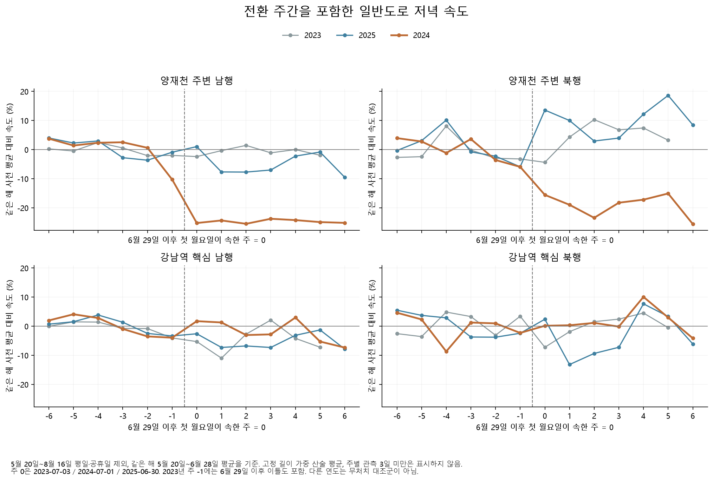
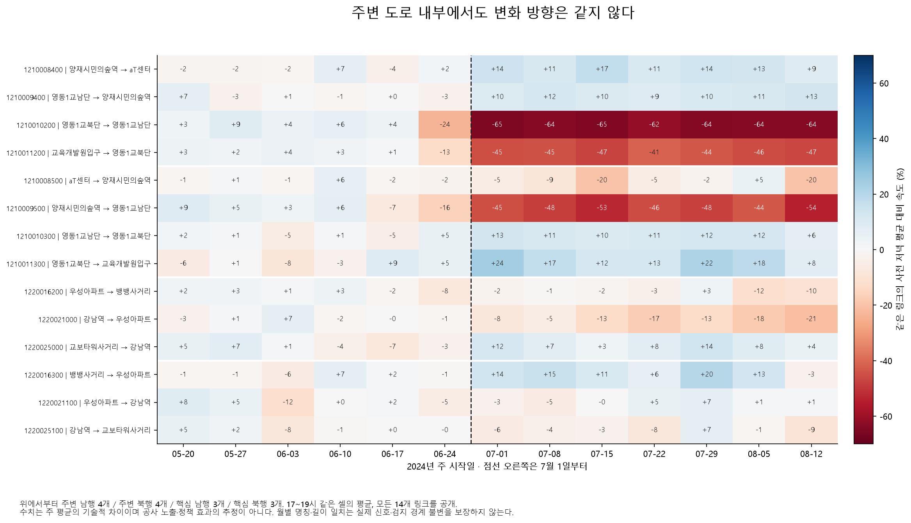

# 전환 주간을 포함하면 보이는 일반도로 변화

2026-10-29 작성. [주변 14개 링크 비교](deepening-road-report.md)에 빠져 있던 전환 주간을 연결했다. 일부 주변 링크는 2024년 6월 29일 이전부터 속도가 낮아지고, 강남역 핵심 남행은 추세 포함 여부에 따라 수준 차이의 부호가 바뀐다. 따라서 단일 시행일을 기준으로 관측 변화를 정책의 원인 효과라고 부를 근거는 부족하다.

## 범위와 읽는 방법

기존 14개 링크·4개 시간대·두 집계법을 유지했다. 각 해 2023~2025년 5월 20일~8월 16일의 평일에서 원래 공휴일을 제외하고, 결측은 채우지 않았다. 새 분기점을 찾거나 결과에 따라 기간·링크를 고르지 않았다. 버스 운행시간 자료와 다른 **일반도로 속도(km/h)** 분석이다.

주별 그림의 0주는 매년 6월 29일 다음 첫 월요일을 시작으로 한다. 각 해 원래 사전 기간 평균 대비 변화율이며, 최소 3일 관측을 요구한다. 1,794개 집계 중 46개는 2023년 마지막 부분 주의 관측일이 2일이라 제외됐다. 점과 선은 신뢰구간이 아니다. [전체 주별 표](results/deepening/transition/weekly.csv)에 실패한 주도 남겼다.





## 시행일 전부터 보이는 낮은 값

다음은 전환 경계의 일부 일별 저녁 평균이다. 전체 링크·날짜는 [일별 표](results/deepening/transition/daily.csv)와 위 그림에 공개한다. 주변 남행은 영동1교·양재시민의숲의 원래 네 링크를 고정 길이로 가중했다.

| 날짜 | 주변 남행 | 영동1교 북단→남단 `1210010200` | 교육개발원입구→영동1교 북단 `1210011200` |
|---|---:|---:|---:|
| 2024-06-24 | 22.070 | 22.613 | 32.143 |
| 2024-06-25 | 22.738 | 21.640 | 34.700 |
| 2024-06-26 | 20.567 | 16.033 | 30.300 |
| 2024-06-27 | 17.847 | 13.267 | 23.730 |
| 2024-06-28 | 19.036 | 13.317 | 26.713 |
| 2024-07-01 | 18.445 | 8.827 | 20.173 |
| 2024-07-02 | 15.799 | 6.857 | 17.680 |
| 2024-07-03 | 17.901 | 8.830 | 19.477 |
| 2024-07-04 | 17.474 | 6.950 | 20.030 |
| 2024-07-05 | 15.596 | 8.080 | 15.333 |

6월 20일처럼 앞선 낮은 날짜도 있으므로 6월 26~27일을 새 확정 변화점으로 선언하지 않는다. 이 자료만으로 사전 공정·선행 대응·날씨·신호·표본 구성 중 무엇이 원인인지 구별할 수 없다. 북행도 모든 링크가 같은 방향으로 움직이지 않는다.

이 경계를 확인하기 위해 세 해에 동일한 6월 24일~7월 5일, 36일 전체를 원본 XML로 다시 읽었다. 여섯 월 파일의 927,745행을 스캔해 14개 링크×36일×24시간 = **12,096개 값·결측 상태가 모두 일치**했다. 지정한 경계의 추출을 확인한 것이며, 측정 방식 자체나 전체 월의 모든 도로를 검증한 것은 아니다. [원본 대조 명세](results/deepening/transition/raw_check.json), [셀별 대조](results/deepening/transition/raw_check_cells.csv).

## 추세를 넣으면 달라지는 해석

모든 해에서 기준일을 6월 29일로 고정하고 세 기술 회귀를 비교했다. 요일만 조정한 수준 차이, 선형 공통 추세를 추가한 수준 차이, 전후 추세를 따로 허용한 수준·기울기 차이다. 날짜는 기준일에서 중심화했다. 계수는 모형에 따른 기술 요약이며, 인과 효과·유의확률·인과 신뢰구간을 계산하지 않았다.

2024년 저녁, 고정 길이 가중 집단의 결과는 다음과 같다. 단위는 수준 차이 km/h, 기울기 변화 km/h/일이다.

| 집단 | 요일만: 수준 | 공통 추세: 수준 | 전후 추세: 수준 | 전후 추세: 기울기 변화 | 전후 추세: 30일 후 대비 |
|---|---:|---:|---:|---:|---:|
| 주변 북행 | −4.333 | −2.745 | −2.664 | +0.0339 | −1.647 |
| 주변 남행 | −5.631 | −4.455 | −4.286 | +0.0710 | −2.156 |
| 핵심 북행 | +0.217 | +0.424 | +0.463 | +0.0162 | +0.950 |
| 핵심 남행 | −0.231 | +0.971 | +0.997 | +0.0111 | +1.331 |

핵심 남행의 단순 전후 하락과 추세 포함 후 양의 수준 계수는 서로 다른 반사실 추세를 가정한 결과다. 어느 모형을 골라 “정책 때문에 좋아졌다/나빠졌다”고 결론내리지 않는다. 주변 집단의 하락은 세 모형에 남지만, 같은 시기 공사·교통 운영·사전 변화가 분리되지는 않는다. 30일 후 대비도 관측 변화점의 확정치가 아니라 모형의 수준+30×기울기 계수다.

같은 공통 추세 모형의 저녁 수준 계수도 해마다 다르다.

| 집단 | 2023년 | 2024년 | 2025년 |
|---|---:|---:|---:|
| 주변 북행 | +0.228 | −2.745 | +2.692 |
| 주변 남행 | −0.090 | −4.455 | +0.078 |
| 핵심 북행 | −0.378 | +0.424 | −0.201 |
| 핵심 남행 | −0.923 | +0.971 | −0.374 |

다른 해는 같은 계절의 기술 비교다. 2023년과 2025년에도 헌릉로 전용차로 개통 등 운영 변화가 있어 아무 사건도 없는 대조 연도로 보장하지 않는다. 실제 공정·신호 적용 이력을 더 확보해야 한다. [2023년 서울시의회 공사 진행 보고](https://ms.smc.seoul.kr/record/recordView.do?key=4833d0888ff75d435db3fd39dd276a674565cde2a50768454885758e3f741b6adf7c5572346477c5), [2025년 1월 서울시 개통 안내](https://mediahub.seoul.go.kr/archives/2013139).

## 기상 입력을 추가한 같은 날짜 비교

관측소 401·400·108과 날짜 정렬 −1·0·+1일을 모두 계산했다. 각 짝에서 같은 기상 완전 관측 날짜만 사용하고 원래 도로 유효일 대비 보존율도 남겼다. 강수량에는 `log1p`, 기온에는 평균을 사용했다. 대표 401·같은 날짜는 2024년 사전 29일·사후 34일을 모두 보존했다.

| 집단 | 기상 미포함 수준 차이 | 기상 포함 수준 차이 | 9개 관측소·정렬 조합의 포함 계수 범위 |
|---|---:|---:|---:|
| 주변 북행 | −2.745 | −2.999 | −3.625 ~ −2.951 |
| 주변 남행 | −4.455 | −4.245 | −4.450 ~ −4.110 |
| 핵심 북행 | +0.424 | +0.563 | +0.113 ~ +0.563 |
| 핵심 남행 | +0.971 | +0.941 | +0.666 ~ +0.997 |

이 사양 안에서는 강수·기온을 추가해도 주변 하락이 사라지지 않았다. 기상 시간 경계·비선형 반응·다른 사건을 모두 통제했다는 뜻은 아니다. 버스 자료의 시간 정의를 이 도로 기상 비교로 해결할 수도 없다.

## 근거·검증·재현

- [고정 분석 규칙](deepening_transition_config.yaml), [원본 대조 규칙](deepening_transition_check_config.yaml), [입력 명세](results/deepening/transition/input_manifest.json).
- [회귀 전체 270행](results/deepening/transition/fixed_date_regressions.csv), [기상 회귀 전체 216행](results/deepening/transition/weather_regressions.csv), [적합값·잔차](results/deepening/transition/fitted_descriptions.csv). 각 회귀는 양쪽 최소 20일·80% 보존 및 행렬 계수 조건을 통과했다.
- [감사 결과](results/deepening/transition/audit.json): 일별 8,464행, 이전 일별 5,312행 재현. [독립 계수 대조](results/deepening/transition/result_validation.json): 기존 설계·적합 함수를 호출하지 않고 QR 잔차화로 486행의 1,674수치를 재계산, 최대 오차 `3.64e-12` 이하.
- [Bernal 등 ITS 정정문](https://researchonline.lshtm.ac.uk/4657832/1/2017_lopezbernal_IJE_correction.pdf) 1쪽과 [저자 코드](https://github.com/gasparrini/2017_lopezbernal_IJE_codedata/blob/master/Rcode.R)의 날짜 중심화·자기상관 점검을 참고했다. 여기서는 해당 논문의 식별 가정을 확보한 인과 ITS를 구현했다고 주장하지 않는다. 실제 관측 간 잔차 1시차 상관도 표에 남겼으며 주말·결측 때문에 일정한 하루 간격의 상관과는 다르다.

```bash
# 사례 폴더, 기존 원본·추출 캐시 필요. 기존 결과와 첫 탐색 동결은 보존한다.
.venv/bin/python deepening.py transition-audit
.venv/bin/python deepening.py transition-result-check
.venv/bin/python deepening.py transition-raw-check
.venv/bin/python deepening.py transition-plots
```

이번 추가 결과의 다음 자료 우선순위는 **2024년 6~7월 영동1교·시민의숲 교차로의 일별 차로 통제와 신호 적용 이력**이다. 현재 공개된 이름·좌표·길이의 일치만으로 실제 통행 조건이 같았다고 보지 않는다.
