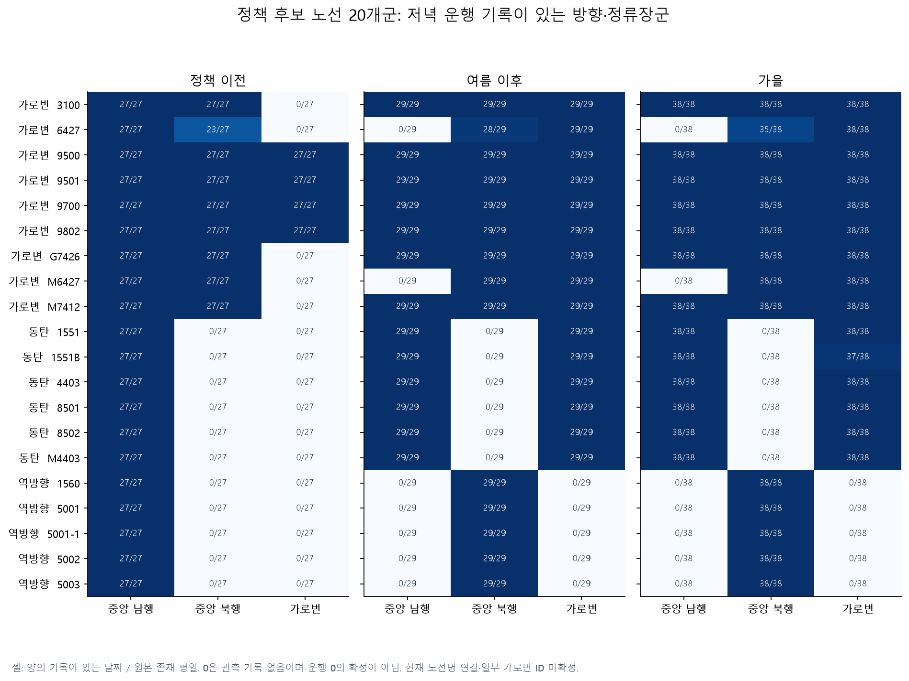
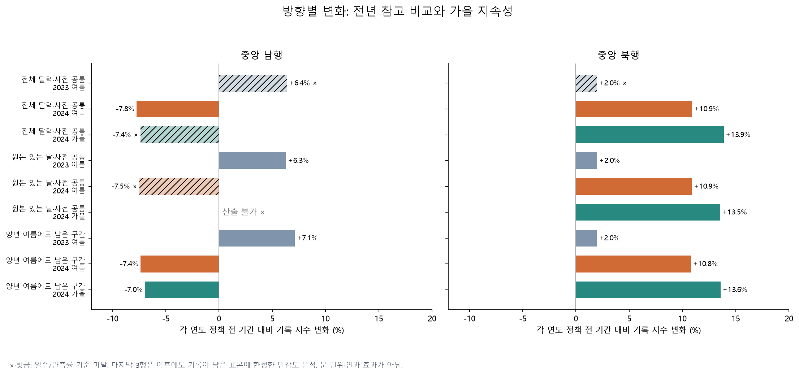
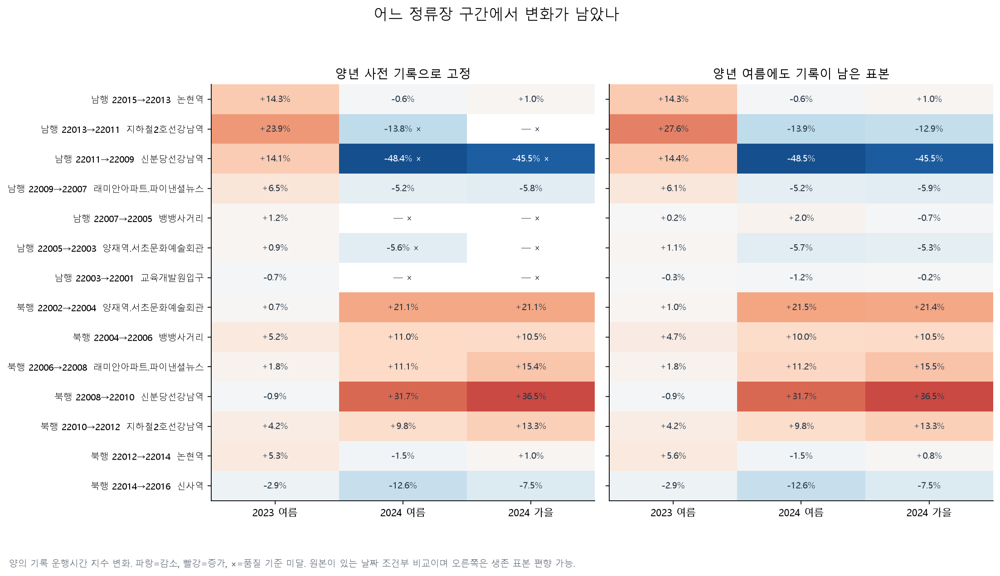
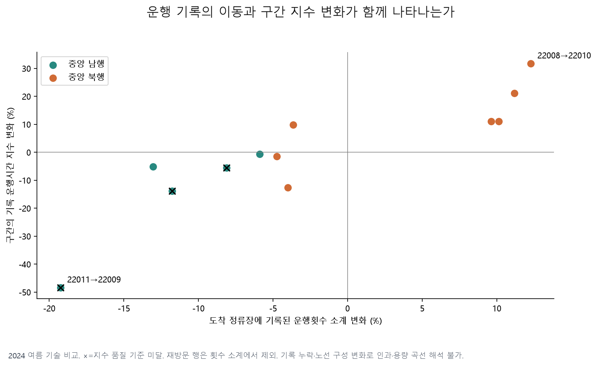
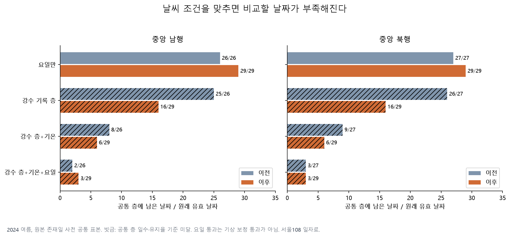

# 강남대로 버스 분산: 노선 이동·전년 비교·가을 지속성

2026-10-29 실행. [기존 후속 결과](followup-report.md)를 본 뒤 수행한 탐색이다. 질문은 **“남행의 감소와 북행의 증가가 노선 이동 기록과 맞는가, 전년 같은 계절과 가을에도 구별되는가?”**다. 결과를 본 뒤 정한 탐색이며 최초 사전 등록 실험으로 표현하지 않는다.

**북행 증가는 표본을 바꿔도 유지됐고, 일부 남행 구간의 큰 감소도 계속 기록된 표본에서 남았다.** 역방향 전환 후보 5개 노선군의 관측 위치 변화는 정책 내용과 부합한다. 다만 남행 전체는 사후 관측률이 떨어지고 날씨 조건을 맞춘 표본이 부족하여, 정책의 인과 효과나 날씨 보정 후 확정된 개선으로 결론 내리지 않는다.

## 1. 이번에 수집하고 확인한 범위

| 자료 | 실제 확보·처리 | 용도 |
|---|---|---|
| 서울 버스 운행시간·운행횟수·승차 기록 | 월 ZIP 39개, 2,513,535,950 bytes. 기존 2024년 4~8월 15개 재사용·24개 추가 | 2023년 4~8월과 2024년 4~10월의 같은 정류장 비교 |
| 월 경계 보완 | 위 39개 중 2023년 3월 3개 | 3월 마지막 주 파일에 있는 4월 1~2일 확보 |
| 기상청 서울108 관측 달력 | 12개월×숫자/현상 2개 화면=24개, 367일 | 일평균 기온·강수 기록의 분포와 겹침 확인 |
| 2023년 5·7월 카드 월별 CSV | 2개, 30,686,465 bytes | 표준 정류장 ID와 ARS의 당시 대응 확인 |

출처와 요청 인자·해시는 [버스 원본](directional-sources.json), [기상 원본](directional-weather-sources.json), [역사적 정류장 원본](directional-history-sources.json)에 있다. 원본·추출 캐시는 Git 제외 경로 `data/directional/`에 보관했다. Git에는 출처 명세, 파생 집계와 그림을 남겼다. 기존 원본 및 결과 파일을 덮어쓰지 않았다.

공식 자료는 [서울 버스 구간별 운행시간 OA-21217](https://data.seoul.go.kr/dataList/OA-21217/S/1/datasetView.do), [정류장별 운행횟수 OA-21220](https://data.seoul.go.kr/dataList/OA-21220/S/1/datasetView.do), [승차 인원 OA-21219](https://data.seoul.go.kr/dataList/OA-21219/S/1/datasetView.do), [월별 승하차 OA-12913](https://data.seoul.go.kr/dataList/OA-12913/F/1/datasetView.do), [기상청 과거관측 달력](https://www.weather.go.kr/w/weather/land/past-obs/obs-by-day.do?stn=108&yy=2024&mm=7&obs=1)이다. 카드 CSV는 정류장 대응 확인에만 사용하며 경기·인천 버스의 전체 승객 수를 나타내는 자료로 사용하지 않았다.

**정책 날짜:** [국토교통부 2024-06-17 자료](https://www.molit.go.kr/USR/NEWS/m_71/dtl.jsp?id=95089865)에서 5월 16일은 **명동 11개 노선**, 6월 29일은 **강남 20개 노선 및 명동 추가 2개 노선**의 조정으로 구분된다. 강남의 기준일은 6월 29일이다. 5월 변경까지 강남의 두 번째 처치로 해석했던 문구를 바로잡았다.

## 2. 비교 규칙과 누락 자료

[실행 설정](directional_config.yaml)은 추가 결과 계산 전에 정했다. 원본의 날짜 누락을 발견한 뒤, 지수 결과를 계산하기 전에 원본 존재일 조건부 비교를 추가했다. 기존 2024년 결과를 이미 알고 있었으므로 새 자료에 대한 탐색 규칙 고정이지 독립된 사전 등록은 아니다.

| 기간 | 날짜 | 전체 달력의 공휴일 제외 평일 | 버스 시간 원본이 있는 날짜 |
|---|---|---:|---:|
| 2023 이전 | 5/20~6/28 | 26 | 22 |
| 2023 여름 이후 | 7/8~8/16 | 27 | 26 |
| 2024 이전 | 5/20~6/28 | 29 | 27 |
| 2024 여름 이후 | 7/8~8/16 | 29 | 29 |
| 2024 가을 | 9/2~10/31 | 38 | 38 |

공휴일은 기존 고정 목록에 [2024년 한국천문연구원 역서 9쪽](https://astro.kasi.re.kr/file/astro_almanac_pdf/20231023135218580.pdf)의 추석·10월 공휴일과 [인사혁신처 제2024-309호](https://www.mpm.go.kr/mpm/comm/noti/mpmNotice/?boardId=bbs_0000000000000205&cntId=834&mode=view)의 10월 1일 임시공휴일을 추가했다. `holidays` 결과와 목록 일치도 검사했다.

- 시간대는 원본의 17·18·19시 열이다. 시각 귀속·시간 단위·정차 포함 여부가 확인되지 않아 **양의 기록값을 각 노선×구간×시각의 해당 연도 이전 평균=100으로 표준화한 지수**만 사용했다. 감소를 실제 몇 분 절약으로 환산하지 않았다.
- 같은 표준 정류장 ID·ARS 대응이 2023·2024년 모두 확인된 중앙 정류장 16개를 주 분석에 썼다. 전체 32개 중 2023년 대응 확인은 22개다. 이 확인은 승강장 위치·노선 ID의 전 기간 불변을 보장하지 않는다. 가로변은 일부 대응이 미확정이므로 보조 결과다.
- 사전 양의 관측률 80% 이상인 노선×구간×시각을 고정하고, 그 셀들의 일평균 지수를 비교했다. 하루에 고정 셀의 80%가 없으면 그날 지수를 산출하지 않는다. 양 기간 유효일 20일 이상, 평균 관측률 차이 10%p 이하가 비교 품질 기준이다. 버스 대수나 승객 수로 가중한 평균이 아니다.
- 날짜를 달력 주 단위로 묶어 2,000회 재표집한 구간을 CSV에 저장했다. 고정 표본과 관측된 날짜에 조건부인 변동 범위이며, 결측·표본 선택·미관측 교란을 보정하는 인과 신뢰구간이 아니다.

누락은 보간하지 않았다. **모든 버스 원본에 2023년 6월 5~11일, 7월 11일, 2024년 5월 28~29일이 없다.** 2023년 6월 ZIP은 6/12~18·6/19~25·6/26~7/2의 세 주 파일만 담고 있다. 운행횟수·승차에는 2023년 4월 26일도 없다. 2024년 9~10월 날짜는 모두 있다. 원본 존재일 조건부 분석은 누락 날짜의 교통 상태를 복원하지 못한다.

선택 정류장의 시간 기록 436,949행에는 저녁 3시간 값 중 **0이 219,238개** 있었다. 0을 무지체나 미운행으로 확정하지 않았다. 운행횟수 339,329행에는 공란 179,925개, 승차 339,330행에는 공란 766,754개가 있었다. 두 자료 모두 같은 날짜·노선·정류장을 순번만 달리해 재방문한 **23,465행**을 소계에서 제외했다. 기록 존재 여부는 재방문의 합집합으로 산출했다. 상세는 [품질 감사](results/directional/audit.json)에 있다.

## 3. 어느 노선의 기록이 이동했나

정책 후보 20개 노선군, 현재 ID 후보 27개 중 22개에서 조사 기간 중 양의 기록을 찾았다. **모든 노선군에서 정책 전후 경로와 부합하는 후보 기록을 찾았지만, 당시 노선 번호와 ID의 법적·운영 이력까지 확정한 것은 아니다.** 아래의 “없음”은 해당 공개자료에서 양의 기록이 없다는 뜻이다.

| 정책군 | 실제 관측 위치 변화 | 가을 확인 |
|---|---|---|
| 저녁 역방향 5개: 1560·5001·5001-1·5002·5003 | 이전 27일 모두 남행 기록, 이후 29일 모두 북행 기록. 남행 22001~22009 기록이 사라지고 북행 22002~22010 기록이 나타남 | 38일 모두 북행 기록 |
| 동탄 6개 | 강남역 중앙 정류장 22009 등의 기록이 사라지고 22653 또는 22654에 나타남. 22005 이하 남행 기록은 유지 | 5개군 38/38일, 1551B 37/38일 가로변 기록 |
| 가로변 전환 9개 | 노선별로 22009·22011 등 중앙 기록 감소/소멸과 22413·22652·22905·22132 등의 가로변 기록 등장 | 새로 관측된 정류장들이 가을에도 관측됨. 일부 노선은 북쪽 중앙 정류장 이용 유지 |

9700·9500 등은 이전에도 일부 가로변 기록이 있으므로, 가로변 그룹 전체에 기록이 생겼는지만으로 이동을 판정하지 않았다. 정류장별 추가·소멸 집합을 [노선 이동표](results/directional/route_path_changes.csv)에, ID별 날짜 수를 [상세표](results/directional/route_movement.csv)에 남겼다. 시간 순서가 없는 기간별 관측 집합을 완전한 주행 궤적으로 표현하지 않는다.

M7412는 과거 조사에서 현재 마스터 지역 접미사 때문에 빠졌던 `234001241`을 추가 확인했다. 이 후보는 이전 중앙 22009·22011 기록에서 이후 가로변 22413·22652 기록으로 바뀌며 가을에도 남는다. 현재 명칭의 `광주`만으로 2024년 노선 소속을 확정하지 않았다. 1560은 기간 전후 관측 ID 자체가 달라, 번호군별 합집합과 ID별 표를 구분한다.



## 4. 전년 같은 계절과 가을에 남은 차이

품질 기준을 바꾸지 않고 네 표본을 모두 계산했다. 2024년 사전 표본만 사용한 결과는 이전 분석과 동일하게 남행 −7.50%, 북행 +11.00%로 재현됐다. 아래는 양년 공통 표본의 핵심 결과다. 각 연도 이전 기간을 기준으로 한 상대 변화율이다.

| 표본 | 방향·셀 수 | 2023 여름 | 2024 여름 | 2024 가을 |
|---|---|---:|---:|---:|
| 전체 달력·양년 사전 공통 | 남행 625 | +6.39% × | −7.76% | −7.36% × |
| 전체 달력·양년 사전 공통 | 북행 487 | +1.97% × | +10.91% | +13.87% |
| 원본 존재일·양년 사전 공통 | 남행 658 | +6.28% | −7.46% × | 산출 불가 × |
| 원본 존재일·양년 사전 공통 | 북행 500 | +1.99% | +10.89% | +13.55% |
| 양년 여름 이후에도 관측률 80%인 표본 | 남행 537 | +7.12% | −7.38% | −6.97% |
| 양년 여름 이후에도 관측률 80%인 표본 | 북행 493 | +1.96% | +10.79% | +13.58% |

**×는 품질 기준 미달이다.** 전체 달력의 2023년 비교는 원본 누락으로 전후 관측률 차이가 10%p를 넘는다. 존재일 조건부 표본에서 남행 관측률은 2024년 이전 **98.3%→여름 81.8%→가을 78.9%**로 떨어진다. 가을은 하루 80% 기준을 넘는 날짜가 없어 전체 지수를 낼 수 없다. 일부 노선이 실제 이동했을 수도 있고 관측체계가 달라졌을 수도 있어, 빠진 셀을 빠른 버스나 0분으로 처리하지 않았다.

여름 이후까지 기록이 남은 남행 537개 셀에서는 가을 −6.97%가 남지만, 이는 **남아 있는 노선·구간의 변화**다. 정책으로 빠져나간 노선의 경험을 포함하지 않고, 사후 관측을 이용해 선택했으므로 전체 효과의 대체 추정치가 아니다. 북행은 세 표본 모두 증가가 유지됐다. [전체 수치](results/directional/index_comparisons.csv), [전년 참고 차이](results/directional/seasonal_reference.csv)를 제공한다. 전년을 검증된 무처치 대조군으로 지정하지 않았으므로 연도별 변화율 차이를 인과 DiD로 부르지 않는다.



## 5. 다음 분석의 초점이 되는 두 구간

| 구간 | 표본 | 2023 여름 | 2024 여름 | 2024 가을 |
|---|---|---:|---:|---:|
| 남행 22011→22009, 지하철2호선강남역→신분당선강남역 | 양년 여름에도 기록이 남은 표본 | +14.43% | **−48.45%** | **−45.55%** |
| 북행 22008→22010, 래미안아파트·파이낸셜뉴스→신분당선강남역 | 양년 사전 공통·원본 존재일 | −0.89% | **+31.72%** | **+36.52%** |

이 표의 여름·가을 비교는 품질 기준을 통과했다. 남행의 사전 공통 표본 전체도 약 −48.39%였지만 전후 관측률 차이 기준을 통과하지 못해, 위 표에는 사후 생존 표본임을 명시했다. 북행의 주 단위 재표집 범위는 여름 +27.97~+35.05%, 가을 +30.28~+43.89%다. 유효일은 북행 이전 27일·여름 29일·가을 37일이다. 구간을 많이 살펴본 뒤 고른 사례이므로 별도의 확인 자료 없이 발견적 검정의 유의성을 주장하지 않는다.



2024년 여름 도착 정류장의 기록 운행횟수 소계는 남행 22009에서 −19.25%, 북행 22010에서 +12.27%로 움직였다. 남행 기록 양성 비율도 77.4%→69.4%로 내려가서 운행량 감소와 누락을 분리하기 어렵다. 북행은 84.4%→85.4%다. 이는 노선 이동과 지수 변화가 함께 나타나는 근거지만, 운행량의 인과 기여도·대기행렬 길이·승객 대기시간을 측정한 결과는 아니다. [동반 변화표](results/directional/mechanism_alignment.csv)의 소계는 재방문 제외 및 양의 기록에 조건부다.



## 6. 날씨를 맞춰도 남는가: 현재는 판단 보류

서울108 일별 기온은 367일 모두 확보했다. 강수량 숫자가 있는 날은 177일, `-` 표기는 190일이다. `-`의 무강수 여부를 확인하지 못하여 0으로 바꾸지 않았다. 숫자 0.0도 일기현상에 비가 기록된 경우가 있어, `1mm 미만`과 `맑음`을 동일시하지 않았다. 일기현상은 보조 기록으로만 남겼다.

2024년 이전 27일의 평균기온은 23.81℃, 여름 이후 29일은 27.96℃였다. 숫자로 기록된 1mm 이상 강수일은 **이전 1일→이후 13일**이다. 양쪽 모두 최소 2일이 있는 강수 층과 기온 구간에 동일 가중치를 적용했지만, 공통으로 남는 날이 너무 적었다.

| 2024 여름 북행 조정 | 남은 이전/이후 날짜 | 원래 유효일 유지율 | 판단 |
|---|---:|---:|---|
| 요일만 | 27/29일 | 100%/100% | 지수 +10.84%. 요일 구성만 맞춘 비교 |
| 강수 기록 층 | 26/16일 | 96.3%/55.2% | 기준 미달 |
| 강수 기록 층+기온 구간 | 9/6일 | 33.3%/20.7% | 기준 미달 |
| 위 조건+요일 | 3/3일 | 11.1%/10.3% | 기준 미달 |

공통 층마다 양쪽 날짜 비중의 평균을 가중치로 사용했다. 전체 사용일 20일 이상 및 각 기간 유지율 80% 이상이어야 한다. 남행도 기상 비교가 기준에 미달하며, 기상 표본 유지율과 별개로 원래 지수의 관측률 품질 문제도 있다. CSV에는 `support_pass`, `index_quality_pass`, 두 조건을 함께 요구하는 `usable_comparison`을 구분했다. 실패한 보정값을 결론에 사용하지 않는다. 2023년 강수 층만 맞춘 결과가 계산되더라도, 2024년의 기상 비교 가능성을 보장하지 않는다.



더구나 서울108의 **하루** 관측은 강남대로의 **저녁** 강우를 직접 측정하지 않는다. 현재 자료로 “비 때문이 아니다”라는 결론을 내릴 수 없다. [기상 비교표](results/directional/weather_comparisons.csv), [공통 층별 표본](results/directional/weather_common_strata.csv), [기간별 날씨](results/directional/period_weather.csv)를 함께 공개했다.

## 7. 앞으로의 방향과 완료 조건

프로젝트의 중심 질문은 **“남행 정체 완화와 북행 부담 증가가 함께 나타났는가?”**로 좁히는 것이 적절하다. 현재 결과는 그 가설을 조사할 위치를 구체화했다. 승객 전체 편익이나 대기행렬의 해소를 입증한 단계는 아니다. [기존 검토 논문](literature.md)의 구간별 패턴·차량/승객 편익 구분을 이어간다.

1. **자료 정의와 역사적 대응부터 확정:** OA-21217 단위·집계 분모·0의 의미, 2024년 M7412·1560의 ID 이력, 가로변 ID와 빈 승차 기록의 수록 범위를 확인한다. 확인 전에는 분 단위 편익·좌석 점유율·완전한 노선별 성과를 산출하지 않는다. 외부 기관에 연락하거나 신청하지는 않았다.
2. **강남 저녁 기상과 계절 범위 보강:** 관측소 이전·결측·품질표를 포함한 2023~2024년 강남 인근 시간별 AWS/ASOS 자료를 우선 확보한다. 현재 이미 받은 4~10월 자료로 이전 기간을 넓힐 경우, 기간·가중치·겹침 기준을 새 설정에 기록하고 기존 기간 결과도 유지한다. 공통 날짜 20일·유지율 80% 기준을 통과하지 못하면 보정 결론을 계속 보류한다.
3. **두 구간의 실제 운영 부담 확인:** 위 남행·북행 구간의 차량별 도착·출발, 신호·정차, 배차 기록을 확보할 수 있을 때 평균 통행시간과 신뢰성 지표를 검증한다. 운행량은 정책으로 바뀌는 결과이므로 인과 회귀에 무조건 통제변수로 넣지 않는다. 승객 편익은 구간 재차·OD·보행/환승 자료가 있을 때 별도로 평가한다.

새 예측 학습은 이번 목표에 포함하지 않았다. 기존 9개 모델 결과를 보존했고, 잠근 2026년 시험값도 열지 않았다. 향후 예측은 위 분석의 표본·결측 문제를 해결한 뒤 별도 검증 기간에서 저속 경보 성능을 평가한다.

## 8. 재현

사례 폴더의 기존 CPU 환경에서 실행했다. 추가 패키지·GPU 설치는 필요하지 않았다.

```bash
.venv/bin/python directional.py collect
.venv/bin/python directional.py prepare
.venv/bin/python directional.py weather
.venv/bin/python directional.py analyze
.venv/bin/python directional.py plot
```

`analyze`는 역사적 정류장 CSV가 없으면 공식 원본을 수집하고, 있으면 해시를 검증해 사용한다. 다른 필수 원본은 앞 단계에서 준비한다. [실행 명세](results/directional/run_manifest.json)에 코드·설정·출처·파생 산출물 해시와 패키지 버전을 기록했다. [신규 테스트](../../tests/test_gangnam_directional.py)는 잘못된 기상 페이지·날짜, 강수 미표기/0 구분, 사전 표본의 사후값 독립성, 주 단위 재표집, 공통 기상 층의 표본 탈락, 재방문 합집합과 소계 제외를 검증한다. 실행·검증 기록은 [후속 계획의 진행 기록](followup-plan.md#진행-기록)에 남긴다.
