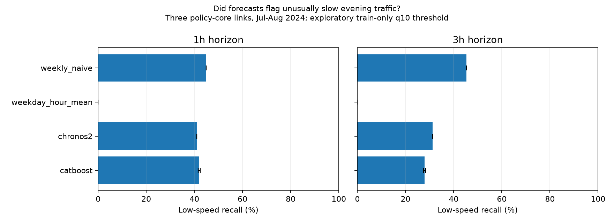

# 추가 자료 조사와 후속 실험: 버스가 빨라진 곳, 정체가 남은 곳

2026-10-28 현재 결과를 본 뒤 진행한 **후속 탐색**이다. 최초 실험의 사전 등록 문서가 아니다. 추천 방향은 **“강남 버스열차는 어디서 풀렸고, 승객과 다른 차량에도 도움이 됐나?”**다. 이를 먼저 분석한 뒤, 확보한 자료로 **평소보다 유난히 느린 저녁 교통을 미리 알아내는 예측**을 붙인다.

최초 조사에서는 공식 원본 **11개, 363,464,438 bytes(약 363 MB)**를 실제 수집했고, 버스 자료 결합·교통량 품질·기존 예측의 저속 상황 진단까지 실행했다. 원본은 Git 제외된 `data/discovery/`에 있고 요청 인자·해시는 [수집 명세](discovery-sources.json), 수치 근거는 [자료 점검 결과](results/discovery/data_audit.json)와 [저속 진단](results/discovery/tail_metrics.csv)에 있다. 이후 사용자 요청으로 아래 1번 방향을 실행해 **4~8월 원본 20개의 정류장·방향별 분석과 그림**을 완성했다. 최신 결과는 [후속 보고서](followup-report.md), 문헌 근거는 [논문 검토](literature.md)에 있다. 새 모델 학습이나 식별된 정책 효과 추정은 이번 후속 작업에 포함하지 않았다.

## 1. 지금 결과에서 생긴 질문

### 버스의 10분 단축과 일반 차량 속도는 다른 질문이다

[국토교통부의 2024-07-25 발표](https://www.molit.go.kr/USR/NEWS/m_71/dtl.jsp?id=95090015)는 신사→양재 **중앙버스전용차로**의 19시 통행시간을 32분→22분으로 보고한다. 첨부 PDF에서 비교일도 확인했다. 이전은 4월 16·17·18·23·24·25일, 이후는 7월 2·3·4·9·10·11일이다. 이 발표는 5~6월 두 차례의 노선 조정 이후를 평가한다.

우리 [기존 결과](report.md)는 교보타워사거리→뱅뱅사거리 **일반도로 차량 속도**를 5월 20일~6월 28일과 7월 8일~8월 16일에 비교했다. 강남 자체 변화는 −0.311 km/h, 비교 도로 하락을 차감한 상대 변화는 +0.937 km/h였다. 두 결과는 교통수단·구간·날짜·집계 방식이 달라 직접 반박하거나 검증하는 관계가 아니다.

후속 질문은 “버스 개선이 **중앙차로·가로변·반대 방향·주변 도로**에서 어떻게 달랐나?”다. 단순한 모델 순위보다 정책이 작동한 위치와 이용자의 경험을 설명할 수 있다.

### 평균 오차가 작아도 평소보다 느린 상황을 놓칠 수 있다

기존에 저장한 예측을 재학습 없이 다시 점검했다. 2023-01~2024-03 학습 자료의 **링크×시각×주말 여부별 속도 하위 10%**를 상대 저속 기준으로 삼았다. 이는 법정·절대 정체 기준이 아니다. 정답과 예측이 각각 이 기준 이하인지 비교했다. 진단 규칙은 결과를 본 뒤 정한 탐색이며 모델 선택·경보 임계값 튜닝에는 사용하지 않았다.

정책 핵심 3개 링크, 주말을 포함한 매일 17·18·19시, 2024-07~08 공통 관측의 결과다. 1시간 예측은 저속 127건/전체 492건, 3시간 예측은 128건/495건이다. CatBoost는 3개 시드 평균이고 나머지는 기존 단일 실행이다. ‘1/3시간’은 기존 예측기의 horizon 정의이며 입력 종료 직후부터의 시간 구간이다.

| 기존 모델 | 1시간 MAE (km/h) | 1시간 저속 재현율 | 3시간 MAE (km/h) | 3시간 저속 재현율 |
|---|---:|---:|---:|---:|
| CatBoost | 1.508 | 42.0% | 2.111 | 27.9% |
| Chronos2 | 1.553 | 40.9% | 1.971 | 31.3% |
| 전주 같은 시각 | 2.325 | 44.9% | 2.327 | 45.3% |
| 요일·시각 평균 | 2.422 | 0.0% | 2.425 | 0.0% |



CatBoost의 1시간 저속 재현율은 정책 전 시험 구간에서도 24.7%였다. 따라서 정책 때문에 놓침이 생겼다고 해석하지 않는다. 점 예측 오차를 줄인 모델을 그대로 경보기로 썼을 때의 진단이다. 다음에는 **저속 확률·누락률·오경보율**을 직접 평가해야 한다. 전주 기준선의 높은 재현율만으로 우수하다고 판단하지 않고 정밀도도 같이 비교한다.

## 2. 추가 자료의 실제 접근성과 우선순위

`수집·점검`은 원본을 받아 내부 행까지 확인했다는 뜻이다. `목록 확인`은 원본의 역사적 범위나 결합 성공을 보장하지 않는다. 확인일은 모두 2026-10-28이다.

| 우선순위·자료 | 상태·확인 범위 | 단위·결합 키 | 활용과 남은 조건 |
|---|---|---|---|
| P0 [정류장 간 평균 운행시간 OA-21217](https://data.seoul.go.kr/dataList/OA-21217/S/1/datasetView.do) | **2024-05·07 ZIP 수집**. 05-20~26, 07-08~14 주간 점검 | 날짜×노선 ID×출발/도착 정류장 ID·순서×시각 | 실제 버스의 구간 지체. 경기·인천 노선도 원본에서 확인. 시간 단위·0 의미·평균 분모는 추가 확인 필요 |
| P0 [정류장별 운행횟수 OA-21220](https://data.seoul.go.kr/dataList/OA-21220/S/1/datasetView.do) | **2024-07 ZIP 수집**, 07-08~14 점검 | 날짜×노선 ID×정류장 ID·순서×시각 | 정차 공급과 중앙/가로변 분산. 시간당 횟수만으로 실제 배차간격 분산·대기시간을 만들 수는 없음 |
| P0 [정류장별 승차 승객 OA-21219](https://data.seoul.go.kr/dataList/OA-21219/S/1/datasetView.do) | **2024-07 ZIP 수집**, 07-08~14 점검 | 위 운행횟수와 동일한 키 | 승객이 몰리는 정류장·시간대. 월 합계인 OA-12913과 다른 자료이며 경기·인천 후보 노선도 관측됨. 빈 값 의미 확인 필요 |
| P0 [TOPIS 시간별 교통량](https://topis.seoul.go.kr/refRoom/openRefRoom_2.do) | **2024-05·07 XLSX 수집**, 8지점·양방향·전 시간 점검 | 날짜×검지 지점×방향×시각, 대/시간 | 속도 변화와 차량 유입을 구분. 강남역 D-35·신사역 D-43 사용 가능. 사평대로 D-36·테헤란로 D-42는 두 달 전체 결측 |
| P0 [노선 마스터 OA-21230](https://data.seoul.go.kr/dataList/OA-21230/S/1/datasetView.do), [정류장 마스터 OA-21231](https://data.seoul.go.kr/dataList/OA-21231/S/1/datasetView.do) | **CSV 수집**, 1,540노선·11,503정류장 | 노선 ID, 정류장 ID↔ARS·좌표·정류장 유형 | 서울/경기/인천 노선 구분과 공간 결합. 다운로드 시점의 설명표이므로 2024년 명칭·위치 유효성은 별도 검증 |
| P1 [구간별 총 승객 OA-21218](https://data.seoul.go.kr/dataList/OA-21218/S/1/datasetView.do) | 공식 설명·2024 및 최근 파일 목록 확인, **미수집** | 날짜×노선×정류장 구간×시각 | 승차 인원보다 승객 시간 부담에 가까운 후보. ‘총 승객’의 집계 정의와 운행시간 분모 일치부터 확인 |
| P1 [ASOS 관측](https://data.kma.go.kr/data/grnd/selectAsosRltmList.do?pgmNo=36)·강남 인근 AWS | 공식 제공 경로 확인, **규약을 충족하는 원본 미확보** | 관측소×일시, 강수·기온·바람 | 비·폭염 조건 분리. ASOS 108과 인근 AWS 대표성 비교, 강수 빈칸·미량·결측 정의 확보. 미래 실제 날씨를 예측 입력으로 사용하지 않음 |
| P1 [경기도 광역버스 일자·시간대 승하차 15163060](https://www.data.go.kr/data/15163060/openapi.do) | **2026-09 등록 자료** 발견. 제공기관 연결까지 확인했으나 상세 화면이 불완전하게 반환되어 원본 미수집 | 일자×시간×업체·노선번호×정류소 ID/번호, 승·하차 | 하차까지 보완할 유력 후보. 2024년 소급 제공·실제 파일 범위·인증 방식 미확인. 신규 등록일을 관측 시작일로 해석하지 않음 |
| P2 [월별 시간대 승하차 OA-12913](https://data.seoul.go.kr/dataList/OA-12913/F/1/datasetView.do) | **2024-05·07 CSV 수집**, 42,910/42,372행 | **월**×노선번호×정류장×시각 | 서울 면허 버스의 주변 수요 맥락. 정책 노선 번호 후보 매칭은 두 달 모두 0건. 일별 승객 자료처럼 펼쳐 쓰지 않음 |
| P2 [경기도 정류소별 승하차 15144886](https://www.data.go.kr/data/15144886/fileData.do) | 공식 목록·필드 확인, **미수집** | 날짜×정류소, 최초/환승 승차 등 | 지역 정류장 수요 보완. 강남의 서울 정류장 포함 여부와 2024년 파일 범위가 미확인이라 주자료로 채택하지 않음 |

서울 열린데이터광장의 위 버스 통계·마스터는 해당 페이지의 공공누리 제1유형 표기를 확인했다. 경기 15163060은 이용허락 제한 없음으로 안내한다. TOPIS 월별 XLSX의 개별 이용 조건은 기존과 같이 미확인이다. 이 저장소에는 원본이나 개별 승객·예측 행을 재배포하지 않고 출처·해시·품질 집계만 올린다.

## 3. 실제 결합 점검에서 발견한 함정

- **키 결합과 값의 유효성은 다르다.** 현 마스터 좌표의 강남권 사각형(위도 37.480~37.525, 경도 127.018~127.042)에 해당하는 251개 정류장을 탐색 범위로 삼았다. 07-08~14 운행시간 11,407행의 운행횟수 키 매칭은 99.9912%, 승객 키 매칭은 100%다. 그러나 세 시각의 34,221셀 중 양의 운행시간·양의 운행횟수·기록된 승객 수가 모두 있는 것은 15,908셀(46.5%)뿐이다. 빈 승객 수를 0명으로 자동 치환하지 않는다.
- **운행시간과 횟수의 분모를 확인해야 한다.** 양의 시간인데 출발 정류장의 같은 시간대 운행횟수가 양수로 기록되지 않은 셀이 112개 있다. 정류장 도착·출발의 시간 귀속 차이도 가능한 설명일 뿐 아직 확인되지 않았다. 바로 곱해서 ‘버스 총 지체시간’을 만들지 않는다.
- **월 ZIP은 달력 월이 아니다.** 5월 ZIP은 05-06~06-02 주간 파일을 담고 있어 05-01~05가 없다. 7월 ZIP에는 07-29~08-04가 들어 있다. 실제 날짜 필터와 인접 월 간 중복 검사가 필요하다. 이번 주간 점검을 월 전체 검증으로 표현하지 않는다.
- **전체 파일에는 중복이 있다.** 선택한 5·7월 운행시간 주간의 완전 키 중복은 각각 64·100행, 7월 운행횟수는 17행이다. 이번 강남권 부분에는 완전 키 중복이 없다. 확장 수집 때 동일값 중복과 값이 충돌하는 중복을 분리하고 충돌은 중단한다.
- **순환 노선은 정류장 ID만으로 합치면 안 된다.** 결합 키에 정류장 순서를 포함했다. 운행횟수·승객 원본에는 노선 ID `0`과 버스 정류장 체계 밖의 행도 있어서, 노선 마스터·정류장 유형으로 적용 범위를 정해야 한다.
- **번호 검색은 처치 판정이 아니다.** 현재 마스터에는 같은 3100 번호의 다른 지역 노선, 예약·급행·A/B 변형이 있다. 2024년 행에 현재 A/B 이름을 붙이는 것만으로 과거 방향을 판정하지 않는다. 후보 31개 ID를 정책의 20개 노선과 같다고 세지 않는다. 전체 버스 주간의 정류장 마스터 매칭은 약 52%이며, 서울 밖 정류장도 포함되므로 원인별 조사가 필요하다.
- **교통량 지점은 도로 링크와 같지 않다.** D-35 유출은 강남역→뱅뱅사거리로 설명돼 있다. 두 인접 링크의 맥락으로 붙인 시간 키는 월별 1,488행 모두 맞고 두 달 모두 유효 값이 있다. 동일 검지 값을 두 개의 독립 관측이나 각 링크의 교통량으로 세지 않는다. XLSX 범례에서 `0시=0~1시`, 단위 `대/시`를 확인했으나 기존 속도 시간 해석은 여전히 가정이다.
- **공개 지연을 고려해야 한다.** OA-21217~20의 안내는 5일 전 자료 적재, API 최근 30일이다. 월 ZIP은 더 늦게 공개된다. 과거 시각의 관측값이어도 그때 공개되지 않았다면 실시간 예측에 쓸 수 없다. 최근 관측을 보조 입력으로 쓰는 소급 실험과 실제 제공 지연을 지킨 실험을 분리한다.

### 기존 NULL 구간의 원인 후보도 찾았다

[2024-08-01 TOPIS 중단 공지](https://data.seoul.go.kr/together/notice/datasetNoticeView.do?bbsCd=10008&ditcCd=&pageIndex=1&seq=c8c3b684c5f06d58ed26779e3ea120b8)는 정기백업 때문에 **08-02 21:00~08-03 11:00** 서비스를 중단할 예정이라고 알린다. 기존 속도 원본의 NULL 921개가 몰린 08-02 21:00~08-03 09:00과 겹친다. 시간 일치에 따른 **원인 후보**이며 모든 누락의 확정 원인이라는 뜻은 아니다. 후속 품질표에 시스템 중단 공지를 별도 표시하고 이를 실제 교통 정지나 0 km/h로 학습하지 않는다.

## 4. 추천하는 세 가지 후속 프로젝트

| 순서 | 주제 | 재미있는 결과물 | 범위와 난이도 판단 |
|---|---|---|---|
| **1 — 추천** | **버스열차는 어디로 사라졌나?** 중앙/가로변/반대 방향과 일반 차량의 변화를 비교 | 같은 구간의 버스 지체·차량 속도·교통량을 나란히 보여주는 시간대별 그림, 병목 이동 지도 | 학생 프로젝트 약 3/5. 신논현~양재 중심, 2024년 전후로 제한. 확증 인과추론은 별도 과제 |
| **2 — 1번 다음** | **평균은 맞는데 유난히 막히는 저녁은 왜 놓칠까?** | “3시간 뒤 상대 저속일 확률”, 놓친 날/오경보 사례, 날씨·수요를 추가했을 때의 차이 | 약 3/5. CatBoost와 기존 기준선에서 시작해 분류·분위수 목표를 비교. 새 GPU 대형 모델은 우선순위가 낮음 |
| **3 — 확장** | **정류장을 옮기면 누가 편해지고 누가 더 걸을까?** | 변경 정류장별 승객 변화와 도보 접근거리, 출발 지역별 혜택 지도 | 약 3~4/5. 역사적 정류장 위치·횡단 경로·승객 구간 정의가 필요. 현재 좌표만으로 2024년 보행시간을 계산하지 않음 |

권장 순서는 **1번의 정류장·차로 분석 → 2번의 경보 모델 → 3번의 보행 부담 확장**이다. 먼저 데이터 정의와 지도 연결을 해결하면 모델을 많이 늘리지 않아도 이야기가 생긴다.

## 5. 다음 실행 순서와 완료 조건

### A. 2024년 노선·정류장 연결표 확정

[서울시 6월 안내](https://mediahub.seoul.go.kr/archives/2011484)를 기준으로 오후 역방향 5개, 가로변 전환 9개, 강남역에서 가로변 정차 후 뱅뱅사거리 중앙차로 합류 6개를 구분한다. `노선 ID / 당시 번호 / 운영 지역 / 유효 시작·종료 / 방향 / 정류장 ID·ARS / 순서 / 중앙·가로변 / 근거 URL` 표를 만든다. 현재 검색식은 후보 찾기에만 쓴다.

완료 조건은 원문 20개 노선 모두에 대응 여부를 기록하고, 실제 분석에 포함하는 노선·정류장에는 당시 근거가 있는 것이다. 확인 안 된 항목은 별도 탐색 표본으로 남긴다. 반대 방향이나 서울 시내버스도 정책의 간접 수혜자일 수 있어 자동으로 무처치 비교군으로 지정하지 않는다.

### B. 추가 수집을 2024-04~08로 넓히고 날짜 단위 품질표 생성

운행시간·횟수·승객의 4~8월 ZIP과 경계 주간을 포함하는 인접 월 파일을 받는다. 원본 해시를 남기고 실제 날짜로 자른다. 4월은 국토부 발표의 비교일을 맞추기 위한 보조 분석, 기존 5~8월 규약은 원래 분석의 재현용으로 보존한다. 매체가 달라 수치를 똑같이 재현할 수 없으면 차이를 표로 설명한다.

`날짜×노선×정류장/구간×시각`의 중복·관측 수·0·빈칸·개편 전후 ID 변화를 먼저 출력한다. 같은 키의 충돌 값은 자동 평균하지 않는다. 단위·결측 정의 미확인 자료를 섞은 효과 추정은 하지 않는다. 강수는 정의가 확인된 원본을 확보한 뒤 우천/비우천 층을 추가한다.

완료 조건은 선택 패널의 기대 셀 대비 관측률을 날짜별로 산출하고, 사전 결정한 관측률 기준(후속 실행 등록 시 확정)을 통과하거나 제외 사유를 전부 기록하는 것이다. 1주 표본의 높은 키 결합률을 전체 기간 보장으로 사용하지 않는다.

### C. 먼저 세 장의 그림으로 질문에 답하기

1. **버스:** 중앙·가로변·역방향 그룹별 구간 운행시간의 시간대 곡선. 공통 정류장과 개편으로 바뀐 경로를 구분한다. 개별 차량 운행시간이 아닌 시간대 평균들의 분포이므로 이를 승객의 90백분위 통행시간이라고 부르지 않는다.
2. **다른 차량:** D-35·D-43의 속도–교통량 관계와 방향별 전후 변화. 기존 전체 도로 XLSX에서 사평대로·테헤란로·봉은사로·서초대로의 속도도 메타데이터부터 확인해 주변 병목을 살핀다. 결측인 D-36·D-42 교통량은 제외한다.
3. **수요·공급:** 정류장별 승차와 통과 횟수의 시간대 변화. 두 변수의 의미가 확인된 셀만 쓴다. 승차 인원/통과 횟수는 정류장에서의 탑승 압력 지표이지 재차 인원·좌석 점유율·평균 대기시간은 아니다.

결과를 보고 유리한 정류장만 선택하지 않도록 A 단계에서 범위를 고정한다. 날짜 단위 불확실성과 관측률을 함께 제시하고, 교통량·운행횟수는 정책이 바꿀 수 있는 결과이므로 인과 회귀의 통제변수로 자동 추가하지 않는다. 확실한 비교 설계가 없으면 기존과 같이 기술적 전후 비교로 보고한다.

### D. 새 예측 실험은 새 시험 기간으로

2024년 시험 결과를 이미 보았으므로 같은 기간의 점수 개선을 일반화 성능 향상이라고 발표하지 않는다. 다음 등록안은 **2023~2025 학습 / 2026-01~04 검증 / 2026-05~08 잠금 시험**이다. TOPIS 2026 목록에서 속도·교통량은 1~9월 실제 첨부파일, 버스 통계는 8월 월 파일까지 확인했다. [속도·교통량 목록 확인 기록](results/discovery/fresh_holdout_catalog.json)을 보존했다. 10~12월은 목록의 빈 자리이지 확보 가능한 파일이 아니다. 새 시험 값은 이번에 읽지 않았다.

실험은 같은 표본·계산 예산으로 `과거 속도만 → 이용 가능 시점이 확인된 교통량 추가 → 버스 수요·공급 추가 → 기상 추가` 순서로 비교한다. 실시간 제공 지연을 증명하지 못한 최신 보조 관측은 소급 맥락 실험으로 표시하고 실제 경보 성능과 분리한다. 날씨 예보는 발행 시각이 남은 기록만 사용한다.

기준선 2개·기존 CatBoost 회귀·CatBoost 저속 분류/분위수부터 비교한다. 기준 속도는 새 학습 자료에서만 정하고 확률 보정·경보 기준·오경보 허용치는 검증 구간에서 정한다. MAE, 저속 재현율·정밀도, PR-AUC, 확률 보정, 하루 오경보 수를 함께 출력한다. 시험은 최종 설정을 고정한 후 한 번 연다. GPU 모델 확장은 이 비교에서 남은 문제가 확인될 때 진행한다.

## 6. 외부 AI 또는 기관 자료로 확인할 질문

아래는 전달용 초안이며 이번 작업에서 외부 메시지를 발송하지 않았다. 답에는 추측 대신 공식 문서 URL·페이지·해당 필드 정의를 요청한다.

1. OA-21217의 `운행시간_17시` 단위는 무엇이고, 출발/도착 중 어느 시각으로 집계하는가? 신호·정류장 정차를 포함하는가? 0은 미운행·미수집 중 무엇인가? 평균의 분모는 관측 운행 건수인가?
2. OA-21219·21220의 빈 값은 각각 미승차·미운행·결측 중 무엇인가? 동일 키의 양의 운행시간에 양의 운행횟수가 없는 112셀을 어떻게 설명하는가? 예시 셀은 로컬 원본에서 제한해 추출할 수 있다.
3. 2024-06-29 전후 20개 정책 노선의 **역사적 ID·A/B 전환·정류장 순서·중앙/가로변 위치**를 확인할 당시 노선/정류장 마스터 또는 변경 이력이 있는가? 3100 동명 노선과 M7412 지역 표기 변화도 구분해 달라.
4. OA-21218의 구간 총 승객은 해당 구간을 통과한 인원인가? OA-21217과 분모·시간 귀속이 같아 승객 시간 지표의 가중치로 쓸 수 있는가? 별도로 개별 승객의 소요시간 분포를 제공하는가?
5. 경기도 15163060은 2024년 파일까지 제공하는가? 서울 소재 정류장과 인천 노선을 포함하는가? ARS·정류소 ID의 코드 체계, 월별 파일 목록, 인증 없는 파일 경로와 신청이 필요한 API를 구분해 달라.
6. ASOS/AWS 강수의 빈칸·미량·QC 표기, TOPIS 월별 속도 시간 열·0·측정 변경과 파일 이용 조건에 관한 공식 정의를 찾아 달라. 이 항목들은 기존 탐색 가정을 확증으로 바꾸기 위한 근거다.

## 7. 이번 조사 재현

저장소 루트에서 실행한다. 이전 사례 환경과 20개월 속도·저장된 예측 결과가 필요하다. 네 개의 최초 프로토콜 설정과 기존 결과 보고서는 이번 조사로 덮어쓰지 않았다.

```bash
cd cases/sgim49697-ops-gangnam-bus-2024
.venv/bin/python discover.py collect
.venv/bin/python discover.py audit
.venv/bin/python discover.py diagnose
```

`collect`는 고정 명세의 공개 다운로드만 실행한다. 원본 해시가 달라지면 덮어쓰지 않고 중단한다. 특히 현재 마스터가 갱신되었다면 이 실행을 완전히 재현하려면 보존한 스냅샷이 필요하다. 새 원본은 별도 탐색 버전으로 등록한다. `audit`는 명시한 주간의 품질과 결합 가능성을, `diagnose`는 기존 공통 예측의 사후 저속 진단을 만든다. 출력에 코드·설정·입력 해시를 기록한다.

검증은 저장소의 `make check PY=.venv/bin/python`과 사례 환경의 `python -m pytest tests/test_gangnam_bus.py tests/test_gangnam_discovery.py`를 사용한다. 테스트는 인터넷 호출 없이 정류장 재방문 키, 중복·결측 차단, 주간 파일의 월 경계, 학습 기간 누수, 놓친 저속 상황 계산, 캐시 보존을 검사한다.

## 진행 기록

### 2026-10-28 — 정류장·방향별 후속 분석 실행

- 사용자 요청에 따라 1번 방향을 실제 실행하고 관련 논문 본문을 함께 검토했다. 기존 기여 브랜치를 유지했으며 최초 프로토콜 4개와 외부 계획 원문은 변경하지 않았다.
- 변경 범위: 개인 사례의 후속 수집·분석·그림 코드, 탐색 설정·정책 연결표, 출처 명세, 결과 28개 파일과 보고서·문헌 정리, `tests/test_gangnam_followup.py`. 원본 20개 약 1.00 GB(6개 재사용·14개 추가), 논문 원문과 추출 캐시는 Git에서 제외했다.
- 실행 결과: 버스 원본 38,330,088행에서 정류장 32곳을 추출하고 주변 5개 도로 88개 링크·교통량 2지점을 비교했다. 전후 모두 관측이 충분한 셀의 중앙 남행 지수 −7.40%, 북행 +11.12%. 22011→22009 구간의 감소는 기본 −48.39%, 보조 −48.45%였다. 실제 분 단위나 인과 효과로 해석하지 않는다.
- 문헌 반영: 2025년 정류장 정체 유형·대기행렬 운영전략 논문 2편의 본문을 확인해 구간·시간대 분리와 버스/승객 부담의 구분에 반영했다. 국토부 6월 첨부 4~6쪽으로 당시 ARS와 20개 노선군을 확인했다.
- 검증: `followup.py collect`, `prepare`, `analyze`, `plot` 실제 완료. `make check PY=.venv/bin/python` 통과(선택 의존성 5건 생략·기존 경고 82건), 사례 환경의 기존 35개+신규 9개 테스트 **44개 통과**, 라이선스 71개·계보 3개 검사 통과. 그림 5장 시각 확인, 입력·코드·산출물 해시와 내부 링크 검사, `git diff --check` 통과. 외부 계획 원문 SHA-256도 기존 값과 일치했다.
- 남은 조건: 운행시간 단위·0/공란·평균 분모, 역사적 노선명/ID와 가로변 8곳 연결, M7412 후보 미관측, 기상 자료 정의. 원본의 05-28·29 누락과 승차 기록 부족을 보고했다. 새 예측 학습은 다음 단계이며 이번에는 2026년 잠금 시험 값을 읽지 않았다.
