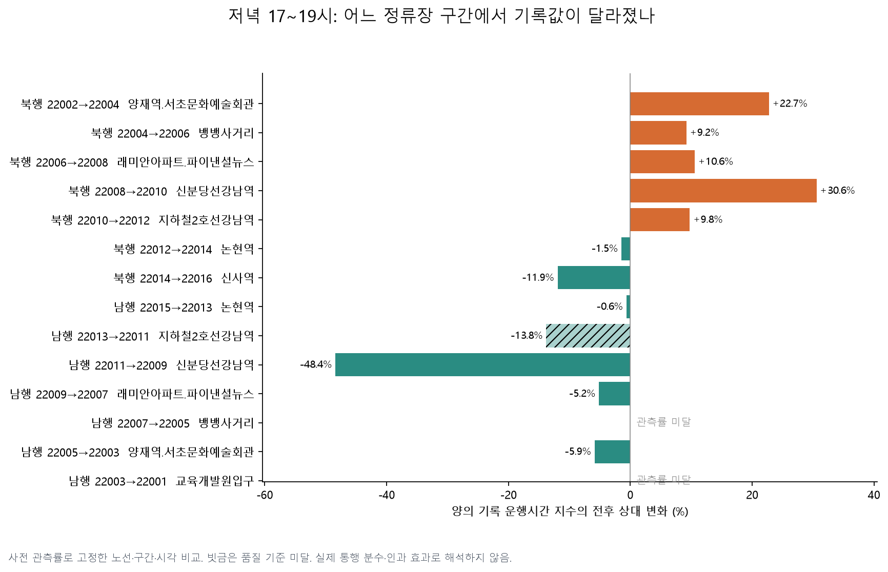
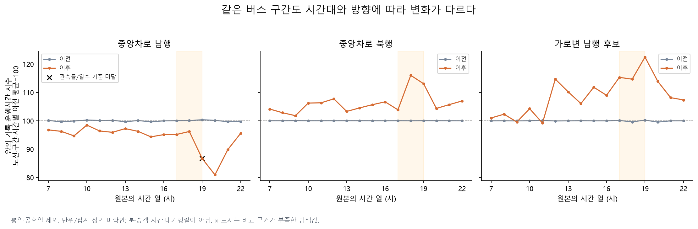
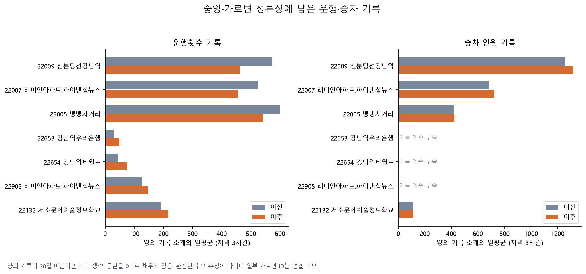
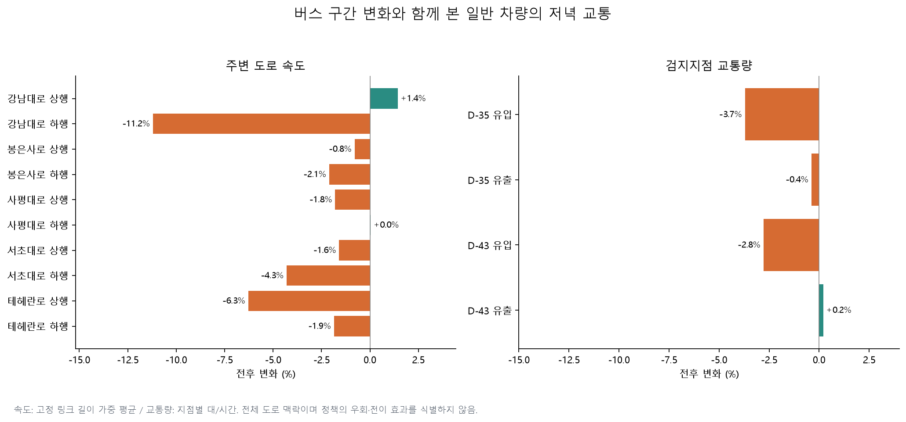
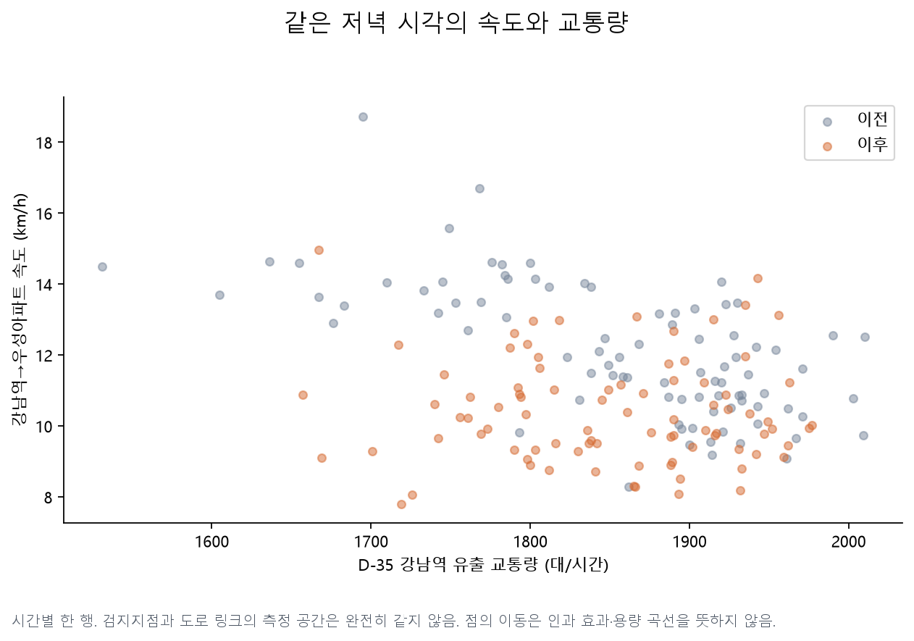

# 강남 버스 정체는 어디서 달라졌나: 정류장·방향별 후속 탐색

**가장 뚜렷한 변화는 남행 2호선 강남역→신분당선 강남역 구간이었다.** 동일 노선·구간·시각의 양의 운행시간 기록을 비교한 지수는 약 **48.4% 낮아졌다.** 반면 북행 래미안아파트→신분당선 강남역은 **30.6% 높아졌다.** 강남 전체를 한 숫자로 설명하기보다 어느 방향·정류장이 달라졌는지 살펴볼 이유가 생겼다.

이는 **실제 소요시간의 분 단위 변화나 정책의 인과 효과가 아니다.** 공개 `운행시간`의 단위·0값·시간 귀속·평균 분모가 확인되지 않아, 동일 단위와 집계 방식이 유지됐다는 가정 아래 양의 기록을 이전 평균으로 나눈 지수만 계산했다. 정류장 대기행렬이 사라졌는지, 승객 총 통행시간이 줄었는지는 아직 답할 수 없다.

작성일 2026-10-28. 기존 결과를 본 뒤 실행한 탐색이다. [기존 정책·예측 결과](report.md), 최초 네 설정, 외부에서 받은 단기 실행계획은 보존했다. 이번에는 새 모델을 학습하지 않고 정류장 분산을 설명하는 자료와 분석을 추가했다.

## 1. 수집과 비교 범위

- **2024년 4~8월 버스 운행시간·운행횟수·승차 기록·차량 교통량 원본 20개**를 확보했다. 기존 조사 파일 6개 재사용, 14개 추가 다운로드. [수집 명세](followup-sources.json)에 공개 요청과 해시를 기록했다. 전체 버스 CSV **38,330,088행**을 읽어 대상 정류장을 추렸다.
- 일반 차량 속도는 기존에 받은 월별 전체 도로 XLSX 중 같은 5개월에서 **강남대로·사평대로·테헤란로·봉은사로·서초대로 88개 링크**를 새로 추출했다. 링크 시작·종점·방향·길이의 변경은 이 범위에서 없었다. 도로 이름 전체를 고른 것이므로 교차로 바로 옆의 국소 우회만 측정하는 패널은 아니다.
- 기본 비교는 **이전 05-20~06-28 / 이후 07-08~08-16**, 평일·공휴일 제외, 저녁 **원본 시간 열 17·18·19시**다. 예정 날짜는 각각 29일이다. 버스 세 원본 모두 05-28·29가 통째로 없어서 분석 가능한 이전 날짜는 최대 27일이다. 시간 열의 의미가 다른 자료를 정확히 같은 통행 사건으로 간주하지 않는다.
- [국토부 6월 변경자료](https://www.molit.go.kr/USR/NEWS/m_71/dtl.jsp?id=95089865)에서 20개 정책 노선군과 당시 정류장 번호를 확인했다. 선정 정류장 **32곳 중 24곳**은 2024년 월별 카드자료로 ID↔ARS 조합을 대조했고 **8곳은 현재 마스터에 근거한 임시 대응**이다. 중앙 남·북행 정류장은 모두 2024년 조합이 확인됐다. [정류장 표](results/followup/station_registry.csv)
- 정책 원문의 **20개 노선 모두 대응 상태**를 기록했다. 19개 노선군에서 현재 명칭에 대응하는 후보 ID의 양의 운행 기록을 찾았고 **M7412 고양 후보는 미확인**이다. 이는 과거 노선명·ID를 19개 확정했다는 뜻이 아니다. [노선군 확인표](results/followup/policy_family_coverage.csv)

## 2. 같은 버스 구간에서 무엇이 바뀌었나

각 `노선 ID×출발 정류장×도착 정류장×시간 열`의 이전 양의 기록 평균을 100으로 두었다. 이전 관측률 80% 이상인 셀을 먼저 고정하고, 날짜별로 관측된 셀에 동일 가중치를 주었다. 0·공란은 빠진 값을 뜻하는 것으로 **가정해 지수에서 제외**하고, 관측률을 별도로 남겼다. 따라서 선택 셀 수가 고정돼도 날짜별 관측 구성은 조금 달라질 수 있다.

날짜 관측률 80% 이상, 전후 각각 20일 이상, 기간 평균 관측률 차이 10%p 이하가 기본 품질 기준이다. 이는 완전 관측이나 인과 식별을 보장하는 기준은 아니다. [지수 집계](results/followup/bus_summary.csv), [날짜별 관측률](results/followup/bus_daily.csv), [고정 셀](results/followup/bus_selected_cells.csv)

| 구분 | 고정 셀 수 | 이전→이후 지수 | 상대 변화 | 관측률 이전→이후 | 사용 날짜 이전/이후 |
|---|---:|---:|---:|---:|---:|
| 중앙 남행 | 652 | 100.15→92.63 | **−7.50%** | 91.77%→83.02% | 26/29 |
| 중앙 북행 | 522 | 100.01→111.01 | **+11.00%** | 92.55%→98.93% | 27/29 |
| 가로변 남행 후보 | 74 | 100.07→117.49 | +17.40% | 91.71%→95.85% | 27/29 |

가로변 결과에는 임시 정류장 연결이 섞여 있으므로 중앙차로 결과와 같은 확실성으로 다루지 않는다. 선택된 기존 구간의 비교이지 새로 생긴 모든 가로변 경로의 평균도 아니다. 날짜를 독립 재표집한 2,000회 구간은 CSV에 저장했지만, 자기상관·계절·동시 정책을 해결한 인과 신뢰구간으로 해석하지 않는다.



| 같은 방향의 인접 구간 | 기본 비교 | 전후 모두 관측률 80% 이상인 셀만 비교 |
|---|---:|---:|
| 남행 22011→22009, 2호선 강남역→신분당선 강남역 | **−48.39%** | **−48.45%**, 45셀 |
| 남행 22009→22007, 신분당선 강남역→래미안아파트 | −5.15% | 전체 구간표에 수록 |
| 북행 22008→22010, 래미안아파트→신분당선 강남역 | **+30.55%** | **+30.55%**, 78셀 |
| 남행 22007→22005, 래미안아파트→뱅뱅사거리 | 이후 관측률 미달, 기본 비교 보류 | +2.05%, 93셀 |

전후 관측이 모두 충분한 셀만 남기는 보조 분석은 **개편 뒤 사라진 기록을 확인한 후 추가한 생존 표본 진단**이다. 기본 표본을 대체하지 않는다. 중앙 남행 −7.40%, 북행 +11.12%로 방향은 유지되지만, 이동한 버스까지 포함한 전체 정책 성과는 아니다. [모든 구간·보조 결과](results/followup/bus_segments.csv)



첫 주를 포함해 7월 1일부터 비교해도 남행 −7.15%, 북행 +11.19%였다. 발표일 이전까지만 쓰는 비교, 7월만 쓰는 비교, 국토부의 6개씩 비교일을 맞춘 결과도 저장했다. 이 세 비교는 최소 20일 기준에 미달하므로 기본 결과와 동등한 검증 통과로 세지 않는다. 국토부와 날짜를 맞춰도 전체 경로 통행시간·교통수단·집계 방식이 달라 공식 ‘32분→22분’을 검증한 것은 아니다.

## 3. 중앙에서 가로변·북행으로 옮겨간 흔적

현 명칭이 `5001B용인`인 후보 ID `228000176`은 저녁 중앙 남행의 양의 운행 기록이 이전 27일, 이후 북행이 29일 관측됐다. `5001-1B` 후보도 남행 이전 25일→북행 이후 29일이었다. 공식 오후 역방향 조정과 **일치하는 관측 경로**이지만 현재 A/B 이름이 2024년에도 같았다고 확정하지는 않는다. [후보별 당시 관측 정류장](results/followup/candidate_route_presence.csv)



| 정류장 | 저녁 3시간 운행횟수 양의 기록 소계의 일평균: 이전→이후 |
|---|---:|
| 22009 신분당선강남역 중앙 | 572.96→462.69 |
| 22007 래미안아파트 중앙 | 523.74→455.48 |
| 22654 강남역티월드 가로변 | 43.78→73.34 |
| 22905 래미안아파트 가로변 | 126.89→147.00 |
| 22132 서초문화예술정보학교 가로변 | 190.33→215.66 |

이 표는 **관측된 양의 값의 소계**다. 공란·미수록을 0으로 채우지 않았고 같은 버스가 여러 정류장에 나타날 수 있어 행을 더해 전체 운행 대수로 세지 않는다. 재방문이 모호한 정류장 행도 제외했다. 승차 자료는 더 불완전하다. 예를 들어 22653 강남역우리은행은 양의 승차 기록이 없고 22905 가로변은 이전 3일·이후 6일에만 양의 기록이 있다. 이를 무승객·승객 감소로 해석하거나 평균 대기시간을 계산할 수 없다. [원본 관측률·일수](results/followup/station_recorded_counts.csv)

## 4. 일반 차량은 같은 방향으로 움직였나



강남대로 **전체 수록 링크**의 하행 속도는 20.89→18.55 km/h(−11.20%), 상행은 21.14→21.44 km/h(+1.43%)였다. 테헤란로 상행은 15.15→14.20 km/h(−6.29%), 서초대로 하행은 −4.30%였다. 상·하행은 TOPIS 원본 표기이며 도로마다 동일 방위를 뜻하지 않는다. 이 범위는 기존 핵심 3개 링크보다 넓어 기존 −0.311 km/h와 수치가 다른 것이 모순은 아니다. [88개 링크의 시작·종점](results/followup/road_links.csv), [방향별 수치](results/followup/road_summary.csv)

D-35 강남역의 유출 교통량은 1,856.69→1,849.49대/시간(**−0.39%**), 유입은 −3.71%였다. D-43 신사역은 유출 +0.20%, 유입 −2.78%였다. 확보한 두 지점의 방향별 14,688개 시간 셀에는 결측이 없었다. D-36·D-42는 이전 조사에서 통째 결측이 확인돼 제외했다. 강남역 유출량이 크게 증가하지 않은 관측만으로 주변 정체의 원인을 버스 분산 또는 차량 유입 하나로 결정할 수 없다. [교통량 결과](results/followup/volume_summary.csv)



D-35 검지지점은 강남역→뱅뱅사거리 방향이고 속도 링크는 강남역→우성아파트여서 측정 공간이 완전히 같지는 않다. 시간 키로 한 번만 결합해 3,672행 중 3,662행에 유효한 속도·교통량이 함께 있었다. 같은 지점 교통량을 여러 링크의 독립 관측으로 복제하지 않았다. 교통량은 정책의 매개 결과일 수도 있어 인과 모형의 통제변수로 넣지 않았다.

## 5. 논문에서 가져온 것과 아직 필요한 것

2025년 **정류장 정체 유형 연구**와 **대기행렬 기반 운영전략 연구**를 본문까지 검토했다. 전자는 정류장·시간대 분리, 후자는 버스 운행 개선과 승객 보행·대기 부담을 구분하는 데 활용했다. [서지·읽은 범위·적용·한계](literature.md)에 원문 링크와 후속 수집 우선순위를 정리했다.

지금 결론은 “남행 일부 구간의 기록 지수가 크게 낮아졌고, 북행·가로변 후보와는 다른 패턴이 나타났다”까지다. 다음에는 **필드 정의와 역사적 ID 확인 → 차량별 도착·출발 BMS와 승차 수록 범위 → 기상·동시 변경 대조** 순서로 보완해야 한다. 그래야 ‘버스열차’의 대기행렬이 실제 줄었는지, 북행 변화가 무엇 때문인지, 승객이 얼마나 이득을 봤는지 답할 수 있다. 공개 집계자료만으로 이 질문들의 인과적 답을 만들어내지는 않았다.

## 6. 품질과 재현

버스 선택 행에는 완전 키 충돌·동일값 중복이 없었다. 운행횟수·승차는 같은 날짜·노선·정류장을 여러 순번으로 재방문한 **각 10,829행을 격리**했다. 운행시간에는 이런 반복 구간이 없었다. 날짜별 0·공란·양의 기록 수는 `results/followup/quality_*.csv`, 전체 감사는 [audit.json](results/followup/audit.json)에 있다. 원본을 평균으로 억지 결합하거나 미수록 값을 0으로 채우지 않았다.

원자료·추출 Parquet·논문 원문은 Git에 올리지 않는다. 기존 환경과 다운로드한 원본이 있는 사례 폴더에서 다음을 실행한다. 원본 수집에는 기존 [조사 명세](discovery-sources.json)의 마스터·월별 카드 CSV도 필요하다. 오래된 마스터가 원격에서 바뀌면 고정 스냅샷을 별도로 확보해야 하며 바뀐 원본으로 조용히 대체하지 않는다.

```bash
cd cases/sgim49697-ops-gangnam-bus-2024
.venv/bin/python discover.py collect
.venv/bin/python followup.py collect
.venv/bin/python followup.py prepare
.venv/bin/python followup.py analyze
.venv/bin/python followup.py plot
```

속도 원본이 없으면 기존 `.venv/bin/python fetch.py --scope policy --metadata-only --workers 2`로 `data/raw/2024-04.xlsx`~`2024-08.xlsx`와 출처 파일을 먼저 준비한다. 분석 설정은 [followup_config.yaml](followup_config.yaml), 정책 범위는 [followup-policy.yaml](followup-policy.yaml)이다. `common_recording`만 최초 결과 확인 뒤 추가한 관측구성 민감도이며 나머지 기준은 이번 전체 분석 전에 고정했다. 테스트는 중복 격리·사전 표본 선택·단위 배율 불변성·관측률 관문·생존 표본 구분·도로 가중치·재표집 재현성을 검사한다.
