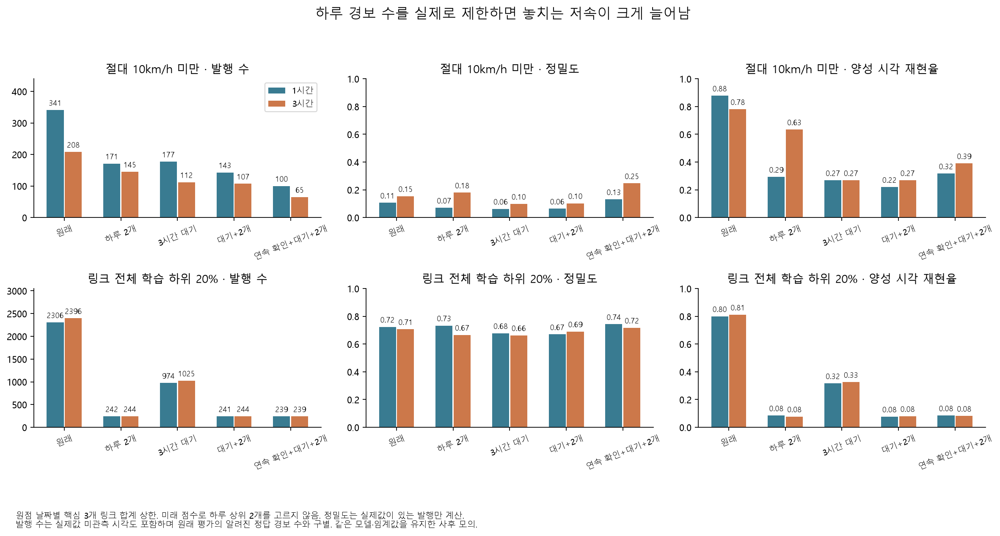
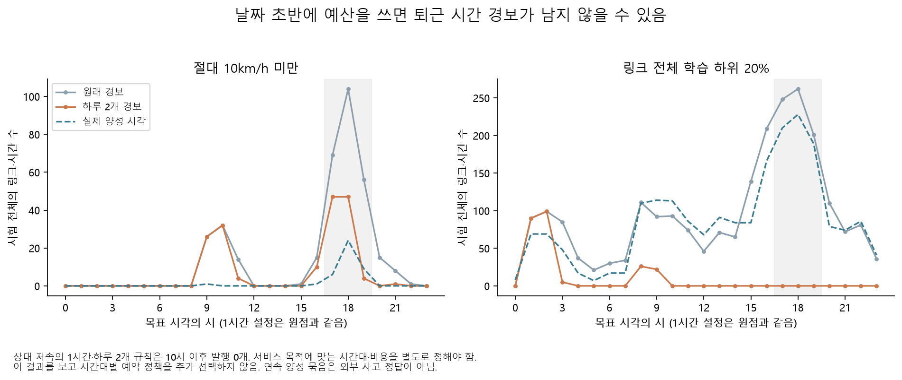

# 경보를 하루 두 개로 제한하면 무엇을 놓치는가

**하루 발행 수는 제한할 수 있지만, 같은 모델의 유용성이 함께 보장되지는 않았다.** 원래 상대 저속의 1시간 재현율은 80.0%였으나 하루 두 개 상한을 적용하면 8.5%가 됐다. 날짜 초반에 예산을 써 퇴근 시간의 발행이 사라졌다. 절대 저속도 제한 방식과 예측 간격에 따라 정밀도·재현율의 손실이 달랐다.

## 실제로 순서대로 발행하는 모의

[설정](overnight_alert_replay_config.yaml)은 `9513fb2`, 구현·테스트는 `2121cdd`에 저장한 뒤 계산했다. 원래 고정한 CatBoost 지연 버스 추가 모델의 1·3시간 확률, 3월 보정기, 4월 FPR 조건 임계값을 유지했다. 새 학습·임계값 선택은 없다. 앞의 ‘4월 평균 하루 두 개’ 임계값 실험과 달리 이번에는 **매 예측 원점의 실제 발행에 상한을 적용**한다.

| 정책 | 발행 조건 |
|---|---|
| 원래 | 원래 확률 임계값 이상이면 발행 |
| 하루 2개 | 같은 원점 날짜에서 핵심 3개 링크 합계 최대 2개 |
| 3시간 대기 | 같은 링크의 마지막 발행 뒤 3시간 이상 지나야 재발행 |
| 대기+2개 | 위 대기와 하루 상한을 함께 적용 |
| 연속 확인+대기+2개 | 바로 전 원점에서도 같은 링크가 임계값 이상이어야 함. 시간 공백·점수 부재는 확인을 초기화 |

같은 원점에는 지금 알려진 확률 내림차순·링크 ID 오름차순으로 처리했다. 미래 시각의 점수를 보고 하루의 상위 두 개를 고르지 않았다. 억제된 후보는 마지막 발행 시간을 다시 시작하지 않는다. 4월부터 순서대로 처리해 5월 경계를 준비했다. 원점은 `Asia/Seoul`이며 현재 설정에서 1시간 모델은 목표 시작과 같고 3시간 모델은 목표 시작보다 2시간 앞선다. 명목 간격을 그대로 1·3시간 조기경보 시간으로 해석하지 않는다.

실제값이 없는 36개 링크·시간도 먼저 예측·발행 판단에 넣었다. 이후 정밀도에서는 정답이 알려진 발행만 사용하고 미확인 발행을 따로 보고한다. 유효 8,820개 기존 실제값·라벨·확률은 원래 저장 예측과 일치했고 제한 없는 발행도 원래 경보와 일치했다.

## 발행 수와 탐지의 절충

아래 수치는 2025년 5~8월 목표 시각 전체다. 발행 수에는 미확인 실제값도 포함한다. 정밀도는 알려진 정답, 재현율은 실제 양성 시각을 분모로 사용한다.

| 라벨·간격 | 정책 | 발행 수 | 정밀도 | 재현율 | 잡은 연속 저속 묶음 |
|---|---|---:|---:|---:|---:|
| 절대 저속·1시간 | 원래 | 341 | 10.62% | 87.80% | 30 / 34 |
| 절대 저속·1시간 | 하루 2개 | 171 | **7.02%** | **29.27%** | 11 / 34 |
| 절대 저속·1시간 | 연속 확인+대기+2개 | 100 | 13.13% | 31.71% | 13 / 34 |
| 절대 저속·3시간 | 원래 | 208 | 15.38% | 78.05% | 26 / 34 |
| 절대 저속·3시간 | 하루 2개 | 145 | 17.93% | 63.41% | 23 / 34 |
| 절대 저속·3시간 | 연속 확인+대기+2개 | 65 | 24.62% | 39.02% | 16 / 34 |
| 상대 저속·1시간 | 원래 | 2,306 | 72.36% | 80.00% | 546 / 726 |
| 상대 저속·1시간 | 하루 2개 | 242 | 73.33% | **8.48%** | 104 / 726 |
| 상대 저속·1시간 | 연속 확인+대기+2개 | 239 | 74.26% | 8.48% | 173 / 726 |
| 상대 저속·3시간 | 원래 | 2,396 | 70.67% | 81.16% | 565 / 726 |
| 상대 저속·3시간 | 하루 2개 | 244 | 66.53% | **7.76%** | 102 / 726 |
| 상대 저속·3시간 | 연속 확인+대기+2개 | 239 | 71.73% | 8.19% | 168 / 726 |

원래 절대 1시간의 341개 중 미확인 2개를 빼면 기존 보고서의 339개다. 원래 상대 1·3시간의 미확인 발행은 각각 12·13개다. 이 수를 거짓 경보로 넣거나 계산 뒤 삭제해 예산을 되돌리지 않았다. 모든 상한 정책은 **4월 준비와 시험 전체의 원점 날짜별 최대 발행 2개**를 지켰다. 3시간 모델은 목표 창 경계와 원점 날짜가 다르므로 목표 날짜 123일로 나눈 평균을 일별 상한의 증명으로 쓰지 않는다.

연속 저속 묶음은 같은 링크의 라벨 1이 한 시간 간격으로 이어진 경우다. 관측 공백은 묶음을 끊는다. 묶음 안의 양성 시각에서 한 번 이상 발행하면 포착으로 계산했으며, 사고·대기행렬 사건을 실제 탐지했다는 의미가 아니다. 대기·연속 확인이 예산을 남겨 나중 시각을 발행할 수도 있어, 정책을 추가할수록 참 경보 수가 단조 감소한다고 가정하지 않는다.

## 시간대별 예산 소진이 중요하다

상대 저속 1시간·하루 두 개 정책의 242개 발행 중 189개가 1~2시에 나왔다. 마지막 발행은 9시였고 **10시 이후 발행은 0개**였다. 전체 상대 저속 2,075개 중 저녁 17~19시 627개를 이 정책은 모두 놓쳤다. 전체 정밀도만 보면 이 문제를 발견하기 어렵다.

따라서 다음 서비스 질문은 ‘경보 수를 줄일 수 있나’보다 **누가, 어떤 시간대의 어떤 저속을, 얼마의 놓침·오경보 비용으로 확인할 것인가**다. 출퇴근용이라면 시간대와 예산 배분을 먼저 정하고 미래 기간에서 평가해야 한다. 이번 결과를 본 뒤 유리한 시간대 규칙을 추가 선택해 성능을 개선했다고 보고하지 않는다. 실제 원점에 자료가 도착하는지도 아직 원래 지연 가정이다.

## 재현과 전체 결과

사례 환경에서 `python overnight.py alert-replay`, `alert-plots`를 실행한다. [120개 성능행](results/overnight/alert_replay/metrics.csv), [원점 날짜별 발행](results/overnight/alert_replay/daily.csv), [시간별 결과](results/overnight/alert_replay/hourly.csv), [억제 사유](results/overnight/alert_replay/suppression_reasons.csv), [연속 저속 묶음](results/overnight/alert_replay/episodes.csv), [감사 명세](results/overnight/alert_replay/audit.json)를 제공한다. 날짜·시간별 표는 그 경계에서 잘린 묶음 지표도 포함하므로 전체 묶음 수는 전체 창의 별도 표를 사용한다. 세부 순차 예측 캐시는 Git에서 제외한다. 이 비교는 이미 본 시험의 사후 운영 모의이며 독립 시험이나 서비스 검증이 아니다.
