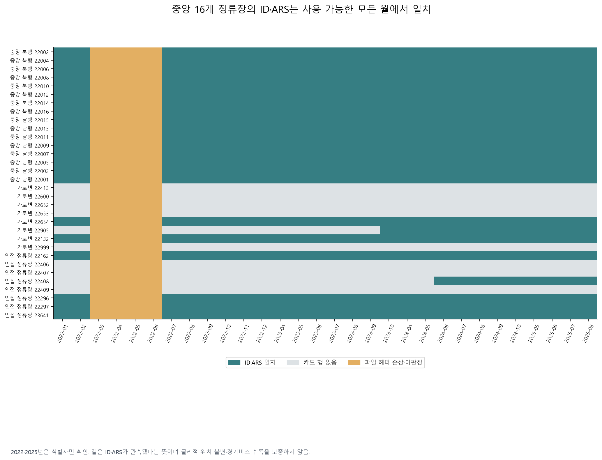
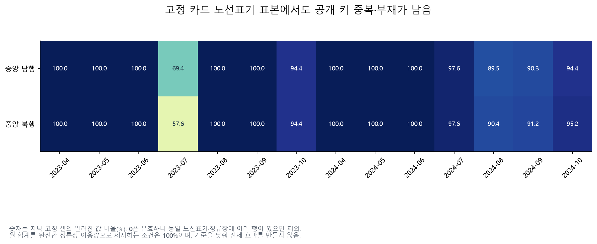
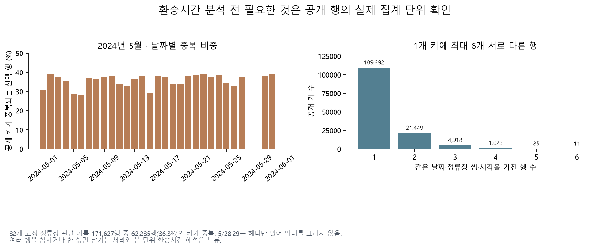

# 월별 카드·환승·출도착 자료의 활용 가능성

후속 확인: 이 문서의 반복 키 제외 결과는 초기 보수적 집계로 보존한다. [일별 카드 14개월 대조와 운영 기록 보고서](overnight-operations-report.md)에서 노선 표기 예외를 분리하고 중앙 16개 정류장의 월 전체 합계를 검증했다. 새로운 기록 합계 분석과 초기 제외 집계의 범위를 구별한다. 환승의 공개 키 중복·단위 미확정은 여전히 해결되지 않았다.

작성일: 2026-10-29. 야간 탐색 E03·E10의 추가 조사다. 분석 범위는 [설정](overnight_auxiliary_config.yaml), 원본 21개의 출처·해시는 [수집 명세](overnight-auxiliary-sources.json)에 있다. 기존 원본 4개를 재사용하고 17개를 추가 수집했다. 원본·정류장 쌍별 추출 파일은 Git에 올리지 않는다.

## 판정

| 방향 | 이번 판정 | 근거와 다음 조건 |
|---|---|---|
| 과거 정류장 ID·ARS 확인 | 채택 | 정상인 26개 월에서 중앙 16개 정류장의 대응이 모두 일치한다. 위치·노선 이름까지 확인된 것은 아니다. |
| 월별 카드로 전체 중앙정류장 승하차 증감 제시 | 현재 보류 | 같은 노선표기·정류장에 이름·순번이 다른 여러 행이 있다. 엄격한 집계에서 중앙 방향 전체 비교가 통과하지 못했다. 일별 카드와 월 합계의 대조를 다음 후보로 삼는다. |
| 환승시간으로 정류장 이동의 이용자 부담 평가 | 현재 보류 | 공개 키 중복, 사용자 유형별 분모 차이, 시간 단위·귀속 시점 미확정이 남아 있다. 여러 행을 임의 합산하거나 분으로 환산하지 않는다. |
| 출도착 자료의 일별 명시적 합계 | 추가 분석 후보 | 공개 키 중복은 없고 일별 합계가 있다. 수록 수단·노선 범위와 관측된 정류장 쌍의 변화부터 검토해야 한다. |
| 출도착 자료를 완전한 시간별 수요로 사용 | 현재 보류 | 선택 행의 시각 셀 77.3%가 공란이다. 알려진 시각 합이 일 합계와 같더라도 공란의 공식 정의를 대신하지 못한다. |

월별 카드는 [OA-12913](https://data.seoul.go.kr/dataList/OA-12913/F/1/datasetView.do), 환승은 [OA-21221](https://data.seoul.go.kr/dataList/OA-21221/F/1/datasetView.do), 출도착은 [OA-21222](https://data.seoul.go.kr/dataList/OA-21222/F/1/datasetView.do)다. 서울시가 제공한 집계 자료이며 출처를 표시한다. 환승·출도착 카탈로그의 이용허락은 공공누리 제1유형이다. 실제 사람 수·전체 이동을 완전히 포착한다고 가정하지 않는다.

## 정류장 이력: 중앙 16개는 안정적으로 대조됨

2022년 연간 ZIP 안의 12개 월, 2023·2024년 각각 4~10월, 2025년 5~8월을 확인했다. 이 중 2022년 3~6월 카드 파일은 첫 식별 열이 `?"사용년월"`로 손상되어 격리했다. 임의로 헤더를 고치지 않았다. 나머지 **26개 월 × 중앙 16개 = 416개 대응**은 모두 같은 ID·ARS로 확인됐다.

2022·2025년에는 식별 열만 추출했다. 특히 2025년 카드 수치를 예측 특징에 넣거나 동결된 시험을 고치지 않았다. 카드 행이 없던 정류장은 “없어진 정류장”으로 해석하지 않는다. 이 자료는 서울 면허 버스만 대상으로 하므로 경기 광역버스만 이용하는 정류장이 빠질 수 있다.



가로변·인접 정류장 일부는 월별로 등장 여부가 다르다. ARS 22905는 이번 카드 범위에서 2023년 10월부터, 22408은 2024년 6월부터 대응이 관측된다. 이것만으로 물리적 정류장 신설일을 결정할 수 없다. 현재의 좌표가 2022~2025년 내내 같았다는 증거도 아니다.

원문 설명에는 2022년 7월부터 교통수단 타입 열이 추가됐다고 되어 있다. 실제 2022년 상반기 CSV에는 이 열 자체가 없는 경우가 있어, 없는 필드를 특정 버스 유형으로 채우지 않았다. [파일별 범위](results/overnight/cards/source_coverage.csv), [정류장 대응](results/overnight/cards/station_identity.csv).

## 월별 승하차: 이름·순번 변형이 합계 해석에 중요함

수치 분석은 서울 면허 버스의 2023·2024년 4~10월 14개 파일로 한정했다. 전체 행 구조·실제 월을 확인한 뒤 32개 정류장 관련 **4,945개 행, 237,360개 시각·승하차 셀**을 추출했다. 숫자 0은 알려진 값이고 공란·행 부재는 0으로 바꾸지 않는다.

우선 카드의 `노선번호 × 표준버스정류장ID × 월`을 검사했다. 1,092개 행이 같은 키에 두 개 이상 속했다. N37처럼 노선 이름에 반대 방향의 기종점이 쓰인 경우, 402처럼 정류장 이름 끝의 순번이 달라지는 경우가 있다. **이것이 모두 자료 오류라는 뜻은 아니다.** 서로 다른 운영 방향·월중 정보 변경의 구분일 수 있지만, 현재 공개 설명만으로 행 사이의 승객 집계가 배타적인지 확인하지 못했다.

따라서 이번 엄격한 계산은 해당 키의 모든 행을 제외했다. 제외된 셀은 52,416개, 남은 양수 셀은 144,607개, 숫자 0은 40,337개다. 낮 시간에 모든 중복 행이 0인 심야버스까지 포함해 보수적으로 제외하므로 이 결과는 수요가 사라졌다는 증거가 아니다.

2023·2024년 각각 4·5월 네 파일에서 모든 48개 시각·승하차 셀이 유효한 **265개 노선표기×정류장**을 사전 고정한 비교도 만들었다. 6월 월계에는 시행 뒤 이틀이 섞이므로 수치 분석 전에 기준 월을 4·5월로 정했다. 노선표기는 이 카드 자료 내부의 식별자이며 BIS `노선_ID`로 해석하지 않는다.



고정 표본에서도 2023년 7월 저녁의 알려진 값 비율은 남행 69.4%, 북행 57.6%였다. 2024년 7월은 양방향 97.6%, 8월은 남행 89.5%, 북행 90.4%다. 월 총수를 제시하려면 선택한 값과 해당 방향의 모든 정류장이 완전해야 한다는 기준을 사용했으며, 중앙 남·북행 전체의 여름·가을 비교는 통과하지 못했다. 일부 정류장만 통과한 수치를 전체 방향의 결과로 대신 발표하지 않는다.

다음 확인은 [일별 카드 OA-12912](https://data.seoul.go.kr/dataList/OA-12912/S/1/datasetView.do)와의 대조다. 같은 달의 일별 승하차 합과 월별 시각 합이 노선·정류장 이름 변형별로 어떻게 대응하는지 확인하면 합칠 수 있는 행과 남겨야 할 불확실성을 구분할 수 있다. 정책 효과를 얻기 위해 품질 기준을 낮추는 방식으로 처리하지 않는다.

2024년 8·9월 CSV의 크기가 작았던 이유도 확인했다. 이 파일들은 필드마다 따옴표를 쓰지 않고, 인접 월은 모든 필드를 인용한다. 행 수는 41,756~42,848 수준이며 동일한 여섯 서울 버스 유형이 등장한다. 파일 크기만으로 수록 노선이나 이용자가 급감했다고 판단하지 않는다.

결과: [관측 상태](results/overnight/cards/record_status.csv), [제외 행의 식별 정보](results/overnight/cards/excluded_rows.csv), [월별 방향](results/overnight/cards/monthly_group.csv), [전체 비교와 실패](results/overnight/cards/group_comparisons.csv), [정류장별 비교](results/overnight/cards/station_comparisons.csv).

## 환승: 행 구분과 시간 정의를 먼저 확인해야 함

2024년 5월 원본은 31개 일별 CSV, **14,154,808행**이다. 모든 행의 열 수·날짜·ID 길이를 검사하고 32개 정류장 중 하나가 하차 또는 승차 끝점인 **171,627행**을 선택했다. 5/28·29는 헤더만 있으며, 이 두 파일만 UTF-8 BOM 인코딩이고 나머지는 CP949다. 확인된 헤더와 정확히 일치할 때만 인코딩을 선택했다.

공개 열은 날짜, 하차 ID, 승차 ID, 시각, 전체·유형별 환승 수와 평균 시간이다. 공개 키 `날짜 × 하차 ID × 승차 ID × 시각`에서 다음 문제가 남는다.

| 검사 | 결과 |
|---|---:|
| 서로 다른 공개 키 | 136,878개 |
| 한 행만 있는 키 | 109,392개 |
| 여러 행이 있는 키 | 27,486개 |
| 여러 행인 키에 속하는 기록 | 62,235행, 전체 선택 행의 36.26% |
| 최대 행 수 | 같은 키에 6행 |
| 완전히 같은 행의 추가 사본 | 16행 |
| 전체 환승 수와 공개된 다섯 유형의 합이 다른 행 | 1,093행 |

중복 키 대부분은 값도 다르므로 단순한 동일 행 중복 제거로 해결되지 않는다. 공개되지 않은 노선·사업자 등의 구분이 원인인지 확인되지 않았다. 전체와 다섯 유형의 환승 수 차이는 0~3으로, 다른 사용자 유형이 포함되었을 가능성은 있지만 공식 정의 없이 이름을 붙이지 않는다.

유형별 환승 수 합이 전체와 같은 170,534행에서도, 유형별 평균에 각 환승 수를 곱해 만든 평균과 공개 전체 평균의 차이가 1 원 단위를 초과하는 행이 1,961개 있다. 이는 검사 결과이며 오류 원인이나 집계 방식을 확정한 것이 아니다. 초·분 단위, 시간대의 승차/하차 귀속, 환승 인정 조건도 확인되지 않았다.



이번에는 이 문제를 확인하기 위한 한 달만 수집했다. 키 구분·분모·단위가 풀리기 전에는 여러 달을 늘려 정류장 이전 전후 환승시간 효과를 계산하지 않는다. [선택 기록 품질 명세](results/overnight/auxiliary/selected_quality_audit.json), [날짜별 중복](results/overnight/auxiliary/transfer_probe_selected_quality_by_day.csv).

## 출도착: 일 합계는 있지만 완전한 시각 패널은 아님

2024년 5월 출도착 원본은 31개 CSV, **20,260,920행**이며 같은 32개 정류장 관련 행은 **208,962개**다. 공개 키 `날짜 × 승차 ID × 하차 ID`의 중복은 없고 모든 선택 행에 일별 `승객_수`가 있다. 환승·BIS 자료와 달리 5/28·29에도 행이 존재하므로 자료마다 날짜 누락 여부를 따로 판단해야 한다.

선택 행의 시간별 셀 5,015,088개 중 알려진 값은 1,138,329개, 공란은 3,876,759개다. 24시간이 모두 알려진 행은 228개뿐이다. 모든 선택 행에서 알려진 시각 값의 합이 일 합계와 일치했지만, 이것을 공식적인 공란=0 규칙으로 간주하지 않는다.

후속 후보는 명시된 **일 합계의 관측 기록**이다. 2024년 5월의 승차·하차 방향, 정류장별 수록 상대 지점과 다른 자료의 범위를 대조한 뒤 추가 월 수집 여부를 결정한다. 서로 다른 경유 구간을 더한 전체 여행자 수, 고유 인원, GTX 전환 인원으로 발표하지 않는다.

두 카탈로그의 ID 길이 설명은 서로 반대다. OA-21221은 버스 9자리·철도 4자리, OA-21222는 반대로 설명한다. 이번에는 과거 카드에서 검증된 **9자리 버스 정류장 ID 자체로 연결**했다. 4자리 ID의 역사적 역명을 이름 추측으로 붙이지 않았다. [전체 구조 검사](results/overnight/auxiliary/probe_members.csv), [일별 선택 범위](results/overnight/auxiliary/od_probe_selected_quality_by_day.csv).

## 재현과 보존

사례 환경에서 순서대로 실행한다.

```bash
python overnight.py auxiliary-collect
python overnight.py auxiliary-probe
python overnight.py auxiliary-quality
python overnight.py cards-prepare
python overnight.py cards-analysis
python overnight.py auxiliary-plots
```

자료마다 다른 다운로드 폼의 `infSeq`를 읽는다. 출도착 ZIP의 해제 크기는 약 2.28GB라 버스용 2GiB 한도에서 처음 실패했으며, 별도 8GiB 상한과 압축 원본 400MiB 상한을 기록했다. ZIP을 디스크에 해제하지 않고 최대 두 작업으로 순차 읽는다. 초기 CP949 전용 환승 파서는 헤더만 있는 두 파일에서 실패했고, 확인된 두 인코딩의 헤더를 정확히 대조하도록 수정했다. 실패를 성공 자료로 등록하지 않았다.

원본·추출·코드 해시는 감사 명세에 남긴다. 새 비교는 탐색이며 기존 정책 추정·예측 시험의 독립 검증을 대신하지 않는다.
