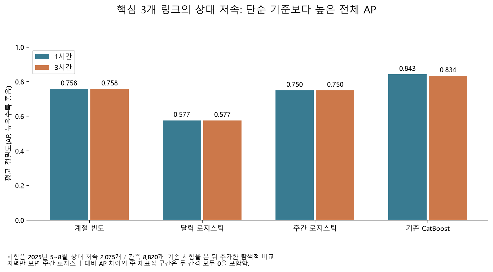
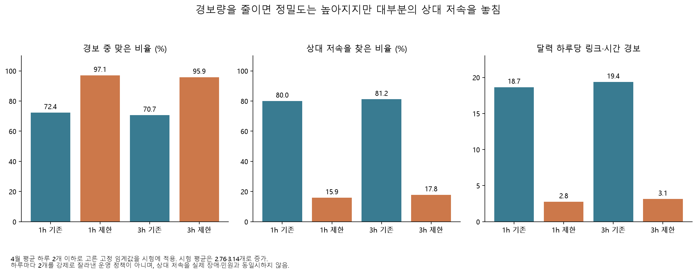
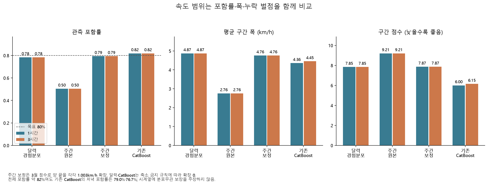

# 상대 저속과 속도 범위는 단순한 기준보다 나은가

기존 CatBoost는 핵심 3개 일반도로 링크에서 상대 저속과 속도 구간의 단순 기준보다 나았다. 다만 저녁 상대 저속에서는 주간 로지스틱 대비 AP 차이가 불확실했고, 경보량을 줄이면 재현율이 크게 낮아졌다. **후속 예측 주제는 속도 범위의 시간대별 보정이 가장 유망하다.** 아직 실시간 운영 성능이나 정책 효과를 입증한 결과는 아니다.

## 비교의 지위와 자료

[기존 고정 시험](overnight-forecast-report.md)을 본 뒤 설계한 **사후 탐색 비교**다. 새로운 독립 시험으로 부르지 않는다. [추가 규칙](overnight_forecast_baselines_config.yaml)은 `662f722`, 코드·[개발 명세](results/overnight/forecast_baselines/supplement_manifest.json)는 `c845922`에 저장한 뒤 추가 평가를 실행했다. 기존 모델·보정기·임계값·시험 결과를 유지했으며 2026년 잠금 값은 사용하지 않았다.

학습은 2023~2024년, 확률·구간 보정은 2025년 3월, 경보 임계값은 4월이다. 추가 분류 모델 6개는 고정 설정으로 학습했고 경고가 없었다. 계절 빈도는 전체 학습 1,086,533행, 로지스틱은 링크별 최대 4,000개의 고정 표본 248,000행을 사용했다. 같은 달력/주간 특징의 세 기준은 예측 간격에 따라 입력이 달라지지 않아 1·3시간 결과가 동일하며 독립 반복 실험으로 세지 않는다.

시험은 2025년 5~8월 123일, 핵심 3개 링크의 동일한 8,820개 링크·시간 관측이다. 상대 저속은 학습기의 링크별 하위 20% 기준으로 정의하며 시험 사건은 2,075개(23.53%)다. 7월 4일 저녁~5일 오전의 결측 36개 링크·시간은 보간하지 않았다. 주 공동 재표집은 18개 달력 주를 1,000회 사용한 탐색적 변동 구간이며 다중 비교를 보정한 확정 검정은 아니다.

## 상대 저속: 전체와 저녁의 결론을 구분

| 모델 | 1시간 AP | 3시간 AP | 1시간 Brier |
|---|---:|---:|---:|
| 링크·요일·시간 계절 빈도 | 0.7581 | 0.7581 | 0.0977 |
| 달력 로지스틱 | 0.5766 | 0.5766 | 0.1469 |
| 주간 속도 로지스틱 | 0.7504 | 0.7504 | 0.1055 |
| 기존 CatBoost | **0.8425** | **0.8340** | **0.0800** |

전체 AP의 CatBoost−계절 빈도 차이는 1시간 +0.0844 [0.0399, 0.1388], 3시간 +0.0759 [0.0308, 0.1304]다. 주간 로지스틱 대비는 +0.0921 [0.0745, 0.1110], +0.0837 [0.0678, 0.1009]다. 그러나 **17~19시만 비교하면 주간 로지스틱 대비 차이 구간은 [−0.0012, 0.0440], [−0.0001, 0.0415]로 0을 포함**한다. 전체 시간대의 개선을 퇴근 시간의 확실한 우위로 바꾸어 말하지 않는다.

추가 기준은 단순 모델과의 비교다. 상대 저속에서 버스 특징 자체의 기여를 분리하는 동일 설정 도로 전용 CatBoost 비교는 아직 없으므로, 이 결과를 버스 특징의 효과로 귀속하지 않는다.

## 경보량 제한의 비용

4월 평균 하루 2개 이하·오경보율 10% 이하에서 재현율을 최대화하는 임계값을 정하고 시험에 그대로 적용했다. 같은 확률의 경보를 임의로 나누지 않았다. 이 규칙은 시험의 매일 경보를 2개로 제한하는 운영 상한과 다르다.

| 기존 CatBoost | 정밀도 | 재현율 | 달력 하루당 경보 |
|---|---:|---:|---:|
| 1시간 기존 기준 | 72.36% | 80.00% | 18.65 |
| 1시간 제한 기준 | **97.06%** | **15.90%** | **2.76** |
| 3시간 기존 기준 | 70.67% | 81.16% | 19.37 |
| 3시간 제한 기준 | **95.85%** | **17.83%** | **3.14** |

시험 경보는 개발 때의 하루 평균 2개를 넘었고 상대 저속의 82~84%를 놓친다. 상대 저속은 평소보다 느린 상태이지 사고·민원·개입 필요성과 검증된 동일 사건이 아니다. 따라서 높은 정밀도만으로 운영 채택을 결정하지 않는다.

## 속도 구간: 단순 기준과 보정의 비교

달력 경험분포는 학습기의 링크·요일·시간별 10/50/90 분위수이며 표본 부족 시 링크·시간→링크→전체로 대체한다. 주간 경험분포는 과거 4주의 같은 시각 속도를 사용하고 3개 미만이면 학습 달력 분포로 대체한다. 주간 원본의 표본 수가 작아 포함률이 낮은 점도 그대로 보고했다.

| 1시간 구간 | 포함률 | 평균 폭(km/h) | 중앙값 MAE | 구간 점수 |
|---|---:|---:|---:|---:|
| 달력 경험분포 | 78.39% | 4.87 | 1.57 | 7.85 |
| 주간 경험분포 원본 | 50.46% | 2.76 | 1.50 | 9.21 |
| 주간 경험분포 보정 | 79.41% | 4.76 | 1.50 | 7.87 |
| 기존 CatBoost | **81.88%** | **4.36** | **1.30** | **6.00** |

구간 점수는 폭과 구간 밖 오차의 벌점을 합하며 작을수록 좋다. CatBoost−보정 주간 점수 차이는 1시간 −1.866 [−3.385, −0.813], 3시간 −1.722 [−3.170, −0.680]이다. 달력 기준보다도 낮다. 3시간 CatBoost의 평균 폭은 4.45km/h, 포함률 81.87%, 중앙값 MAE 1.34, 점수 6.15다.

보정은 3월의 `max(하한−관측, 관측−상한)` 점수에서 `ceil((n+1)×0.8)` 순위를 사용했다. **음수 보정값으로 구간을 축소하지 않는 변형**을 미리 정했으므로 달력·CatBoost의 확장은 0, 주간은 양 끝 각각 1.003km/h다. 원 논문과 완전히 같은 CQR 구현이라고 표현하지 않는다. 학습과 보정 분리 및 점수는 [Romano·Patterson·Candès(2019)](https://proceedings.neurips.cc/paper_files/paper/2019/file/5103c3584b063c431bd1268e9b5e76fb-Paper.pdf), 구간 점수는 [Gneiting·Raftery(2007), 6.2절](https://sites.stat.washington.edu/raftery/Research/PDF/Gneiting2007jasa.pdf)을 참고했다.

전체 포함률과 달리 저녁은 1시간 79.04%, 3시간 **76.69%**다. 우성아파트→뱅뱅사거리 링크도 79.15%·78.91%로 목표보다 낮다. 시계열 의존과 분포 이동이 있으므로 교환가능성에 기반한 분포무관 보장을 붙이지 않는다. [Zaffran 등(2022)](https://proceedings.mlr.press/v162/zaffran22a.html)의 논의는 이 한계를 확인하는 데 사용했고, 논문의 적응 알고리즘을 실행한 것은 아니다.

## 다음 판단과 재현

채택할 방향은 **저녁·구간별로 오차가 다른 속도 범위 예측**이다. 더 복잡한 모델 추가보다 사전에 정한 과거 보정 창·시간대별 보정 규칙을 새 기간에서 평가하는 것이 우선이다. 지금 시험에서 가장 좋은 보정값을 고른 뒤 같은 시험을 다시 성능 증거로 사용하지 않는다. 실제 제공 지연과 운영 사건의 정의도 별도 확인이 필요하다.

원본·특징·모델 캐시를 보유한 사례 환경에서 `python overnight.py baseline-prepare`, `baseline-evaluate`, `baseline-plots`를 실행한다. 준비 단계는 기존 명세를 검증하고 재사용한다. 새 체크아웃에는 Git 제외 원본·모델이 없으므로 전체 평가가 즉시 실행되지는 않는다. 커밋된 명세는 원실행 검증 자료이며 다른 환경에서의 재학습을 동일 바이너리라고 간주하지 않는다. 그림은 커밋된 비교표로 다시 만들 수 있다. [전체 확률 지표](results/overnight/forecast_baselines/probability_metrics.csv), [구간 지표](results/overnight/forecast_baselines/quantile_metrics.csv), [확률 짝 비교](results/overnight/forecast_baselines/probability_paired.csv), [구간 짝 비교](results/overnight/forecast_baselines/quantile_paired.csv), [평가 감사](results/overnight/forecast_baselines/evaluation_audit.json), [논문·공식 자료 출처](overnight-supplement-references.json)를 제공한다.
