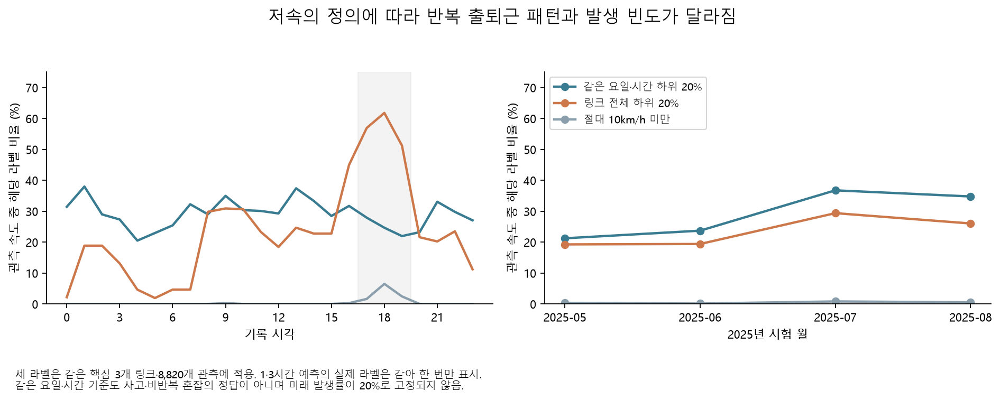
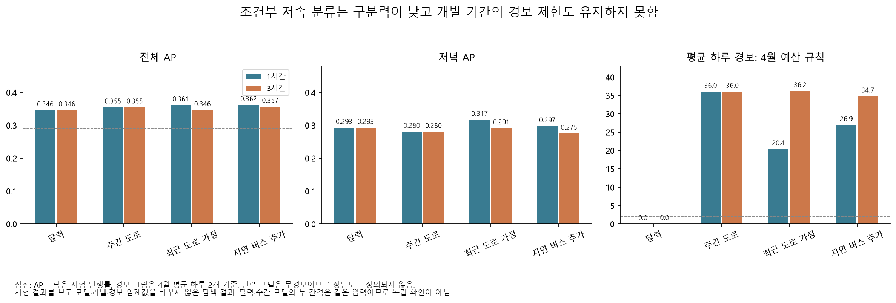
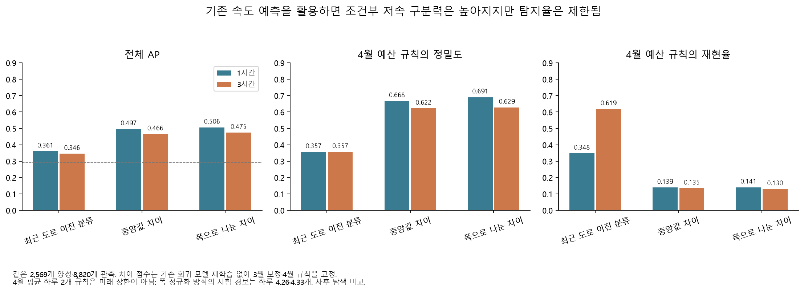

# 같은 요일·시간의 평소보다 느린 상태를 예측할 수 있는가

**기존 상대 저속의 높은 AP를 ‘평소와 다른 정체를 잘 예측한다’고 해석하면 안 된다.** 링크 전체 하위 20% 대신 같은 요일·시간의 학습 분포 하위 20%를 새 라벨로 삼아 다시 학습했더니, 전체 AP는 0.346~0.362였고 4월의 경보 제한도 시험에서 유지되지 않았다. 새 분류 설정은 현재 활용 후보에서 제외한다. 원래 상대 저속·절대 저속 결과는 서로 다른 질문의 결과로 보존한다.

## 무엇을 다르게 정의했는가

[규칙](overnight_conditional_low_config.yaml)을 결과 계산 전에 저장했다. 각 링크의 **2023~2024년 같은 요일·같은 시각** 속도 하위 20%를 선형 분위수로 계산하고, 관측 속도가 이 값보다 엄격하게 낮을 때만 새 라벨을 1로 둔다. 한 집단이 60개 미만이면 같은 링크·시각, 이어 같은 링크 전체로 대체한다. 다른 도로로 대체하지 않으며 결측 속도는 결측 라벨로 남긴다. 실제 요일을 쓰고 공휴일 여부는 기존 예측 특징으로 유지한다.

시험 핵심 3개 링크의 8,820개 관측은 모두 첫 단계인 링크·요일·시각 임계값을 사용했다. 1·3시간 예측은 같은 실제값·라벨을 사용하므로 발생률을 두 번의 확인으로 세지 않는다.

| 라벨 | 전체 발생 수 / 비율 | 저녁 17~19시 발생 수 / 비율 |
|---|---:|---:|
| 절대 10km/h 미만 | 41 / 0.46% | 39 / 3.52% |
| 링크 전체 학습 하위 20% | 2,075 / 23.53% | 627 / 56.64% |
| 같은 요일·시간 학습 하위 20% | 2,569 / 29.13% | 275 / 24.84% |

새 라벨과 기존 링크 전체 라벨의 교집합은 1,106개다. 새 라벨 2,569개 중 1,463개는 기존 링크 전체 저속에 해당하지 않는다. 반대로 절대 저속 41개 중 8개는 그 요일·시간에는 흔한 낮은 속도여서 새 라벨이 아니다. **새 라벨은 심각도나 개입 필요성의 순위를 대신하지 않는다.**

같은 요일·시간의 발생률도 미래에 20%로 고정되지 않는다. 새 라벨의 월별 발생률은 2025년 5월 21.24%, 6월 23.70%, 7월 36.75%, 8월 34.77%다. 계절·속도 분포 변화와 기준 추정 오차가 섞여 있으므로 이를 바로 돌발사건 증가로 부르지 않는다.

## 동일 모델 설정의 결과와 실패

달력·주간 도로·최근 도로 가정·지연 버스 추가의 네 정보 집합에 기존 CatBoost 깊이 8·시드 17·링크별 최대 4,000개 표본을 적용했다. 각 248,000행을 사용했고 새 튜닝 격자는 만들지 않았다. 기존 2025년 1~2월 조기 종료, 3월 시그모이드 보정, 4월 FPR 0.10 이하 최대 재현율 규칙을 유지했다. 8개 모델의 선택 반복 수는 14~16회, 학습 경고는 0건이다. [개발 명세](results/overnight/conditional_low/development_manifest.json)는 평가 전에 커밋 `5df4b19`로 고정했다.

| 입력 | 전체 AP: 1시간 / 3시간 | 저녁 AP: 1시간 / 3시간 |
|---|---:|---:|
| 달력 | 0.346 / 0.346 | 0.293 / 0.293 |
| 주간 도로 | 0.355 / 0.355 | 0.280 / 0.280 |
| 최근 도로 가정 | 0.361 / 0.346 | 0.317 / 0.291 |
| 지연 버스 추가 | 0.362 / 0.357 | 0.297 / 0.275 |

전체의 주간−달력, 최근−주간, 버스−최근 AP 차이는 두 간격 모두 주 재표집 구간에 0을 포함한다. 저녁 1시간의 최근−주간 차이는 +0.0366 [0.0079, 0.0692]지만 절대 AP 자체가 높지 않고 다중 탐색 뒤의 한 단면이다. 최근 자료가 실제로 제때 제공되는지도 별도 확인이 필요하다.

달력 모델은 4월의 FPR 조건을 만족하는 양의 재현율 경보를 찾지 못해 **무경보** 규칙이 선택됐다. 시험에서도 경보 0개·재현율 0이며 정밀도는 정의되지 않는다. 나머지 모델의 원래 규칙은 시험에서 하루 평균 33.05~39.07개 경보, 정상 관측에 대한 거짓양성률 42.63~49.61%였다. 4월 평균 하루 2개 이하로 제한한 추가 규칙도 시험에서는 20.37~36.20개가 됐다. 개발 기간의 평균 제한은 미래의 일별 상한을 보장하지 않는다.

주간 모델의 4월 확률 중앙값은 0.2420, 추가 예산 임계값은 0.2688이었다. 그 기준은 4월에 35개 경보(하루 1.17개)를 냈지만 시험에서는 하루 36.04개로 늘었다. [월별 점수 진단](results/overnight/conditional_low/monthly_score_diagnostics.csv)에 발생률·확률 분포·유일 점수 수·FPR·경보량을 모두 남겼다. 이 현상은 점수와 기준의 이동을 보여 주며, 특정 외부 요인을 원인으로 식별한 결과는 아니다. 시험에 맞춰 임계값을 다시 고르지 않았다.

증가는 7~8월에 집중됐다. 주간 모델의 5~6월 경보는 하루 1.42·1.17개였지만, 7~8월 확률 중앙값이 0.2887·0.2884로 올라 거의 모든 시각에 경보를 냈다(하루 70.77·69.68개). 학습된 모델의 [PredictionValuesChange 중요도](results/overnight/conditional_low/model_feature_importance.csv)에서도 1시간 주간 모델은 공휴일 45.0%, 월 37.5%에 무게가 실렸다. 이는 모델 의존성의 진단이며 특징의 인과 효과가 아니다. **계절에 따른 발생률 변화에 반응하는 것과 그 계절 안의 개별 저속 시각을 가려내는 능력은 구별해야 한다.**

## 문헌의 정의와 이번 라벨의 범위

[FHWA 보고서 3장 표 3](https://www.fhwa.dot.gov/publications/research/operations/16064/004.cfm)은 반복 혼잡을 원인·위치·시간과 지속시간이 예측 가능한 현상으로 설명하고, 비반복 현상에는 불규칙 사건을 포함한다. 따라서 달력 기준의 낮은 속도만으로 사고·공사·비반복 혼잡의 정답 라벨을 만들었다고 할 수 없다.

[Anbaroğlu·Cheng·Heydecker(2015)](https://discovery.ucl.ac.uk/id/eprint/1473173/)는 링크 통행시간의 분포와 시공간 연결을 이용한 탐지를 비교하고, 사건 정답이 부족할 때의 평가 제약도 논의한다. 본문 2.1~2.3절을 확인했다. 이 연구의 로그정규 분포·시공간 탐지 방법을 여기서 재현한 것은 아니다. 우리 분석에는 사건 발생·해제 시각, 공사 통제, 신호, 차량 궤적 등 외부 확인 자료가 더 필요하다. [확인 범위와 출처](overnight-conditional-references.json)를 따로 남겼다.

## 판단과 재현

이 결과로 모든 조건부 저속 예측이 불가능하다고 결론내리지 않는다. **현재의 고정 설정 이진 분류를 경보 도구로 채택하지 않는다는 판단**이다. 아래의 기존 속도 예측을 활용한 후속 비교는 같은 라벨의 별도 탐색 결과다. 새 시험 결과를 보고 원래 라벨·학습 규칙·평가를 대체하지 않았다.

사례 환경에서 `python overnight.py conditional-low-prepare`, `conditional-low-evaluate`, `conditional-low-review`를 실행한다. [144개 지표](results/overnight/conditional_low/metrics.csv), [144개 짝 비교](results/overnight/conditional_low/paired_comparisons.csv), [평가 명세](results/overnight/conditional_low/evaluation_audit.json)를 제공한다. AP처럼 경보 규칙과 무관한 지표가 두 규칙에 반복 기록되므로 독립 결과 수로 합산하지 않는다. 대용량 원본·특징·모델·예측 캐시는 Git에서 제외되며 새 체크아웃에서 재현하려면 앞선 수집·특징·모델 준비가 필요하다. 2026년 잠금 결과는 읽지 않았다.

## 기존 속도 예측을 활용한 차이 점수

새 분류기를 늘리는 대신 이미 고정한 최근 도로 분위수 모델의 중앙값 `q50`을 사용했다. 같은 요일·시간의 학습 임계값에서 `q50`을 뺀 원차이와, 이를 `max(q90-q10, 0.1km/h)`로 나눈 점수를 각각 3월 시그모이드로 보정했다. 실제 미래 속도는 점수 계산에 쓰지 않는다. 회귀 재학습은 없으며 시험에서 폭 하한을 적용한 행도 0개였다. [설정](overnight_conditional_margin_config.yaml)과 입력 23개 해시·개발 예측을 포함한 [준비 명세](results/overnight/conditional_margin/preparation_manifest.json)를 `de04d7a`에 고정한 뒤 평가했다.

| 점수 | 전체 AP: 1시간 / 3시간 | 4월 예산 규칙의 시험 정밀도 | 시험 재현율 | 하루 평균 경보 |
|---|---:|---:|---:|---:|
| 중앙값 원차이 | 0.497 / 0.466 | 0.668 / 0.622 | 0.139 / 0.135 | 4.36 / 4.52 |
| 폭으로 나눈 차이 | **0.506 / 0.475** | **0.691 / 0.629** | **0.141 / 0.130** | **4.26 / 4.33** |

폭으로 나눈 점수의 전체 AP는 최근 도로 이진 분류보다 1시간 +0.1457 [0.1180, 0.1766], 3시간 +0.1286 [0.0979, 0.1623] 높았다. 원차이보다도 +0.0098 [0.0024, 0.0169], +0.0090 [0.0024, 0.0150] 높았으나 절대 차이는 작다. 같은 주를 공유하는 짝 재표집 구간이며 여러 후속 실험 뒤의 확정 검정으로 쓰지 않는다. 저녁 AP는 0.416·0.355로 전체보다 낮다.

**다음 예측 연구의 후보로는 남기되 경보 도구로 완성됐다고 보지 않는다.** 4월 평균 하루 2개 제한은 시험에서 약 4.3개가 됐고, 조건부 저속 시각의 약 86~87%를 놓친다. 원래 FPR 규칙을 쓰면 재현율 약 34~35%·하루 13~14개 경보이며 시험 FPR은 약 12~13%로 개발의 10% 조건을 넘는다. 점수 이동과 비용 절충을 드러내는 결과다. 실제 경보 수 상한은 순차 발행 규칙을 별도로 평가해야 한다.

`python overnight.py conditional-margin-prepare`, `conditional-margin-evaluate`, `followup-plots`로 재현한다. [72개 지표](results/overnight/conditional_margin/metrics.csv), [144개 짝 비교](results/overnight/conditional_margin/paired_comparisons.csv), [평가 감사](results/overnight/conditional_margin/evaluation_audit.json)를 함께 제공한다.
