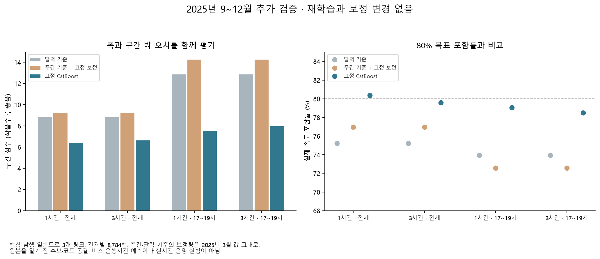
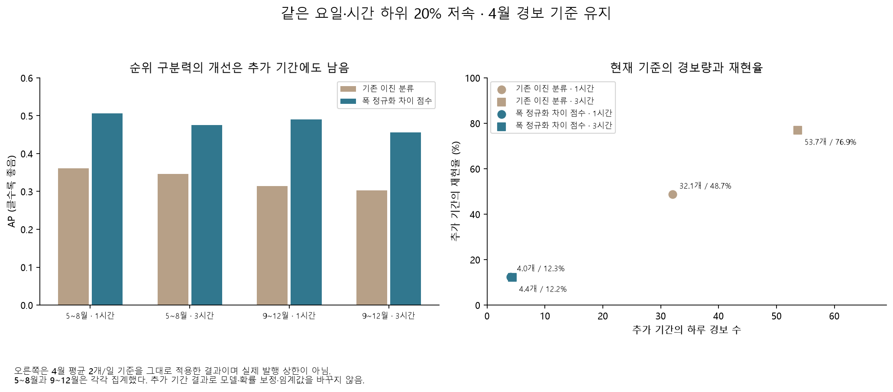

# 미열람 가을·겨울에서도 예측의 장점이 남는가

**2025년 9~12월에서도 속도 범위 모델과 조건부 저속 차이 점수의 장점이 남았다.** 고정 CatBoost 분위수의 중앙값 오차와 구간 점수는 달력·주간 기준보다 낮았고, 조건부 저속의 폭 정규화 차이 점수도 기존 최근 도로 이진 분류보다 높은 AP를 보였다. 다만 4월 경보 기준을 유지한 차이 점수의 재현율은 약 12%였고, 전체 80% 구간 포함률을 모든 시간·월에 유지하지 못했다. 실제 경보 서비스 채택으로 이어지는 결과는 아니다.

## 무엇을 새 기간 전에 고정했나

앞선 확장 탐색은 2025년 5~8월 시험을 여러 번 재사용했다. 이를 보완하기 위해 **이번 실행에서 아직 받거나 열지 않은 9~12월**을 별도 기간으로 정했다. [설정](overnight_confirmation_config.yaml), 수집·평가 코드, 모델·보정·경보 기준을 담은 [18개 항목의 동결 명세](results/overnight/confirmation/selection_manifest.json)를 `3da34ee`에 커밋한 뒤에만 수집했다. 수집기는 해당 명세가 HEAD와 같은지 확인한다.

- 원래 학습·선택·보정·4월 경보 기준을 그대로 사용했다. 새 학습·확률 보정·구간 확장량 변경·임계값 선택은 0회다. 이전 시험과 결과는 보존했다.
- 고정 핵심 남행 일반도로 링크 `1220025000`, `1220021000`, `1220016200`만 사용했다. 버스 운행시간 예측이나 버스 특징의 추가 가치를 확인하는 실험이 아니다.
- 1·3시간 각각 분위수 3개, 전체 하위 20% 모델 3개, 조건부 이진 분류 1개, 조건부 차이 점수 2개를 정했다. 비교는 전체·17~19시, 링크별·월별 지표를 모두 저장했다.
- 8월의 기존 도로 캐시로 168~672시간 주간 지연과 최근 도로 특징을 준비했다. 실제 한 시간 격자를 유지하며 표본을 제거한 다음 시계열을 당기지 않았다. 원래 최근 도로 입력의 공개 지연 가정은 남는다.
- 이 기간은 과거 자료를 새로 지정한 **후향적 추가 검증**이다. 실제 온라인 예측·외부 도시 일반화 실험이 아니며, 주 재표집 범위는 지정 비교의 기술적 불확실성으로 읽는다.

## 원본·표본 품질

[TOPIS](https://topis.seoul.go.kr/refRoom/openRefRoom_1.do) 월 XLSX 4개, **166,694,910 bytes**를 별도 폴더에 수집했다. 강남대로 월 가공 87,840행에서 기존 핵심 3개 링크만 사용했다. 학습기와 비교한 메타데이터 변경·부재에 따른 제외는 0개였고, 12개 링크·월 조합 모두 100% 관측이다. 간격별 **8,784개 예정 관측이 전부 유효**했고 실제값 부재는 0개다. 사전 품질 기준 95%를 모두 통과했다. 2026년 자료는 열지 않았다.

전체 하위 20% 라벨은 1,990개(22.65%), 같은 요일·시간 하위 20% 라벨은 2,479개(28.22%)였다. 두 라벨의 AP를 직접 비교하지 않는다. 학습 임계값의 하위 집단 대체는 0개였다. [출처](overnight-confirmation-sources.json), [관측률](results/overnight/confirmation/coverage.csv), [특징 감사](results/overnight/confirmation/feature_audit.json), [타깃 수](results/overnight/confirmation/target_counts.csv)

## 속도 범위: 기준보다 좋은 결과가 유지됐다

| 모델 | 간격 | 중앙값 MAE (km/h) | 80% 목표 포함률 | 평균 폭 (km/h) | 구간 점수 ↓ |
|---|---:|---:|---:|---:|---:|
| 고정 CatBoost | 1시간 | **1.393** | **80.36%** | **4.407** | **6.370** |
| 고정 CatBoost | 3시간 | **1.455** | **79.59%** | **4.524** | **6.640** |
| 주간 경험분포 + 3월 고정 확장 | 1·3시간 | 1.686 | 76.96% | 5.040 | 9.238 |
| 달력 경험분포 + 3월 고정 확장 | 1·3시간 | 1.746 | 75.22% | 4.889 | 8.826 |

주간·달력 기준은 두 간격의 입력이 같아 수치가 같다. 독립적인 두 번의 검증으로 세지 않는다. 구간 점수는 폭과 구간 밖 오차를 함께 벌점으로 계산하므로 작을수록 좋다. 원래 3월의 확장량은 주간 약 1.003 km/h, 달력 0이며 가을·겨울에 다시 맞추지 않았다.

전체 구간 점수의 CatBoost−주간 차이는 1시간 **−2.868 [−6.033, −0.998]**, 3시간 **−2.598 [−5.620, −0.809]**였다. 달력 대비는 −2.456 [−4.865, −1.066], −2.185 [−4.449, −0.869]다. 같은 주 가중치를 양쪽에 적용한 1,000회 비교이며 여러 결과를 종합한 인과·일반화 보장은 아니다. 저녁의 두 기준 대비 차이도 음수였다.

전체 평균만으로 신뢰성을 보장할 수는 없다. 저녁 포함률은 **79.05%·78.51%**, 12월은 **78.27%·77.15%**였다. 월별 1시간 MAE는 9월 1.246, 10월 1.542, 11월 1.305, 12월 1.471 km/h다. 10월과 12월의 상대적인 악화를 숨기지 않았으며 새 기간에서 구간을 더 넓혀 점수를 다시 산출하지 않았다.

## 조건부 저속: 순위는 개선되지만 놓치는 사건이 많다

조건부 저속의 기준은 2023~2024년 학습 자료에서 정한 링크·요일·시간별 하위 20%다. 차이 점수는 이 기준과 고정 분위수 중앙값의 차이를 예측 구간 폭으로 나눈 값이며, 실제 속도를 입력으로 사용하지 않는다.

| 방식 | 간격 | AP | 4월 예산 기준의 정밀도 | 재현율 | 하루 경보 |
|---|---:|---:|---:|---:|---:|
| 기존 최근 도로 이진 분류 | 1시간 | 0.3140 | 30.84% | 48.69% | 32.08 |
| 기존 최근 도로 이진 분류 | 3시간 | 0.3023 | 29.10% | 76.89% | 53.68 |
| 폭 정규화 차이 점수 | 1시간 | **0.4907** | **62.20%** | **12.34%** | **4.03** |
| 폭 정규화 차이 점수 | 3시간 | **0.4559** | **56.34%** | **12.18%** | **4.39** |

AP 차이는 1시간 **+0.1767 [+0.1460, +0.2108]**, 3시간 **+0.1536 [+0.1303, +0.1789]**다. 저녁에서도 차이 점수가 높았다. 원차이 점수의 AP는 0.4860·0.4550으로 가까웠다. 이 추가 검증은 폭 정규화가 원차이보다 우수하다는 별도 확정 근거로 사용하지 않는다.

4월에 평균 2개/일 조건으로 정한 임계값은 새로운 계절에서 실제 2개 상한을 보장하지 못했다. 차이 점수도 4개 안팎을 발행하면서 약 88%의 양성 관측을 놓쳤다. 기존 이진 분류는 하루 32~54개로 과도했다. 월별 차이 점수 AP는 1시간 0.431~0.550, 3시간 0.397~0.504였고, 제한 경보 재현율은 1시간 8.2~15.1%, 3시간 6.7~16.6%였다. 이 기준을 서비스에 채택하지 않는다.

## 반복 저속: 최근 정보의 가치는 간격에 따라 다르다

링크 전체 하위 20% 라벨의 AP는 달력 **0.7652**, 주간 도로 **0.7850**, 최근 도로 **1시간 0.8048·3시간 0.7920**이었다. 주간−달력 차이 +0.0198 [+0.0115, +0.0287]가 남았고, 최근−주간은 1시간 **+0.0198 [+0.0116, +0.0293]**였다. 3시간은 **+0.0070 [−0.00010, +0.01522]**로 범위에 0을 포함한다. 저녁의 3시간 차이도 0을 포함했다. 가까운 시점의 최근 도로 정보가 더 유용하다는 방향은 강화되지만, 두 간격 모두의 확실한 개선으로 요약하지 않는다.

## 판단·산출물·검증

### 전체 결과를 본 뒤의 주·달력 사후 점검

위 사전 지정 평가가 끝난 뒤 별도 [진단 규칙](overnight_confirmation_review_config.yaml)을 기록했다. 같은 저장 예측에서 한 주씩 제외해 전체·저녁, 두 간격, 두 기준의 구간 점수 차이를 다시 계산했다. **18개 주×8개 비교의 144개 제외 결과 모두 CatBoost−기준이 음수**였다. 다만 차이의 크기는 10/6 주의 영향을 많이 받았다. 1시간 전체의 CatBoost−주간은 원래 −2.868이며 그 주를 제외하면 −1.594다. ‘특정 한 주만 없으면 우위가 사라진다’는 모양은 아니지만 모든 주의 개선 폭이 비슷하지도 않다.

| 비교 | 18개 주를 하나씩 제외한 점수 차이 범위 |
|---|---|
| 1시간 전체: CatBoost−주간 | [−3.038, −1.594] |
| 3시간 전체: CatBoost−주간 | [−2.774, −1.387] |
| 1시간 저녁: CatBoost−주간 | [−7.132, −3.822] |
| 3시간 저녁: CatBoost−주간 | [−6.665, −3.429] |

이 범위는 신뢰구간이 아닌 **단일 주 제외의 민감도 범위**다. [모든 기준·제외 결과](results/overnight/confirmation_review/leave_one_week_out.csv), [주별 점수 차이](results/overnight/confirmation_review/weekly_differences.csv)를 제공한다.

모델 입력과 같은 `holidays.KR`의 지정 공휴일 표식도 살폈다. 일반 일요일은 표식 없는 주말로 분류하며, 법령상 공휴일 전체를 재정의한 분류가 아니다. 분석 기간의 표식일은 10/3·5·6·7·8·9, 12/25의 7일이다. 10월 연휴는 [2025년 월력요항](https://www.kasi.re.kr/publication/post/newsMaterial/30071?cPage=8)의 10/3~9 안내와 대조했다.

| 집단 | 날짜·주 | 1시간 포함률 / MAE | 3시간 포함률 / MAE |
|---|---|---|---|
| 표식 없는 평일 | 82일·18주 | 81.61% / 1.346 | 81.30% / 1.384 |
| 표식 없는 주말 | 33일·17주 | 79.21% / 1.356 | 77.44% / 1.417 |
| 지정 공휴일 표식일 | 7일·3주 | 71.23% / 2.117 | 69.64% / 2.474 |

MAE 단위는 km/h다. 표식일 504행은 3개 링크의 같은 시각을 반복 포함한 값이며, 최소 8주 조건을 충족하지 못해 **집단 비교 채택은 보류**했다. 위 수치는 표본을 드러내는 기술 집계다. 해당 집단에서 하한보다 실제 속도가 더 낮은 비율은 16.87%·16.47%였다. 모델에 이미 공휴일 표식이 있다는 사실만으로 특수한 날의 범위 예측을 신뢰할 수 없다는 후속 질문으로 남긴다. 휴일이 오차의 원인이라는 결론이나 추가 보정·재학습은 하지 않았다. [집단 전체 지표](results/overnight/confirmation_review/calendar_groups.csv), [진단 감사](results/overnight/confirmation_review/audit.json)

가장 유지할 가치가 있는 예측 결과는 **속도 범위·중앙값을 단순 기준과 비교하는 실험**이다. 조건부 차이 점수는 더 나은 순위 점수의 후보로 남기되 경보의 서비스 시간·실제 비용·오류 지연을 먼저 정의해야 한다. 버스 정책의 원인 분석과 일반도로 예측을 별도 질문으로 유지한다.

공개 산출물은 [확률 지표 216행](results/overnight/confirmation/probability_metrics.csv), [분위수 지표 54행](results/overnight/confirmation/quantile_metrics.csv), [확률 짝 비교 192행](results/overnight/confirmation/probability_paired.csv), [분위수 짝 비교 72행](results/overnight/confirmation/quantile_paired.csv), [평가 감사](results/overnight/confirmation/evaluation_audit.json)와 그림 2장이다. 이 행 수는 서로 독립적인 실험 수가 아니다. 18개 항목의 개별 예측은 Git 제외 Parquet에 보존했다.

관련 고정 기간·잠금·결측/중복 테스트 2개와 루트 종합 검사를 통과했다. 명세를 커밋한 뒤 `confirmation-collect` → `confirmation-prepare` → `confirmation-evaluate` → `confirmation-plots` 순서로 실행했으며 원래 43개 동결과 추가 명세들을 검증했다. 새 기간 결과로 기존 코드·모델·선택 기준을 고치지 않았다.
