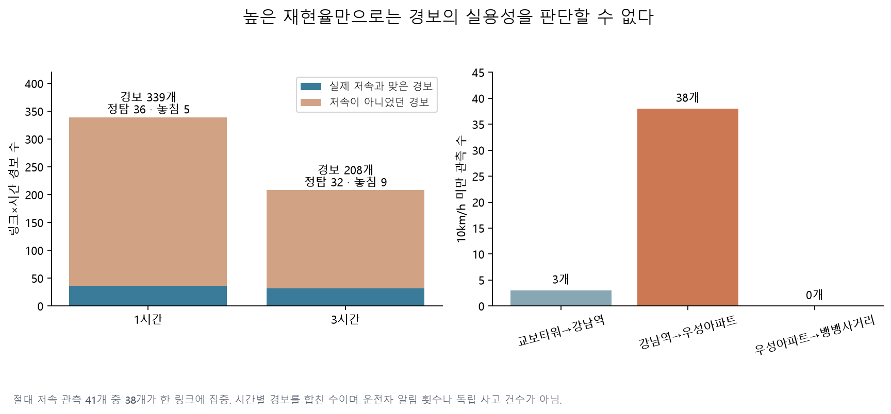
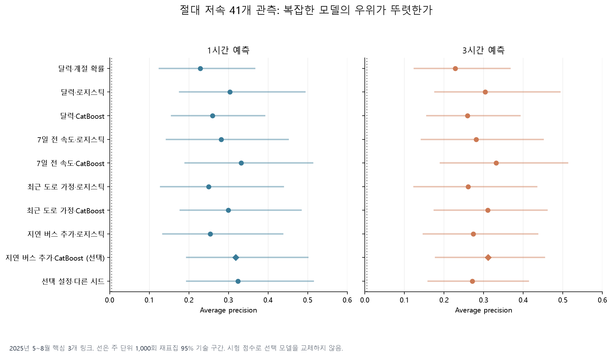
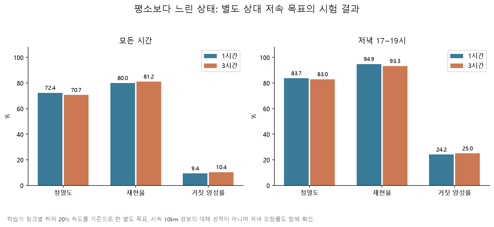
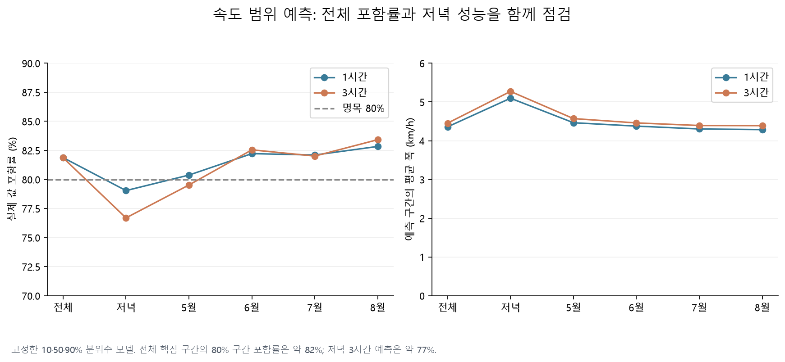

# 2025년 여름 저속 경보와 속도 범위 예측의 고정 시험

**시속 10km 미만을 알리는 모델은 실험 결과로 보존하고 운영 경보 채택은 보류한다.** 사전에 선택한 모델의 핵심 구간 AP는 1시간 0.318, 3시간 0.311이지만, 실제 경보의 정밀도는 10.6%, 15.4%다. 41개 저속 관측 중 38개가 한 링크에 몰려 있으며, 버스 특징의 추가 이익도 뚜렷하게 확인되지 않았다. 상대 저속과 속도 범위 예측은 후속 탐색 후보로 남긴다.

이 보고서는 [기존 9개 모델의 결과](report.md)와 별개의 시험이다. [계획](overnight-forecast-plan.md), [설정](overnight_forecast_config.yaml), [시험 전 동결 명세](results/overnight/forecast/selection_manifest.json), [전체 지표](results/overnight/forecast/test_metrics.csv)를 함께 제공한다. 2026년 잠금 자료는 사용하지 않았다.

## 무엇을 언제 예측했는가

TOPIS 월별 원본 2023년 1월~2025년 8월의 강남대로·사평대로·테헤란로·봉은사로·서초대로를 준비했다. 학습기 관측률 95%·속성 일관성을 만족한 62개 링크를 고정했고, 주 평가는 처음 정한 강남대로 남행 3개 링크를 사용한다. 다른 59개 링크를 섞은 점수는 별도 참고치다.

| 역할 | 기간 | 사용한 판단 |
|---|---|---|
| 학습 | 2023-01~2024-12 | 링크 선택·대체값·상대 저속 기준·모델 적합 |
| 후보 선택 | 2025-01~02 | 모델·특징·하이퍼파라미터·조기 종료 |
| 확률 보정 | 2025-03 | sigmoid 보정 |
| 경보 기준 | 2025-04 | 거짓 양성률 10% 이내에서 재현율 최대화 |
| 독립 시험 | 2025-05~08 | 고정 평가와 실패 진단 |

정시 `t`의 1시간 예측은 `t`에 시작하는 한 시간 평균 속도, 3시간 예측은 `t+2`에 시작하는 한 시간 평균 속도다. 가장 최근 도로 특징은 `t−2`에 시작해 `t−1`에 끝나는 구간으로 한 시간의 처리 여유를 둔다. 버스 특징은 최소 168시간 지연한다. 월 파일의 당시 공개 시점을 검증한 것은 아니므로 **회고적인 자료 가용성 가정**이다. 실제 미래 날씨는 입력하지 않았다.

개발 후보 50개를 학습하고 24개를 선택·보정했다. 기록된 학습 시간 합계 954.9초, 경고 0건이다. 2026-10-29 03:25:07 KST에 모델·보정·경보 기준·코드를 포함한 43개 파일을 동결하고, 명세를 커밋 `7d8a46b`로 푸시한 뒤 시험 자료를 처음 수집했다. 평가 완료는 03:30:43 KST다. 시험 결과로 재학습하거나 우승 모델을 바꾸지 않았다.

## 사건 수와 결측부터 확인

핵심 구간은 예정 8,856개 중 8,820개 링크×시간이 관측됐다(99.59%). 각 링크에서 2025-07-04 20시~07-05 07시의 12시간이 빠졌고 목표값을 보간하지 않았다. 41개 저속 관측은 31일에 나타났으며, 링크별 연속 저속을 묶으면 34개 묶음이다. 이는 독립된 교통사고나 통행자 수가 아니다.

| 핵심 남행 링크 | 관측 시간 | 10km/h 미만 | 발생 날짜 | 연속 저속 묶음 |
|---|---:|---:|---:|---:|
| 교보타워사거리→강남역 (`1220025000`) | 2,940 | 3 | 3 | 3 |
| 강남역→우성아파트 (`1220021000`) | 2,940 | 38 | 30 | 31 |
| 우성아파트→뱅뱅사거리 (`1220016200`) | 2,940 | 0 | 0 | 0 |

전체 저속 비율은 0.465%, 저녁 17~19시는 39/1,107=3.52%다. 저속이 없는 링크의 AP·재현율은 정의할 수 없으며 0이나 1로 대체하지 않았다. 개발 단계에도 선택 16개, 보정 **3개**, 경보 기준 선택 **6개**뿐이었다. 이를 시험 전에 이미 한계로 기록했다.

시험 버스 원본에서는 6월 29일·7월 1~2일의 날짜 부재가 확인됐다. 이 날짜의 7일 후 보조 특징은 결측으로 남는다. 버스 고정 셀은 학습 때 선택한 것을 재사용했고, 개발·시험 경계의 기존 값과 일치하는지도 검사했다.

## 절대 저속 경보: 탐지는 하지만 거짓 경보가 많다

주 모델은 두 간격 모두 지연 버스 특징을 더한 깊이 8 CatBoost, 시드 17이다. 3월 보정기와 4월 임계값을 그대로 적용했다. 아래 경보 수는 세 링크의 시간별 경보 합계다.

| 지표 | 1시간 | 3시간 |
|---|---:|---:|
| Average precision | 0.3178 | 0.3108 |
| 주 재표집 AP 95% 구간 | 0.1949~0.4999 | 0.1783~0.4536 |
| 경보 수 | 339 | 208 |
| 맞은 경보 / 거짓 경보 | 36 / 303 | 32 / 176 |
| 놓친 저속 관측 | 5 | 9 |
| 정밀도 | 10.62% | 15.38% |
| 재현율 | 87.80% | 78.05% |
| 거짓 양성률 | 3.45% | 2.00% |
| 하루 경보 수 | 2.76 | 1.69 |
| Brier score | 0.003800 | 0.003902 |

거짓 양성률의 분모는 실제 저속이 아닌 8,779개 관측이다. 사건이 드물어 이 값이 낮아도 경보 대부분이 거짓일 수 있다. 저녁만 보면 거짓 양성률은 각각 **18.16%, 14.33%**로 높아진다. 4월 모든 시간에 적용한 10% 제약이 다른 계절이나 하위 시간대에서도 보장되는 것은 아니다.

월별 1시간 AP는 5월 0.112, 6월 0.444, 7월 0.343, 8월 0.609다. 각 월 사건은 8·3·18·12개이므로 높은 월 점수를 안정적인 개선으로 해석하지 않는다. 5월의 1시간 재현율은 50%, 3시간은 37.5%다. 3월 보정 이후 시험 Brier는 보정 전 0.003701→0.003800(1시간), 0.003828→0.003902(3시간)으로 오히려 나빠졌다. 보정이 일반화를 보장하지 않았다는 결과도 남긴다.

## 버스 특징과 복잡한 모델의 실익

| 비교 모델 | 1시간 AP | 3시간 AP |
|---|---:|---:|
| 링크·요일·시간의 계절 확률 | 0.2286 | 0.2286 |
| 달력만 쓰는 로지스틱 | 0.3038 | 0.3038 |
| 7일 이전 도로 속도 CatBoost | 0.3317 | 0.3317 |
| 최근 도로 관측 가정 CatBoost | 0.2993 | 0.3107 |
| 지연 버스 추가 CatBoost — 사전 선택 | 0.3178 | 0.3108 |
| 선택 설정의 다른 시드 42 | 0.3237 | 0.2712 |

달력·주간 지연 특징은 두 예측 간격에 같은 정보를 쓰므로 점수가 같다. 시험에서 주간 지연 기준선의 점수가 더 높다고 새 우승자로 바꾸지 않는다. 각 특징 집합에서 개발기에 선택한 설정을 비교한 결과라, 두 모델의 차이 전부를 버스 특징 하나의 효과로 볼 수도 없다.

시험을 본 뒤 [짝 비교 진단](results/overnight/forecast/test_paired_differences.csv)을 추가했다. 모든 링크·시간에 같은 주 가중치를 주고 1,000회 재표집했으며, 모델 재선택에 사용하지 않았다. 선택 모델에서 최근 도로 CatBoost를 뺀 AP 차이는 1시간 **+0.0186 [−0.0413, +0.0822]**, 3시간 **+0.0001 [−0.0300, +0.0368]**다. 달력 로지스틱과의 차이도 두 간격 모두 0을 포함한다. 다중 비교 보정 없는 기술 구간이며, 버스 특징 추가의 확실한 이익을 입증하지 못했다.

62개 링크 전체의 AP는 1시간 0.799, 3시간 0.777이지만 사건은 7,126개로 모집단과 빈도가 다르다. 이 점수를 핵심 강남역 3개 구간의 성능으로 대신 제시하지 않는다.

## 상대 저속: 다른 질문에서는 표본이 충분하다

학습기 링크별 하위 20% 속도를 기준으로 별도 학습한 민감도 모델이다. 핵심 링크의 기준은 각각 16.12·14.68·20.10km/h다. 주 목표에서 고른 모델 종류·특징·깊이를 그대로 사용했으며 상대 목표용 추가 튜닝은 하지 않았다.

| 지표 | 1시간 | 3시간 |
|---|---:|---:|
| 시험 상대 저속 관측 | 2,075 / 8,820 | 동일 |
| Average precision | 0.8425 | 0.8340 |
| 정밀도 | 72.36% | 70.67% |
| 재현율 | 80.00% | 81.16% |
| 거짓 양성률 | 9.40% | 10.36% |
| 하루 경보 수 | 18.65 | 19.37 |

절대 저속과 라벨·빈도가 달라 AP를 직접 비교하면 안 된다. 저녁 거짓 양성률은 **24.17%, 25.00%**이고 하루 경보도 많다. 사용자 알림보다는 “평소 대비 느린 구간의 상태 표시”로 검토할 만하다. 이 목표에는 동일 조건의 단순 모델 비교가 충분하지 않아 CatBoost 우위나 버스 특징의 효용을 확정하지 않는다.

## 속도 범위 예측: 후속 설명용 후보

| 핵심 구간 지표 | 1시간 | 3시간 |
|---|---:|---:|
| 10·50·90% 평균 pinball loss | 0.4167 | 0.4287 |
| 중앙값 예측 MAE (km/h) | 1.300 | 1.343 |
| 명목 80% 구간 실제 포함률 | 81.88% | 81.87% |
| 평균 구간 폭 (km/h) | 4.357 | 4.453 |
| 저녁 포함률 | 79.04% | 76.69% |
| 핵심 구간 분위수 교차율 | 0% | 0% |

전체 62개 링크에서는 교차가 각각 0.0148%, 0.0121% 발생했다. 순서를 재정렬해 숨기지 않았다. 전체 포함률이 명목값과 가깝다는 사실만으로 조건별 보장이나 정책 반사실 예측이 성립하지 않는다. 같은 시험의 단순 분위수 기준선과 비교하지 않았으므로 모델의 우월성도 미확인이다.

## 결과의 채택 범위

| 방향 | 판단 | 이유와 다음 조건 |
|---|---|---|
| 10km/h 절대 저속 알림 | 운영 채택 보류, 실패 사례 채택 | 개발 사건 부족·낮은 정밀도·단일 링크 집중. 독립 시기 사건과 운영 지연 검증 필요 |
| 버스 보조 특징의 예측 효용 | 미확정 | 최근 도로 기준선과의 AP 차이 구간이 0 포함. 정책 기술 분석의 가치는 별도 판단 |
| 상대 저속 상태 표시 | 탐색 후보 | 더 많은 사건과 유용한 순위 성능. 단순 기준선·시간대별 오탐 부담 비교 필요 |
| 속도 범위 설명 | 탐색 후보 | 전체 포함률은 명목값에 가깝지만 저녁 약화. 계절 분위수 기준선과 지속성 확인 필요 |

자료 지연·누락·집계 시간은 계획의 가정 그대로다. 이 실험은 일반 차량 속도의 예측이며 버스 승객의 도착시간, 승차 대기, 정책이 없었을 때의 속도를 예측한 것이 아니다. 후속 탐색에서 이 시험을 다시 쓰면 이미 본 자료의 분석이라고 표시하고, 새 독립 검증과 구분한다.

## 재현과 검증

기존 개발·동결 단계를 재현한 환경에서 `overnight.py forecast-test-collect`, `forecast-test-bus-collect`, `forecast-test-prepare`, `forecast-test-bus-prepare`, `forecast-test-features`, `forecast-test-evaluate`를 순서대로 실행한다. 시험 관문이 동결 파일 해시를 검사한다. `forecast-test-diagnostics`, `forecast-plots`는 저장된 시험 결과의 사후 진단과 그림이다.

- [평가 감사](results/overnight/forecast/test_evaluation_audit.json): 24개 예측·모델·특징·평가 파일의 해시.
- [주 재표집](results/overnight/forecast/test_week_bootstrap.csv): 사건 없는 재표집을 포함한 유효/무효 횟수.
- [사후 진단 감사](results/overnight/forecast/test_diagnostics_audit.json), [관측 지지](results/overnight/forecast/test_event_support.csv), [보정 구간](results/overnight/forecast/test_reliability_bins.csv), [그림 명세](results/overnight/forecast/figures.json).
- 파서·미래 값 불변·학습기 선택·동결·고정 셀·확률 지표·전체 평가 흐름 검사를 통과했다. 추가 짝 비교·확률 구간·연속 관측 검사는 4개 통과했고 그림의 범례·축·표기를 실제 열어 확인했다.

원본·행별 예측·모델 바이너리는 Git에서 제외하고, 코드·출처·해시·집계 표·그림을 저장한다.
