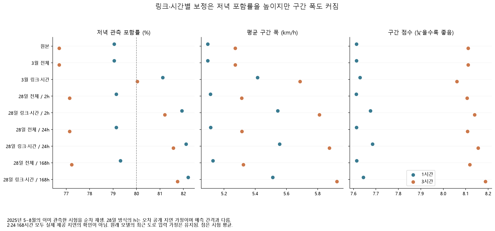
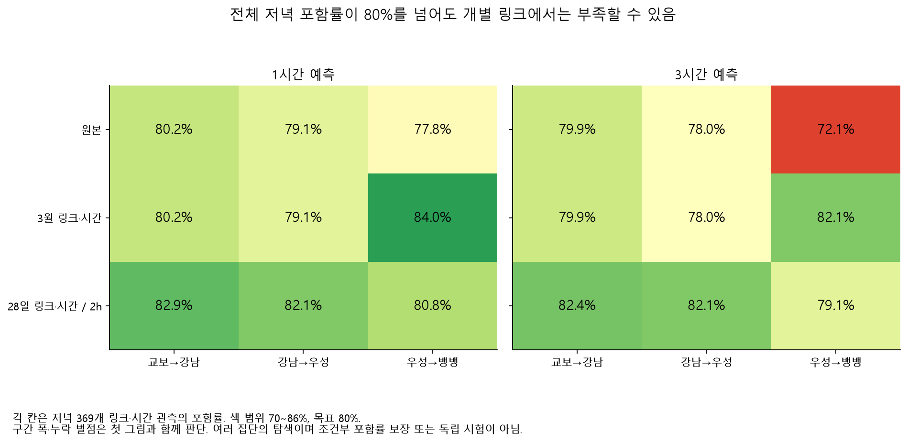

# 속도 범위의 보정: 저녁 포함률을 높이는 비용

**링크·시간대별 보정은 저녁 포함률을 높였지만 구간 폭도 커졌다.** 3시간 예측의 저녁 포함률은 원본 76.69%에서 3월 고정 보정 80.04%, 28일 이동 보정 81.21%가 됐다. 그 자체를 전체 성능 개선·운영 준비 완료로 표현하지 않는다. 구간 점수의 뚜렷한 개선은 확인하지 못했고 일부 링크는 여전히 80% 미만이다.

## 무엇을 고정하고 무엇을 바꿨는가

[규칙](overnight_interval_calibration_config.yaml)은 `2d75dda`, 코드와 [준비 명세](results/overnight/interval_calibration/preparation_manifest.json)는 `388997d`에 저장한 뒤 추가 평가를 실행했다. 이미 관측한 2025년 5~8월을 재사용하는 **사후 탐색**이다. 기존 분위수 모델·예측·초기 시험 결과와 2026년 잠금 값은 보존했다.

기존 모델로 3~4월 핵심 3개 링크의 예측을 간격별 4,392행 만들었다. 3월 2,232행의 기존 예측과 실제값이 정확히 같음을 확인했다. 준비와 평가는 별도 경로·명세로 분리했다. 시험은 각 간격 8,820행이며 저녁 17~19시는 1,107행이다.

보정 점수는 `max(q10−실제값, 실제값−q90)`이며 `ceil((n+1)×0.8)` 순위 값을 사용한다. 음수이면 0으로 두어 구간을 축소하지 않는다. 양 끝만 같은 값으로 넓히고 중앙값 예측은 바꾸지 않는다. 이는 [Romano·Patterson·Candès의 CQR](https://proceedings.neurips.cc/paper_files/paper/2019/file/5103c3584b063c431bd1268e9b5e76fb-Paper.pdf)을 참고한 변형이며 동일한 원 알고리즘이라고 부르지 않는다.

전체 점수와 `링크×저녁/나머지 시간` 점수를 나누었다. 3월 고정 방식과 원점 이전 28일 이동 창을 비교했고, 작은 집단은 60개 미만이면 같은 창의 전체 점수→3월 전체 점수로 대체하도록 정했다. 실제 평가에서 이동 집단은 최소 63~84개 점수를 확보해 대체가 발생하지 않았다. 3월 집단은 저녁 93개, 나머지 651개다.

이동 보정은 `목표 구간 시작 + 공개 지연 ≤ 예측 원점`인 오차만 사용한다. 지연은 2·24·168시간을 고정했고 미래 실제값 위반은 **0건**이었다. 서울 시간대를 보존했으며, 미래·미공개 값을 바꿔도 앞선 구간이 바뀌지 않는 테스트도 통과했다. 지연은 실제 공개 시각을 확인한 값이 아니라 가정이다. 24·168시간 민감도에서도 원래 모델의 최근 도로 입력 가정은 그대로 남는다.

[Xu·Xie(2021)의 EnbPI](https://proceedings.mlr.press/v139/xu21h.html)는 이용 가능한 과거 잔차와 배치 피드백을 다룬다. 이 실험은 부트스트랩 LOO 앙상블을 만들지 않았으므로 EnbPI 구현이 아니다. ACI·SPCI도 실행하지 않았다. 시계열 의존·분포 이동 때문에 분포무관 또는 집단별 포함률 보장을 주장하지 않는다. [문헌과 확인 범위](overnight-interval-references.json)를 함께 남겼다.

## 저녁의 포함률·폭·누락 벌점을 함께 비교

| 간격·방식 | 포함률 | 평균 폭(km/h) | 구간 점수 |
|---|---:|---:|---:|
| 1시간 원본 | 79.04% | 5.10 | 7.613 |
| 1시간 3월 링크·시간 | 81.12% | 5.41 | 7.629 |
| 1시간 28일 링크·시간, 지연 2h | 81.93% | 5.54 | 7.676 |
| 3시간 원본 | 76.69% | 5.27 | 8.111 |
| 3시간 3월 링크·시간 | 80.04% | 5.69 | 8.061 |
| 3시간 28일 링크·시간, 지연 2h | 81.21% | 5.81 | 8.140 |

전체 시간의 원본 포함률은 1·3시간 모두 약 81.9%이며 3월 전체 점수의 보정량은 0이었다. 따라서 전체 보정은 원본과 동일하며 독립적인 성공 사례로 세지 않는다. 3월 고정 집단 보정은 우성→뱅뱅 링크만 확장했다. 저녁 양 끝의 확장량은 1시간 0.478km/h, 3시간 0.623km/h다. 다른 링크의 저녁은 0이었다.

구간 점수는 폭과 구간 밖 오차를 함께 벌점으로 주며 낮을수록 좋다. 3시간 저녁의 고정 집단 보정−원본 차이는 −0.050 [−0.136, 0.028]로 개선 여부가 불확실하다. 1시간 이동 집단 보정−원본은 +0.062 [0.012, 0.112]로 오히려 점수가 높았다. **포함률을 높인 만큼 더 넓고 덜 날카로운 예측이 될 수 있다.**

오차 공개를 24·168시간으로 늦춰도 이동 집단의 저녁 포함률은 1시간 82.11%·82.20%, 3시간 81.57%·81.75%였다. 지연이 긴 것이 더 좋다는 결론은 내리지 않는다. 같은 시험을 본 뒤 일부 방식을 최종 선택하지 않았고, 모든 9개 방식의 결과를 저장했다.

## 전체 평균으로 가려지는 링크

3시간 원본의 저녁 포함률은 교보→강남 79.95%, 강남→우성 78.05%, 우성→뱅뱅 **72.09%**다. 3월 고정 집단 보정은 마지막 링크를 82.11%로 높였지만 다른 두 링크는 바꾸지 않았다. 28일 집단 보정·2시간 지연은 각각 82.38%, 82.11%, **79.13%**였다. 전체 저녁이 81.21%여도 모든 링크가 목표를 만족하는 것은 아니다.

구간 하한이 음수인 시험 행은 없었다. 점수 차이 구간은 같은 18개 달력 주를 1,000회 공동 재표집한 결과다. 저장된 순차 예측의 손실을 재표집하며, 각 재표집에서 이동 보정 과정을 다시 실행한 것은 아니다. 개별 칸의 차이를 독립 확증 검정으로 해석하지 않는다.

## 판단과 재현

채택할 과제는 **어느 링크·시간에 예측구간이 부족한지 보여 주고 포함률과 폭의 비용을 함께 설명하는 것**이다. 모델을 더 크게 만드는 필요성은 이 결과에서 드러나지 않았다. 운영 모델 선택은 새 기간과 실제 공개 지연, 필요한 경보·의사결정 비용을 정한 후 진행해야 한다. 이번 재사용 시험으로 최적 보정 방식이 확정됐다고 하지 않는다.

사례 환경에서 `python overnight.py interval-calibration-prepare`, `interval-calibration-evaluate`, `interval-calibration-plots`를 사용한다. 준비·평가에는 Git 제외 원본 특징·모델·예측 캐시가 필요하며 새 체크아웃에서 바로 전체 실행되지는 않는다. 그림은 커밋된 표로 재생성할 수 있다. [전체 216개 지표](results/overnight/interval_calibration/metrics.csv), [432개 짝 비교](results/overnight/interval_calibration/paired_comparisons.csv), [일별 지표](results/overnight/interval_calibration/daily_metrics.csv), [평가 감사](results/overnight/interval_calibration/evaluation_audit.json)를 제공한다.
