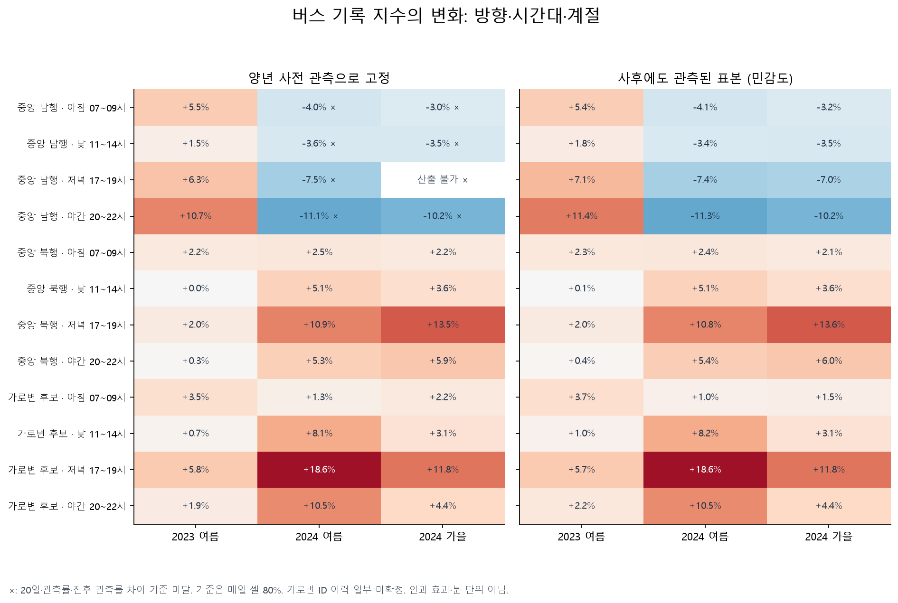
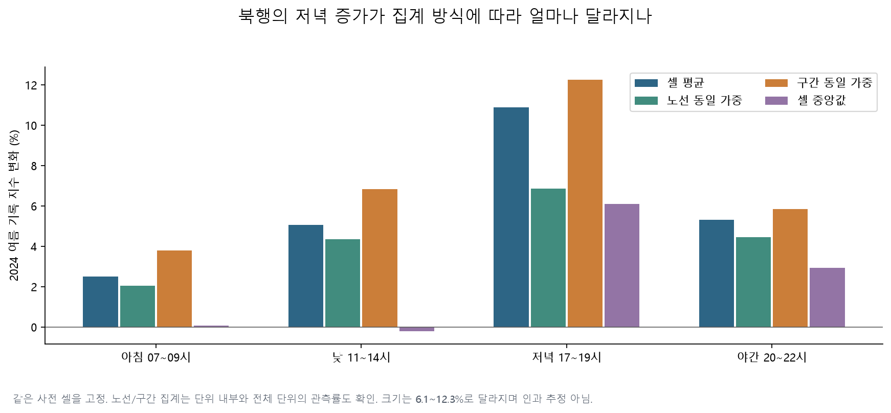
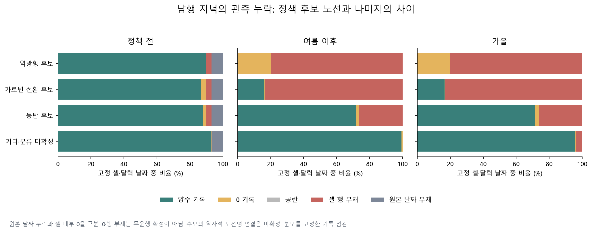
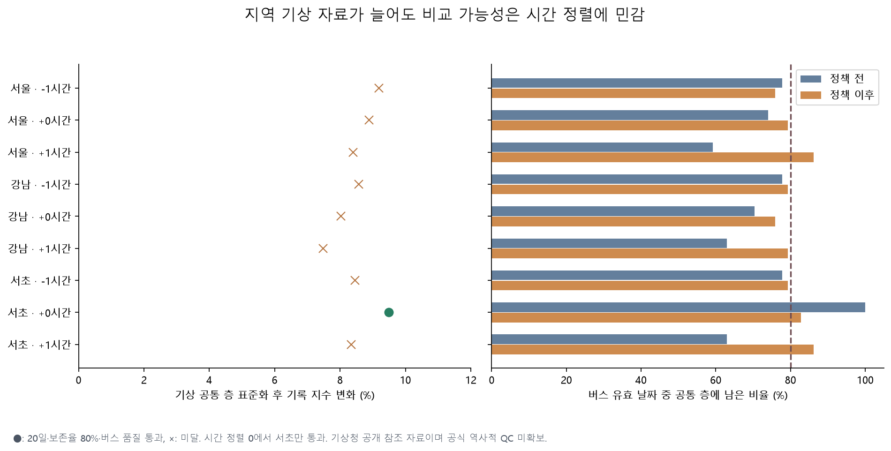

# 확장 탐색 1차: 시간대·관측 누락·지역 기상으로 다시 본 방향 차이

2026-10-29 실행. [10시간 계획](archive.md#reports) (`overnight-plan.md`, 로컬 보관)의 E01·E02·E04·E05·E07·E08에서 얻은 첫 결과다. 이후 승객·노선군·공간·다년 자료와 예측 탐색을 이어간다. 원래 계획·프로토콜·결과와 2026년 잠금 시험값은 보존했다.

가장 남는 질문은 **“남행에서 빠져나간 노선의 기록과 계속 운행한 버스의 변화를 구분하면, 저녁의 병목 이동을 어디까지 설명할 수 있나?”**다. 북행의 저녁 증가가 다른 시간대보다 크고 집계법을 바꾸어도 방향이 남는다. 남행 전체에서는 사후 관측 누락이 크며, 그 누락은 정책 후보 노선에 집중된다. 지역 기상 자료를 새로 확보했지만 기상 표본의 비교 가능성은 아직 시간 정렬에 민감하다.

## 표본과 해석

기존 39개 버스 ZIP의 검증된 16시간 캐시를 재사용하여 132개 노선 ID·2,808,176개 날짜/노선/구간/시간 기록을 만들었다. 반복 방문이 겹친 키는 제외했다. 양수 평균 운행시간을 같은 셀의 사전 평균 대비 지수로 나타냈다. 단위·정차 포함 여부·0 생성 규칙이 공식적으로 확정되지 않았으므로 분 단위 시간이나 무운행으로 환산하지 않는다.

비교 기간은 기존과 같다. 2023·2024년 사전은 5월 20일~6월 28일, 여름 사후는 7월 8일~8월 16일, 가을은 2024년 9월 2일~10월 31일이다. 평일·공휴일 제외, 원본에 날짜가 존재하는 경우의 공통 사전 표본이 주 분석이다. 사후에도 계속 관측된 표본은 선택 편향 가능성이 있는 민감도다.

관측률 80%에서 사전 셀을 고정한 뒤 하루 판정 기준만 75·80·85·90%로 바꿨다. 셀 평균·노선 동일 가중·구간 동일 가중·셀 중앙값을 비교했다. 노선/구간 가중은 각 단위 내부와 전체 단위의 관측률을 모두 요구한다. 전후 각각 20일 이상, 관측률 차이 10%p 이내의 기준을 유지했다. 주말은 별도 사전 평균을 쓰지만 날짜 수가 부족해 모든 주말 비교가 이 기준에 미달했다. 총 1,560개 조합은 탐색 결과이며 유의한 결과를 골라 인과 효과로 해석하지 않는다.

## 북행은 저녁 증가가 가장 크다

공통 사전 표본·셀 평균·80% 관측률 조건의 북행 결과다. 아래 값은 모두 기존 버스 품질 기준을 통과했다.

| 시간대 | 2023 여름 | 2024 여름 | 2024 가을 |
|---|---:|---:|---:|
| 07~09시 | +2.18% | +2.50% | +2.18% |
| 11~14시 | +0.02% | +5.07% | +3.64% |
| 17~19시 | +1.99% | +10.89% | +13.55% |
| 20~22시 | +0.26% | +5.30% | +5.92% |



2024년 저녁 북행은 셀 평균 +10.89%, 노선 동일 가중 +6.87%, 구간 동일 가중 +12.25%, 셀 중앙값 +6.10%다. 증가 방향은 같지만 크기는 집계 대상의 가중에 따라 다르다. 낮은 중앙값이 −0.21%로 셀 평균 +5.07%와 달라, 평균만으로 모든 구간이 나빠졌다고 표현할 수 없다.



가로변 후보도 저녁 평균 +18.57%를 보였으나 일부 역사적 정류장 ID와 방향·공간 대응이 미확정이고 구간 동일 가중의 품질 기준도 실패한다. **탐색을 이어갈 후보**로 두며 확정된 전이 효과로 부르지 않는다.

## 남행 누락은 정책 후보 노선에 집중된다

공통 사전 표본의 남행 저녁 양수 기록 관측률은 원본이 존재하는 날짜 기준으로 사전 98.3%에서 사후 81.8%로 낮아졌다. 같은 셀에서 정책 후보와 기타·분류 미확정을 나누면 다음과 같다. 이는 전체 노선 운행률이 아니라 고정된 날짜/구간/시간 셀의 기록 비율이다.

| 분류 | 사전 양수 기록 비율 | 사후 양수 기록 비율 |
|---|---:|---:|
| 정책 3개군에 연결된 현재 ID 후보 | 94.4% | 25.2% |
| 기타·분류 미확정 | 99.5% | 99.3% |

역방향 후보는 사후 남행에서 양수 기록이 없고 0 또는 행 부재로 나타난다. 이를 시간이 0으로 개선된 것으로 계산하지 않았다. 기존 방향별 경로 분석과 연결하면 노선 이동에 의한 표본 변화라는 설명과 부합하지만, 현재 이름과 당시 ID의 대응이 완전히 확정된 것은 아니다.



남행 공통 사전 표본의 여름 변화는 시간대별 −3.97%, −3.61%, −7.46%, −11.11%지만 **모두 전후 관측률 차이 기준에 미달**한다. 계속 관측된 표본에서는 감소가 남아도, 이 값은 사후 생존 표본의 조건부 결과다. 다음 단계는 기타·분류 미확정 중 당시 이름을 확인할 수 있는 노선과 구간을 분리하는 것이다.

## 지역 시간별 기상은 진전이지만 강건한 결론까지는 아니다

[자료 정의·수집 결과](archive.md#reports) (`overnight-evidence.md`, 로컬 보관)에 근거해 서초·강남·서울 3개 관측소에서 26,157개 시간의 강수 관측과 26,246개 시간의 기온을 확보했다. 기상 결측은 그대로 유지했다. 공통 층 보존율의 분모는 기상 관측이 있는 날만이 아니라 **모든 버스 유효 날짜**다.

서초 401·기본 시간 정렬에서 북행 저녁의 강수+기온 층을 맞추면 +9.50%다. 사전 27일, 사후 24일을 남겨 20일·80% 조건을 통과한다. 남은 공통 층은 **해당 시간대 강수 1mm 미만**과 세 기온 구간이다. 비가 많은 조건까지 비교가 성립한다는 뜻이 아니다. 한 층은 사후 2일뿐이어서 층별 추정의 불안정성도 남는다.



3개 관측소 × −1·0·+1시간 정렬 중 이 조합만 강수+기온 기준을 모두 통과했다. 값의 부호는 같지만 나머지 조합은 필요한 공통 날짜가 부족하다. 요일까지 동시에 맞춘 서초 기본 정렬도 12일/9일로 실패한다. **현재 채택할 결론은 “지역 자료로 일부 비교가 가능해졌지만 기상 조건의 비교 가능성은 아직 불안정하다”**이다. 공개 웹 참조 관측의 역사적 QC도 미확보다.

## 재현과 산출물

사례 폴더의 기존 가상환경에서 실행한다. `weather-collect`는 현재 확인된 1건의 시각 불일치 때문에 실패 상태를 명세에 남기며 비정상 종료한다. `weather-prepare`는 검증을 통과한 560개 응답만 처리하고 실패 내역·불완전 수집 상태를 결과 감사표에 전달한다. 그 요청을 정상 응답으로 간주하지 않는다.

```bash
.venv/bin/python overnight.py weather-collect
.venv/bin/python overnight.py weather-prepare
.venv/bin/python overnight.py bus-prepare
.venv/bin/python overnight.py bus-sensitivity
.venv/bin/python overnight.py weather-analysis
.venv/bin/python -c 'from gangnam.overnight_observation_plots import plot; plot()'
```

- [버스 집계 비교 1,560행](results/overnight/bus/aggregation_comparisons.csv), [일별 주 분석 지수](archive.md#results) (`results/overnight/bus/daily_indices_primary.csv`, 로컬 보관), [누락 분해](archive.md#results) (`results/overnight/bus/missingness_by_route_segment.csv`, 로컬 보관)
- [기상 비교 3,456행](results/overnight/weather/comparisons.csv), [공통 층별 표본](archive.md#results) (`results/overnight/weather/common_strata.csv`, 로컬 보관), [원본 기상 품질](results/overnight/weather/hourly_quality.csv)
- [버스 패널 감사](results/overnight/bus/panel_audit.json), [기상 감사](results/overnight/weather/audit.json), [기상 비교 감사](results/overnight/weather/comparison_audit.json)
- 모든 집계법의 일별 상세와 큰 패널·원본은 Git 제외 경로에 보존하고 해시를 기록했다. 원문·초기 프로토콜·이전 결과는 변경하지 않았다.

새 합성 자료 검증은 과거 시각 오인·숫자 0·결측·중복 충돌·노선 동일 가중·누락 분모·기상 표본 보존율을 점검한다. 전체 저장소 검사와 자료/코드 해시는 진행 기록에 남긴다.
