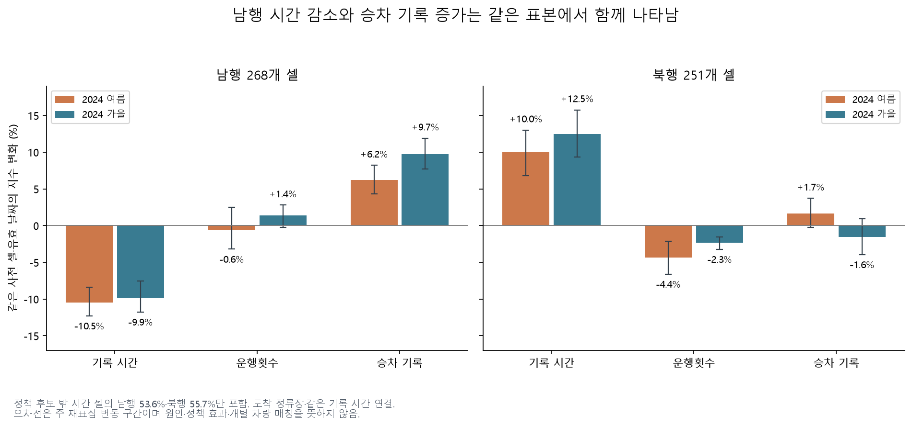
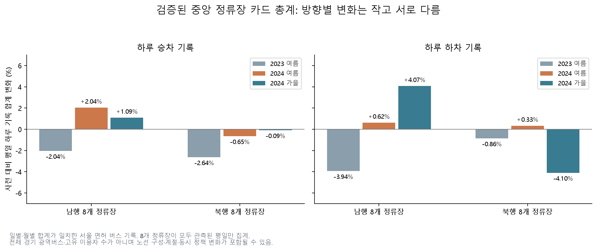
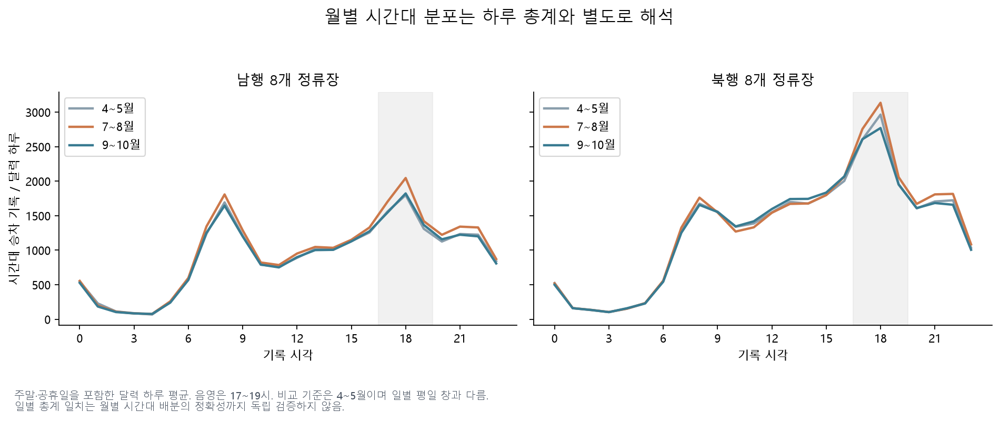
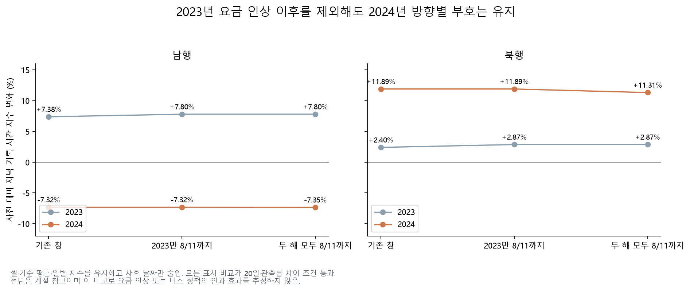
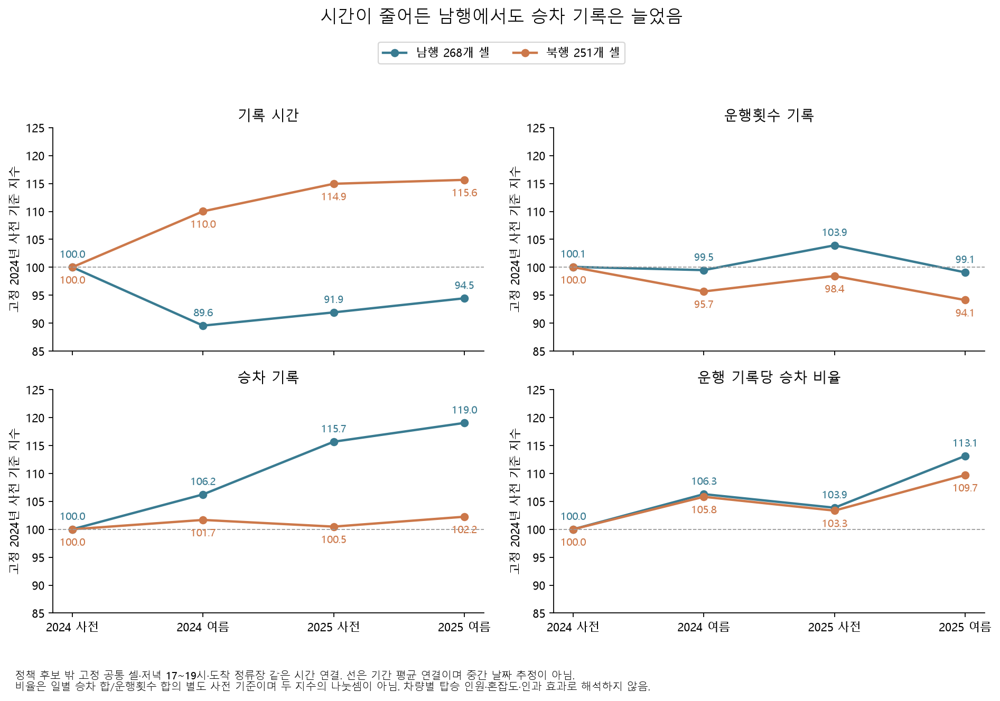

# 같은 버스 표본의 운영 기록과 검증된 카드 총계

2026-10-29 10시간 탐색의 추가 결과다. **남행의 시간 감소는 승차 기록 감소와 함께 나타난 현상이 아니었다.** 세 지표가 함께 관측되는 제한 표본에서 남행 저녁 기록 시간은 여름 −10.46%, 승차 지수는 +6.24%다. 북행은 시간 +10.00%, 운행횟수 −4.35%로 다른 양상이다. 원인이나 정책 효과를 식별한 결과는 아니다.

일별 카드 14개월을 대조하니 중앙 16개 정류장의 월 전체 합계가 두 공개 자료에서 모두 재현됐다. 기존의 반복 키 제외 집계와 별도로 **공개된 서울 면허 버스 승하차 기록 전체**의 추이를 제시할 근거가 생겼다. 두 자료는 같은 카드 처리 체계를 공유할 수 있으므로 독립 측정 두 개가 일치했다는 뜻은 아니다.

## 공통 표본의 시간·운행횟수·승차 기록

자료는 서울 [구간 운행시간 OA-21217](https://data.seoul.go.kr/dataList/OA-21217/S/1/datasetView.do), [정류장 운행횟수 OA-21220](https://data.seoul.go.kr/dataList/OA-21220/S/1/datasetView.do), [승차 인원 OA-21219](https://data.seoul.go.kr/dataList/OA-21219/S/1/datasetView.do)다. [설정](overnight_mechanism_config.yaml)은 실행 전에 커밋했다.

- 과거 ID·ARS 대응이 확인된 중앙 정류장의 공간상 인접 구간을 사용한다. 두 연도 사전 관측률 80%와 양수 기준 평균을 세 지표에서 모두 요구했다.
- 날짜는 세 원본의 교집합을 쓰고, 일별 집계는 **같은 셀·같은 날짜에 세 지표가 모두 알려진 관측**만 사용한다. 운행·승차의 숫자 0은 유효하며 공란·음수·반복 방문을 0으로 바꾸지 않았다.
- 도착 정류장의 같은 기록 시각에 연결한다. 개별 차량의 실제 도착 시각 매칭은 확인되지 않았다. 출발 정류장 연결도 별도로 계산했다.
- 저녁은 17~19시, 사전 5/20~6/28, 여름 7/8~8/16, 가을 2024년 9/2~10/31의 평일·공휴일 제외다. 일별 관측률 80%, 유효 날짜 20일, 전후 관측률 차이 10%p 조건을 유지했다.

정책 후보 밖 시간 셀은 남행 500개·북행 451개였으며, 공동 표본은 **268개(53.6%)·251개(55.7%)**다. 전체 사전 시간 후보를 분모로 하면 40.9%·50.5%다. 공동 셀은 모두 기타·분류 미확정 집단에 속한다. 따라서 `all_preselected`와 `other_or_unclassified`의 동일 결과를 독립 확인 두 개로 세지 않는다.

| 방향 | 기간 | 기록 시간 지수 | 운행횟수 지수 | 승차 기록 지수 |
|---|---|---:|---:|---:|
| 남행 | 2024 여름 | −10.46% | −0.58% | +6.24% |
| 남행 | 2024 가을 | −9.86% | +1.36% | +9.73% |
| 북행 | 2024 여름 | +10.00% | −4.35% | +1.68% |
| 북행 | 2024 가을 | +12.47% | −2.32% | −1.56% |

2024년 여름 시간 지수의 주 재표집 구간은 남행 [−12.29, −8.36]%, 북행 [+6.82, +13.01]%다. 이는 기술적 변동 구간이며 다중 탐색을 보정한 인과 검정이 아니다. 출발 정류장 연결에서도 남행 −9.47%, 북행 +10.39%다. 4시간대·두 연결 방식에서 2024년 여름 시간 지수의 남행 음수·북행 양수가 유지됐다.

“이 표본의 승차가 줄어서만 시간이 줄었다”는 단순한 설명은 자료와 맞지 않는다. 버스전용차로 용량, 정류장 정차·대기, 노선 배치, 신호, 실제 운행 간격 중 어느 요인이 원인인지는 분리할 수 없다. 시간의 정확한 단위·집계 정의도 미확정이다. 세 지수의 비율을 승객당 지체·재차 혼잡률·배차 간격으로 바꾸지 않았다.

## 일별 카드로 월 집계의 예외를 확인

서울 [일별 노선·정류장 승하차 OA-12912](https://data.seoul.go.kr/dataList/OA-12912/S/1/datasetView.do)와 [월별 시간대 승하차 OA-12913](https://data.seoul.go.kr/dataList/OA-12913/S/1/datasetView.do)를 2023·2024년 각각 4~10월에 대조했다. [최초 3개월 결과](results/overnight/daily_cards/audit.json)는 별도로 보존했다.

| 확인 단위 | 결과 |
|---|---|
| 일별 원본 전체 행 너비·날짜 검사 | 17,420,194행 |
| 기존 32개 정류장에 해당하는 일별 행 | 144,946행 |
| 선택 정류장 원본의 완전히 동일한 행 중복 | 일별·월별 모두 0개 |
| 노선 표기×정류장×월×승하차 | 8,856개 중 8,745개 정확 일치 |
| 양쪽에 값이 있으나 다른 합계 / 한쪽에만 같은 표기 키 존재 | 13개 / 98개 |
| 노선 표기를 합친 정류장×월×승하차 | 실제 수록된 642개 중 640개 정확 일치 |
| 중앙 16개 정류장×14개월×승하차 | 448개 모두 정확 일치 |

대부분의 예외는 `0411/411`, `서울01/서울01출근`, `서울06/서울06출근`, `서울07/서울07출근`, `8442/8442출근` 같은 표기 차이에서 생긴다. 전역 치환으로 노선을 강제 병합하지 않았다. 각 자료에 실제 있는 노선 행을 정류장 전체로 합친 뒤 다시 대조했다. 정확한 행 중복이 없고 월 전체 합계가 일치하는 경우에만 새 총계를 사용한다. 한쪽 키가 없으면 기존 `both_without_exact_duplicates`도 거짓이 되므로 그 개수를 실제 중복 행 수로 세면 안 된다.

남은 불일치는 2023년 4월 ARS **22132 서초문화예술정보학교**의 승차 2건·하차 1건이다. 작은 차이도 허용 오차로 통과시키지 않았다. 이 정류장·월·승하차는 미확정이며 중앙 16개에는 해당하지 않는다. 642개는 실제 수록된 조합 수다. 32개 정류장이 모든 월에 등장했다거나 부재한 정류장 인원이 0이라는 의미가 아니다.

## 검증된 중앙 정류장 전체의 일별 기록

[새 규칙](overnight_card_records_config.yaml)은 대조 결과를 본 뒤 고정한 탐색이다. 공개된 모든 노선 표기의 서로 다른 행을 합치며 고정 노선 표본은 아니다. 방향별 8개 정류장이 **그날 모두 유효할 때만** 합계를 공개한다. 버스와 같은 날짜 창·평일 달력이지만 카드에는 BIS 원본이 없는 날짜도 있어 실제 유효 날짜 수가 다르다.

| 방향·기록 | 2023 여름 | 2024 여름 | 2024 가을 |
|---|---:|---:|---:|
| 남행 승차 | −2.04% | +2.04% | +1.09% |
| 남행 하차 | −3.94% | +0.62% | +4.07% |
| 북행 승차 | −2.64% | −0.65% | −0.09% |
| 북행 하차 | −0.86% | +0.33% | −4.10% |

2024년 여름 남행 승차는 평일 하루 25,797.6→26,323.2건, 북행은 35,574.4→35,341.8건이다. 주 재표집 구간은 각각 [+0.46, +3.68]%, [−2.02, +0.62]%다. 북행의 작은 음수를 확정적인 감소로 설명하지 않는다. 2023년 사전/사후는 26/27일, 2024년 29/29일, 가을 38일이다.

범위는 **서울 면허 버스의 공개 승하차 기록**이다. 모든 경기 광역버스, 버스의 전체 이용자, 고유 사람 수가 아니다. 같은 사람이 여러 번 승차하면 여러 기록이 될 수 있다. 이 범위의 소폭 변화로 GTX나 기후동행카드의 효과를 분리할 수 없다.

월별 시간대도 별도로 작성했다. 4~5월 대비 7~8월의 달력 하루 저녁 승차는 남행 +10.71%, 북행 +5.71%다. **주말 포함·다른 사전 기간·월 단위**이므로 위 평일 하루 수치나 공통 버스 셀의 저녁 지수와 직접 비교하지 않는다. 일별 총계 일치는 월별 시간대 배분을 독립 검증하지 않는다.

## 2023년 요금 변경 이후 날짜를 빼면

[서울버스 요금 조정](https://mediahub.seoul.go.kr/archives/2008762)은 2023년 8월 12일 시행되어 기존 전년 사후 창에 포함된다. [별도 규칙](overnight_fare_trim_config.yaml)에 따라 기존 셀·사전 기준 평균·일별 지수를 고정하고 날짜만 줄였다. 아래는 정책 후보 밖 저녁 시간 지수다.

| 사후 창 | 2023 남행 | 2024 남행 | 2023 북행 | 2024 북행 |
|---|---:|---:|---:|---:|
| 기존 8/16까지 | +7.38% | −7.32% | +2.40% | +11.89% |
| 2023만 8/11까지 | +7.80% | −7.32% | +2.87% | +11.89% |
| 두 해 모두 8/11까지 | +7.80% | −7.35% | +2.87% | +11.31% |

표의 모든 비교는 20일·관측률 차이 조건을 통과했다. 전체 144개 비교 중 132개 통과와 실패 12개를 모두 저장했다. 요금 변경 이후의 며칠만으로 반대 부호가 생긴 것은 아니지만, 전년이 무처치 대조군이 되거나 동시 정책 문제가 해결되는 것은 아니다.

## 채택한 범위와 재현

공통 운영 기록은 **방향별 운영 특성이 달라졌는지 묻는 보조 분석**, 카드 총계는 **검증된 중앙 정류장의 서울 면허 기록 변화**로 채택한다. 기존 월 카드의 반복 키 제외 결과와 전체 승객 가중 실패는 보존한다. 실제 배차 간격, 정차·대기시간, 모든 경기 광역버스 수요와 이용자 부담은 추가 정의·자료가 필요하다.

사례 환경에서 `python overnight.py daily-card-full-collect`, `daily-card-full-analysis`, `card-records`, `mechanism`, `fare-trim`, `operations-plots`를 각각 실행한다. 원본은 Git에 넣지 않고 [일별 출처 명세](overnight-daily-card-full-sources.json)에 요청·크기·해시를 기록했다. [카드](results/overnight/card_records/audit.json), [공동 운영](results/overnight/mechanism/audit.json), [요금 기간](results/overnight/fare_trim/audit.json)의 입력·코드·출력 해시를 제공한다. 전체 일별 캐시는 `data/overnight/`에 보존하고 저장소에는 비교표·방향별 일별 집계·그림을 둔다.

## 같은 공통 셀을 2025년까지 유지하면

[연장 규칙](overnight_operations_persistence_config.yaml)을 저장한 뒤 승차 기록의 2025년 4~8월 원본 5개를 추가했다. 4월은 주간 CSV의 월 경계 확인용이며 비교 창은 기존 5~8월을 유지했다. 전체 **12,224,033행**의 너비·날짜를 검사하고 선택 정류장 135,179행을 정리했다. 기존 시간·운행횟수 캐시와 원래 공통 셀, 셀별 **2024년 사전 평균**을 그대로 사용한다. 2025년 관측 결과로 셀을 다시 고르지 않았다.

날짜 분모는 이전 공통 원본 교집합 대신 전체 예정 평일·공휴일 달력을 쓴다. 중앙 16개 정류장×4개월의 기존 ID·ARS 검증을 연결했고, 실제 유효 날짜는 2024년 사전/사후 27/29일, 2025년 27/28일이다. 저녁 도착 연결의 남행 268개·북행 251개 셀은 위 2024년 분석과 같다.

| 방향·지표 | 2024 사전→2025 사전 | 2025 사전→여름 | 2024 사전→2025 여름 |
|---|---:|---:|---:|
| 남행 기록 시간 지수 | −8.09% | +2.75% | −5.56% |
| 북행 기록 시간 지수 | +14.93% | +0.61% | +15.63% |
| 남행 운행횟수 지수 | +3.85% | −4.66% | −0.99% |
| 북행 운행횟수 지수 | −1.58% | −4.38% | −5.89% |
| 남행 승차 기록 지수 | +15.67% | +2.91% | +19.04% |
| 북행 승차 기록 지수 | +0.48% | +1.76% | +2.25% |
| 남행 운행 기록당 승차 비율 | +3.86% | +8.93% | +13.13% |
| 북행 운행 기록당 승차 비율 | +3.35% | +6.16% | +9.71% |

2024→2025년 사전의 시간 변화 주 재표집 구간은 남행 [−10.86, −5.32]%, 북행 [+7.82, +24.51]%다. 남행 승차 기록은 [+13.64, +18.03]%이며 북행은 [−1.48, +2.61]%로 0을 포함한다. 2025년 자체의 시간 변화는 두 방향 모두 구간에 0이 포함된다. **남행의 시간 감소와 승차 기록 증가는 다음 해에도 같은 제한 표본에서 함께 관측된다.** 이는 시간 감소의 원인을 특정하거나 승객당 지체 감소를 입증하지 않는다.

추가 비율은 매일 같은 공동 관측 셀의 `승차 합 / 운행횟수 합`을 계산하고 그 비율의 사전 일평균을 100으로 정규화했다. 위 셀 동일 가중 승차·운행 지수를 서로 나눈 값이 아니다. `노선×정류장×시간` 횟수 키가 여러 인접 셀에 중복 연결되지 않는지도 검사했다. 원래 선택 집단에서 **운행 0·승차 양수인 공동 셀은 0개**였으며, 그런 셀이 있는 날에는 비율을 보류하도록 구현했다. 공개 시간 집계의 비율이므로 차량별 탑승 인원·실제 배차 간격·재차 혼잡도로 부르지 않는다.

4시간대·도착/출발 연결·두 방향·4지표·5비교의 **320행은 모두 관측 조건을 통과**했다. 같은 원본의 겹치는 비교들이므로 320개의 독립 검증은 아니다. [전체 비교와 변동 구간](results/overnight/operations_persistence/comparisons.csv), [0·결측 관측 상태](results/overnight/operations_persistence/observation_states.csv), [분석 명세](results/overnight/operations_persistence/analysis_audit.json), [출처](overnight-operations-persistence-sources.json)를 공개한다.

재현은 사례 환경의 `python overnight.py operations-persistence-collect`, `operations-persistence-prepare`, `operations-persistence`, `operations-persistence-plots` 순서다. 기존 원본·공통 셀·2025년 시간/운행 캐시가 필요하며 새 체크아웃에는 대용량 원본이 포함되지 않는다. 기존 2024년 결과와 별도 경로에 저장한다.
