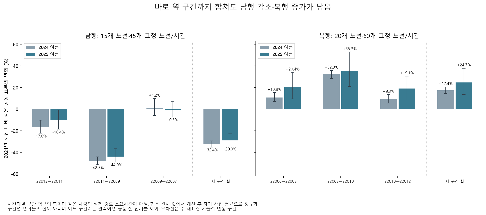

# 인접 구간을 합쳐도 방향별 변화가 남는가

강남역 주변의 큰 기록 변화가 바로 옆 구간으로 시간이 옮겨 기록된 현상인지 점검했다. **같은 노선·시간에서 세 구간의 원시 평균을 합쳐도 2024년 사전 대비 그해 여름 남행 −32.45%, 북행 +17.39%**였다. 2025년 여름에도 −28.96%, +24.65%로 반대 방향이 남았다. 단순한 인접 구간 사이의 기록 재배분만으로 설명하기는 어려워졌지만, 측정 방식이나 실제 운행 원인을 구별한 결과는 아니다.

## 같은 표본으로 합을 만드는 방법

[32개월 궤적](overnight-timeline-report.md)과 [14개 구간 비교](overnight-segment-report.md)를 본 뒤 설정한 탐색이다. [설정](overnight_path_sums_config.yaml)을 결과 계산 전에 커밋했으며 원래 사전 선택 셀과 예측 동결 파일을 변경하지 않았다.

- 저녁 17~19시 정책 후보 밖의 원래 노선·시간 셀 중 경로의 모든 구간에 공통인 셀을 사용했다. 2023·2024년 사전의 공동 양수 관측률 80% 이상을 요구했다. 선택 단계 분모는 원래 선택 당시 원본이 있는 날짜이며, 기간 비교의 관측률은 전체 예정 평일을 분모로 계산한다.
- 어느 구간이든 공란·0·음수·부재·같은 날 재방문으로 제외되면 해당 날짜·노선·시간의 모든 구간과 합을 함께 제외했다. 결측 구간을 0으로 더하지 않는다.
- **원시 구간 값을 먼저 합한 뒤** 해당 노선·시간의 공동 관측 2024년 사전 평균으로 나눴다. 구간별 정규화 지수를 더한 값이 아니다. 성분도 같은 공동 날짜에서 자기 기준 평균을 사용한다.
- 고정 셀 관측률 80% 이상인 날짜의 셀 평균을 비교했다. 양쪽 유효 20일 이상, 관측률 차이 10%p 이하, 각 관측률 80% 이상, 노선 3개 이상을 요구했다. 주 재표집 2,000회의 기술적 변동 구간을 함께 저장했다. 같은 경로의 성분·겹치는 경로는 독립 비교가 아니다.
- 2024년 사전/사후와 2025년 사전/사후 창은 이전 분석과 같고 유효일은 각각 27/29/27/28일이다. 합 30개·성분 70개, **전체 100개 비교가 관측 조건을 통과**했다.

**시간대별 구간 평균의 합은 같은 차량 한 대를 따라 측정한 실제 경로 소요시간이 아니다.** 평균별 차량 구성·가중치가 같다는 보장이 없고 시간 단위·정차 포함 여부도 미확인이다. 분 단위 환산·승객 시간 절감·인과 효과를 계산하지 않는다.

## 여섯 경로의 결과

아래 세 열은 모두 **2024년 사전**을 기준으로 한 변화율이다. 남행은 각 경로 45개 셀·15개 노선, 북행은 상류 두 구간 66개·22개, 하류 두 구간 63개·21개, 세 구간 60개·20개다. 이 비교의 모든 셀이 사전 공동 관측 조건을 통과했다.

| 방향·ARS 경로 | 2024 여름 | 2025 사전 | 2025 여름 |
|---|---:|---:|---:|
| 남행 22013→22011→22009 | −39.15% | −33.89% | −33.85% |
| 남행 22011→22009→22007 | −36.99% | −33.27% | −34.62% |
| **남행 22013→22011→22009→22007** | **−32.45%** | **−27.71%** | **−28.96%** |
| 북행 22006→22008→22010 | +22.75% | +27.29% | +28.67% |
| 북행 22008→22010→22012 | +19.97% | +20.74% | +26.56% |
| **북행 22006→22008→22010→22012** | **+17.39%** | **+18.63%** | **+24.65%** |

세 구간 합의 2024년 여름 변동 구간은 남행 **[−35.17%, −29.40%]**, 북행 **[+14.34%, +20.52%]**다. 2025년 여름은 남행 **[−34.32%, −22.46%]**, 북행 **[+13.45%, +37.83%]**다. 북행은 다음 해 여름의 불확실성이 더 크다. 같은 2025년 안의 여름 변화와 사후 창끼리의 전년 비교는 여섯 경로 모두 구간에 0을 포함했다. 지속된 수준 차이와 추가 개선·악화를 구별해야 한다.

세 구간 공동 표본에서 남행 강조 구간 22011→22009는 2024년 여름 −48.45%, 바로 앞은 −16.96%, 뒤는 +1.22%다. 북행 강조 구간 22008→22010은 +32.32%, 앞 +10.78%, 뒤 +9.35%다. 감소와 증가가 옆 구간에서 정확히 상쇄되는 모습은 아니다. 다만 구간별 변화율은 각기 다른 기준량으로 나눈 값이므로 합산하지 않는다. 특히 북행 공동 60개 셀의 결과를 기존 시간 전용 69개 셀의 결과와 혼용하지 않는다.

## 노선 내 순서 키도 점검했다

여섯 경로가 겹치는 부분을 중복 제거하면 고정 노선·구간 조합은 **111개**다. 시점별로 원본에 등장하는 출발·도착 순서 쌍의 집합을 대조했다. 숫자 결과의 크기로 표본을 다시 선택하지 않았다.

| 기간 | 고정 조합 수 | 원본 부재 조합 | 2024 사전과 다른 관측 순서 집합 | 다른 집합이 있는 노선 수 | 비인접 순서 기록 |
|---|---:|---:|---:|---:|---:|
| 2024 사전 | 111 | 0 | 0 | 0 | 0 |
| 2024 여름 | 111 | 0 | 0 | 0 | 0 |
| 2025 사전 | 111 | 6 | 33 | 7 | 0 |
| 2025 여름 | 111 | 6 | 33 | 7 | 0 |

2024년 전후에는 111개 순서 집합이 모두 같았다. 2025년의 부재 6개는 노선 `100100603`의 구간이며 고정 분모에서 삭제하지 않았다. 2025년 사전의 6개 조합에는 기간 중 두 순서 쌍이 있었지만 모두 도착 순서−출발 순서가 1이었다. 순서 번호의 변경은 경로 앞부분 변경·재번호 부여 등으로도 생길 수 있다. **순서 키 일치는 실제 정류장 위치·검지 경계·신호 운영이 같았다는 증거가 아니다.** 당시 공간·검지 이력은 별도로 필요하다.

## 해석과 재현

이 결과는 ‘강조 구간 한 곳의 시간이 바로 앞뒤로 옮겨 기록되었을 뿐’이라는 좁은 설명을 약화한다. 전체 기록 체계의 변경, 경로 평균의 차량 구성, 시간 단위·정차 포함, GTX-A 구성역 개통 등 동시 변화는 여전히 분리하지 못한다. 주변 일반도로 결과가 다르다는 이유만으로 버스 정차·신호를 원인으로 확정할 수도 없다.

사례 환경에서 `overnight.py path-sums`, `overnight.py path-sums-plots`로 기존 캐시를 검증해 실행한다. [전체 비교](results/overnight/path_sums/comparisons.csv), [일별 지수](results/overnight/path_sums/daily.csv), [선택 조건](results/overnight/path_sums/eligibility.csv), [순서 요약](results/overnight/path_sums/sequence_summary.csv), [구간별 순서](results/overnight/path_sums/sequence_pairs.csv), [입력·코드 감사](results/overnight/path_sums/audit.json)를 제공한다. 원시 기준값은 Git 제외 Parquet다. 원시 합의 정규화, 한 성분 결측의 공동 제외, 사후 변경의 사전 선택 불변, 중복 구간 거부, 겹치는 경로의 순서 중복 제거·충돌 거부를 테스트했다.
