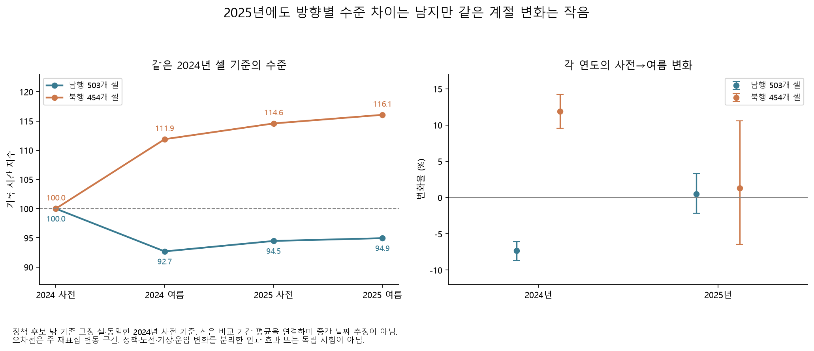
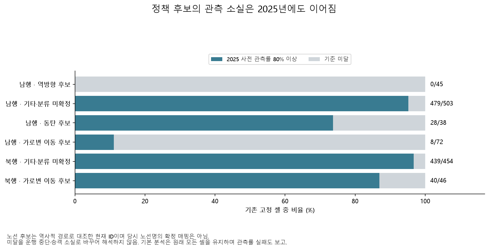
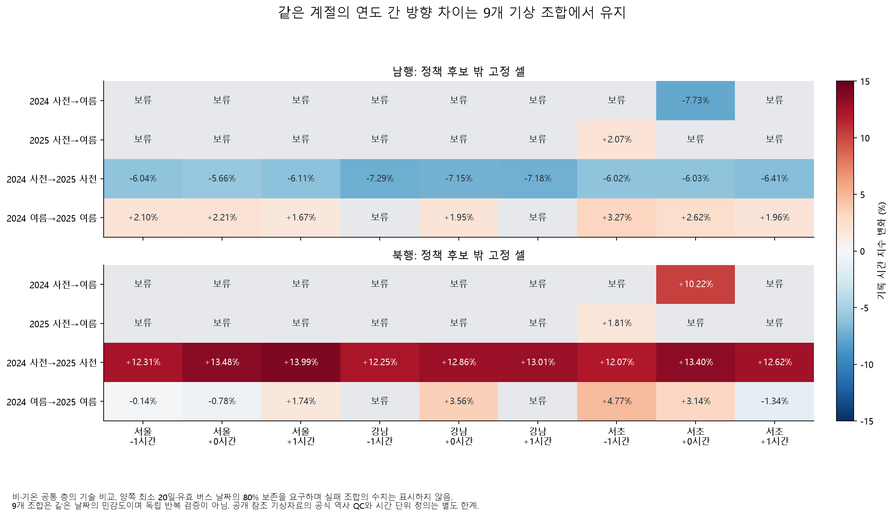

# 2024년 방향별 차이는 2025년에도 남았는가

정책 후보 밖의 고정 표본에서는 **2025년 초여름에도 2024년 사전 대비 남행 시간이 낮고 북행은 높은 상태**가 관측됐다. 반면 2025년 안의 초여름→여름 변화는 두 방향 모두 작고 주 재표집 구간이 0을 포함했다. 2024년의 큰 방향 차이를 매년 같은 계절 변화 하나로 설명하기 어렵다는 탐색 근거다. 여러 해의 노선·기상·운임 변화를 분리한 인과 효과는 아니다.

## 기존 셀을 그대로 연장

[연장 규칙](overnight_persistence_config.yaml)을 `c845922`에 커밋한 뒤 실행했다. 2023·2024년 사전 관측 조건으로 이미 고정했던 노선 ID×출발×도착×시간 셀을 유지하고, 모든 기간에 **같은 2024년 셀별 사전 평균**을 기준으로 삼았다. 신규 노선이나 2025년 사후 생존 여부로 기본 표본을 바꾸지 않았다.

원본은 기존에 수집·검증한 2025년 5~8월 시간 자료와 4월 ZIP의 경계 날짜다. 2025년 자료는 예측 특징으로 이미 사용했으므로 새 독립 시험이 아니다. 중앙 16개 정류장의 ID·ARS는 해당 4개월 카드 식별자 64개 대조에서 전부 일치했다. 이는 당시 노선명·배차·정류장 위치가 모두 동일하다는 증명은 아니다.

| 기간 | 평일·공휴일 제외 예정 일수 |
|---|---:|
| 2024 사전 5/20~6/28 | 29 |
| 2024 여름 7/8~8/16 | 29 |
| 2025 사전 5/20~6/28 | 27 |
| 2025 여름 7/8~8/16 | 28 |

공휴일을 공식 자료와 패키지에서 대조했다. [2025년 6월 3일 임시공휴일](https://www.korea.kr/news/policyNewsView.do?newsId=148941443)을 포함해 제외하며, 원본 누락 날짜를 예정 분모에서 빼지 않는다. 2024년 사전의 알려진 5/28·29 누락은 그대로 남고, 2025년 원본 부재 6/29·7/1·7/2는 이번 비교 창 밖이다. 0·공란·행 부재·원본 날짜 부재를 따로 집계했다.

## 저녁의 수준과 계절 변화

아래는 정책 후보 밖 남행 503개·북행 454개 셀의 동일 가중 지수다. 실제 분 단위·고유 승객의 이동시간으로 바꾸어 해석하지 않는다.

| 비교 | 남행 변화 | 북행 변화 |
|---|---:|---:|
| 2024 사전→2024 여름 | −7.32% [−8.68, −6.07] | +11.89% [+9.54, +14.21] |
| 2025 사전→2025 여름 | +0.50% [−2.16, +3.31] | +1.29% [−6.47, +10.59] |
| 2024 사전→2025 사전 | **−5.53% [−7.38, −3.76]** | **+14.59% [+10.14, +19.49]** |
| 2024 여름→2025 여름 | +2.45% [+0.25, +4.96] | +3.73% [−3.51, +12.56] |

괄호는 2,000회 주 재표집의 탐색적 변동 구간이다. 2025년 여름 남행은 2024년 여름보다 다소 높지만 2024년 사전 기준 지수는 약 94.95로 100보다 낮다. 북행은 같은 기준 약 116.06이다. ‘남행 개선이 전부 사라졌다’거나 ‘북행이 2025년 여름에 다시 크게 악화했다’고 요약하지 않는다.

밤 20~22시에도 2025년 사전 대비 전년 사전 변화는 남행 −11.75%·북행 +9.44%이며, 2025년 사전→여름 변화는 각각 −0.06%·−0.08%다. 아침은 −2.10%·+1.55%, 낮은 −1.15%·+8.64%로 시간대에 따라 크기가 다르다. 모든 시간대·4개 집계법·실패 비교를 [전체 표](results/overnight/persistence/comparisons.csv)에 남겼다.

## 관측 유지 조건이 결론의 범위를 정한다

정책 후보 밖 저녁 셀 중 2025년 사전 관측률 80%를 충족한 셀은 남행 479/503, 북행 439/454다. 이 조건을 추가한 생존 집단에서도 2025년 사전의 전년 대비 변화는 남행 −5.54%·북행 +14.59%다. 보조 결과일 뿐 기본 표본을 이 집단으로 바꾸지 않았다.

반대로 정책 후보를 포함한 **남행 전체 고정 셀**은 2025년 사전·여름 관측률 약 78.7%·78.6%로 하루 80% 조건을 충족한 날짜가 없다. 전체 남행의 지속 효과는 보고할 수 없다. 역방향 후보 45개 셀 중 조건 충족은 0개, 가로변 이동 후보는 8/72, 동탄 후보는 28/38이다. 미관측을 실제 운행 중단이나 승객 소실로 해석하지 않는다. 전체 512개 비교 중 463개가 조건을 통과했고 실패 49개도 보존했다.

## 동시 변화와 다음 확인

### 추가 지역 기상 비교

[기상 연장 규칙](overnight_persistence_weather_config.yaml)을 `63d08ce`에 저장한 뒤 2025년 5~8월 서초(401)·강남(400)·서울(108)의 공개 AWS 시간 응답 189개를 추가했다. 요청 시각·지점·간격 검증 실패와 겹친 시각 수치 충돌은 0개였다. 예정 8,856개 관측소·시간 중 기온 8,848개, 시간 강수 8,815개가 수치로 관측됐다. 빈칸·비수치 표시는 0으로 채우지 않았다. 공식 역사 QC 파일이 아닌 [기상청 공개 참조 화면](https://www.weather.go.kr/w/weather/land/aws-obs.do)의 자료다.

같은 2024년 기상과 결합해 비·기온 분류의 공통 층을 비교했다. 양쪽 최소 20일·유효 버스 날짜의 80% 유지 조건은 낮추지 않았다. **2024 사전→2025 사전의 저녁 비교는 3개 관측소×3개 시각 정렬 조합이 모두 통과**했다. 남행 −7.29~−5.66%, 북행 +12.07~+13.99%로 부호가 유지된다. 주 설정인 서초·시각 이동 0은 남행 −6.03%, 북행 +13.40%, 사용 날짜 27일·24일이다. 같은 자료의 민감도 9개이며 독립적인 9번의 재검증은 아니다.

2025년 사전→여름은 주 설정에서 17일·26일만 공통 층에 남아 **실패**했다. 전체 9개 중 서초 −1시간 조합 하나만 통과했고 이를 주 결과로 바꾸지 않았다. 2024년 안의 계절 비교도 여전히 9개 중 1개만 통과한다. 여름끼리의 연도 비교는 7개가 통과하지만 북행 부호가 조합별로 달라 일관된 증가라고 해석하지 않는다. 전체 2,304개 비교 중 1,160개 통과와 모든 실패를 [기상 비교표](results/overnight/persistence_weather/comparisons.csv)에 남겼다.

이 결과는 **관측한 비·기온 분류를 맞춰도 같은 계절의 방향별 수준 차이가 남는다**는 뜻이다. 관측되지 않은 기상·노선 구성·정책·수요 변화까지 제거했다는 뜻은 아니다. 원래 기상 출처·결과는 보존했으며 [추가 출처](overnight-persistence-weather-sources.json), [수집·준비 감사](results/overnight/persistence_weather/preparation_audit.json), [비교 감사](results/overnight/persistence_weather/comparison_audit.json)를 제공한다. 재현 단계는 `persistence-weather-collect`, `persistence-weather-prepare`, `persistence-weather`, `persistence-weather-plots`다.

### 정책 맥락과 다음 구간 분석

[서울시 요금 이력](https://news.seoul.go.kr/traffic/archives/345)에 따르면 2025년 6월 28일 지하철 교통카드 일반 기본요금이 1,400원에서 1,550원으로 바뀌었다. 2025년 계절 비교의 대안 설명으로 남기며 현재 자료로 버스 전환량을 계산하지 않는다.

2024년은 [K-패스](https://www.molit.go.kr/mtc/USR/N0201/m_36770/dtl.jsp?id=95089685&lcmspage=1)와 [더 경기패스](https://gnews.gg.go.kr/news/news_view.do?number=202404241436287416C109&s_code=C109&type_m=main)가 5월 1일부터 시행됐다. 이번 일별 사전 창은 그 뒤지만 기존 월 카드 4~5월 기준은 시행 전후를 함께 포함한다. [구성역·기후동행카드 등 기존 동시 정책](archive.md#reports) (`overnight-context-report.md`, 로컬 보관)과 함께 해석해야 한다.

다음에는 같은 표본에서 구간별 지속성을 나누고 북행 증가가 특정 구간·노선에 집중되는지 확인한다. 모든 기간·관측소에서 조건을 통과한 것이 아니므로 전체 결과에 포괄적으로 ‘기상 보정 완료’라는 표현을 붙이지 않는다.

사례 환경에서 `python overnight.py persistence`, `python overnight.py persistence-plots`로 재현한다. [관측 상태 분해](results/overnight/persistence/record_states.csv), [2025 사전 유지율](archive.md#results) (`results/overnight/persistence/pre2025_retention.csv`, 로컬 보관), [감사 명세](results/overnight/persistence/audit.json), [관련 출처](overnight-supplement-references.json)를 함께 제공한다. 기존 예측 모델·코드 동결과 2026년 잠금 자료는 유지했다.
