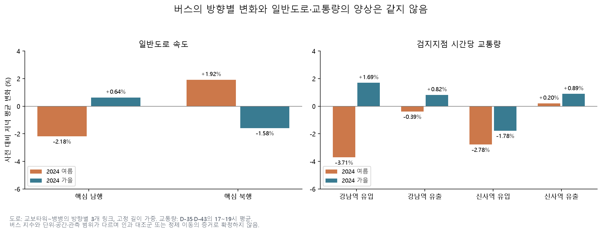
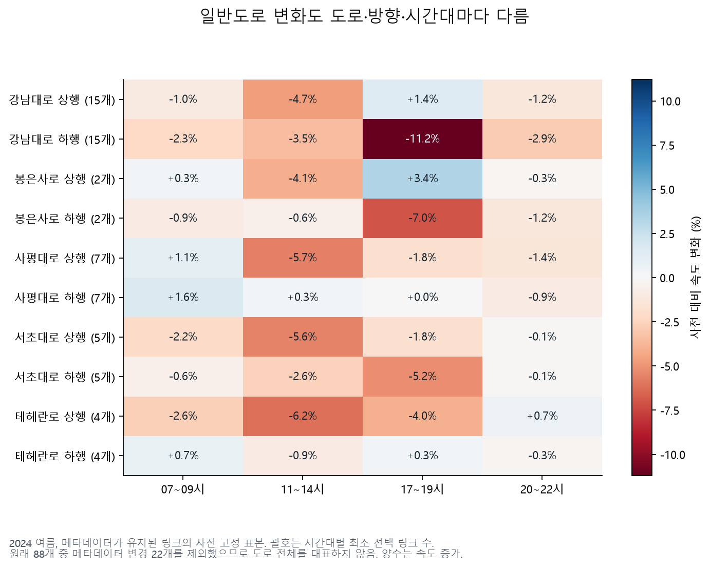
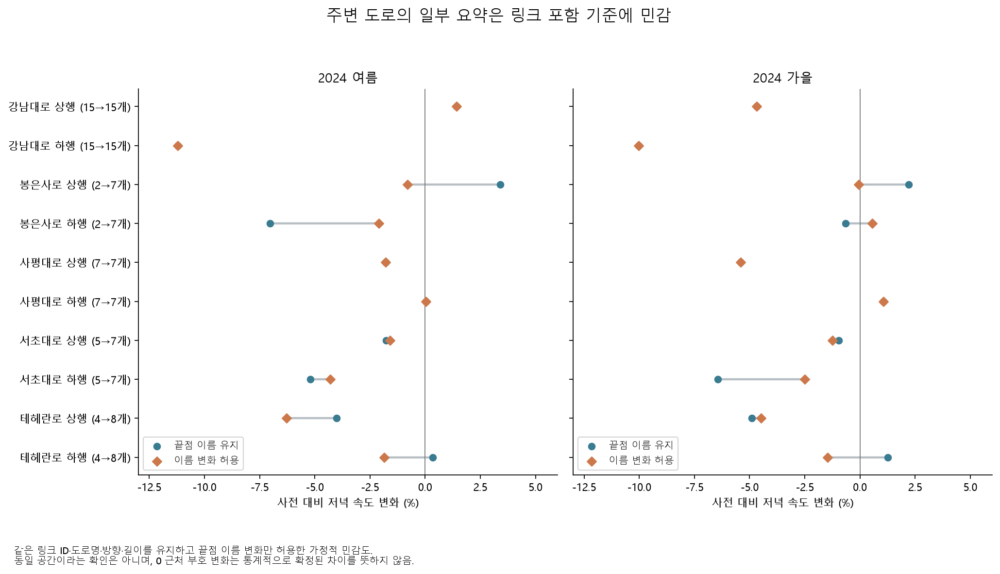

# 버스의 방향 차이는 주변 일반도로에서도 같은가

2024년 여름 저녁의 일반도로 핵심 구간 속도는 남행 −2.18%, 북행 +1.92%였다. 버스의 제한 표본에서 관측한 남행 시간 감소·북행 시간 증가와 같은 양상은 아니다. **일반도로가 빨라졌기 때문에 버스도 빨라졌다는 설명으로 결과를 요약하기 어렵다.** 다만 단위·관측 범위·공간이 달라 원인을 반증하거나 정책 효과를 식별한 비교는 아니다.

## 자료와 고정 범위

[규칙](overnight_road_context_config.yaml)을 커밋한 뒤 2023·2024년 각각 4~10월의 기존 TOPIS 속도 캐시와 교통량 14개월을 비교했다. 교통량 5개월은 재사용하고 9개월을 추가 수집했다. 공식 [TOPIS 교통량 페이지](https://topis.seoul.go.kr/refRoom/openRefRoom_2.do?tab=trafficvolReport)는 D-35를 강남역·신분당선 구간, D-43을 신사역 구간으로 제시한다. 실제 월 파일 설명도 두 해에 걸쳐 유지된다.

| 지점 | 유입 | 유출 |
|---|---|---|
| D-35 | 뱅뱅사거리→강남역 | 강남역→뱅뱅사거리 |
| D-43 | 논현역→신사역 | 신사역→논현역 |

속도는 강남대로·사평대로·테헤란로·봉은사로·서초대로를 사용했다. 핵심 비교는 교보타워사거리~강남역~우성아파트~뱅뱅사거리의 방향별 3개 링크다. 두 연도 사전 기간의 링크×시간 관측률 80%를 모두 요구하고, 선택 셀과 길이 가중치를 사후에 바꾸지 않았다. 같은 셀의 동일 가중 평균도 저장했다. 길이 가중 산술 속도는 특정 차량의 실제 통행시간이 아니다.

사전 5/20~6/28, 여름 7/8~8/16, 가을 2024년 9/2~10/31의 평일·공휴일 제외다. 원본 날짜 부재를 예정 달력에서 빼 관측률을 높이지 않았다. 일별 시간대 관측률 80%, 비교 20일, 전후 관측률 차이 10%p 조건을 유지했다. 교통량은 **해당 시간대의 시간당 평균 대수**이며 하루 전체 대수가 아니다.

## 메타데이터와 품질

88개 링크 중 22개는 시점명 또는 종점명이 달라 엄격한 기본 분석에서 제외했다. 도로명·방향·길이는 바뀌지 않았으며 확인한 차이는 끝점 이름이었다. 단순 명칭 정비인지 실제 공간 변화인지는 이름과 길이만으로 확정하지 않았다.

| 도로 | 방향당 원래 링크 | 방향당 유지 링크 | 유지 비율 |
|---|---:|---:|---:|
| 강남대로 | 15 | 15 | 100% |
| 사평대로 | 7 | 7 | 100% |
| 서초대로 | 7 | 5 | 71.4% |
| 테헤란로 | 8 | 4 | 50.0% |
| 봉은사로 | 7 | 2 | 28.6% |

특히 봉은사로는 소수의 유지 링크 결과다. 좋은 일별 관측률이 도로 전체의 공간 대표성을 보장하지 않는다. 아래의 명칭 변화 허용 민감도는 별도 결과이며 엄격한 기본 결과를 보존한다.

교통량 선택 지점에는 미관측 시간 73개, 숫자 0은 0개였다. 2023년 9월은 `요일(2)` 열이 추가된 형식이므로 검증된 두 헤더만 허용하고 시간 열을 이름으로 읽었다. 336개 비교 중 335개가 조건을 통과했다. 실패는 **D-43 유출, 2023년 여름 20~22시**다. 사전 100%·사후 88.89% 관측률 차이가 10%p를 초과했다.

## 저녁 핵심 구간과 지점

| 측정 | 2023 여름 | 2024 여름 | 2024 가을 |
|---|---:|---:|---:|
| 핵심 남행 일반도로 속도 | −4.08% | −2.18% | +0.64% |
| 핵심 북행 일반도로 속도 | +1.45% | +1.92% | −1.58% |
| D-35 유입 교통량 | −1.18% | −3.71% | +1.69% |
| D-35 유출 교통량 | −1.01% | −0.39% | +0.82% |
| D-43 유입 교통량 | −3.66% | −2.78% | −1.78% |
| D-43 유출 교통량 | −3.49% | +0.20% | +0.89% |

2024년 여름 핵심 남행 속도는 14.24→13.92km/h, 북행 13.00→13.24km/h다. 주 재표집 변화 구간은 남행 [−5.83, +1.52]%, 북행 [−2.19, +6.98]%로 모두 0을 포함한다. 작은 속도 변화를 확정적인 개선·악화로 표현하지 않는다. D-35 유출은 1,856.69→1,849.49대/시간, D-43 유출은 2,035.13→2,039.28대/시간으로 큰 폭의 감소가 관측된 것은 아니다.

강남대로 하행 전체 15개 유지 링크의 저녁 속도 변화는 여름 −11.20%, 가을 −10.02%다. 핵심 3개와 다른 공간 범위이므로 섞지 않는다. **어느 공간 범위를 요약하느냐가 해석에 중요하다.**

## 활용과 재현

[별도 규칙](overnight_road_names_config.yaml)을 먼저 커밋한 뒤 같은 링크 ID·도로명·방향·길이를 유지하면서 끝점 이름 변화만 허용했다. 88개가 이 가정에 해당하며 사전 선택·날짜 창·가중치는 기존과 같다. 다음은 고정 길이 가중 저녁 속도다.

| 도로·방향 | 유지→허용 링크 | 여름: 엄격→허용 | 가을: 엄격→허용 |
|---|---:|---:|---:|
| 봉은사로 상행 | 2→7 | +3.40%→−0.79% | +2.20%→−0.06% |
| 봉은사로 하행 | 2→7 | −7.04%→−2.11% | −0.65%→+0.57% |
| 테헤란로 하행 | 4→8 | +0.35%→−1.86% | +1.26%→−1.48% |
| 서초대로 하행 | 5→7 | −5.20%→−4.30% | −6.44%→−2.49% |

강남대로 핵심 구간·강남대로 전체·사평대로는 포함 링크가 같아 결과도 유지된다. 전체 288개 비교쌍 중 38개는 부호가 달랐지만 여러 기간·집계법이 중복되며 0에 가까운 값도 포함한다. 이를 38개의 독립적·유의한 발견으로 세지 않는다. **일부 인접 도로의 소수 링크 결과만으로 대조군을 정하기 어렵다.** 실제 공간 동일성은 좌표·당시 링크 이력으로 추가 확인해야 한다. 재현은 `python overnight.py road-names`, `python overnight.py road-names-plot`이며 [비교쌍](results/overnight/road_names_sensitivity/strict_vs_names.csv)에 전부 남겼다.

[공통 버스 운영·카드 기록](overnight-operations-report.md)에 일반도로 맥락을 덧붙이는 분석으로 채택한다. 버스 지수·일반 차량 속도·검지지점 교통량을 동질적인 혼잡 측정처럼 합치지 않는다. 일반도로를 무처치 대조군으로 삼거나 “정체가 다른 도로로 이동했다”고 확정하지 않는다.

다음 확인은 버스 정류장 정차·대기와 노선 분산의 공간 대응, 22개 끝점 명칭 변화의 의미다. 승객 전환 경로를 주장하려면 당시 전체 광역버스 수록 범위와 다른 수단의 출도착 자료가 필요하다.

사례 환경에서 `python overnight.py road-context-collect`, `road-context`, `operations-plots`를 각각 실행한다. [교통량 출처](overnight-road-context-sources.json), [감사 명세](results/overnight/road_context/audit.json), [공간 유지율](results/overnight/road_context/metadata_retention.csv), [전체 비교](results/overnight/road_context/comparisons.csv)를 제공한다. 속도는 기존 예측 캐시의 **2023·2024년 지정 월만** 읽었다. 고정 예측 코드·모델·2026년 잠금 값은 변경하거나 열지 않았다.
