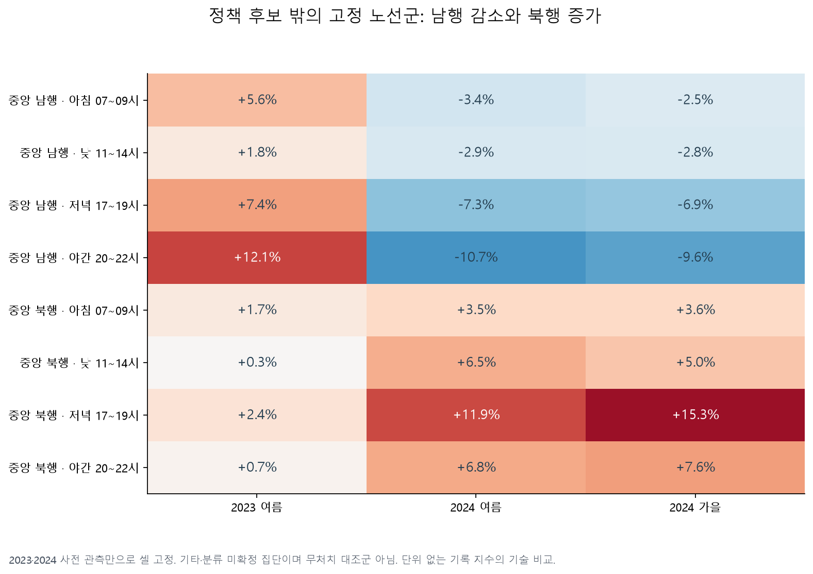
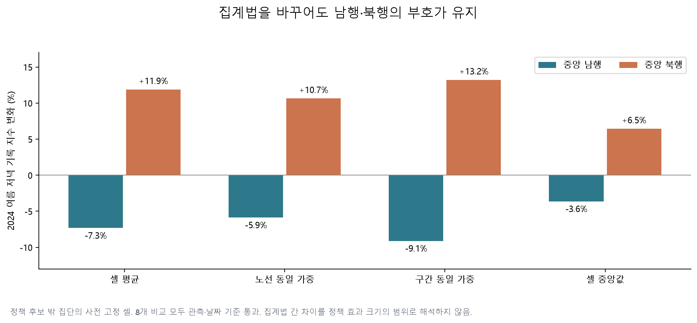
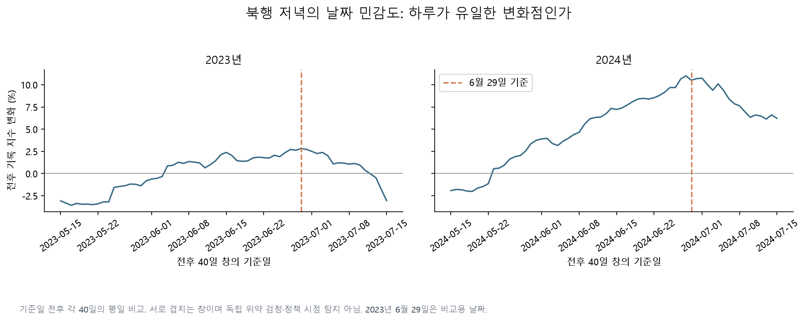
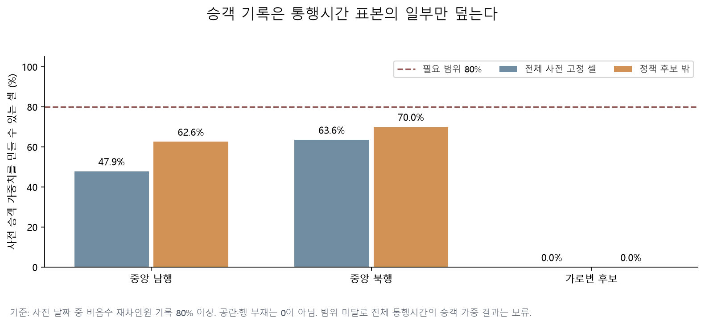

# 노선군 분리·시간대·승객 기록의 추가 결과

2026-10-29 확장 탐색 2단계. [첫 결과](overnight-observation-report.md)의 남행 관측 감소를 확인한 뒤, 정책 조정 후보와 나머지 노선을 분리했다. **사전 기간에 고정한 기타·분류 미확정 집단에서는 남행 감소와 북행 증가가 함께 남는다.** 이 집단을 ‘무처치 대조군’이나 역사적 이름까지 확인된 ‘서울 시내버스’로 부르지 않는다.

## 표본을 나누면 보이는 차이

사전 고정은 2023·2024 사전 기간의 양수 기록 관측률 80%로 한다. 정책 이후에도 관측되었는지를 선택 조건으로 넣지 않았다. 노선 후보 ID의 과거 경로는 대조했지만, 현재 노선명과 당시 노선명을 완전히 연결한 것은 아니다. 기간과 지수 정의는 [기존 방향별 설정](directional_config.yaml)을 유지한다. 시간은 원본의 라벨이며 정확한 집계 시작·종료 의미는 아직 확정하지 않았다.

| 기타·분류 미확정 집단, 저녁 17~19시 | 남행 | 북행 |
|---|---:|---:|
| 고정 셀 수 / 노선 ID 수 | 503 / 49 | 454 / 37 |
| 2023 여름 변화 | +7.38% | +2.40% |
| 2024 여름 변화 | **−7.32%** | **+11.89%** |
| 2024 가을 변화 | −6.93% | +15.33% |
| 2024 여름 사전→사후 양수 관측률 | 99.53→99.30% | 99.80→99.79% |
| 2024 여름 유효 평일 사전 / 사후 | 27 / 29일 | 27 / 29일 |

각 연도 사전 평균을 기준으로 같은 셀의 기록을 지수화한 기술 비교다. 남행 여름의 주 단위 재표집 구간은 −8.68~−6.07%, 북행은 +9.54~+14.21%다. 이 구간은 고정한 표본과 기간의 변동만 반영하며 교란·자료 정의·탐색적 선택의 불확실성을 포함한 정책 효과 구간이 아니다. 가을에는 남행 95.50%, 북행 96.13%로 관측률이 낮아졌지만 기존 비교 기준은 통과했다.



| 2024 여름 저녁 집계 방식 | 남행 | 북행 |
|---|---:|---:|
| 셀 평균 | −7.32% | +11.89% |
| 노선 동일 가중 | −5.87% | +10.65% |
| 구간 동일 가중 | −9.11% | +13.23% |
| 셀 중앙값 | −3.63% | +6.46% |

8개 비교 모두 관측 기준을 통과했다. 집계법마다 크기가 달라지므로 한 숫자를 대표적인 정책 효과로 고정하지 않는다. 가로변 후보 집단은 여름 저녁 +18.62%지만 일부 정류장의 과거 대응이 미확정이라 보조 결과로 남긴다.



## 기상·시각·기준일 점검

기타·분류 미확정 집단의 저녁을 서초 AWS 401, 기본 시간 정렬, 강수·기온 공통 층에서 비교하면 남행 −7.73%, 북행 +10.22%다. 사전 27일, 사후 24일이 남아 80% 보존율과 20일 조건을 통과한다. **관측소 3개 × 시간 정렬 3개의 나머지 8개 조합은 보존율 또는 날짜 수에서 실패했다.** 부호가 같아 보이더라도 이를 강건한 날씨 보정 효과로 채택하지 않는다. 원본 기상의 공식 역사적 품질 플래그도 미확보다.

전체 사전 고정 북행 패널의 개별 시간 비교에서는 18시 +16.17%, 19시 +13.05%로 증가가 두드러진다. 17시는 +3.41%다. 각 시간의 사전 관측 조건으로 셀을 따로 고정했기 때문에 서로 완전히 같은 노선·구간 구성이라고 가정하지 않는다. 남행 전체는 정책 후보 기록 감소로 관측 조건이 나빠, 이 시간별 전체 패널을 남행 집단의 개선 근거로 대체하지 않는다.

기준일 전후 각 40일 창으로 5월 15일~7월 15일을 이동하면, 2024년 6월 29일의 전체 북행 저녁 변화는 +10.51%, 비교 가능한 날짜 중 절대 변화 순위는 5위다. 5월 16일은 −1.79%다. 2023년 6월 29일은 +2.82%다. 이 창은 서로 겹치고 계절·자기상관을 포함한다. 순위로 실제 처치일을 찾아냈다거나 독립적인 위약 검정을 통과했다고 해석하지 않는다.



## 승객 가중치가 지금은 성립하지 않는 이유

[서울시 버스노선별 정류장별 시간대별 승객수](https://data.seoul.go.kr/dataList/OA-21218/S/1/datasetView.do)의 2024년 4~8월 5개 월 ZIP을 추가 확보했다. `재차인원합_일`, `재차인원합_0시`~`23시`를 원문 그대로 읽었다. 시간 열은 0을 붙이지 않는 이름이며, 평균 운행시간 파일과 달리 정류장 순서가 하나다. 동일 날짜·노선·구간의 중복 방문을 따로 확인한 뒤 결합했다.

- 선택 정류장 원본 57,089행. 모든 행에서 **관측된 시간값의 합**과 일합계는 같았지만 24시간이 전부 수치인 행은 0개다. 이것만으로 공란을 0으로 확정하지 않는다.
- 2024년 5월 28·29일은 이 원본에도 없다. 통행시간과 맞출 수 있는 행의 부재, 공란, 수치 0을 각각 보존했다.
- 시간대 버스 기록 1,198,208개 중 승객 행과 연결된 것은 567,696개, 비음수 승객 수치까지 있는 것은 511,436개다.
- 저녁 사전 고정 전체 셀에서 사전 승객 가중치를 만들 수 있는 비율은 북행 **63.60%**, 남행 **47.87%**, 가로변 **0%**다. 정책 후보 밖으로 제한해도 북행 70.04%, 남행 62.62%다.



네 시간대·두 집단·세 방향의 **24개 가중 비교가 전부 80% 범위 조건에 실패**했다. 비어 있는 노선의 승객 수를 0으로 넣어 전체 버스의 승객 가중 효과를 만들지 않는다. 별도 후속 질문은 ‘승객 자료가 사전에 충분히 관측된 제한된 집단의 변화’이며, 전체 정책 효과와 다른 표본임을 분명히 해야 한다. 구간 합계를 더해 고유 승객 수를 만들거나, 미확정 통행시간 단위에 곱해 승객 분을 계산하지 않는다.

## 추가 연도 원본의 품질

2022년 4~8월과 2023년 1월~2025년 4월의 운행시간·운행횟수 66개 월 ZIP을 확보했다. 이 중 26개는 해시가 같은 기존 원본을 재사용했다. 2022년 원본 10개는 분석 보류다. 일부 주간 파일에서 헤더 31개에 데이터 33개, 손상된 첫 열 이름, 헤더만 있는 파일을 확인했다. 뒤에 붙은 두 필드는 원문에 날짜시각과 숫자가 있지만 의미를 확인하기 전에 임의로 열을 맞추지 않았다.

2023년 이후 개발 자료 56개는 별도로 추출했다. 2024-11-04~10 운행시간은 헤더와 첫 행이 붙어 있고, 2023-01-02~08 운행횟수는 헤더 29개에 첫 행 22개라 주간 파일 전체를 격리했다. 나머지 자료로도 원본 날짜·행 부재·0·공란을 구별한다. 격리 자료는 원본을 지우지 않고 [감사표](results/overnight/multiyear/extraction_audit.json)에 남겼다.

## 재현과 다음 판단

사례 폴더에서 기존 추출·기상 준비 이후 실행한다. 원본·가공 Parquet는 Git에서 제외하고 출처·해시·집계 결과를 추적한다.

```bash
.venv/bin/python overnight.py routes
.venv/bin/python overnight.py route-weather
.venv/bin/python overnight.py passenger-collect
.venv/bin/python overnight.py passenger-prepare
.venv/bin/python overnight.py passenger-analysis
.venv/bin/python overnight.py route-plots
.venv/bin/python overnight.py multiyear-collect
.venv/bin/python overnight.py multiyear-prepare
```

핵심 산출물은 [노선군 비교](results/overnight/bus/route_group_comparisons.csv), [시간별 비교](results/overnight/bus/hourly_comparisons.csv), [기상 조합 전체](results/overnight/bus/route_group_weather.csv), [승객 가중 조건](results/overnight/passengers/fixed_weight_comparisons.csv)다. 설정은 [노선군·시점](overnight_route_config.yaml), [다년 수집](overnight_multiyear_config.yaml)에 남겼다.

현재 채택할 방향은 **관측 구성이 안정적인 노선군의 남행·북행 차이를 구간별로 설명하는 분석**이다. 날씨 보정 전체 효과와 전체 승객 부담 추정은 보류한다. 2025년 저속 경보는 [별도 규약](overnight-forecast-plan.md)에 따라 학습·보정·시험을 분리해 진행 중이며 이 보고서의 정책 효과 증거로 쓰지 않는다.
