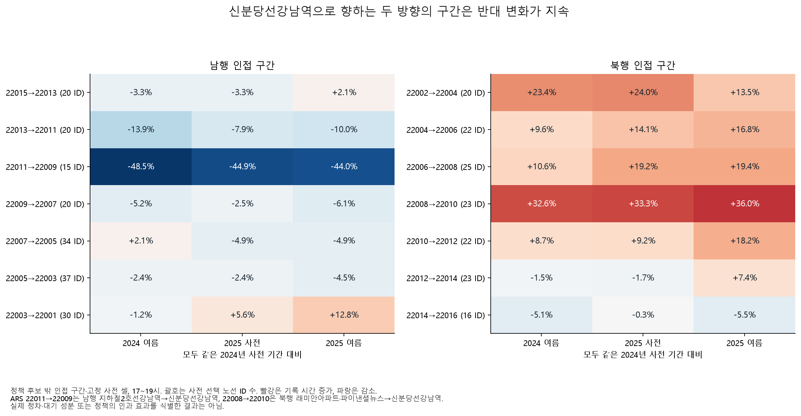
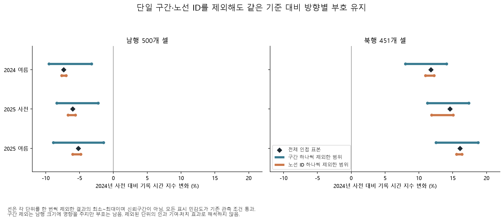
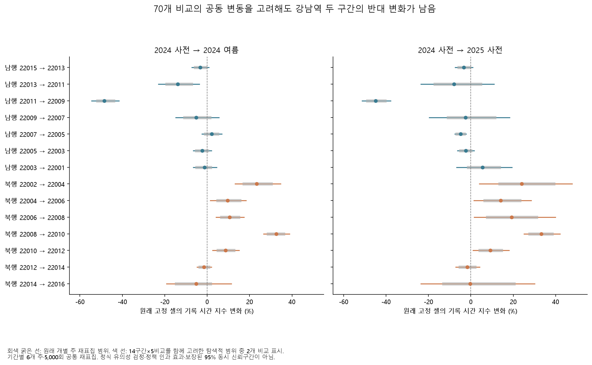
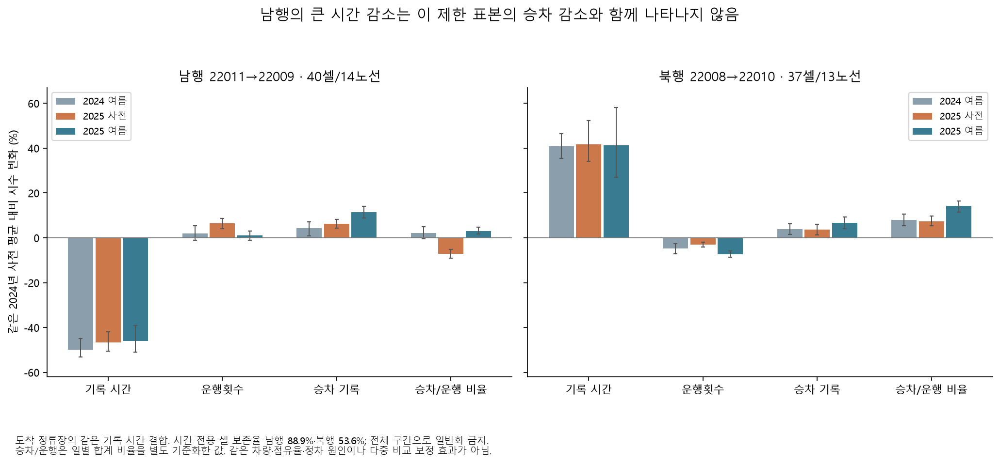

# 같은 강남역, 서로 다른 방향의 지속성

가장 큰 남행 감소 구간과 북행 증가 구간의 반대 변화가 2025년에도 관측됐다. **남행 지하철2호선강남역→신분당선강남역은 약 44% 감소, 북행 래미안아파트·파이낸셜뉴스→신분당선강남역은 약 36% 증가**한 상태였다. 모두 같은 2024년 사전 기준 대비 2025년 여름의 기록 시간 지수다. 단일 구간이나 노선 ID를 제외해도 제한 표본의 방향별 부호는 남았다.

## 같은 표본을 인접 구간으로 나눈 결과

[규칙](overnight_persistence_segments_config.yaml)을 `8bd9acc`에 저장한 뒤 [2025년 지속성 분석](overnight-persistence-report.md)의 기존 사전 셀을 분해했다. 정책 후보 밖 집단에서 같은 방향·레지스트리 순서상 바로 다음 정류장으로 가는 구간만 사용했다. 2025년 사전·사후 관측값으로 셀을 새로 고르지 않았으며 2024년 셀별 기준 평균도 유지했다.

방향당 7개, 총 14개 인접 구간이다. 저녁에는 남행 503개 중 500개, 북행 454개 중 451개가 해당한다. 방향별 비인접 셀 3개씩을 다른 구간에 합치지 않고 [제외 표](results/overnight/persistence_segments/excluded_nonadjacent.csv)에 남겼다. 따라서 방향 평균은 원래 전체 경로 집계와 조금 다르다. 정류장 ID·ARS·순서의 대조를 사용했으며 정확한 역사적 좌표·차로 형상을 확인한 것은 아니다.

| 저녁 구간 | 사전 셀 / 노선 ID | 2024 여름 | 2025 사전 | 2025 여름 |
|---|---:|---:|---:|---:|
| 남행 22011→22009 | 45 / 15 | −48.45% | −44.90% | **−43.98%** |
| 북행 22008→22010 | 69 / 23 | +32.59% | +33.27% | **+36.02%** |

세 열 모두 같은 **2024년 5/20~6/28 사전 기간**과 비교한다. 2025년 여름의 주 재표집 구간은 남행 [−48.98, −36.81]%, 북행 [+21.91, +52.87]%다. 이는 탐색적 변동 구간이며 여러 구간·시간대 중 큰 값을 본 뒤 정한 확정 가설이나 다중 비교 보정 검정은 아니다. 이전 보고서의 북행 +31.72%와 표본이 다르므로 동일 추정치의 수정으로 해석하지 않는다.

모든 구간이 같은 방향으로 변한 것은 아니다. 남행 22003→22001은 같은 기준 대비 2025년 여름 +12.79%였고, 북행 22014→22016은 −5.51%였다. 시간대 4개·비교 5개·구간 14개의 280개 결과를 모두 저장했다. 최소 3개 노선 ID, 날짜·관측률 조건은 모두 통과했지만 이 280개를 독립된 발견으로 세지 않는다.

2025년 안에서 사전→여름만 비교하면 두 강조 구간은 +1.67%·+2.06%이며 변동 구간이 모두 0을 포함한다. 주된 관측은 다음 해 여름의 새 급변보다 **이미 달라진 수준의 지속**이다.

## 한 구간이나 노선에 좌우되는가

저녁의 고정 인접 표본에서 사전 구간 14개와 방향별 노선 ID 84개를 각각 하나씩 제외했다. 새 결과가 좋아지는 단위를 골라 제거하지 않았다. 전체 표본 2개를 포함한 500개 비교는 모두 기존 관측 조건을 통과했다.

| 2024 사전→2025 여름 | 전체 인접 표본 | 구간 하나씩 제외한 범위 | 노선 ID 하나씩 제외한 범위 |
|---|---:|---:|---:|
| 남행 | −5.19% | **−8.88~−1.46%** | −6.00~−4.81% |
| 북행 | +16.07% | **+12.52~+18.73%** | +15.56~+16.38% |

제외 범위는 신뢰구간이 아니다. 한 구간을 빼면 남행 감소의 크기가 상당히 달라지므로 특정 구간의 집중은 중요하다. 그럼에도 이 진단에서 부호는 유지돼 단 하나의 구간·노선 ID만으로 방향 평균 전체가 만들어졌다고 보기는 어렵다. 원래 표본을 바꾸거나 제외 단위의 인과 기여를 계산한 결과는 아니다.

## 어떤 추가 자료가 원인을 구분해 줄까

정류장 용량·군집 운행 연구는 다음 관측 항목을 정하는 데 도움이 된다. 현재 기록 시간의 단위·정차 포함 여부를 대신 정의해 주지는 않는다.

| 참고 자료 | 적용할 관찰 관점 | 현재 적용 한계 |
|---|---|---|
| [Gu 등(2010), 정류장 용량](https://escholarship.org/uc/item/8zc6p9kb) | 정차면 수·직렬 정차·버스 출발 흐름 | 공식 저장소 초록 확인. 신호 영향에서 분리된 정류장 가정이며 강남대로에 그대로 대입할 수 없음. 로컬 PDF 미확보 |
| [Daganzo·Pilachowski(2009), 작업 원고](https://escholarship.org/uc/item/0551g0zw) | 앞뒤 버스 간격과 승객 수요의 피드백 | 단순화한 노선·수요 모형. 시간당 대수는 실제 배차간격 분산이나 군집 운행 관측이 아님 |
| [Alhadidi·Rakha, 사전원고](https://arxiv.org/abs/2104.09266) | 감속·승하차·가속·차로 재진입 시간의 분리 | 방법 절은 시각·속도·GPS의 2Hz 원기록을 초별로 집계. 현재 시간대 합계로 해당 성분을 식별할 수 없음 |

다음 수집의 우선 대상은 강조한 두 방향 구간의 **개별 차량 도착·출발 시각, 문 개폐/정차 시간, 정차면 배치와 변경일, 실제 노선별 배차, 신호 운영 이력**이다. 차량·시간 단위가 검증되면 버스가 달리는 시간과 정류장에서 기다리는 시간을 구분할 수 있다. 현재 시간·운행횟수·승차의 같은 시간대 결합만으로 차량별 정차시간을 산출하지 않는다.

공개 경기 광역버스 승하차 [목록](https://www.data.go.kr/data/15163060/openapi.do)은 필요한 항목을 설명하지만 과거 제공 기간이 비어 있다. 연결된 서비스 화면은 일부 탭에서 응답이 중단됐고 다른 탭은 존재하지 않는 서비스로 응답했다. 2024년 원본 확보 가능성은 미확정으로 남기며 가입·활용신청·외부 문의를 실행하지 않았다.

원본·검증 캐시가 있는 사례 환경에서 `python overnight.py persistence-segments`, `python overnight.py persistence-segments-plots`로 재현한다. 그림은 커밋된 표로 다시 만들 수 있다. [구간 비교](results/overnight/persistence_segments/segment_comparisons.csv), [모든 단일 제외 결과](results/overnight/persistence_segments/leave_one_out.csv), [감사 명세](results/overnight/persistence_segments/audit.json), [문헌 접근 범위](overnight-bottleneck-references.json)를 함께 제공한다. 정책 후보 밖 집단은 무처치 대조군이 아니며 전체 버스·승객의 인과 효과로 일반화하지 않는다.

## 여러 구간·비교를 함께 고려한 추가 진단

개별 범위만 보고 큰 값 두 개를 고르는 문제를 줄이기 위해, 저녁 **14개 구간×5개 비교=70개**를 하나의 묶음으로 다시 살폈다. 기존 일별 지수·기간·표본을 그대로 사용했다. 각 기간의 6개 달력 주를 5,000회 재표집하면서 모든 구간에 같은 주 가중치를 주고, 같은 기간을 쓰는 비교에도 같은 추출을 재사용했다. 기간 사이 추출은 독립이다. 로그 평균비의 중심화 오차를 각 비교의 재표집 표준편차로 나눈 뒤, 70개 최대 절댓값의 95백분위(3.2644)를 공통 범위 계수로 사용했다. 유효 추출 5,000개, 무효 0개다.

이는 **기술적 동시 변동 범위**이며 보장된 95% 동시 신뢰구간이나 정식 다중 검정이 아니다. 기간마다 주가 6개뿐이고 기간 사이 독립·주 단위 재표집의 근사, 사후 탐색이라는 한계가 있다. [Romano·Wolf(2005)](https://www.econ.uzh.ch/dam/jcr%3Affffffff-935a-b0d6-ffff-ffffa286d4d1/etca.pdf)의 공동 의존·표준화 논의를 참고했지만 단계적 검정이나 재표집별 표준오차 추정을 구현한 것이 아니다. 그 논문의 보장을 이 범위에 옮기지 않는다.

| 비교 | 기존 개별 범위가 0을 제외 | 새 공동 범위가 0을 제외 |
|---|---:|---:|
| 2024 사전→여름 | 8 / 14 | 7 / 14 |
| 2025 사전→여름 | 4 / 14 | **0 / 14** |
| 2024 사전→2025 사전 | 9 / 14 | 7 / 14 |
| 2024 여름→2025 여름 | 5 / 14 | 3 / 14 |
| 2024 사전→2025 여름 | 11 / 14 | 6 / 14 |
| 합계 | 37 / 70 | **23 / 70** |

핵심 두 구간의 2024 사전→2025 여름 범위는 남행 −43.98% [−53.55, −32.43]%, 북행 +36.02% [+11.83, +65.43]%다. 범위가 넓어져도 반대 변화는 남는다. 반면 2025년 안의 사전→여름 변화는 남행 +1.67% [−17.49, +25.28]%, 북행 +2.06% [−16.77, +25.14]%로 두 구간 모두 0을 포함한다. **새 급변보다 달라진 수준의 지속을 중심 주장으로 삼는 것이 적절하다.**

[계산 규칙](overnight_segment_uncertainty_config.yaml)은 결과 전에 저장했다. `python overnight.py segment-uncertainty`, `followup-plots`로 재현하며 [전체 70개 범위](results/overnight/segment_uncertainty/comparisons.csv), [기간별 표본](results/overnight/segment_uncertainty/period_support.csv), [감사 명세](results/overnight/segment_uncertainty/audit.json)를 제공한다.

## 강조 구간에서도 시간·운행·승차를 함께 보면

방향 평균의 운영 기록 비교를 두 강조 구간에 그대로 옮기지 않도록, 원래 공동 관측 셀을 14개 구간으로 분해했다. [구간 운영 규칙](overnight_segment_operations_config.yaml)과 코드는 결과 전에 `2121cdd`에 저장했다. 원래 2023·2024년 사전 공동 관측 조건과 2024년 기준을 유지하고 2025년 결과로 재선택하지 않았다. 도착/출발 정렬·4지표·5비교의 560개 행은 모두 관측 조건을 통과했다.

도착 정렬의 남행 강조 구간은 시간 전용 45셀 중 40셀·14노선(88.89%), 북행은 69셀 중 37셀·13노선(53.62%)만 남았다. **북행은 시간 전용 표본의 절반 수준이라 결과의 크기를 앞의 전체 인접 셀 추정치와 혼합하지 않는다.** 숫자 0 횟수는 유효 관측으로 두고 세 지표가 함께 알려진 셀·날짜만 집계했다. 운행 0·승차 양수 모순은 두 정렬 전체에서 0개였다.

| 같은 공동 셀의 2024 사전→2025 여름 | 남행 22011→22009 | 북행 22008→22010 |
|---|---:|---:|
| 기록 시간 | **−46.04%** [−50.88, −39.18] | **+41.18%** [+26.90, +58.07] |
| 운행횟수 | +1.02% [−1.16, +3.04] | −7.26% [−8.56, −5.92] |
| 승차 기록 | **+11.36%** [+8.85, +14.10] | **+6.68%** [+4.14, +9.26] |
| 일별 승차 합 / 운행횟수 합의 별도 지수 | +3.11% [+1.79, +4.71] | +14.19% [+11.45, +16.42] |

두 구간 모두 승차 기록이 늘었지만 시간 변화는 반대였다. 남행 감소를 해당 공동 표본의 승차 감소로만 설명하기는 어렵고, 북행의 시간·운행당 기록 비율 증가도 함께 관측된다. 이것만으로 정차 시간이 원인이거나 정책이 혼잡을 반대편으로 옮겼다고 식별할 수는 없다. 시간 지수의 단위·정차 포함 정의, 실제 배차 간격·문 개폐·신호 자료가 여전히 필요하다.

비율은 일별 합계 승차/운행을 계산한 뒤 그 자체의 사전 평균으로 기준화한다. 셀별 승차 지수와 운행 지수를 나눈 값이 아니다. 따라서 남행의 2024 사전→2025 사전에서 셀 평균 승차 +6.30%·운행 +6.49%와 별도 비율 −7.16%가 함께 나올 수 있다. 서로 다른 가중·집계량을 같은 대수식으로 해석하지 않는다.

출발 정류장의 같은 시간대로 연결하면 남행 승차의 2024 사전→2025 여름 변화는 +45.58%, 북행은 +1.66%다. 시간 변화의 부호는 같아도 승차 변화의 크기가 크게 달라진다. 이 정렬의 셀은 남행 39·북행 39개로 도착 정렬과도 완전히 같지 않다. **차량이 그 구간에 들어올 때 탄 승객, 나올 때 탄 승객을 직접 연결한 자료가 아니다.** 두 정렬을 독립 확인이나 같은 모집단의 단순 차이로 부르지 않는다.

`python overnight.py segment-operations`, `segment-operations-plots`로 재현한다. [표본 보존율](results/overnight/segment_operations/eligibility.csv), [560개 비교](results/overnight/segment_operations/comparisons.csv), [일별 지수](results/overnight/segment_operations/daily.csv), [관측 상태](results/overnight/segment_operations/observation_states.csv), [감사 명세](results/overnight/segment_operations/audit.json)를 제공한다. 이 절의 개별 주 범위는 앞의 시간 전용 70개 공동 범위와 다른 분석이며 다중 검정 보정 구간이 아니다.
