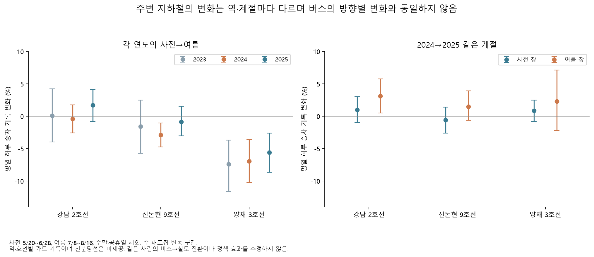
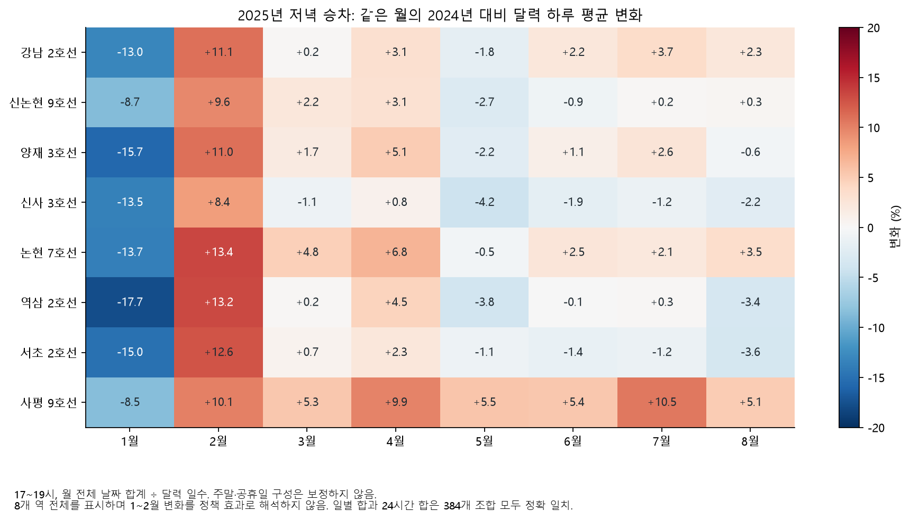

# 주변 지하철 승하차는 버스 방향별 변화의 수요 맥락이 될까

2023~2025년 주변 8개 역·호선의 공개 카드 자료를 추가했다. **일별 합계와 월 시간대 합계 384개가 모두 일치했지만, 버스에서 철도로 옮겨 탄 사람 수를 식별할 자료는 아니다.** 특히 신분당선은 공식 자료의 제공 대상이 아니다. 이 결과는 버스 지수의 반대 변화에 대중교통 수요 맥락을 더하며, 정책의 인과 효과나 교통수단 전환량으로 사용하지 않는다.

## 실제 확보와 검증

- 서울 열린데이터광장의 [일별 역·호선 승하차 OA-12914](https://data.seoul.go.kr/dataList/OA-12914/A/1/datasetView.do), [월별 시간대 승하차 OA-12252](https://data.seoul.go.kr/dataList/OA-12252/S/1/datasetView.do)를 사용했다. 전자는 공식 첨부파일, 후자는 공개 Sheet의 사용월 필터 CSV다. API 인증·기관 신청 없이 24개월씩 48개, 33,632,512 bytes를 확보했다.
- 전체 일별 447,842행·월별 14,850행의 기간과 열 구조를 검사했다. 일별 CSV의 헤더 뒤에 없는 빈 끝 칸 한 개만 명시적으로 허용한다. 값이 있는 초과 칸·둘 이상의 초과 칸은 거부한다. 원본은 변경하지 않았으며 2026년 결과는 읽지 않는다.
- 선택은 **강남 2호선, 신논현 9호선, 양재 3호선**을 주 대상으로, 신사 3호선·논현 7호선·역삼 2호선·서초 2호선·사평 9호선을 주변 맥락으로 고정했다. 역명 끝의 괄호 부역명만 제거하며 호선이 다른 역을 합치지 않는다. 같은 날짜/월의 기본역명 중복은 자동 합산하지 않는다.
- 종류·월·역 384개 대응이 모두 관측됐다. 일별 선택은 730일 × 8역 × 승하차 = **11,680개 모두 양수**, 월별 시간대는 **9,216개 중 양수 8,265개·0값 951개**다. 부재·빈칸은 없었다. 시간대의 0값은 유효한 기록으로 유지했다.
- 역·월·승하차의 일별 총합과 24시간 합 **384개가 정확 일치**했다. 같은 정산 원천을 다른 집계로 대조한 결과이며 독립 측정 검증으로 부르지 않는다. 일별 비교 112개·월별 비교 1,024개가 모두 설정의 관측 조건을 통과했다.

공식 일별 FAQ는 신분당선 미제공을 명시한다. 월별 FAQ는 환승 여부를 분리한 집계가 아니며 티머니 자료를 제공받는다고 설명한다. 이로부터 특정 버스 이용자의 철도 전환, 호선 간 환승 인원, 전체 철도 이용자 수를 계산할 수는 없다. 월별 소개의 1~9호선 범위와 실제 원본의 더 넓은 호선 목록도 구별해 [감사 기록](results/overnight/subway/audit.json)에 남겼다. 출처·요청 인자·해시는 [원본 명세](overnight-subway-sources.json)에 있다.

## 같은 평일 창에서 본 결과

사전은 각 연도 5/20~6/28, 여름은 7/8~8/16이다. 주말·공휴일을 제외한 예정 날짜를 분모에 남겼다. 2023년 26/27일, 2024년 29/29일, 2025년 27/28일이 모두 관측됐다. 아래는 하루 승차 기록 변화이며 괄호는 주 단위 재표집의 기술적 변동 구간이다. 여러 비교의 선택을 보정한 인과 검정이나 공식 보장 구간은 아니다.

| 역·호선 | 2023 사전→여름 | 2024 사전→여름 | 2025 사전→여름 |
|---|---:|---:|---:|
| 강남 2호선 | +0.11% (−3.96, +4.24) | −0.38% (−2.54, +1.76) | +1.71% (−0.79, +4.14) |
| 신논현 9호선 | −1.59% (−5.69, +2.50) | −2.87% (−4.74, −1.03) | −0.83% (−3.01, +1.56) |
| 양재 3호선 | −7.38% (−11.61, −3.70) | −6.92% (−10.21, −3.59) | −5.59% (−8.66, −2.62) |

양재의 여름 감소는 2024년에만 발생하지 않았다. 강남 2호선에는 같은 창의 급격한 승차 증가가 나타나지 않았다. 주변 역의 계절적 차이를 무시한 단일 전후 비교로 버스 정책의 전환 효과를 주장하기 어렵다.

| 역·호선 | 2024 사전 하루 승차 | 2025 사전 하루 승차 | 사전 창 전년 대비 | 여름 창 전년 대비 |
|---|---:|---:|---:|---:|
| 강남 2호선 | 89,685.55 | 90,592.81 | +1.01% (−0.94, +3.03) | +3.12% (+0.51, +5.76) |
| 신논현 9호선 | 34,205.79 | 34,011.48 | −0.57% (−2.62, +1.40) | +1.52% (−0.63, +3.91) |
| 양재 3호선 | 42,843.14 | 43,205.33 | +0.85% (−0.81, +2.50) | +2.29% (−2.21, +7.12) |

하차와 나머지 5개 역도 생략하지 않고 [일별 전체 비교](results/overnight/subway/daily_comparisons.csv)에 제공한다. 버스의 저녁·방향별·제한 셀 지수와 지하철의 하루·역별 기록은 표본과 측정 대상이 다르므로 증감률을 직접 빼서 전환량을 만들지 않는다.

## 월 시간대 맥락

월별 시간대는 주말·공휴일을 포함한다. 월 합계를 해당 월 달력 일수로 나눈 뒤 같은 월의 전년과 비교했다. 평일 일별 결과와 구별한다. 2025년 5~8월 저녁 17~19시 승차의 전년 대비 변화는 강남 2호선 −1.76%, +2.20%, +3.70%, +2.32%, 신논현 9호선 −2.70%, −0.87%, +0.24%, +0.35%였다. 역마다 양상이 다르고 월별 휴일·요일 구성을 보정하지 않았다.

1~2월의 넓은 반대 변화도 전부 표시했다. 달력 구성과 다른 동시 변화가 남아 있으므로 정책 효과로 해석하지 않는다. [월별 전체 비교](results/overnight/subway/monthly_changes.csv)는 아침·저녁·늦은 시간·하루 전체와 승하차를 모두 포함한다.

## 채택 범위와 재현

이 자료는 **주변 수요가 모든 역에서 같은 방향으로 크게 바뀐 것은 아니라는 맥락**에 채택한다. 신분당선·GTX의 역사적 승하차, 같은 이용자의 수단 간 이동, 버스별 승객 구성은 여전히 비어 있다. [공통 운영·버스 카드 결과](overnight-operations-report.md), [강남역 구간 결과](overnight-segment-report.md)와 나란히 읽고, 대체 가능한 원인 설명을 줄이는 자료로 사용한다.

사례 폴더의 기존 환경에서 `overnight.py subway-collect`, `subway-analysis`, `subway-plots` 순서로 실행한다. 수집은 기존 원본의 크기·해시·전체 기간을 검증하고 재사용한다. 결측을 0으로 바꾸거나 일별/월별 불일치를 맞춰 쓰지 않는다. 원본과 일별 선택 Parquet는 Git에서 제외하며 집계 CSV·그림·출처를 제공한다. 새 테스트는 비선택 행 오류, 잠금 연도, 시간대 완전성, 별칭 중복 거부, 관측 0과 결측 분모, 합계 불일치의 보존을 검증한다.
