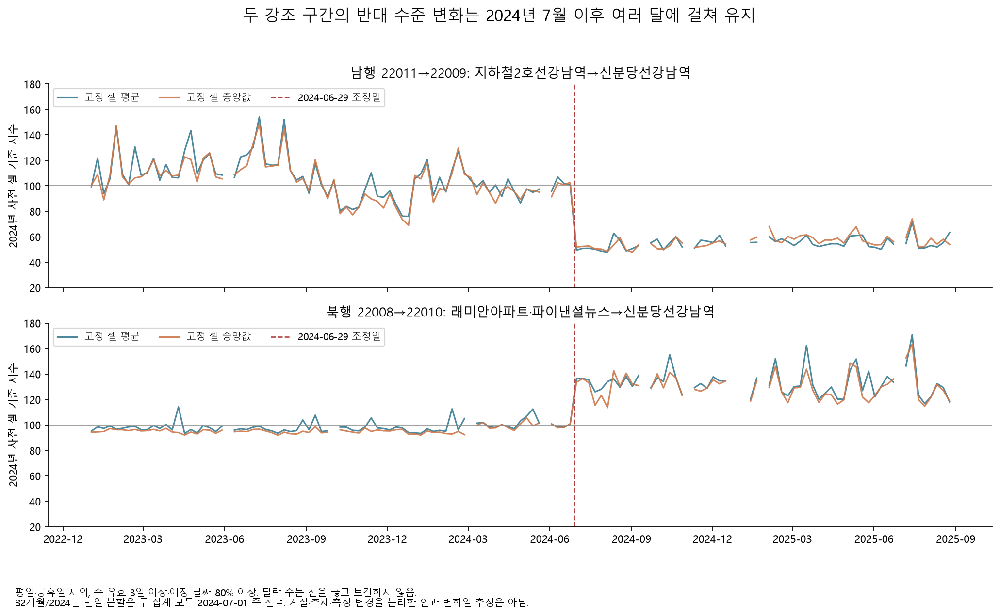
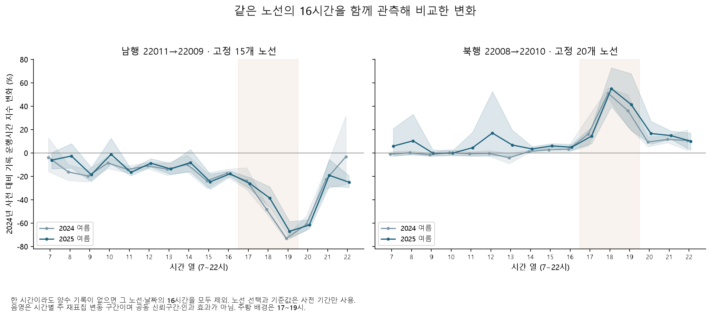

# 강남역 버스는 양방향으로 좋아졌을까?

**추천 프로젝트는 ‘2024년 광역버스 분산 이후 강남역 주변 버스 기록의 방향·시간대별 비대칭과 지속성’이다.** 남행에서 큰 감소를 찾는 데서 끝내지 않고, 북행·다음 해·옆 구간·같은 노선의 다른 시간·승차 기록까지 확인하는 구성이 가장 설득력 있다. 공개 집계로 읽고 검증할 수 있는 분석은 이미 구현했다. 속도 범위 예측은 별도 확장 주제로 붙일 수 있다.

2026-10-29 약 10시간 확장 탐색의 종합 문서다. 시작 규칙과 단계별 변경·검증은 [진행 기록](overnight-plan.md), 모든 결과의 진입점은 [README](README.md)에 있다. 이전 계획과 분석 결과는 보존했다. 결과를 본 뒤 추가한 질문은 탐색으로 표시하며, 2026년 잠금 시험값은 사용하지 않았다.

## 가장 분명해진 관측

아래 값은 **2024년 사전 대비** 변화다. 버스 시간은 단위·정차 포함 여부가 확인되지 않은 원래 양수 기록을 자기 사전 평균으로 나눈 지수다. 실제 분 단위·승객의 시간 절감·정책의 인과 효과를 뜻하지 않는다. 주된 비교는 평일 저녁 17~19시다.

| 관측 대상 | 2024년 여름 | 2025년 여름 | 읽는 방법 |
|---|---:|---:|---|
| 남행 강조 구간 22011→22009 | **−48.45%** | **−43.98%** | 사전 고정 45개 노선·시간 셀 |
| 북행 강조 구간 22008→22010 | **+32.59%** | **+36.02%** | 사전 고정 69개 셀; 남행과 별도 표본 |
| 남행 인접 세 구간의 원시 평균 합 | **−32.45%** | **−28.96%** | 모든 구간 공동 관측 45개 셀 |
| 북행 인접 세 구간의 원시 평균 합 | **+17.39%** | **+24.65%** | 모든 구간 공동 관측 60개 셀 |

강조 구간은 남행 **지하철2호선강남역→신분당선강남역**, 북행 **래미안아파트·파이낸셜뉴스→신분당선강남역**이다. 두 구간의 양 끝이 같은 왕복 도로 조각은 아니다. 인접 합도 같은 차량을 따라 잰 경로 시간이 아닌 시간대별 구간 평균의 합이다. 시간 전용·여러 구간 공동·운영 공동 표본은 서로 크기가 다르므로 변화율을 섞거나 기여율로 분해하지 않는다. [구간 결과](overnight-segment-report.md), [인접 합 결과](overnight-path-report.md)



32개월의 주간 지수를 두 상수 수준으로 나눠 보았을 때 두 강조 구간 모두 **2024-07-01 주**가 선택됐다. 2024년만 사용하거나 셀 평균 대신 중앙값을 써도 같았다. 조건을 통과한 남행 14개 노선 모두, 북행은 평균 집계에서 21개 중 18~20개가 같은 주를 골랐다. 이는 짧은 비교 창 바깥에서도 변화가 이어졌다는 근거다. 계절·추세를 제거한 변화점 검정이나 실제 효과 발생일 추정은 아니다. [장기 궤적](overnight-timeline-report.md)



같은 노선·날짜에서 7~22시가 모두 관측된 표본에서도 변화가 저녁에 집중됐다. 남행 15개 노선의 19시 열은 2024년 여름 −73.15%, 북행 20개 노선의 18시 열은 +50.99%였다. 다음 해 여름에도 −67.08%, +55.00%다. 하루 전체가 일정한 배율로 달라진 모양은 아니지만, 시간별 차량 구성·검지 방식 변화까지 배제한 것은 아니다. [시간대 공동 표본](overnight-hour-report.md)

마지막으로 양쪽의 **같은 14개 노선·같은 날짜·같은 저녁 시간**까지 맞췄다. 이 제한 표본의 2024년 여름은 남행 **−49.80%**, 북행 **+40.52%**였고, 2024년 사전 대비 2025년 여름도 **−46.02%·+40.96%**였다. 사후 누락 노선을 고정 분모에서 빼지 않았다. 서로 다른 노선 구성이 차이의 전부를 설명하지는 못한다. 같은 차량의 왕복이나 인과 대조는 아니며 앞의 다른 표본 수치와 크기를 혼합하지 않는다. [양방향 공동 노선 검증](overnight-hour-report.md)

## 어떤 설명은 약해졌고, 무엇은 아직 모르는가

| 설명·우려 | 실제로 확인한 것 | 남는 한계 |
|---|---|---|
| 사라진 버스 기록을 개선으로 센 것 아닌가 | 정책 후보 남행의 양수 기록은 94.4→25.2%로 줄었다. 이를 시간 개선으로 환산하지 않고 후보 밖 집단·고정 셀을 따로 분석했다 | 후보 밖 집단도 정책의 간접 영향을 받을 수 있어 무처치 대조군이 아님 |
| 집계 방식·한 노선 때문에 생긴 것 아닌가 | 셀/노선/구간 동일 가중·중앙값에서 방향 부호가 유지됐다. 한 노선·한 구간씩 제외한 범위도 공개했다 | 같은 도로·집계 체계를 공유하므로 독립 검증 횟수로 셀 수를 사용할 수 없음 |
| 바로 옆 구간으로 시간이 옮겨 기록됐나 | 원시 인접 합에서도 반대 변화가 남았고 2024 전후 111개 노선·구간의 순서 키 집합이 같았다 | 실제 위치·검지 경계·집계 정의의 동일성은 미확인 |
| 승객이 크게 줄어서 시간이 줄었나 | 시간·운행·승차가 함께 관측된 저녁 남행 표본의 2024→2025 사전은 시간 −8.09%, 승차 +15.67%였다 | 제한 셀의 기록이며 모든 승객·같은 차량의 수요가 아님. 수요가 원인이 아니라고 단정하지 않음 |
| 일반도로가 함께 빨라진 것 아닌가 | 같은 전년 사전 비교에서 핵심 남행 3개 링크는 +5.10%, 넓은 강남대로 남행 15개는 −4.29%였다. 북행 핵심 +0.65%의 범위에는 0이 포함됐다 | 도로 범위·차종이 다르고 버스 차로·정차를 직접 관측하지 않음 |
| 여름 날씨 때문 아닌가 | 지역 시간 기상을 확보했다. 2024→2025 사전 비교는 3관측소×3정렬에서 남행 감소·북행 증가가 유지됐다 | 2024년 안의 여름 날씨 보정은 9개 중 1개만 조건 통과. 서로 다른 결과를 합쳐 ‘날씨 영향 제거’라고 말하지 않음 |
| 모든 전년 비교를 같은 시설에서 한 것인가 | 서울시 원문에서 강남역 중앙 승강장 연장·횡단보도 사업의 2023-11-25 개통을 확인했다 | 2023년과 2024년의 물리 환경 동일성을 가정할 수 없음. 2024년 버스 조정과 별개 사건 |

[관측·누락](overnight-observation-report.md), [노선·집계](overnight-route-report.md), [운영·카드](overnight-operations-report.md), [주변 도로](overnight-road-report.md), [지속성·기상](overnight-persistence-report.md), [자료 정의와 현장 변경](overnight-evidence.md)에 전체 수치·실패·조건을 남겼다.

**원인 판정의 가장 큰 빈칸은 시간 필드의 정의와 당시 운영·검지 이력이다.** 같은 날인 2024-06-29 [GTX-A 구성역 개통](https://www.molit.go.kr/USR/NEWS/m_71/dtl.jsp?id=95089901&lcmspage=2)도 있어 단순 전후 비교로 버스 정책만 분리할 수 없다. 2025년 요금·운영 변화도 남는다. 북행 증가가 남행 개선의 ‘전가’였다고 확정할 자료는 없다.

## 예측 실험은 어디까지 유망한가

예측 대상은 **일반도로 핵심 남행 3개 링크의 속도**다. 위 버스 기록 운행시간을 예측한 모델이 아니다. 최초 실험은 2023~2024년 학습, 2025년 1~2월 선택, 3월 확률/구간 보정, 4월 경보 기준, 5~8월 고정 시험으로 나눴다. 50개 후보 중 선택 24개를 시험 전에 동결했다. 이후 추가 비교는 같은 시험을 재사용한 탐색임을 표시했다.

| 방향 | 5~8월에서 확인한 결과 | 판단 |
|---|---|---|
| 속도 범위·중앙값 예측 | 1시간 MAE 1.300 km/h, 80% 목표 포함률 81.88%, 평균 폭 4.36 km/h. 3시간은 1.343, 81.87%, 4.45 | **보조 주제로 채택.** 달력·주간 기준과 구간 점수까지 비교 |
| 링크 전체 하위 20% 저속 | 버스 추가 AP 1시간 0.843·3시간 0.834. 달력만 0.799, 주간 도로 0.836, 최근 도로 0.845·0.838 | 반복 패턴 예측은 가능하지만 높은 점수만으로 사고 탐지·버스 정보의 효과를 주장하지 않음 |
| 버스 정보 추가 | 최근 도로 대비 AP 차이 −0.0026·−0.0037의 변동 구간에 0 포함 | 추가 이득을 확인하지 못함. 버스 데이터를 붙였다는 이유로 더 좋은 모델로 채택하지 않음 |
| 같은 요일·시간 하위 20% | 기존 최근 도로 분류 AP 0.361·0.346. 속도 중앙값과 기준의 폭 정규화 차이는 0.506·0.475 | 별도 라벨에서 유망한 점수. 4월 예산 기준의 재현율은 14.1%·13.0%로 낮음 |
| 절대 10 km/h 미만 경보 | 시험 양성 41개, 정밀도 10.6~15.4%. 저녁·특정 링크에 집중 | 운영 채택 보류. 높은 재현율과 낮은 정밀도를 함께 보고 |
| 실제 하루 2개 경보 상한 | 전체 하위 20% 1시간 재현율 80.0→8.5%. 10시 이후 발행 0개 | 하루 평균 예산과 실제 상한은 다름. 현재 발행 정책 채택 보류 |
| 시간·날씨별 구간 오차 | 주 지점 강수 양수의 포함률 76.76%·76.07%. 저녁 강수는 96행으로 짝 비교 요건 미달 | 전체 평균으로 신뢰성을 설명하기 어려움. 과거 발표 예보·새 검증 필요 |

AP는 양성을 앞에 놓는 순위 성능이며 경보의 정밀도·운영 비용과 다르다. 두 하위 20% 라벨은 기준과 실제 양성 비율이 달라 AP를 서로 직접 비교하지 않는다. 최근 도로 입력은 공개 지연을 확인하지 못한 운영 가정을 포함한다.

상세: [최초 고정 시험](overnight-forecast-report.md), [단순 기준과 비교](overnight-baseline-report.md), [구간 보정](overnight-interval-report.md), [조건부 저속과 차이 점수](overnight-conditional-report.md), [날씨별 오류](overnight-weather-performance-report.md), [순차 경보](overnight-alert-report.md).

**아직 열지 않은 2025년 9~12월도 별도로 확인했다.** 후보·코드·모델·기준을 먼저 커밋하고 4개월을 수집했으며, 간격별 8,784개 유효 관측에서 재학습 없이 평가했다. 고정 분위수의 MAE는 1시간 1.393·3시간 1.455 km/h, 포함률 80.36%·79.59%로 달력·주간 기준보다 낮은 오차·구간 점수를 유지했다. 조건부 차이 점수 AP도 0.491·0.456으로 기존 분류 0.314·0.302보다 높았지만, 제한 경보 재현율은 약 12%에 머물렀다. [가을·겨울 검증 보고서](overnight-confirmation-report.md)에 월별 악화·전체 후보·불확실성을 함께 공개했다. 이전 시험과 합치거나 새 기간에 맞춰 기준을 바꾸지 않았다.

이후 한 주씩 제외한 진단에서도 구간 점수의 우위는 남았지만, 공휴일 표식일의 포함률은 71.2%·69.6%로 낮았다. 7일·3주뿐이어서 해당 집단 비교는 보류했다. 단순히 평균 성능을 더 높이는 것보다 비·특수한 날에 언제 예측을 신뢰하기 어려운지 밝히는 확장이 실용적이다.

## 수집·실행한 방향과 보류한 방향

| 방향 | 이번 작업 | 판정·근거 |
|---|---|---|
| 지역 시간별 기상 | 서초·강남·서울 2023~2025년 요청·시각·중복·기온/강수 점검 | 관측 비교 채택. 시각 불일치 응답 1건 제외; 결측을 무강수로 바꾸지 않음 |
| 버스 기록·다년 구조 | 기존·추가 월 ZIP, 82개 파일의 전체 행 너비 감사와 손상 주간 격리 | 2023년 이후 유효 자료 채택. 2022년 비교는 사전 7일·사후 11일로 보류 |
| 노선·정류장 이력 | 현재 후보와 당시 경로를 구별하고 월별 카드의 ID↔ARS 대조 | 경로·정류장 대응은 보강. 역사적 노선명과 물리 위치는 별도 확인 필요 |
| 시간·계절·표본 | 시간대·주말·기준일 창·가을·2025년·32개월 궤적·단일 제외 | 품질 통과 결과 채택. 주말·날씨 조건 실패도 남김 |
| 공간·구간 합 | 14구간, 공동 변동 범위, 인접 두/세 구간 합·순서 키 | 방향·국소 집중의 진단으로 채택. 다중 탐색을 인과 검정으로 표현하지 않음 |
| 승객 가중 | 재차인원 원본·시간 결합률과 제한 가중 표본 | 전체 가중 비교 24개 보류. 충분히 관측된 제한 표본만 별도 공개 |
| 공동 운영 기록 | 같은 시간·운행횟수·승차 셀과 구간별 연장 | 제한 공동 표본 채택. 집계 운행당 승차를 실제 차량 혼잡률로 바꾸지 않음 |
| 버스 카드 총계 | 일별/월별 합계와 2025년 중앙 정류장 연장 | 중앙 합계 대조 채택. 동일 카드 처리 계열이라 독립 센서 검증은 아님 |
| 환승·출도착 | 공개 원본 키·중복·시간 결측 검사 | 환승 키 중복 36.26%, 출도착 시간 공란 77.3%로 직접 연결·인원 합 보류 |
| 일반도로·교통량 | 66개 안정 링크, 공간 범위·이름 변경·D-35/D-43·2025 연장 | 맥락 채택. 도로 이름 변경을 허용하면 부호가 바뀌는 결과도 공개 |
| 지하철 맥락 | 24개월×일별/시간대별 48개 원본, 8역, 월별 합계 384개 정확 대조 | 대규모 일괄 수요 이동의 설명에는 제한적. 신분당선 미제공·환승 식별 불가 |
| 동시 정책·문헌 | GTX-A·요금상품·요금·시설 변경, 버스 정차·혼잡·구간 예측 관련 원문 | 비교 설계와 해석 한계에 반영. 문헌의 단위·인과 결론을 원자료에 전용하지 않음 |
| 과거 정차·개문 자료 | T Data 1083 API 출력과 83 파일의 헤더·실제 기간 키 확인 | 과거 원본 미확보. 현재 파일을 2024년 자료로 사용하지 않음 |
| 과거 예보·돌발 정답 | 기상청 발표/발효 시각과 접근 조건, 서울 실시간/구 단위 API 확인 | 인증·과거 범위·공간 해상도 확인 전 입력·정답 활용 보류 |

[카드·환승·출도착 보고서](overnight-auxiliary-report.md), [지하철 보고서](overnight-subway-report.md), [동시 정책·연구](overnight-context-report.md), [후속 자료 출처](overnight-followup-references.json)에 구체적인 열·날짜·요청·해시를 기록했다. 원본·모델은 로컬에 보존하고 공개 PR에는 필요한 집계·자체 그림·코드·근거만 담는다.

## 다음 데이터의 우선순위

**새 모델을 더 많이 학습시키기보다 첫 두 항목이 버스 프로젝트의 해석을 가장 많이 바꾼다.** 실제 확보·정의 확인 전에는 수집 가능하다고 단정하지 않는다. 외부 AI에 전달할 구체적인 질문은 [확인 요청서](verification-request.md)에 준비했다. 기관 연락·계정 신청은 수행하지 않았다.

| 우선순위 | 필요한 자료·정의 | 무엇을 구별할 수 있나 | 수집 후 통과 조건 |
|---|---|---|---|
| 1 | OA-21217 시간 단위·출도착/정차 경계·평균 분모·0/공란·집계 변경 이력 | 기록 수준 변화와 실제 운행시간의 의미 | 해당 파일·2023~2025년에 적용되는 공식 답·명세; 유사 API 설명 대용 금지 |
| 1 | 2024년 당시 ARS별 위치·승강장·검지 경계·정차 위치·신호 변경 | 인접 합으로도 남는 변화가 운영·측정 중 어디와 관련되는가 | 실제 시행일·공간 범위·버전 이력과 관측 ID 연결 |
| 2 | T Data 1083의 과거 여행·개문·정차/통과·검출 건수 또는 익명 차량별 도착/출발 | 달리는 시간·서 있는 시간·대기·승차의 구분 | 실제 과거 응답, 단위·분모·중복 방문·개문 정의, 동일 차량/구간 연결률 |
| 2 | 당시 발표된 기상 예보와 도로 관측의 실제 공개 지연 | 비·기상 악화 때의 예측구간과 사용 가능한 입력 | 발표·발효·공개 시각 검증, 원점 이후 실제값 사용 금지 |
| 3 | 과거 사고·공사·통제의 위치·시작/종료·사건 ID | 평소보다 느린 상황과 실제 돌발 사건의 관계 | 해당 기간 원본과 링크 매칭; 실시간 화면·자치구 건수를 사건 정답으로 쓰지 않음 |
| 3 | 신분당선·GTX-A·광역버스의 범위가 맞는 수요 자료 | 동시에 달라진 교통수단 수요의 맥락 | 승차·환승·고유 이용자 구분, 같은 공간·시간의 비교 가능성 |

## 제출·발표 구성과 검증 경로

발표는 ① 정책과 자료 범위 ② 남행만 보면 놓치는 북행 ③ 긴 궤적·시간대·인접 합 ④ 승차·주변 교통과 설명의 한계 ⑤ 필요한 운영 자료 순서가 적절하다. 예측은 부록 또는 별도 확장으로 두고, 속도 범위의 기준 모델 비교와 실패한 경보 운영을 함께 보여 준다. 성공 사례만 모은 정책 홍보나 실시간 서비스 완성으로 포장하지 않는다.

공개 수치 대조는 Python 3.12 표준 라이브러리만 필요하다.

```bash
cd cases/sgim49697-ops-gangnam-bus-2024
python review_overnight.py --check
```

[핵심 수치 표](results/overnight/review/key_numbers.csv)는 각 값의 원본 집계 파일·고유 선택 조건·단위·해석 한계를 연결한다. [검증 명세](results/overnight/review/manifest.json)는 해당 CSV와 보존 대상·공개 동결 파일의 해시를 검사한다. 원본 재파싱·모델 재학습을 대신하는 검증은 아니다. 기존 로컬 원본·모델 환경에서는 `.venv/bin/python review_overnight.py --check --local-artifacts`로 추가 동결 검사도 실행한다. 전체 의존 관계와 실행 구분은 [재현 안내](overnight-reproduction.md)를 따른다.
