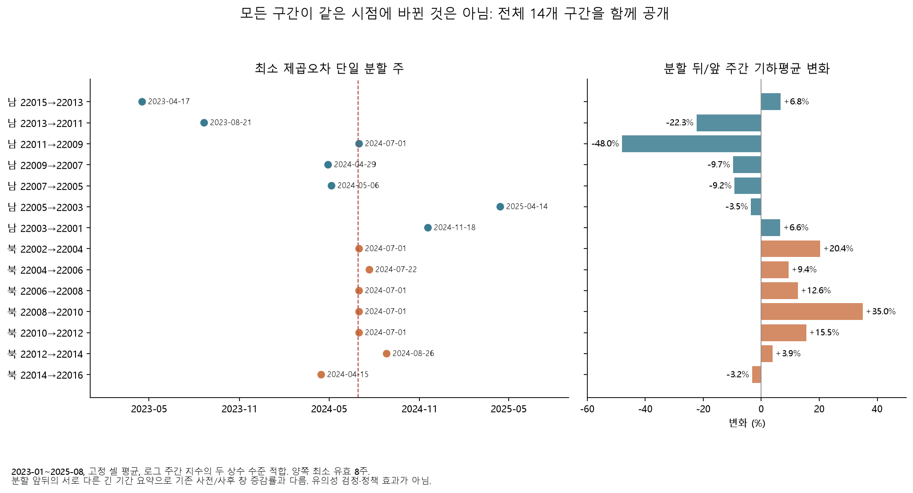

# 반대 방향의 버스 기록 변화는 언제부터 이어졌나

이미 확보한 2023년 1월~2025년 8월 버스 원본으로 **같은 14개 인접 구간과 강조 두 구간의 모든 사전 선택 노선**을 길게 표시했다. 강조한 남행·북행은 32개월 전체와 2024년만 분석했을 때 모두 2024년 7월 1일 주에서 두 수준으로 나누는 것이 가장 잘 맞았다. 주간 변화의 시점이 조정 직후와 맞는다는 기술적 근거이며 정책이 원인이라는 판정은 아니다.

## 새 질문과 계산 범위

기존 [구간 비교](overnight-segment-report.md)는 미리 정한 짧은 사전/사후 창에서 같은 구간의 방향과 지속성을 보였다. 이번에는 그 사이·앞뒤의 여러 달을 포함해, 짧은 창 선택만으로 생긴 모습인지와 노선마다 시점이 다른지 살폈다. 원래 모델·시험·선택 셀을 바꾸지 않는다.

- 기존 `multiyear`와 `forecast_bus_test`의 크기·해시를 검증한 버스 캐시를 재사용했다. 2026년은 접근하지 않았다. 추가 원본 다운로드와 모델 학습은 없다.
- 저녁 17~19시의 정책 후보 밖 고정 셀·2024년 사전 기준 평균을 그대로 사용했다. 14개 구간과 강조 남행의 15개·북행의 23개 노선, 총 **52개 계열**이다. 두 집계는 같은 셀의 평균과 중앙값이며 독립 표본이 아니다.
- 일별 고정 셀 관측률 80% 이상, 주별 유효 날짜 3일 이상·예정 평일의 80% 이상을 요구한다. 주는 월요일~일요일, 공휴일은 공식 대조 목록을 사용한다. 새 범위의 [2025년 월력요항](https://www.kasi.re.kr/publication/post/newsMaterial/30071?cPage=8), [1/27 임시공휴일 공고](https://www.mpm.go.kr/mpm/comm/noti/mpmNotice/?boardId=bbs_0000000000000205&category=&cntId=904&mode=view&pageIdx=3)를 추가했다. 짧은 공휴일 주·원본 부재 주를 보간하지 않는다.
- 각 계열의 로그 주간 지수를 두 상수 수준으로 근사하고 제곱오차가 가장 작은 분할을 찾았다. 양쪽 최소 유효 8주, 전체 예정 주의 80% 관측을 요구하며 같은 점수면 앞선 후보를 고른다. 전체 범위는 예정 139주, 2024년은 완전히 포함되는 52주다.
- **계절·추세를 제거한 변화점 추정이 아니다.** 여러 변화가 있어도 하나의 분할만 허용한 기술 요약이다. 최소점의 날짜는 실제 변화가 시작된 날짜·정책 효과 발생일·통계적 유의성으로 해석하지 않는다. 모든 208개 결과와 탈락을 보존했다.

## 강조 구간의 결과

| 구간 | 적합 범위 | 선택된 주 | 분할 뒤/앞 주간 기하평균 변화 | 한 수준 대비 제곱오차 감소 |
|---|---|---|---:|---:|
| 남행 22011→22009 | 32개월 | 2024-07-01 | −48.00% | 87.20% |
| 남행 22011→22009 | 2024년 | 2024-07-01 | −47.43% | 94.02% |
| 북행 22008→22010 | 32개월 | 2024-07-01 | +34.99% | 86.32% |
| 북행 22008→22010 | 2024년 | 2024-07-01 | +34.08% | 90.71% |

표는 셀 평균 집계다. 중앙값 집계도 네 경우 모두 같은 주를 골랐고, 변화는 남행 −45.69%/−47.20%, 북행 +35.45%/+34.58%였다. 전체 기간의 유효 주는 남행 130/139주·북행 128/139주, 2024년은 48/52주·47/52주다. 여기의 긴 앞뒤 기간 기하평균 변화는 기존 5~8월 사전/사후 변화와 계산 대상이 다르므로 교체하지 않는다.

노선별로도 확인했다. 관측 조건을 통과한 남행 **14/15개 노선은 두 범위·두 집계 모두 7/1 주**를 골랐다. 북행은 **21/23개가 통과**했고 평균 집계에서 전체 범위 18개, 2024년 범위 20개가 7/1 주를 골랐다. 통과한 남행 14개는 모두 감소, 북행 21개는 모두 증가였다. 같은 교통·집계 체계를 공유하는 노선들이므로 독립적인 35회 검증이나 정책 효과의 확률로 환산하지 않는다.

탈락은 남행·북행의 노선 ID `100100603`, 북행의 `204000153`이다. 전체 범위 유효 비율이 각각 60.43%, 79.86%였고, 2024년은 63.46%, 76.92%였다. 79.86%를 80%로 반올림해 통과시키지 않았다. 두 집계·두 범위 합계 **196개 통과·12개 보류**다. [전체 분할 표](results/overnight/timeline/single_level_changes.csv)에 기록했다.

## 주변 구간과 한계

전체 범위의 평균 집계에서 북행 7개 중 4개와 강조 남행이 7/1 주를 골랐다. 다른 남행 구간은 2023년, 2024년 3~5월, 2025년 등 서로 다른 시점을 골랐으며 한 수준 대비 개선도 훨씬 작았다. 모든 구간에서 일제히 같은 배율이 바뀐 모습으로 단순화할 수 없다. 동시에 일부 구간의 큰 동시 변화만으로 기록 체계·정류장 검지 범위 변경 가능성을 배제할 수도 없다.

후속 [인접 구간 합](overnight-path-report.md)에서도 반대 변화가 남았고, [동일 노선의 16시간 공동 표본](overnight-hour-report.md)에서는 저녁의 큰 차이를 확인했다. 공개 값은 시간대별 평균이므로 합을 실제 같은 차량의 소요시간으로 부르지 않는다. 당시 물리 위치·검지 방식·개문/정차·신호 자료와 원래 시간 필드의 정의는 계속 필요하다. 같은 날 GTX-A 구성역 개통 등 동시 변화도 분리되지 않았다.

## 산출물과 재현

[규칙](overnight_timeline_config.yaml), [계열 목록](results/overnight/timeline/series.csv), [14,456개 주간 행](results/overnight/timeline/weekly.csv), [3,328개 월별 행](results/overnight/timeline/monthly.csv), [입력·달력·해시 감사](results/overnight/timeline/audit.json)를 제공한다. 사례 환경에서 `overnight.py timeline`, `timeline-plots`를 실행한다. 원본 재수집 없이 기존 캐시를 검사하고 별도 결과 폴더에 쓴다. 일별 선택 결과는 Git 제외 Parquet다. 알려진 수준 변화·결측 주·공휴일 주·상수·0값에 대한 테스트 3개가 통과했다.
