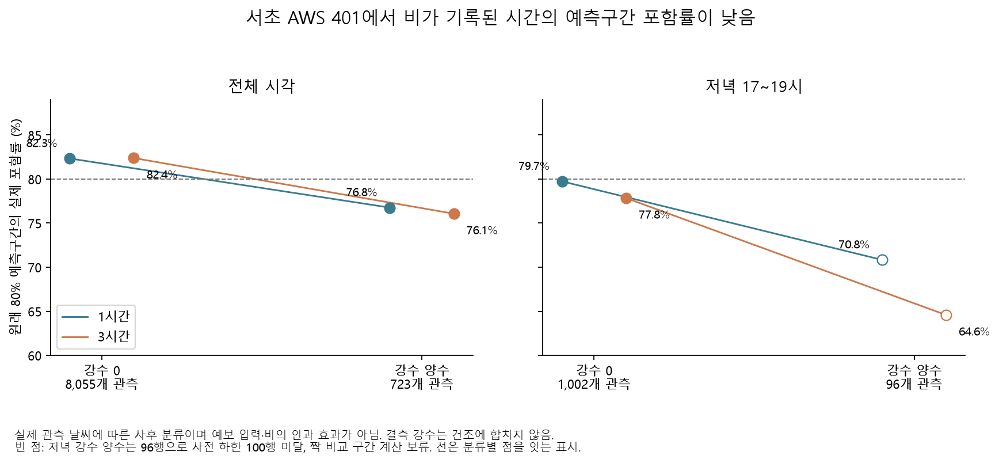

# 비가 기록된 시간에는 속도 예측이 얼마나 달라지는가

**서초 AWS 401에서 비가 기록된 시간은 원래 속도 예측구간의 포함률이 낮았다.** 전체 시각의 80% 구간 포함률은 건조 약 82.3%에 비해 강수 양수 약 76.1~76.8%였다. 실제 관측 날씨에 따른 사후 분류이므로 비의 인과 효과나 날씨를 입력한 새 모델의 성능이 아니다.

## 고정 모델·표본과 분류

[규칙](overnight_weather_performance_config.yaml)을 결과 전에 저장하고 원래 핵심 3개 링크·2025년 5~8월의 8,820개 실제값을 유지했다. 이미 고정한 CatBoost 분위수 모델과 3월 폭 보정을 거친 주간 경험분포 기준을 같은 관측에서 비교했다. 기상은 추가 수집한 401·400·108 지점의 같은 시간 표기(offset 0)를 연결했다. 시간대는 `Asia/Seoul`로 확인했지만 두 원본의 시간 구간 끝/시작 정의까지 입증한 것은 아니다.

강수 0과 양수를 나누고 결측은 별도 보존했다. 온도는 30℃ 미만·이상·결측으로 나눴다. 비교 범위 계산은 최소 100행·8개 달력 주 조건을 적용했다. 72개 집단 중 44개가 조건을 통과했고 144개 성능행과 396개 짝 지표를 저장했다. 여러 지점은 같은 도로 표본의 기상 대안이지 독립 실험이 아니다.

| 주 지점 401 | 관측 수 | 1시간 포함률 / 중앙값 MAE | 3시간 포함률 / 중앙값 MAE |
|---|---:|---:|---:|
| 전체·강수 0 | 8,055 | 82.33% / 1.290km/h | 82.38% / 1.329km/h |
| 전체·강수 양수 | 723 | **76.76% / 1.415km/h** | **76.07% / 1.500km/h** |
| 저녁·강수 0 | 1,002 | 79.74% / 1.613km/h | 77.84% / 1.699km/h |
| 저녁·강수 양수 | 96 | 70.83% / 1.888km/h | 64.58% / 2.120km/h |

전체 강수 미확인 42행·저녁 9행을 건조 집단에 합치지 않았다. 강수 양수 723행은 세 링크가 공유하는 241개 시간이다. 저녁 96행은 32개 시간이며 **100행 조건을 통과하지 못해 해당 짝 비교 범위는 보류**한다. 표의 점 추정치를 충분한 근거가 있는 비교로 읽지 않는다.

400·108 지점으로 나누어도 전체 강수 양수의 포함률은 1시간 77.35·78.35%, 3시간 76.07·76.41%로 낮았다. 108 지점 저녁 강수 표본 114행은 조건을 통과하지만 주 지점의 부족을 이유로 그 결과로 교체하지 않았다. 30℃ 이상에서 포함률이 모든 시간대에 낮아지는 일관된 패턴은 없었다. 계절·시간대·속도 분포가 섞여 있어 강수/기온 자체의 영향을 식별하지 않는다.

## 단순 기준과 비교하면

포함률 저하가 있어도 CatBoost의 구간 점수는 주간 경험분포 기준보다 낮았다(낮을수록 좋음). 401 지점 전체 강수 양수에서 점수 차이는 1시간 −1.538 [−2.321, −0.918], 3시간 −1.129 [−1.953, −0.566]이었다. 같은 주를 공유하는 짝 재표집 범위다. 따라서 현재 모델의 상대적 장점과 비가 기록된 시각의 절대 포함률 부족은 동시에 존재한다.

## 다음에 수집할 것은 과거에 발표된 예보

예측 개선을 시험하려면 **예측 원점 전에 발표·공개된 예보**가 필요하다. 미래 실제 강수·기온을 입력하면 현재 실험의 정보 제약을 위반한다. [기상자료개방포털 단기예보](https://data.kma.go.kr/data/rmt/rmtList.do?code=420&pgmNo=572)는 2010년 6월부터 조회 전일까지의 자료와 UTC 조회 기준을 명시한다. [기상청 API허브](https://apihub.kma.go.kr/apiList.do?seqApi=10&seqApiSub=286)는 발표 시각 `tmfc`·발효 시각 `tmef`를 KST로 구별하고 인증키를 요구한다. 예보 파일 확보, 해당 격자, 실제 공개 지연, 변수·코드 변경을 확인한 후에만 새 특징으로 연결할 수 있다. 현재 평가에는 예보를 넣지 않았다.

돌발사건 정답도 별도 과제다. [서울시 OA-13315](https://data.seoul.go.kr/dataList/OA-13315/A/1/datasetView.do)는 시간 범위를 실시간으로 표시하고 내려받을 파일이 없다. 현재 목록의 존재만으로 2023~2025년 발생·해제 이력을 확보했다고 하지 않는다. 예보와 사건 이력의 접근 확인 범위는 후속 수집 기록으로 남긴다.

사례 환경에서 `python overnight.py weather-performance`, `followup-plots`를 실행한다. [성능](results/overnight/weather_performance/metrics.csv), [집단 표본](results/overnight/weather_performance/support.csv), [월별 구성](results/overnight/weather_performance/stratum_months.csv), [짝 비교](results/overnight/weather_performance/paired_comparisons.csv), [감사 명세](results/overnight/weather_performance/audit.json)를 제공한다. 2026년 잠금 결과는 사용하지 않았다.
