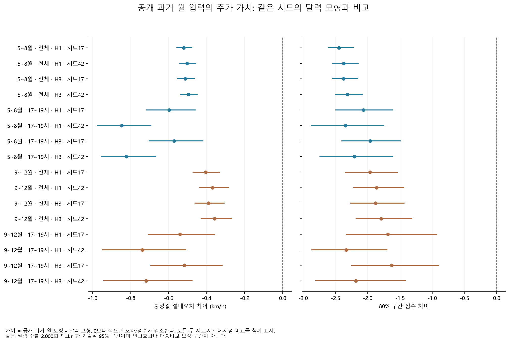

# 분석 결과

## 출발점: 정책 전후의 변화는 모두 같은 변화일까

2024년 6월 29일 버스 운행 조정은 혼잡한 강남대로에서 운행을 분산하려는 조치였다. 처음에는 일반도로 속도의 전후 차이를 정책 효과로 추정하려 했다. 그러나 비교 도로의 비노출, 측정 일관성, 충분한 비교 집단을 확인하지 못했다. 이후 질문을 **같은 노선의 방향별 기록이 어떻게 달라졌는가**, **월별 공개자료로 어느 수준의 예측이 가능한가**로 좁혔다.

전체 설명과 보조 관찰은 [독립 HTML](project-overview.html), 정확한 실행 조건은 [analysis-plan.yaml](analysis-plan.yaml)에 있다. 아래는 이번 제출에서 직접 재계산할 수 있는 두 분석이다.

## 1. 버스 기록의 방향 차이

서울 열린데이터광장의 정류장 구간별 운행시간 ZIP 32개월(2023년 1월–2025년 8월)을 썼다. 남행은 지하철2호선강남역→신분당선강남역(ARS 22011→22009), 북행은 래미안아파트·파이낸셜뉴스→신분당선강남역(22008→22010)이다. 두 구간은 서로 정확히 반대편인 한 물리 구간은 아니다.

한 노선·날짜에서 **양방향 07–22시의 32개 값이 모두 양수**여야 공동 관측으로 인정했다. 사전 기간의 공동 관측률을 통과한 14개 노선을 고정하고, 각 노선·방향·시간의 2024년 사전 평균을 100으로 기준화했다. 보고 시간은 17·18·19시이며 노선별 평균을 동일 가중했다. 사후 누락은 0으로 채우지 않고 고정 분모 80% 관측률 미달 날짜의 지수를 결측 처리했다.

542번은 [과천시 공식 폐선 공지](https://www.gccity.go.kr/portal/newsList/view.do?idx=733&mId=0301140000)의 2024년 8월 24일 이력에 따라 제외했다. 변화 크기를 보고 고른 제외가 아니다. 원래 14개, 13개를 원래 통과 날짜로 제한한 조건, 13개에 원래 관측률 기준을 적용한 조건을 모두 비교했다.

| 고정 13개·원래 관측률 기준 | 남행 기록 변화 | 북행 기록 변화 |
|---|---:|---:|
| 2024년 여름, 같은 해 사전 대비 | −49.71% | +41.03% |
| 2025년 여름, 같은 해 사전 대비 | −46.02% | +40.95% |

폐선으로 인한 구성 변화만으로 방향 차이가 없어지지는 않았다. 다만 이 값은 **운행시간 기록의 상대 변화**다. 물리 단위가 확인되지 않아 몇 초·몇 분 단축으로 바꿀 수 없으며, 정책의 인과 효과로도 해석하지 않는다. 30개 조건의 관측률·유효 일수·주 단위 부트스트랩 범위는 [전체 버스 비교표](results/deepening/cohort/comparisons.csv)에 있다.

## 2. 늦게 공개되는 자료로 예측하기

TOPIS 도로별 일자별 통행속도 XLSX 36개월(2023–2025년)을 사용했다. 강남대로·사평대로·테헤란로·봉은사로·서초대로에서 학습기 관측률 95% 이상이며 속성이 안정적인 62개 링크를 고정했다. 주요 평가는 강남대로 3개 링크에서 했다. 0·음수·공란·`NULL`은 결측으로 처리했고, 속성이 변경되거나 없어진 링크의 월 전체를 마스킹했다.

**자료 공개 시각을 특징 생성에 적용했다.** 발행 시각 이전에 공개된 월만 사용하며, 공개 가능 시각은 현재 게시·수정일과 다음 달 11일 중 늦은 시점으로 잡았다. 당시 자료 버전까지 증명하는 시각은 아니다. 과거 한 시간 전 속도를 즉시 알 수 있다고 가정한 실험은 최종 실행 범위에서 제외했다.

| 항목 | 방법 |
|---|---|
| 학습 | 2023-01–2024-12, 링크별 최대 4,000행을 목표값과 무관하게 균일 표집 |
| 조정 | 2025-01–02, 주요 3개 링크, 조기 종료에만 사용 |
| 평가 | 여름 2025-05-11–08-31, 가을 2025-09-01–12-31 |
| 모형 | CPU CatBoost, 깊이 6, 최대 1,000회, 학습률 0.05, 조기 종료 100회 |
| 출력 | 10·50·90% 분위수. 교차 비율을 기록하고 분위수를 정렬 |
| 입력 비교 | 달력만 / 달력 + 공개된 과거 월의 지연값·1개월 및 3개월 요일·시간 프로필 |
| 반복 | 예측 간격 1·3시간 × 특징군 2개 × 시드 17·42 = 8회 |
| 기준선 | 공개된 3개월 경험 분위수. 표본이 적으면 학습기 달력 경험 분위수로 대체 |

예측 대상 구간 시작은 발행 시각에서 `h−1`시간 뒤다. 따라서 h=1은 현재 시작하는 한 시간 구간, h=3은 두 시간 뒤 시작하여 세 시간 뒤 끝나는 구간이다. 결측 목표를 버려 시간 축을 당기지 않는다.

아래는 주요 3개 링크·전체 시간·시드 17·h=1의 요약이다. MAE와 폭의 단위는 km/h이며, 포함률은 실제 속도가 10–90% 구간 안에 든 비율이다.

| 기간 | 입력/기준선 | MAE ↓ | 포함률 | 평균 구간 폭 | 구간 점수 ↓ |
|---|---|---:|---:|---:|---:|
| 여름 | 달력 | 1.778 | 87.8% | 7.080 | 8.329 |
| 여름 | 공개된 과거 월 + 달력 | 1.257 | 84.8% | 4.538 | 5.884 |
| 여름 | 3개월 경험 프로필 | 1.373 | 68.0% | 3.625 | 7.189 |
| 가을 | 달력 | 1.907 | 85.4% | 7.105 | 8.895 |
| 가을 | 공개된 과거 월 + 달력 | 1.502 | 78.8% | 4.616 | 6.932 |
| 가을 | 3개월 경험 프로필 | 1.697 | 62.5% | 3.609 | 9.405 |

이 조건에서는 공개된 과거 자료를 더한 모형이 달력만 쓴 모형보다 오차·구간 점수가 작았다. 가을의 포함률 저하도 함께 보여야 한다. 모든 링크·월·시간 조건이 같은 개선을 보였다고 확대하지 않는다. [최종 예측 지표표](results/deepening/archive_forecast/metrics.csv)는 두 기간·두 간격·두 시드 및 기준선의 180행 전체를 포함한다. 달력 주를 함께 재표집한 240개 짝 비교는 실행 시 `runs/<ID>/paired_comparisons.csv`에 생성된다.

이미 살펴본 2025년 결과를 재비교한 사후 탐색이다. 이 분석으로 새로운 기간의 실시간 예측 성능이 입증됐다고 말하지 않는다.

## 결과 확인과 활용

기록의 방향 차이는 현장 점검 대상을 정하는 데, 폐선 처리와 고정 분모는 교통 데이터 품질 관리에, 공개 시계를 지킨 예측 비교는 월별 대시보드의 기준선을 정하는 데 활용할 수 있다. 활용 조건과 다음 수집 우선순위는 [discussion.md](discussion.md)에 정리했다.

기본 검토기는 공개 파일의 해시·HTML 표시 수치·핵심 비교표를 검사한다. [README](README.md)의 전체 실행 후 새 결과 경로를 전달하면 실제 재계산과 저장 결과를 대조한다. 전체 수치 229개 중 62개는 최종 비교표와 직접 대조하고, 167개 보조 수치는 역사적 스냅샷으로 보존한다.
