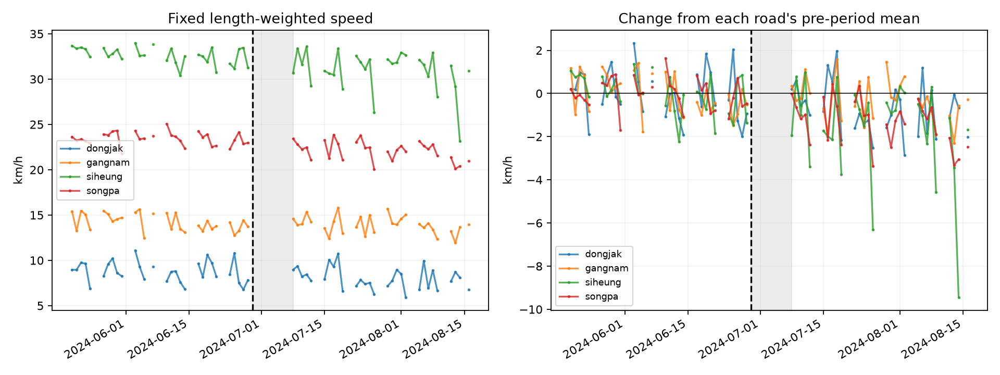
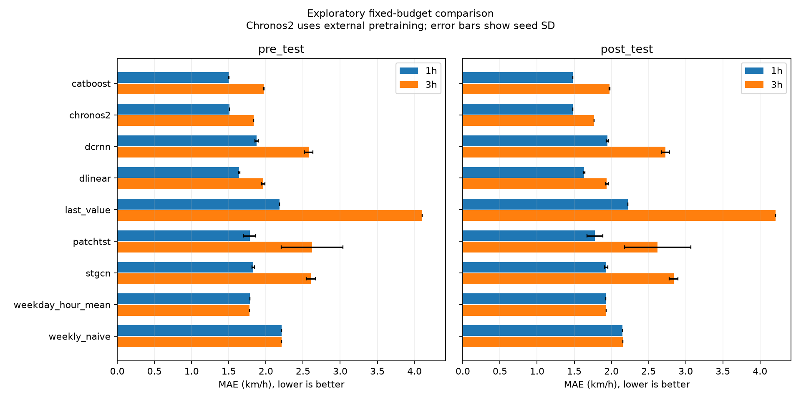

# 강남대로 버스 정책 전후 비교와 단기 예측 결과

2026-10-28 실자료 실행 `exploration_20261028`. **탐색 분석이며 정책 인과효과는 판단 불가(`not_identified`)다.**

## 자료와 실행 조건

[TOPIS 월별 차량 통행속도](https://topis.seoul.go.kr/refRoom/openRefRoom_1.do)의 2023-01~2024-08, 20개월을 수집했다. 네 도로의 94개 링크 중 시종점 변경 4개를 제외했고, train 관측률 기준을 통과한 90개를 사용했다. 1,315,440개 시간별 관측의 유효율은 99.9298%다. 빈칸 2개, 문자열 결측 표기 921개, 0값 0개, 음수 0개를 기록했다. 2024-08-02~03 누락 때문에 post_test 평가 창이 줄었으며, 모든 모델에 같은 창을 적용했다.

공휴일은 공식 역서와 대조했다. 시간 열을 종료시각으로, 단위를 km/h로 해석하는 가정은 공식 월별 정의 확인과 구분한다. 차선 수 변경을 허용했고 측정 환경의 불변성을 입증하지 않았다. 90개 노드·82개 방향 연결은 시종점명으로 만든 그래프이며, 역사적 지도나 실제 회전 가능성의 검증 결과가 아니다.

## 정책 전후 비교

정책일은 [서울시 안내](https://mediahub.seoul.go.kr/archives/2011484)에 따른 2024-06-29, 전 기간은 05-20~06-28, 후 기간은 07-08~08-16이다. 평일·비공휴일 17~20시의 고정 길이가중 속도지수를 비교했다. 모든 도로에서 동일한 전 29일·후 29일을 확보했다. 단위는 km/h다.

| 도로 | 전 평균 | 후 평균 | 단순 변화 |
| --- | --- | --- | --- |
| dongjak | 8.766 | 8.010 | -0.755 |
| gangnam | 14.236 | 13.925 | -0.311 |
| siheung | 32.623 | 30.965 | -1.658 |
| songpa | 23.439 | 22.109 | -1.330 |

강남대로 자체 속도의 변화는 -0.311 km/h다. 비교 도로 평균의 하락 폭이 더 커서 이중차분은 **+0.937 km/h**다. 이를 '강남대로 속도가 0.94 km/h 빨라졌다'로 읽으면 안 된다. 통상적인 버스 통행시간·승객 시간 절감도 측정하지 않았다.

점선은 정책일, 회색 구간은 주 분석에서 제외한 전환 기간이다. 오른쪽은 각 도로의 전 기간 평균을 뺀 값이며 인과효과 추정 곡선이 아니다.

| 민감도 | 상대 변화(km/h) |
| --- | --- |
| exclude_announcement | +0.760 |
| include_first_week | +0.871 |
| hour_shift_-1 | +0.634 |
| hour_shift_+1 | +1.195 |
| extend_yangjae | +0.505 |
| dry_days | 미실행: verified_weather_missing |
| zero_as_valid | +0.937 |

가짜 정책일 2024-06-10의 상대 변화는 -0.272 km/h다. 비교 도로 한 곳씩 제외한 값은 +0.732~+1.183 km/h다. 시간 창과 양재역 연장에 따라 크기가 달라진다. 한 처치 도로와 세 후보 비교 도로만으로 동시 정책·장마·우회 노출을 배제할 수 없으므로 유의확률이나 인과 신뢰구간을 제시하지 않는다.

## 예측 비교

train은 2023-01~2024-03, validation은 2024-04다. 평가 시각마다 그때까지 관측된 최신 168시간으로 다음 1·3시간을 예측하며 모델 가중치는 다시 학습하지 않는다. 정답은 보간하지 않는다. 과거 입력은 최대 3시간 전방 채움 후 train의 요일·시간 평균을 사용하고, 평균·표준편차·링크 선택·CatBoost 표본은 train만으로 정한다. 5개 학습 모델은 검증 구간으로 설정을 고른 뒤 seed 17·42·2026으로 학습했다. 단순 기준선과 Chronos2는 한 번 평가했다.

정책 전 시험은 05-01~06-16(101,340창), 전환기는 06-17~06-30(30,060창), 정책 후 시험은 07-01~08-31(118,239창)이다. 정책 후 시험 기간은 정책 비교의 후 기간과 다르다. 아래 MAE는 작을수록 좋고, 학습 모델은 3개 seed 평균이다.

| 모델 | 전 1h | 전 3h | 후 1h | 후 3h |
| --- | --- | --- | --- | --- |
| last_value | 2.183 | 4.102 | 2.220 | 4.206 |
| weekday_hour_mean | 1.782 | 1.781 | 1.926 | 1.929 |
| weekly_naive | 2.210 | 2.209 | 2.149 | 2.153 |
| catboost | 1.501 | 1.969 | 1.482 | 1.974 |
| dlinear | 1.641 | 1.962 | 1.630 | 1.937 |
| patchtst | 1.782 | 2.622 | 1.778 | 2.621 |
| chronos2 † | 1.507 | 1.836 | 1.483 | 1.764 |
| dcrnn | 1.875 | 2.576 | 1.946 | 2.728 |
| stgcn | 1.830 | 2.602 | 1.930 | 2.839 |

† Chronos2는 고정 revision의 외부 사전학습 모델이다. 학습 자료와 2024년 평가 기간의 중첩 여부를 확인하지 못했으므로 같은 데이터로 처음부터 학습한 모델과 구분한다.

### 강남대로 핵심 세 링크의 1시간 MAE

| 모델 | 정책 전 | 전환기 | 정책 후 |
| --- | --- | --- | --- |
| last_value | 2.180 | 2.283 | 2.141 |
| weekday_hour_mean | 1.713 | 1.521 | 1.810 |
| weekly_naive | 2.222 | 1.381 | 1.796 |
| catboost | 1.433 | 1.265 | 1.322 |
| dlinear | 1.672 | 1.483 | 1.532 |
| patchtst | 1.869 | 1.738 | 1.759 |
| chronos2 | 1.469 | 1.358 | 1.373 |
| dcrnn | 1.922 | 1.915 | 1.886 |
| stgcn | 1.838 | 1.854 | 1.869 |

평균에 가려지는 seed 변동, 3시간·저녁 구간·RMSE는 [전체 집계표](results/forecast_metrics.csv)에 있다. 이 예측 성능은 정책의 반사실 효과를 추정한 값이 아니다.

## 계산 예산과 재현

단기 탐색 예산은 DLinear·PatchTST·STGCN 최대 1,000 step, DCRNN 300 step, CatBoost train 최대 20만 창·800회다. 검증 구간에서 가장 나은 체크포인트를 저장했다. 수렴 완료나 같은 계산량으로의 우열을 주장하지 않는다. 그래프 모델은 교육용 구현이며 원 논문의 성능 재현이 아니다.

| 모델 | seed 수 | 총 학습 초 | 최대 할당 VRAM GiB | 선택 설정 |
| --- | --- | --- | --- | --- |
| catboost | 3 | 206.1 | 0.00 | {'depth': 8, 'learning_rate': 0.05, 'iterations': 800, 'early_stopping_rounds': 80} |
| chronos2 | 1 | 0.0 | 0.00 | {'model_id': 'amazon/chronos-2', 'revision': '29ec3766d36d6f73f0696f85560a422f50e8498c', 'quantile': 0.5, 'group': 'external_pretraining'} |
| dcrnn | 3 | 1013.2 | 2.48 | {'hidden_size': 64, 'recurrent_layers': 2, 'diffusion_steps': 2} |
| dlinear | 3 | 15.4 | 0.06 | {'moving_avg_window': 49} |
| last_value | 1 | 0.0 | 0.00 | {} |
| patchtst | 3 | 46.4 | 0.11 | {'hidden_size': 64, 'encoder_layers': 2, 'n_heads': 4, 'patch_len': 12, 'stride': 6} |
| stgcn | 3 | 170.6 | 1.48 | {'hidden_size': 64, 'blocks': 2, 'temporal_kernel': 3} |
| weekday_hour_mean | 1 | 0.0 | 0.00 | {} |
| weekly_naive | 1 | 0.0 | 0.00 | {} |

학습 시간은 학습 루프·검증 기록으로, 자료 정규화와 라이브러리 초기화 시간은 제외한다. 후보 탐색과 추가 seed를 포함하되 seed 17의 선택 모델 복사를 중복 계산하지 않았다. 같은 GPU에서 신경망을 순서대로 실행했고 CPU CatBoost와 일부 시간은 겹쳤다. Chronos2의 0초는 로컬 재학습을 하지 않았다는 뜻이다. 모델 적재를 포함한 추론 시간·메모리는 [추론 자원 기록](results/prediction_resources.json)에 따로 있다. GPU 부동소수점 실행의 비트 단위 일치는 보장하지 않는다.

[README](README.md)의 수집→감사→정책 비교→학습→평가→집계 명령으로 재현한다. 개인 `estimate.py`를 사용하므로 공통 `make flow` 결과와 혼동하지 않는다. 설정·원본·환경·모델 가중치 해시는 [재현 기록](results/reproduction.json), 결측과 분할은 [품질 기록](results/data_quality.json), 선택 과정은 [학습 기록](results/training_summary.json)에 남겼다. 원본·가공 행·개별 예측·가중치는 Git에 포함하지 않는다.

자료 정의·사용 조건·정책 노출의 미확인 항목과 해석은 [discussion.md](discussion.md)를 함께 읽는다.
