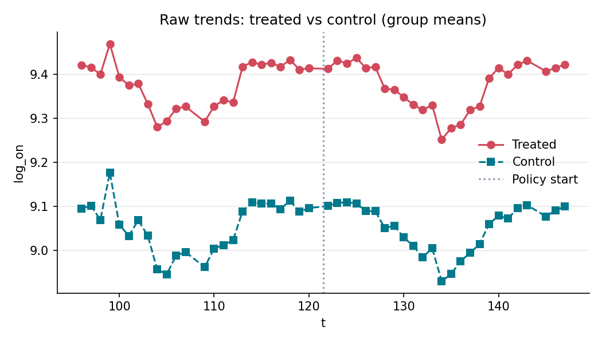
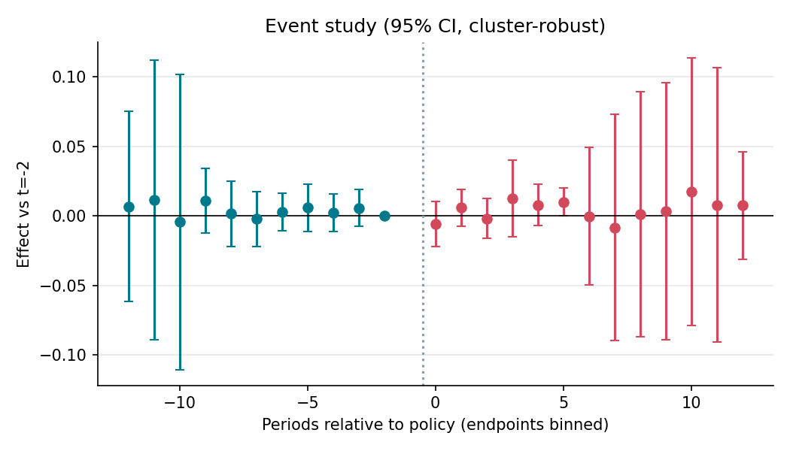

# 기후동행카드 성남 편입(2025.5.3)이 성남 분당선·경강선 역 평일 승차에 미친 효과

**분석 질문**: 2025년 5월 3일 기후동행카드가 성남 수인분당선·경강선 구간에 적용된 뒤, 같은 분당선·경부선의 아직 적용되지 않은 용인·수원 역과 비교해 성남 역의 평일 하루 평균 승차가 달라졌는가?

**종합 판정**: ⛔ 식별 불가

**요약(식별 불가)**: 다음 사유로 이 설계에서는 정책 효과를 추정치로 보고하지 않습니다: 사전추세 차이(평행추세 가정 기각), 신뢰구간이 0을 포함. 표의 수치(+0.00 log 명/일)는 진단용이며 정책 효과로 해석하면 안 됩니다.

## 1. 설계

- 분석 단위: 역(노선|역명) (`sid`), 기간 96–147 (week)
- 처치: 성남 수인분당선 야탑~가천대 10역 · 경강선 판교·이매 (2025-05-03 토요일 적용). 적용일이 걸친 주(t=121, 2025-04-28 주)는 빼고 다음 주(t=122)를 첫 처치 주로 둔다. 성남 8호선 구간은 시범운영(2024-01-27)부터 적용이라 처치·대조 모두에서 뺀다.

- 통제: 같은 분당선 용인(죽전~청명)·수원(영통~수원) 구간과 경부선 수원 구간 역 — 분석 기간(~2025-10) 동안 미적용 — 같은 노선·같은 통근 축(분당선 → 강남·선릉)이라 노선 운행 변화와 수도권 공통 충격(요금 인상, 계절)을 함께 받는다. 성남 역과 가장 가까운 '카드가 없었다면'의 대리다. 역 목록: catalog/lineage/data/climate-card-stations.csv

- 주 결과변수: 평일 하루 평균 승차(로그) — 역 × 주, 평일(공휴일 제외) 승차 인원의 하루 평균에 로그. 평일이 3일 미만인 주는 뺀다
- 추정 방법: `event_study` (cluster: `sid`)

## 2. 결과

| 방법 | 결과변수 | 추정치 | 95% CI | p | N | 클러스터 | 판정 |
|---|---|---:|---|---:|---:|---:|---|
| event_study | log_on | 0.004 | [-0.035, 0.044] | 0.829 | 1372 | 28 | ⛔ 식별 불가 |
| event_study | log_off | 0.008 | [-0.031, 0.047] | 0.677 | 1372 | 28 | ⛔ 식별 불가 |

## 3. 가정 점검 및 반박 검정

| 가정 | 점검 방법 | 결과 |
|---|---|---|
| 평행추세 | pretrend_test | joint Wald (chi2, CRV1) p=0.005 → 기각 |
| 선반영 없음 | placebo_time | 가짜 도입(114) 추정 -0.004, p=0.905 → 통과 |
| 동시 충격의 균형 | manual | 수동 검토 필요 |
| 이용자 효과가 아니라 역 효과(ITT) | manual | 수동 검토 필요 |

## 4. 경고 및 보류 조건

- 사전추세 검정 p=0.005 < 0.1: 평행추세 가정이 의심됩니다. 효과를 인과적으로 해석하지 마세요.
- 사전추세 검정 p=0.098 < 0.1: 평행추세 가정이 의심됩니다. 효과를 인과적으로 해석하지 마세요.
- 신뢰구간이 0을 포함합니다. '효과 없음'이 아니라 '효과 크기를 판별할 수 없음'으로 해석하세요.

## 5. 데이터 출처

| 이름 | 제공 | 라이선스 | URL |
|---|---|---|---|
| 서울시 지하철호선별 역별 승하차 인원 정보 (OA-12914, 역 × 일) | 서울특별시 (서울 열린데이터광장) | KOGL-1 | https://data.seoul.go.kr/dataList/OA-12914/S/1/datasetView.do |

---

# 해석과 한계

## 결과를 한 문장으로
**판단 불가(규칙상)** — 편입 뒤 평균 효과는 +0.4% [-3.5%, +4.5%]로 0과 구별되지 않고, 사전 계수도 모두 ±1.2% 안이지만, 구간이 매우 좁아 사전추세 결합 검정이 기각(p=0.005)되어 계획의 보류 규칙에 따라 효과로 보고하지 않습니다.

## 숫자를 어떻게 읽나
- 사전 계수(−12 ~ −3주)는 크기가 작습니다(±1.2% 안). 결합 검정이 기각된 것은 처치 전에 큰 추세 차이가 있어서라기보다 역 단위 평일 평균이 매우 안정적이라 표준오차가 작기 때문입니다. 그래도 계획에 적은 규칙이 우선입니다.
- 같은 자료로 이중차분(DiD) 평균만 보면 +0.1% [-1.2%, +1.3%]입니다(`scripts/explore_climate_card.py`). 둘을 합쳐 보면 **역 승차가 1~2%보다 크게 늘지는 않았다**는 정도가 이 자료로 말할 수 있는 최대치입니다.
- 가짜 시점(8주 앞당김) 추정은 −0.4%, p=0.91로 선반영 신호는 없습니다.
- 하차(log_off)도 +0.8% [-3.1%, +4.8%]로 같은 모양입니다.

## 조심할 점
- **결제 수단 대체**: 편입 전에도 성남 승객은 다른 카드로 탔습니다. 카드가 바꾼 것이 주로 결제 수단이면 역 승차 합계는 거의 움직이지 않습니다. 서울연구원 설문(카드 이용자 통행 +17.6%, 자기 보고)을 그대로 믿어도 역 효과 ≈ (역 승객 중 새 카드 이용자 비중) × 17.6% 이므로, 이 비중이 약 7% 이상이어야 1.3%를 넘습니다.
- **요금 인상(2025-06-28)**: 처치 7주 뒤입니다. 카드 가격은 동결이라 성남 카드 이용자는 인상 충격을 덜 받습니다 → 효과가 위로 치우칠 수 있습니다. 6월 중순 이후(상대 +6주~) 구간이 넓어지는 것도 이 시기와 겹칩니다.
- **ITT**: 공개 자료에 권종 구분이 없어 카드 이용자의 변화가 아니라 적용 역 전체의 변화입니다.
- **대조군 선택**: 같은 노선 용인·수원 16역. 경기 출퇴근 노선 74역 전체와 비교하면 DiD −1.2% [-2.6%, +0.3%]이고 사전추세가 더 크게 어긋납니다(탐색 분석 표 참고).

## 계획에서 바뀐 것
이 계획은 탐색 분석(`docs/strategy/climate-card.md` 6절)으로 결과를 먼저 본 뒤 작성했습니다 — 사전 등록이 아닙니다. 파이프라인으로 같은 설계를 재현하고 공개 API에 올리기 위한 멘토 예시입니다. 사전 등록 연습은 다음 가설(H8·H9·H10)로 합니다.
