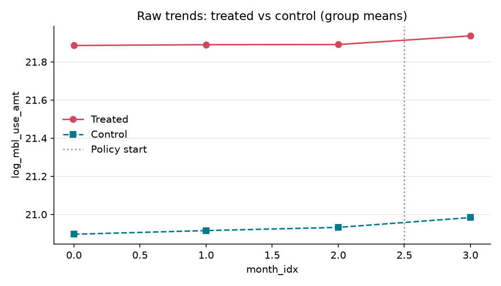

# 원주시 모바일 상품권 할인 상향 한 달(2024년 9월)의 결제 변화

**분석 질문**: 2024년 9월 2일 원주시 모바일 원주사랑상품권 구매 할인이 7%에서 10%로 상향된 달(9월), 6~9월 내내 할인율과 구매한도가 그대로였던 한국조폐공사 운영 시군과 비교해 원주의 월간 모바일 상품권 결제금액이 어떻게 달라졌는가?

**종합 판정**: ⚠️ 조건부

**요약(조건부)**: 추정치는 -0.02 log(1+원) (95% CI -0.15 ~ 0.16) 이지만 다음 위험 신호가 있어 조건부로만 보고합니다: 처치 단위 수 부족(무작위화 추론 사용), 클러스터 수 부족(표준오차 과소추정 위험), 신뢰구간이 0을 포함. 신뢰구간이 0을 포함하므로 효과의 방향과 크기는 판별 불가입니다. 결론 전에 보완 분석이 필요합니다.

## 1. 설계

- 분석 단위: 한국조폐공사 운영 시군(원주 + 규칙을 통과한 비교 7곳) (`region_code`), 기간 0–3 (month)
- 처치: 원주시 모바일 원주사랑상품권의 구매 할인이 7%에서 10%로 바뀐 달이다. 원주시공고 제2024-2250의 시행일은 2024-09-02 10:00이다. 판매정책정보 API에는 2024-09-03부터 10%/월 30만 원 기록이 보이고 2024-10-03부터 다시 7%로 돌아간다(월 구매한도는 30만 원 그대로). 2024년 9월 동행축제와 추석을 위한 한시 혜택이다. 원주의 month_idx 3(2024-09)에 treated 사후를 부여한다. 9월 1일은 혜택 전이고 시행일 오전 10시 전 기록도 섞이지만 월 자료라 분리할 수 없다. 이것이 월 단위 설계의 근본 한계다. 2024년 1~5월 원주는 할인율이 6%, 8%, 10%, 8%로 달마다 바뀌어서 안정적인 변경 전 기간은 6~8월 3개월뿐이다. 근거: https://www.wonju.go.kr/www/selectBbsNttView.do?bbsNo=140&key=216&nttNo=444171

- 통제: fetch.py가 한국조폐공사 운영 81개 지역 중 세 규칙을 모두 통과한 곳만 쓴다. R1 2024-06-01~09-30에 할인율·월 구매한도가 한 가지뿐이다. R2 2024-01~10 모든 달에 모바일 결제금액이 있고 매달 1억 원 이상이다. R3 2024-01~10 인접한 달 사이 로그 변화가 0.5 이하다. 통과 지역은 시흥시·보령시·서천군·태안군·문경시·합천군·남원시 7곳이다. 탈락 지역과 이유는 data/selection.csv에 남는다. 규칙은 결과 값을 보지 않고 정책·자료 품질만 본다. 같은 제공기관(조폐공사) 집계라 자료 정의가 같다. 지역 규모는 원주의 0.5~2배로 맞추지 못했다. 7곳 중 인구가 원주와 비슷한 곳은 시흥(더 큼)뿐이고 나머지는 훨씬 작은 시·군이다.
 — 같은 시기에 정책이 바뀌지 않은 지역은 9월의 공통 변화(추석, 동행축제 홍보, 계절)를 보여 준다. 조폐공사 운영 81개 지역 중 R1 탈락 52곳의 40곳은 9월에 6~8월에 없던 할인율·구매한도를 도입했다(한시 혜택이 전국에서 겹쳤다). 그래서 정책이 안정적이었던 곳은 7곳뿐이다. 7곳은 규모와 지역 특성이 원주와 다르다는 한계를 안고 있다.

- 주 결과변수: 월간 모바일 상품권 결제금액의 로그 변환 — 결제정보 API의 mbl_use_amt(모바일 결제금액)를 지역·월별로 성별·연령대·읍면동 행을 합산한 뒤 log(1+금액)을 계산한다. 결측은 0으로 바꾸지 않는다. 원 단위 금액과 그래프도 함께 보고하며 전체 소상공인 매출로 해석하지 않는다.

- 추정 방법: `did` (cluster: `region_code`)

## 2. 결과

| 방법 | 결과변수 | 추정치 | 95% CI | p | N | 클러스터 | 판정 |
|---|---|---:|---|---:|---:|---:|---|
| did_twfe | log_mbl_use_amt | -0.022 | [-0.155, 0.156] | 0.726 | 32 | 8 | ⚠️ 조건부 |
| did_twfe | log_mbl_user_cnt | 0.019 | [-0.024, 0.077] | 0.726 | 32 | 8 | ⚠️ 조건부 |

## 3. 가정 점검 및 반박 검정

| 가정 | 점검 방법 | 결과 |
|---|---|---|
| 월별 자료의 범위와 정의 | manual | 수동 검토 필요 |
| 시점 번호와 한시 정책 범위 | manual | 수동 검토 필요 |
| 변경 전의 비슷한 움직임 | manual | 수동 검토 필요 |
| 명절과 함께 바뀐 조건 | manual | 수동 검토 필요 |
| 구매 시점과 사용 시점 | manual | 수동 검토 필요 |
| 비교 지역의 대표성 | manual | 수동 검토 필요 |
| 원주 한 곳을 비교하는 한계 | manual | 수동 검토 필요 |

## 4. 경고 및 보류 조건

- 신뢰구간이 0을 포함합니다. '효과 없음'이 아니라 '효과 크기를 판별할 수 없음'으로 해석하세요.
- 처치 단위가 1개뿐이라 군집-강건 표준오차를 믿을 수 없습니다. 무작위화 추론으로 p값과 신뢰구간을 계산했습니다.
- 클러스터 수 8개 < 20: 군집-강건 표준오차가 과소추정될 수 있습니다. wild cluster bootstrap(pyfixest `wildboottest`) 또는 randomization inference 를 병행하세요.

## 5. 데이터 출처

| 이름 | 제공 | 라이선스 | URL |
|---|---|---|---|
| 한국조폐공사 지역사랑상품권 결제정보 | 한국조폐공사 / 공공데이터포털 | other | https://www.data.go.kr/data/15108292/openapi.do |
| 한국조폐공사 지역사랑상품권 지자체별 판매정책정보 | 한국조폐공사 / 공공데이터포털 | other | https://www.data.go.kr/data/15125217/openapi.do |
| 한국조폐공사 지역사랑상품권 사용처지역코드 참고문서 | 한국조폐공사 / 공공데이터포털 | other | https://www.data.go.kr/data/15108292/openapi.do |

---

# 해석과 한계

## 결과를 한 문장으로

**조건부 (효과의 방향과 크기를 판별할 수 없음).** 2024년 9월 원주의 월간 모바일 상품권 결제금액은 정책이 그대로였던 7개 시군과 거의 같이 움직였고(차이 약 -2%, 95% 신뢰구간 약 -14%~+17%), 같은 크기의 “차이”가 처치가 없던 달에도 나와요.

## 이 결론을 믿을 만한 이유와 아닌 이유

믿을 만한 점
- 어느 비교 지역을 빼도 추정이 -0.031~+0.001 안에 있어요. 한 도시에 휘둘리지 않아요.
- 시(市) 4곳만 비교해도 +1% 수준이에요.
- 원주가 7%로 돌아간 10월에도 격차는 0 근처였어요.

못 믿을 점
- **변경 후가 한 달뿐이에요.** 그 한 달에 추석과 동행축제가 겹쳤어요.
- **사전 기간이 3개월뿐이라** 평행 추세를 검정할 수 없어요. 1~5월은 원주 정책이 달마다 바뀌어서 쓸 수 없었어요.
- **비교 지역은 규칙을 통과한 7곳**이고 규모·지역 특성이 원주와 달라요. 인구 규모는 맞추지 못했어요.
- **처치 지역이 원주 한 곳**이에요. 도시를 바꿔치기한 계산에서 원주의 값은 8곳 중 6번째로 컸어요(p=0.75). 이 자료로는 어떤 도시를 처치로 놓아도 비슷한 크기의 “효과”가 나와요.
- **구매와 사용 시점이 달라요.** 9월에 싸게 산 상품권을 10월에 쓰면 9월 결제에 안 보여요.
- 정책 자료는 카드와 모바일이 합쳐진 기록이에요. 원주 모바일의 7%→10%는 공고로 따로 확인했어요.

## 조심할 점

- “효과 없음”이라고 쓰지 말아요. 신뢰구간이 0을 지나서 “판별할 수 없음”이에요.
- 소상공인 전체 매출이나 순소비 증가로 읽지 말아요. 상품권 결제는 다른 결제 수단에서 옮겨 온 것일 수 있어요.
- 비교 지역 7곳을 통과시킨 규칙은 정책과 자료 품질만 봤지만, 규칙을 정할 때 월별 합계를 이미 훑어본 상태였어요. 규칙 선택에 결과가 영향을 줬을 가능성을 완전히 배제할 수 없어요.
- 이용자 수는 사람 수가 아니라 성별·연령·읍면동 칸의 합이에요.

## 계획에서 바뀐 것

| 바뀐 것 | 이유 |
| --- | --- |
| 주 단위(변경 전 11주, 후 4주) → 월 단위(변경 전 3개월, 후 1개월) | 결제정보 API에 일·주 조회가 없고 월 합계만 있어요. 처음 계획에 “월별 자료만 있으면 주간 분석을 실행하지 않는다”는 중단 조건이 있었어요. |
| 비교 도시: 춘천·강릉·충주·제천 후보 → 조폐공사 운영 지역 중 규칙을 통과한 7곳 | 판매정책정보 API는 조폐공사 운영 지역만 담아서 다른 운영대행사 지역(춘천 등)의 할인 이력을 확인할 수 없어요. 확인할 수 없는 곳은 “정책이 안정적”이라는 조건을 검증할 수 없어요. |
| 인구 규모(원주의 0.5~2배) 기준 → 쓰지 않음 | 인구 원표를 확보하지 못했고, 규칙을 통과한 곳이 7곳뿐이어서 규모까지 맞추면 비교 지역이 1곳(시흥)만 남아요. |
| 보조 지표: 결제횟수 → 모바일 이용자 수 | 결제정보 API의 결제횟수(`stlm_nocs`)는 카드와 모바일이 합쳐져 있어 모바일만 따로 볼 수 없어요. |
| 안정적인 변경 전 기간: 6월~8월 | 원주의 2024년 1~5월 할인율이 달마다 바뀌었어요(6%, 8%, 10%, 8%). |

이 변경들은 자료를 열어 본 뒤에 이루어졌어요. 계획서를 먼저 확정하라는 사전 등록 원칙을 지키지 못한 부분이에요. 대신 처음 계획(`7e8c6b8`)을 지우지 않고 남겼고, 비교 지역 선정을 코드 규칙(`fetch.py`)으로 고정했고, 선정에서 탈락한 지역과 이유를 `data/selection.csv`로 재현할 수 있게 했어요.

## 다음에 필요한 것

1. **일별 결제자료.** 원주시나 한국조폐공사(지역화폐운영부)에 2024년 6~10월 일별 모바일 결제자료를 요청할 수 있어요. 받으면 처음 설계(시행일 오전 10시 기준, 일·주 비교)로 돌아가요.
2. **다른 운영대행사의 정책 이력.** 춘천·강릉 같은 곳을 비교에 넣으려면 해당 지역의 2024년 할인 이력이 필요해요.
3. **사전 기간이 긴 다른 사례.** 정책이 오래 안정적이었던 시기에 한 번 바뀐 사례라면 같은 틀로 더 믿을 만한 결과를 낼 수 있어요.
4. 멘토에게 묻기: 월 단위 한 달짜리 처치에서 공용 도구의 “조건부” 판정을 어떻게 다루면 좋을까요?
