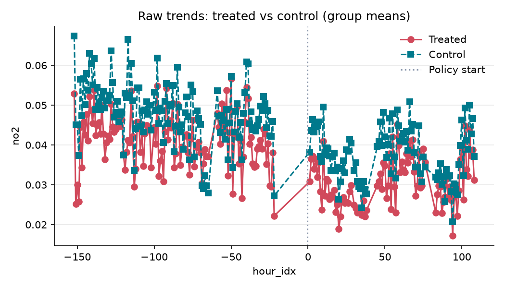
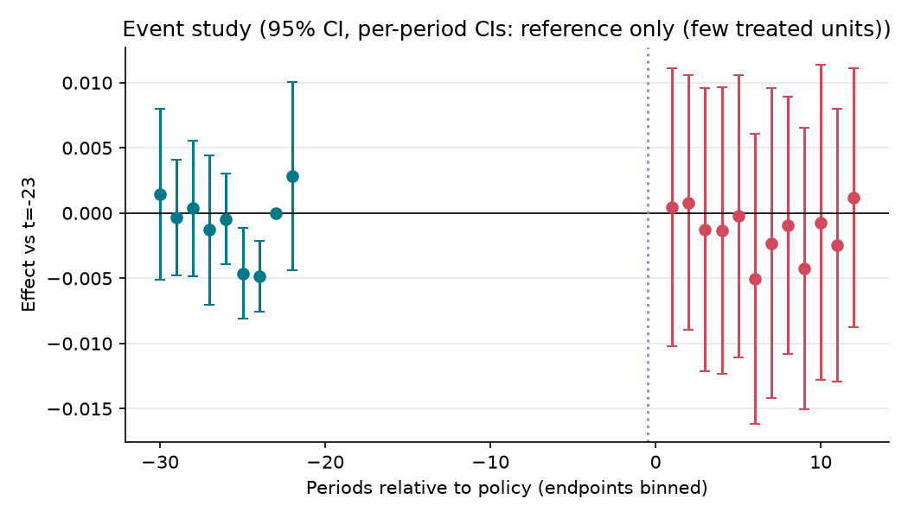

# 녹색교통지역 5등급 운행제한이 서울 도심 대기질에 미친 효과

**분석 질문**: 녹색교통지역 5등급 차량 운행제한 과태료 부과(2019-12-01) 이후, 11곳 모두 NO₂를 관측한 운행제한 시간(06~21시)에 종로·청계천로의 NO₂ 농도는 구역 밖 서울 도로변 측정소와 비교해 시행 전후 주별로 어떻게 달라졌는가?

**종합 판정**: ⚠️ 크기를 판별하지 못함

**요약(크기를 판별하지 못함)**: 추정치는 -0.00 ppm (95% CI -0.02 ~ 0.03) 이지만 다음 위험 신호가 있어 단정하지 않고 범위로만 보고합니다: 처치 단위 수 부족(무작위화 추론 사용), 클러스터 수 부족(표준오차 과소추정 위험), 신뢰구간이 0을 포함. 신뢰구간이 0을 포함하므로 효과의 방향과 크기는 판별 불가입니다. 결론 전에 보완 분석이 필요합니다.

## 1. 설계

- 분석 단위: 도로변 대기질 측정소 (`station_id`), 기간 0–43823 (hour)
- 처치: 녹색교통지역 안 종로(111125, 서울 종로구 종로 169)와 청계천로(111124, 서울 중구 청계천로 184)에 전 기간 treated=1을 부여한다. 2019-07-01 시범 운영, 2019-12-01 과태료 부과 시작. 운행제한은 매일 06~21시다. 저감장치 미개발·장착 불가 확인 차량은 2020-12-31까지 단속 유예. 시범 운영 이전과 과태료 부과 이후를 비교한다. 근거: https://news.seoul.go.kr/traffic/greentraffic 과태료 부과 시작 근거: https://news.seoul.go.kr/traffic/archives/502555

- 통제: 녹색교통지역 밖 서울 도로변 측정소 9곳에 전 기간 treated=0을 부여한다. 핵심 비교군 4곳: 신촌로(111202), 홍릉로(111154), 영등포로(111232), 도산대로(111263). 추가 비교군 5곳: 천호대로(111275), 화랑로(111312), 강남대로(111264), 동작대로 중앙차로(111242), 공항대로(111213). 본분석은 9곳, 민감도 분석은 핵심 4곳만 사용한다. 한강대로(111122)·정릉로(111162)는 접근로·우회 교통 영향 우려, 강변북로(111143)는 자동차전용도로의 배출 특성과 우회 가능성 때문에 본분석에서 제외한다. 이 3곳의 처치 이후 변화는 우회·확산 가능성을 살피는 별도 결과로 보고한다. 시흥대로(111282)는 2018년 신설로 분석창 앞부분의 관측이 없어 제외한다. 경계 거리·관측 및 이전 이력·항목별 자료 길이와 결측률은 커밋 후 적합성 점검으로 보고한다. 경계 거리나 사전추세 결과에 따라 대조군을 자동 교체·추가하지 않는다. 자료·가정 점검에서 문제가 발견되면 해석을 보류하고, 설계 변경은 이유를 기록해 별도 커밋한다.
 — 같은 서울의 도로변 측정망에서 공통 기상·계절·대기질 변화를 비교한다. 핵심 4곳은 도심형 상업·업무지구와의 유사성을 점검할 비교 후보로 두고, 추가 5곳의 외곽 간선·중앙차로·개발지역 등 측정환경 차이 가능성은 4곳만 쓰는 민감도 분석으로 점검한다. 이 분류는 설치 이력·경계 거리·도로 특성·개발 이력을 모두 검증한 결과가 아니며, 대조군에 정책 영향이 없음을 확정한 구분도 아니다. 각 근거는 추가로 확인한다. 9곳 선정은 자료 길이·도로 및 토지이용·정책 영향 가능성을 기준으로 하며, 순열추론의 조합 수나 최소 p값만으로 대조군 수를 정하지 않는다.

- 주 결과변수: 시간별 이산화질소 농도 — 에어코리아 최종확정 시간별 NO₂ 농도.
- 추정 방법: `event_study` (cluster: `station_id`)

## 2. 결과

| 방법 | 결과변수 | 추정치 | 95% CI | p | N | 클러스터 | 판정 |
|---|---|---:|---|---:|---:|---:|---|
| event_study | no2 | -0.001 | [-0.024, 0.029] | 0.892 | 203423 | 11 | ⚠️ 크기를 판별하지 못함 |

### 그래도 말할 수 있는 것

- 시간별 이산화질소 농도: +0.0287 ppm보다 큰 증가나 -0.024 ppm보다 큰 감소는 이 자료와 맞지 않습니다(설계 가정이 맞다는 전제).

> 배제 범위: 효과가 있었는지는 판별하지 못했지만, 95% 범위 밖의 큰 효과는 이 자료와 맞지 않습니다. '효과가 없다'는 뜻이 아닙니다. 판단 불가 결과에는 쓰지 않습니다.

## 3. 가정 점검 및 반박 검정

| 가정 | 점검 방법 | 결과 |
|---|---|---|
| 측정소 유형과 정책 경계의 일치 | manual | 수동 검토 필요 |
| 관측기간과 자료 품질 | manual | 수동 검토 필요 |
| 공통 관측시간의 선택 | manual | 수동 검토 필요 |
| 평행추세 | pretrend_test | randomization inference (사전 계수 제곱합) p=0.784 → 통과 |
| 시범 운영 이전의 선반영 | manual | 수동 검토 필요 |
| 기상과 동시 정책의 지역별 영향 | manual | 수동 검토 필요 |
| 코로나와 정책 강도 변화 | manual | 수동 검토 필요 |
| 대조군 오염과 적은 처치 측정소 | manual | 수동 검토 필요 |
| 적용 외 시간대 반증의 타당성 | manual | 수동 검토 필요 |

## 4. 경고 및 보류 조건

- 신뢰구간이 0을 포함합니다. '효과 없음'이 아니라 '효과 크기를 판별할 수 없음'으로 해석하세요.
- 처치 단위가 2개뿐이라 군집-강건 표준오차를 믿을 수 없습니다. 무작위화 추론(처치 단위를 무작위로 바꿔 반복)으로 p값과 신뢰구간을 계산했습니다.
- 클러스터 수 11개 < 20: 군집-강건 표준오차가 과소추정될 수 있습니다. wild cluster bootstrap(pyfixest `wildboottest`) 또는 randomization inference 를 병행하세요.

## 5. 데이터 출처

| 이름 | 제공 | 라이선스 | URL |
|---|---|---|---|
| 에어코리아 최종확정 측정자료 | 한국환경공단·국립환경과학원 | KOGL-3 | https://www.airkorea.or.kr/web/last_amb_hour_data?pMENU_NO=123 |

---

# 해석과 한계

## 결과를 한 문장으로

11곳 모두 NO₂를 관측한 운행제한 시간대(06~21시)의 주분석에서는, 종로·청계천로의 구역 밖 대비 NO₂ 변화의 방향과 크기를 명확히 판별하지 못했다.

## 조심할 점

다음은 시범 운영기(2019년 7~11월)를 제외한 2017~2021년 전체 정리표 `data/panel.csv`의 품질 점검 결과다. 공통 시간 선택 전의 주간·야간 24시간 자료를 기준으로 한다.

| 점검 항목 | 확인 결과 |
|---|---|
| 측정소 수 | 처치 2곳·대조 9곳, 총 11곳 |
| 행 수 | 441,672행 |
| 측정소×시간 중복 | 0행 |
| NO₂ 결측률 | 3.26% |
| PM2.5 결측률 | 33.46% — 공통 품질검사 기준 20% 초과 |

현재 표에서 2017년 PM2.5는 11곳 모두 전부 결측이고, 홍릉로는 2020년 PM2.5도 전부 결측이다. 원래 계획한 기간의 PM2.5 분석 가능성을 추가로 검토해야 한다.

원자료의 2017년 1·12월, 2018년 5월, 2020년 1월에서 종로·청계천로·홍릉로 각각 72행씩, 총 864행의 NO₂·PM2.5 값을 정리된 표와 대조했다. 확인한 표본에는 불일치가 없었고, 같은 빈칸이 원자료에도 있었다. 이 점검만으로 측정소별 결측 사유까지 확인한 것은 아니다.

무작위화 추론에 필요한 완전 관측·동일 관측시점 조건을 맞추기 위해, 11곳 모두 NO₂ 값이 있는 공통 시간 표 `data/panel.no2.csv`를 사용했다. 이 표는 335,874행이고, 실제 주분석에 사용된 06~21시 자료는 203,423행이다. 처치 단위 2곳·전체 측정소 11곳이라는 제약을 고려해, 보고한 p값과 평균 추정치의 신뢰구간은 군집-강건 표준오차 대신 가능한 36가지 가짜 배정을 모두 계산하는 무작위화 추론으로 구했다. 이 보완만으로 대조 측정소의 교환 가능성이나 설계 가정이 입증되지는 않는다.

추정치는 -0.0013 ppm(95% CI [-0.0240, +0.0287], p=0.892)이다. 감소·0·증가가 모두 신뢰구간에 포함되므로, 현재 자료와 설계로는 변화의 방향과 크기를 명확히 구분하지 못했다. 이 값은 계획에서 정한 사후 주별 계수의 단순평균이며, 12주 이후의 긴 구간도 하나의 계수로 계산된다.

사전계수 검정(p=0.784), 가짜 시행일 검정(p=0.919), 비적용 시간대 검정(p=1.000)에서 사전 지정한 기준(0.10)보다 작은 p값은 나오지 않았다. 자동 표의 '통과'는 해당 검정에서 유의한 신호를 발견하지 못했다는 뜻이다. 평행추세가 성립한다거나 야간 영향·동시 정책의 교란이 없다는 사실을 증명하지 않는다. 수동 점검과 비교 가능성 확인이 남아 있어, 수치를 운행제한만의 인과 효과로 단정하지 않는다.

그림 `raw_trends.png`의 가로축은 `hour_idx`라고 표시되지만 실제 값은 정책 시행 기준 상대 주수다. 시범 운영기로 제외한 기간을 잇는 직선은 관측값 사이의 연결선이다. `event_study.png`의 개별 주 신뢰구간은 적은 처치 단위에서 참고용인 군집-강건 구간이며, 위에 보고한 평균 추정치의 무작위화 추론 구간과 구분한다. 자동 요약의 `-0.00 ppm`은 표시 자릿수에 따른 반올림이고, 실제 추정값은 위의 수치를 따른다.

### 아직 수행하지 않은 계획 항목

- 대조군 9곳과 핵심 4곳만 사용하는 민감도 분석의 비교.
- 정책 후 기간을 2020-01-19·2020-01-31까지로 제한한 경우와 2020년을 제외한 경우의 비교.
- 본분석에서 제외한 접근로·우회로 3곳의 별도 변화 확인.
- 정책 경계·측정소 이전 이력, 선반영, 동시 정책·코로나, 결측 선택과 대조군 비교 가능성에 대한 수동 점검의 보완.

현재 리포트는 NO₂ 주분석과 자동 반증검사의 중간 결과다. 위 항목을 수행하거나 보류 사유를 기록하기 전에는 전체 계획을 완료했다고 보지 않는다.

## 계획에서 바뀐 것

2026-11-01, 최초 품질검사와 원자료 표본 점검에 근거해 다음을 변경했다. 원래 계획 커밋 `06e540e`와 계획 PR #18의 기록은 보존한다. 효과의 방향·크기·유의성을 계산한 뒤 선택한 변경은 아니다.

| 항목 | 원래 계획 | 보완한 계획 |
|---|---|---|
| 추정 지표 | NO₂ 1차·PM2.5 2차 | NO₂ 추정을 우선하고 PM2.5 보조 추정은 보류 |
| 분석 표 | 결측을 유지한 전체 `data/panel.csv` | 11곳 모두 NO₂ 값이 있는 동일 시간의 `data/panel.no2.csv` |
| 결측 처리 | 구체적인 행 선택 규칙 미정 | 한 곳이라도 행·NO₂ 값이 없으면 그 시간 전체를 제외. 실제 0은 유지하고 보간하지 않음 |

분석 기간의 양끝, 처치 2곳·대조 9곳, 시행 시각, 시간대, 주 단위 이벤트 스터디와 반증검사 설정은 유지한다. 제외한 시간의 번호를 다시 매기지 않는다. 원래 2차 지표인 PM2.5의 관측 가능한 기간·측정소와 사전 기간을 별도로 검토하기 전에는 그 효과를 추정하지 않는다.

전체 정리표는 보존하며, NO₂ 추정용 표의 출처 JSON에 입력 스냅샷 해시와 제외 전후 행·시간 수, 연도·시각별 보존율을 남긴다. 현재 스냅샷에서 남는 공통 시간은 30,534시간(335,874행)이다. 주간은 25,095시간 중 18,493시간으로 26.3%가 제외된다. 기준 주(-23)는 주간 90시간·야간 61시간이 남고, 주간 사전 관측은 124개 주에 존재한다.

관측 선택은 시각별로 다르다. 12~16시 보존율은 약 63.6~67.4%이고 21~23시는 약 81%다. 따라서 추정 대상을 공통 관측시간으로 한정하며, 제외된 시간이나 전체 시간대의 효과로 일반화하지 않는다. 완전 관측 표를 만드는 것만으로 결측 선택 편향과 대조군의 교환 가능성이 해결되지는 않는다. 결측 사유와 정책·오염도와의 관련성은 추가로 점검해야 한다.

보완 계획과 준비 코드를 커밋 `564c866`으로 남긴 뒤 NO₂ 주분석을 실행했다. 최초 품질검사 실패 기록은 내용 변경 없이 `quality_log.json`으로 보존했다. 사이트가 이 실패 기록을 완성된 분석 결과로 읽지 않도록 구분했으며, 현재 `flow_log.json`은 보완 계획의 주분석 실행 결과다.
